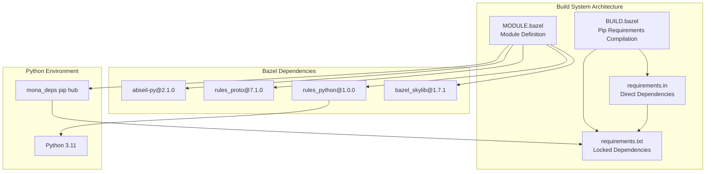
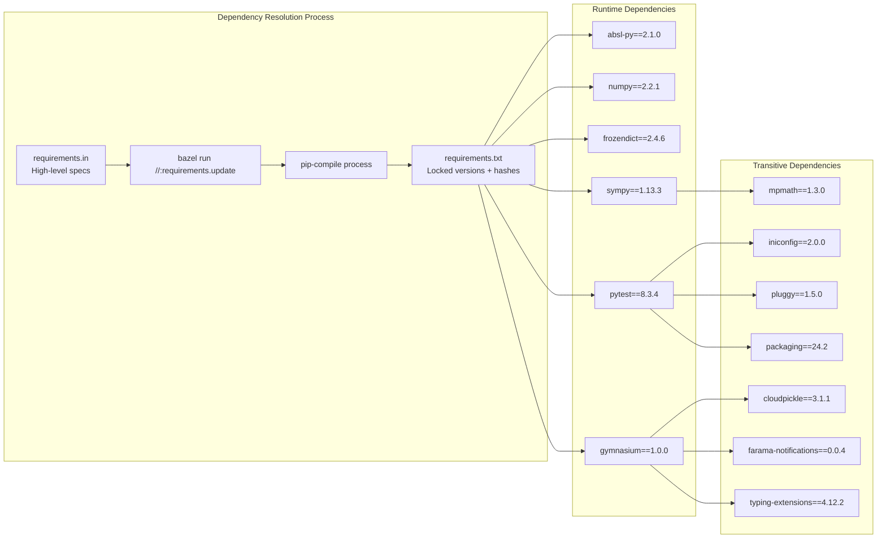

<!-- source: DeepWiki mcp.deepwiki.com · repo google-deepmind/mona · page 2.1 Installation and Dependencies · fetched 2026-10-26 -->

# Installation and Dependencies

<details>
<summary>Relevant source files</summary>

The following files were used as context for generating this wiki page:

- [BUILD.bazel](BUILD.bazel)
- [MODULE.bazel](MODULE.bazel)
- [requirements.in](requirements.in)
- [requirements.txt](requirements.txt)

</details>


This page covers the system requirements, dependency management, and build process for the MONA research system. It explains how to install the necessary tools and dependencies to build and run MONA experiments.

For information about running experiments once the system is built, see [Running Your First Experiment](#2.2). For detailed build system architecture, see [Build System](#6.1).

## Overview

The MONA system uses Bazel as its build system with Python 3.11 as the primary runtime. Dependencies are managed through Bazel's pip integration, with both direct requirements and a compiled lock file for reproducible builds.

## System Requirements

### Bazel Build System

The MONA system requires Bazel for building and dependency management. The system is configured as a Bazel module with specific version requirements.

**Required Bazel Dependencies:**
- `bazel_skylib` version 1.7.1
- `rules_python` version 1.0.0  
- `rules_proto` version 7.1.0
- `abseil-py` version 2.1.0

**Python Version:**
- Python 3.11 (specified in the pip configuration)



Sources: [MODULE.bazel:1-18](), [BUILD.bazel:1-7]()

## Python Dependencies

### Core Dependencies

The system requires several core Python packages for numerical computation, reinforcement learning, and testing:

| Package | Version | Purpose |
|---------|---------|---------|
| `absl-py` | ≥2.1.0 | Command-line flags and logging |
| `numpy` | ≥2.2.1 | Numerical computations and arrays |
| `frozendict` | ≥2.4.6 | Immutable dictionary structures |
| `sympy` | ≥1.13.3 | Symbolic mathematics |
| `pytest` | ≥8.3.4 | Testing framework |
| `gymnasium` | ≥1.0.0 | Reinforcement learning environment interface |

### Dependency Management

Dependencies are managed through a two-file system:

1. **`requirements.in`**: Contains high-level dependency specifications
2. **`requirements.txt`**: Auto-generated lock file with exact versions and hashes



Sources: [requirements.in:1-7](), [requirements.txt:1-151]()

## Installation Process

### Step 1: Install Bazel

Install Bazel following the official Bazel installation guide for your operating system. Ensure you have a compatible version that supports the module system (Bazel 6.0+).

### Step 2: Clone Repository

```bash
git clone https://github.com/google-deepmind/mona
cd mona
```

### Step 3: Build System Setup

The build system is configured through the module definition and pip requirements compilation:

**Module Configuration:**
- Module name: `mona`
- Version: `1.0.0`
- Python version: `3.11`
- Requirements lock file: `//:requirements.txt`

**Build Targets:**
- `//:requirements` - Compiles pip requirements from `requirements.in`

### Step 4: Update Dependencies (Optional)

To update the locked dependency versions:

```bash
bazel run //:requirements.update
```

This regenerates `requirements.txt` with the latest compatible versions and security hashes.

### Step 5: Build the System

Build all targets to verify the installation:

```bash
bazel build //...
```

## Dependency Details

### Core Package Purposes

**`absl-py`**: Provides the command-line argument parsing and logging infrastructure used throughout the MONA system for experiment configuration and output.

**`numpy`**: Essential for numerical computations, state representations, value matrices, and policy arrays in both value iteration and neural network approaches.

**`frozendict`**: Used for immutable state representations and configuration objects that need to be hashable for caching and lookup operations.

**`sympy`**: Supports symbolic mathematics operations, particularly useful for theoretical analysis and verification of the MONA framework properties.

**`pytest`**: Testing framework for unit tests and integration tests of the environment mechanics and MONA algorithms.

**`gymnasium`**: Provides the standard reinforcement learning environment interface used by the PPO implementation and other RL algorithms.

### Build System Integration

The Bazel build system integrates with Python package management through the `rules_python` extension:

- **Pip Hub**: `mona_deps` serves as the central repository for all Python dependencies
- **Lock File**: `requirements.txt` ensures reproducible builds with exact versions and cryptographic hashes
- **Compilation**: The `compile_pip_requirements` rule automatically generates the lock file from high-level specifications

Sources: [MODULE.bazel:11-17](), [BUILD.bazel:3-6](), [requirements.txt:2-6]()

---

