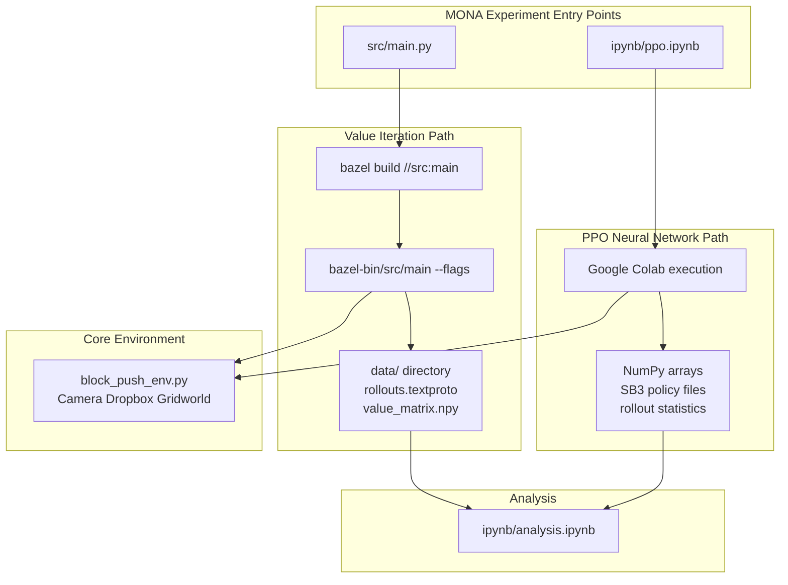
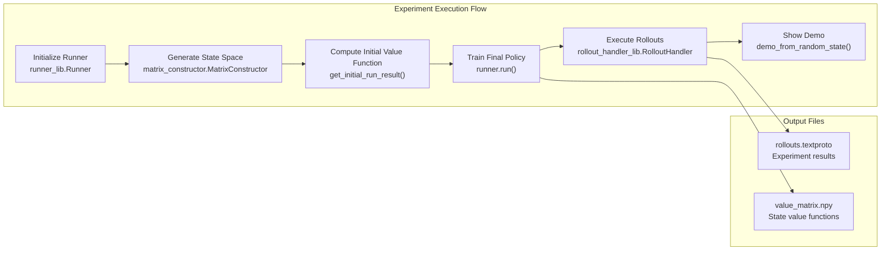
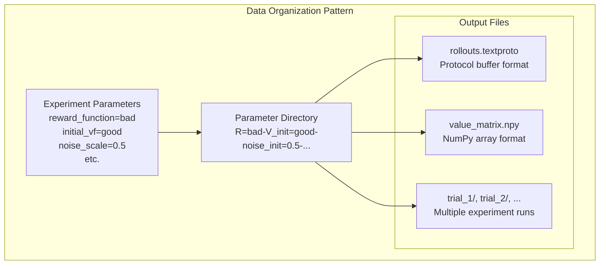

<!-- source: DeepWiki mcp.deepwiki.com · repo google-deepmind/mona · page 2.2 Running Your First Experiment · fetched 2026-10-26 -->

# Running Your First Experiment

<details>
<summary>Relevant source files</summary>

The following files were used as context for generating this wiki page:

- [README.md](README.md)
- [src/main.py](src/main.py)

</details>


This page provides step-by-step instructions for running your first MONA experiments using either the tabular value iteration approach or the PPO neural network approach. It assumes you have completed the installation steps covered in [Installation and Dependencies](#2.1).

For detailed technical explanations of the experimental methods, see [Value Iteration Method](#3.1) and [PPO Neural Network Method](#3.2). For analysis of experimental results, see [Results Analysis](#3.3).

## Overview of Experimental Approaches

MONA supports two distinct experimental approaches for studying reward hacking behavior in the Camera Dropbox environment:



**Sources:** [README.md:39-43](), [README.md:55-83](), [README.md:93-98]()

## Prerequisites

Before running experiments, ensure you have:
- Completed the installation steps from [Installation and Dependencies](#2.1)
- Bazel installed and working (for value iteration experiments)
- Access to Google Colab or Jupyter (for PPO experiments)
- Basic understanding of the Camera Dropbox environment from [Overview](#1)

## Running Value Iteration Experiments

### Command Structure

Value iteration experiments use the `src/main.py` script executed through Bazel. The basic pattern is:

```bash
bazel build //src:main && \
bazel-bin/src/main [FLAGS]
```

### Key Parameters

The most important flags for your first experiment:

| Flag | Purpose | Example Value |
|------|---------|---------------|
| `--board_shape` | Grid dimensions | `4,4` |
| `--max_boxes` | Number of boxes | `2` |
| `--reward_function` | Reward type | `bad` (allows hacking) |
| `--initial_vf` | Initial value function | `good` (prevents hacking) |
| `--data_dir` | Output directory | `data/` |
| `--skip_existing_results` | Skip if data exists | `true` |

**Sources:** [src/main.py:30-148]()

### Basic Example Command

Here's a complete command to run your first value iteration experiment:

```bash
bazel build //src:main && \
bazel-bin/src/main \
  --board_shape=4,4 \
  --max_boxes=2 \
  --episode_step_limit=50 \
  --min_blocking_boxes=1 \
  --reward_function=bad \
  --per_step_penalty=0.01 \
  --skip_existing_results=true \
  --initial_vf=good \
  --noise_scale=0.5 \
  --data_dir=data/ \
  --save_init_value_matrix \
  --save_rollouts_level=3 \
  --show_demo=true
```

This command creates a 4×4 gridworld with 2 boxes where the agent gets rewards for reward hacking (`--reward_function=bad`) but uses an approval function based on non-hacking behavior (`--initial_vf=good`).

**Sources:** [README.md:76-82](), [src/main.py:287-330]()

### Understanding the Output



**Sources:** [src/main.py:331-361](), [src/main.py:153-176]()

The experiment will output:
1. **Console logs** showing initialization, state generation, and training progress
2. **ASCII demo** of the final policy behavior if `--show_demo=true`
3. **Data files** in the directory structure based on your parameters

Expected console output includes:
- Number of states and initial states generated
- Value function computation progress  
- Final policy demonstration showing agent movement and actions

## Running PPO Experiments

### Using Jupyter Notebooks

PPO experiments run through the `ipynb/ppo.ipynb` notebook, designed for Google Colab:

1. **Open the notebook**: [](https://colab.research.google.com/github/google-deepmind/mona/blob/main/ipynb/ppo.ipynb)

2. **Execute setup cells**: Run the initial cells that install dependencies via `apt-get` and `pip`

3. **Configure parameters**: Modify the experiment parameters in the notebook cells

4. **Run training**: Execute the PPO training cells

**Sources:** [README.md:87-98]()

### Key Configuration Options

The notebook allows you to configure:
- **Environment parameters**: Board size, number of boxes, episode limits
- **MONA parameters**: Approval function type, noise levels
- **PPO parameters**: Learning rate, network architecture, training iterations
- **Output options**: What data to save and analyze

### Expected Outputs

PPO experiments generate:

| Output Type | Description | Use Case |
|-------------|-------------|----------|
| **SB3 Policy Files** | `stable_baselines3` compatible models | Load trained policies |
| **Policy Arrays** | NumPy arrays `(iterations, states, actions)` | Analyze policy evolution |  
| **Rollout Statistics** | Success/failure/hacking frequencies | Compare MONA vs ordinary RL |

**Sources:** [README.md:93-98]()

## Verifying Your Results

### For Value Iteration Experiments

Check that your experiment completed successfully:

```bash
# Verify output directory structure
ls data/R=bad-V_init=good-noise_init=0.5-step_penalty=0.01-shape=4_4-boxes=2/

# Should contain:
# - rollouts.textproto (if save_rollouts_level > 0)
# - value_matrix.npy (if save_init_value_matrix=true)
```

### For PPO Experiments  

Verify your notebook outputs include:
- Training progress plots showing learning curves
- Policy arrays with shape information
- Rollout result distributions over training iterations

### Data Structure

Both approaches organize results using parameter-encoded directory names:



**Sources:** [README.md:76-82](), [src/main.py:306-313]()

## Next Steps

After successfully running your first experiments:

1. **Analyze Results**: Use the analysis notebook described in [Results Analysis](#3.3)

2. **Understand the Methods**: Read the detailed technical explanations in [Value Iteration Method](#3.1) and [PPO Neural Network Method](#3.2)

3. **Explore Parameters**: Experiment with different reward functions, noise levels, and environment configurations

4. **Compare Approaches**: Run both value iteration and PPO experiments with the same parameters to compare results

The parameter-encoded directory structure ensures you can run multiple experiments without overwriting previous results, making it easy to explore the parameter space systematically.

**Sources:** [README.md:105-111](), [src/main.py:64-68]()

---

