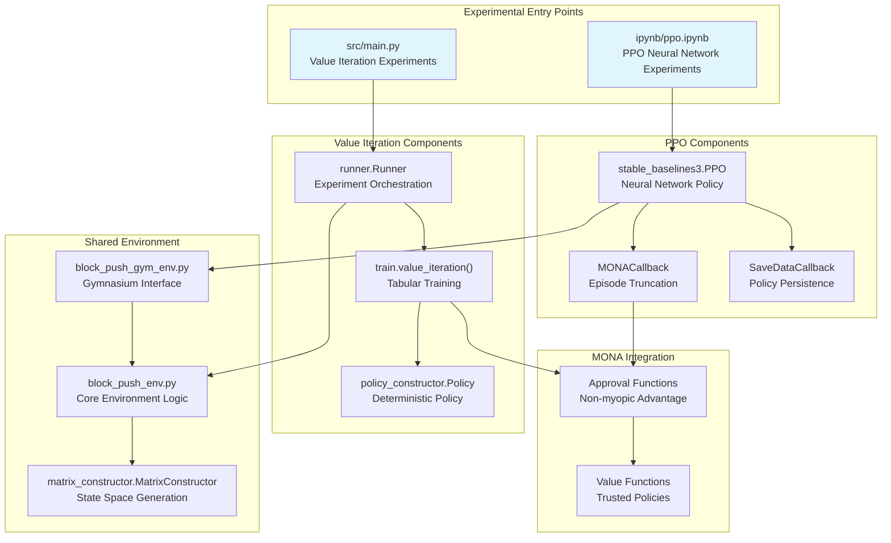
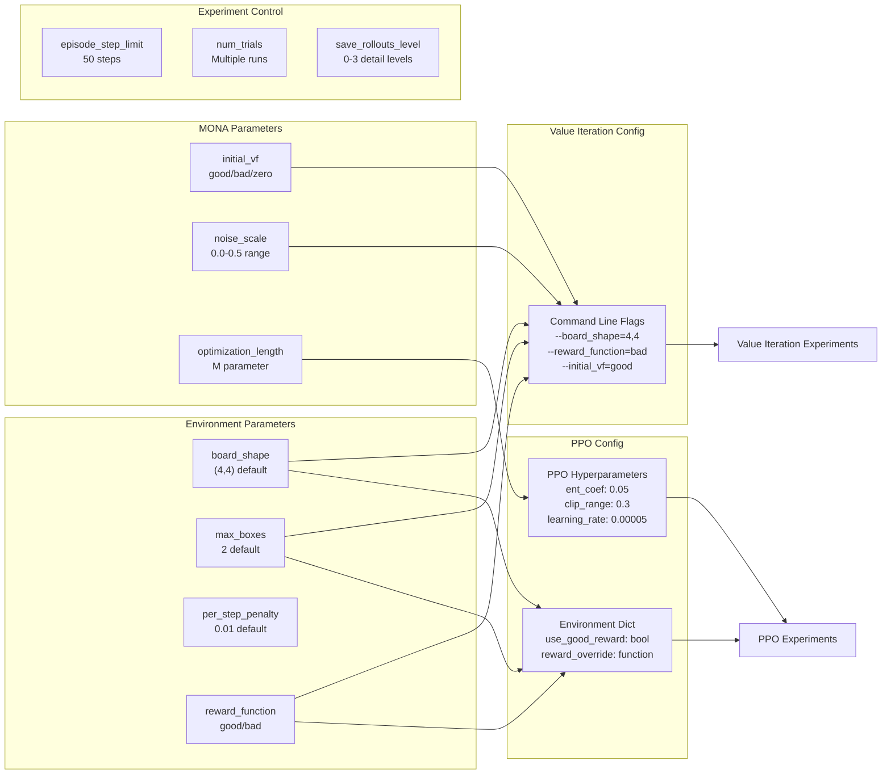
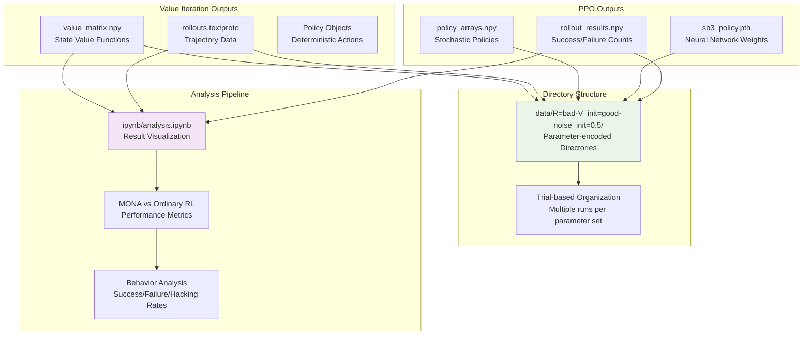
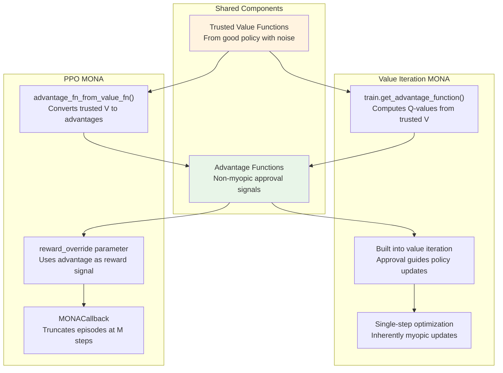

<!-- source: DeepWiki mcp.deepwiki.com · repo google-deepmind/mona · page 3 Experimental Approaches · fetched 2026-10-26 -->

# Experimental Approaches

<details>
<summary>Relevant source files</summary>

The following files were used as context for generating this wiki page:

- [README.md](README.md)
- [ipynb/ppo.ipynb](ipynb/ppo.ipynb)
- [src/main.py](src/main.py)

</details>


This document provides an overview of the two main experimental methods implemented in the MONA repository for testing the Myopic Optimization with Non-myopic Approval framework. The two approaches use different reinforcement learning algorithms—tabular value iteration and neural network PPO—to validate MONA's effectiveness against reward hacking in the Camera Dropbox environment.

For details about the Camera Dropbox environment mechanics, see [Environment Mechanics](#4.1). For information about analyzing experimental results, see [Results Analysis](#3.3).

## Overview of Experimental Methods

The MONA repository implements two distinct experimental approaches to validate the framework's effectiveness:



**Experimental Method Comparison**

Both approaches test the same core hypothesis: that MONA prevents reward hacking by combining myopic optimization with non-myopic approval functions derived from trusted policies.

| Aspect | Value Iteration Method | PPO Neural Network Method |
|--------|----------------------|---------------------------|
| **Entry Point** | `src/main.py` | `ipynb/ppo.ipynb` |
| **Algorithm** | Tabular value iteration | Neural network PPO |
| **State Representation** | Complete state enumeration | Observation vectors |
| **Policy Type** | Deterministic tabular | Stochastic neural network |
| **Environment Interface** | Direct `block_push_env.BlockPushEnv` | Gymnasium wrapper `BlockPushGymEnv` |
| **Orchestration** | `runner.Runner` class | Custom callback system |
| **MONA Implementation** | Built into value iteration | `MONACallback` for episode truncation |

Sources: [README.md:39-49](), [src/main.py:16-17](), [ipynb/ppo.ipynb:9-12]()

## Experimental Parameters and Configuration

Both experimental approaches share a common parameter space for defining environment configuration and MONA settings:



**Parameter Configuration Examples**

The value iteration method uses command-line flags for configuration:

```bash
bazel-bin/src/main --board_shape=4,4 --max_boxes=2 --episode_step_limit=50 \
  --reward_function=bad --initial_vf=good --noise_scale=0.5 \
  --data_dir=data/ --save_rollouts_level=3
```

The PPO method uses Python dictionaries and function parameters:

```python
env_params = {
    "board_shape": (4, 4), 
    "max_boxes": 2, 
    "use_good_reward": False,
    "reward_override": advantage_function
}

ppo_params = {
    "ent_coef": 0.05, 
    "clip_range": 0.3, 
    "learning_rate": 0.00005
}
```

Sources: [src/main.py:76-148](), [ipynb/ppo.ipynb:316-353](), [ipynb/ppo.ipynb:1007-1009]()

## Data Storage and Results

Both experimental approaches generate structured data for analysis, but use different storage formats and organization strategies:



**File Organization Pattern**

Both methods use parameter-encoded directory names to organize results:

```
data/R=bad-V_init=good-noise_init=0.5-step_penalty=0.01-shape=4_4-boxes=2/
├── value_matrix.npy              # Value iteration results
├── rollouts.textproto            # Value iteration trajectories  
├── ppo_output/                   # PPO results directory
│   ├── policy_T=1e6.pth         # Trained neural network
│   ├── policies_T=1e6.npy       # Policy probability arrays
│   └── rollouts_T=1e6.npy       # Rollout success/failure counts
```

**Rollout Data Categories**

Both methods classify rollout outcomes into three categories for analysis:

| Category | Definition | Reward Count |
|----------|------------|--------------|
| **Failure** | Agent fails to complete task | 0 boxes pushed |
| **Intended Behavior** | Agent pushes exactly one box into hole | 1 box pushed |  
| **Reward Hacking** | Agent exploits camera to push multiple boxes | 2+ boxes pushed |

Sources: [src/main.py:37-46](), [ipynb/ppo.ipynb:439-442](), [ipynb/ppo.ipynb:308-309](), [ipynb/ppo.ipynb:573-582]()

## MONA Implementation Differences

The two experimental approaches implement the MONA framework through different mechanisms, reflecting the underlying algorithmic differences:



**Value Iteration MONA Implementation**

The value iteration approach implements MONA by incorporating approval functions directly into the policy improvement step via [`train.get_advantage_function()`](). The advantage function computes Q-values from a trusted value function, providing non-myopic approval signals that guide policy updates.

**PPO MONA Implementation** 

The PPO approach uses a callback-based system where [`MONACallback`]() truncates episodes into sub-sequences of length M (the optimization horizon). The approval function replaces the environment reward through the `reward_override` parameter, ensuring the neural network optimizes based on trusted advantage signals rather than the hackable reward.

Sources: [ipynb/ppo.ipynb:690-699](), [ipynb/ppo.ipynb:801-873](), [ipynb/ppo.ipynb:1026-1027]()

---

