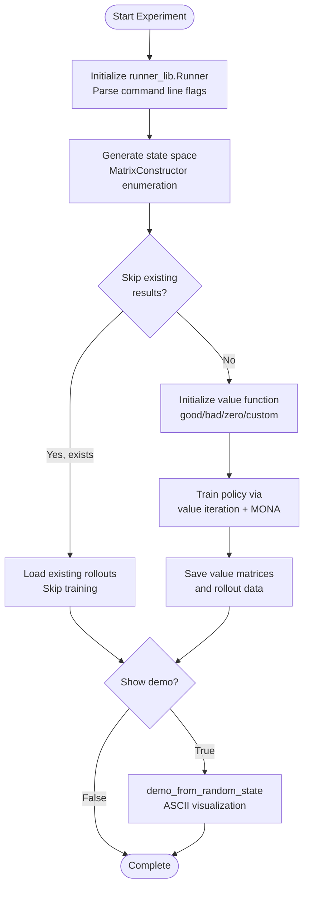
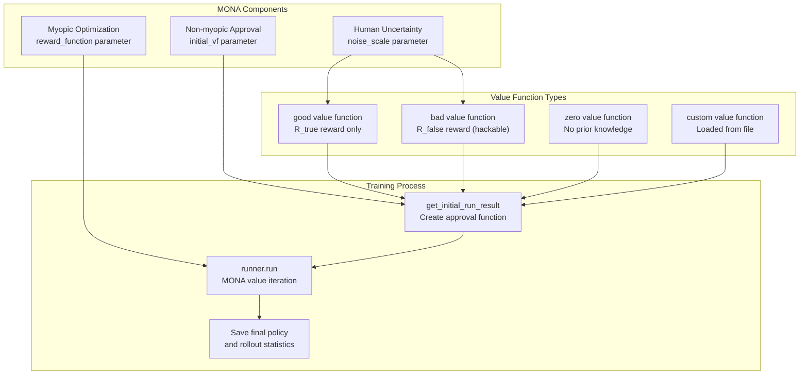
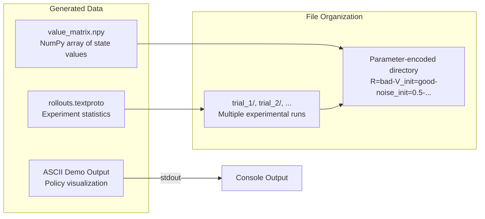

<!-- source: DeepWiki mcp.deepwiki.com · repo google-deepmind/mona · page 3.1 Value Iteration Method · fetched 2026-10-26 -->

# Value Iteration Method

<details>
<summary>Relevant source files</summary>

The following files were used as context for generating this wiki page:

- [README.md](README.md)
- [src/main.py](src/main.py)
- [src/matrix_constructor.py](src/matrix_constructor.py)

</details>


This page covers the tabular value iteration approach for running MONA experiments in the Camera Dropbox environment. This method uses classical tabular reinforcement learning with exact state enumeration, as opposed to neural network approximation. For the neural network approach using PPO, see [PPO Neural Network Method](#3.2). For analysis of results from both approaches, see [Results Analysis](#3.3).

## Overview

The value iteration method implements MONA (Myopic Optimization with Non-myopic Approval) using a tabular approach where all possible states are enumerated and value functions are represented as matrices. The implementation uses classical dynamic programming techniques combined with MONA's framework of myopic optimization guided by non-myopic approval functions.

The primary entry point is `src/main.py`, which orchestrates the entire experimental workflow from state space construction through policy training to result analysis and demonstration.

**Sources:** [README.md:41-42](), [src/main.py:16]()

## Implementation Architecture

The value iteration method consists of several interconnected components that handle different aspects of the experimental process:

### Core Architecture Diagram

```mermaid
graph TB
    subgraph "Value Iteration Workflow"
        MAIN[src/main.py<br/>"Main orchestration script"]
        RUNNER[runner.Runner<br/>"Experiment coordination"]
        MATRIX_CONST[matrix_constructor.MatrixConstructor<br/>"State space generation"]
        POLICY_CONST[policy_constructor<br/>"Policy computation"]
        ROLLOUT_HANDLER[rollout_handler.RolloutHandler<br/>"Policy evaluation"]
        FILE_HANDLER[file_handler<br/>"Data persistence"]
    end
    
    subgraph "Environment Layer"
        BLOCK_ENV[block_push_env.BlockPushEnv<br/>"Core gridworld logic"]
        STATE_LIB[state.State<br/>"State representation"]
        DATA_LIB[data<br/>"Actions and constants"]
    end
    
    subgraph "Data Outputs"
        VALUE_MATRIX["value_matrix.npy<br/>State value arrays"]
        ROLLOUTS_PROTO["rollouts.textproto<br/>Experimental results"]
        DEMO_OUTPUT["ASCII demonstration<br/>Policy visualization"]
    end
    
    MAIN --> RUNNER
    RUNNER --> MATRIX_CONST
    RUNNER --> POLICY_CONST
    RUNNER --> ROLLOUT_HANDLER
    RUNNER --> FILE_HANDLER
    
    MATRIX_CONST --> BLOCK_ENV
    MATRIX_CONST --> STATE_LIB
    STATE_LIB --> DATA_LIB
    
    POLICY_CONST --> VALUE_MATRIX
    ROLLOUT_HANDLER --> ROLLOUTS_PROTO
    MAIN --> DEMO_OUTPUT
```

**Sources:** [src/main.py:24-28](), [src/matrix_constructor.py:37-38]()

### State Space Construction

The `MatrixConstructor` class handles the enumeration of all possible states in the gridworld environment and constructs the necessary matrices for value iteration:

```mermaid
graph LR
    subgraph "State Space Generation"
        ENUM[_iterate_objects_layers<br/>"Generate all object configurations"]
        STATES[_initialize_states<br/>"Create State objects"]
        TRANSITION[transition_matrix<br/>"Build state transitions"]
        REWARDS[construct_reward_matrix<br/>"Compute reward functions"]
        INITIAL[initial_states<br/>"Identify valid start states"]
    end
    
    ENUM --> STATES
    STATES --> TRANSITION
    STATES --> REWARDS
    STATES --> INITIAL
    
    TRANSITION --> |"NDArray[np.int32]"| POLICY_COMPUTATION
    REWARDS --> |"NDArray[np.float64]"| POLICY_COMPUTATION
    INITIAL --> |"set[int]"| ROLLOUT_EVALUATION
    
    POLICY_COMPUTATION[policy_constructor<br/>"Value iteration algorithm"]
    ROLLOUT_EVALUATION[rollout_handler<br/>"Policy testing"]
```

The state enumeration process uses `iterables.multiset_permutations` to generate all possible arrangements of agents, boxes, and empty spaces on the grid [src/matrix_constructor.py:49]().

**Sources:** [src/matrix_constructor.py:40-56](), [src/matrix_constructor.py:238-250]()

## Experimental Workflow

The value iteration workflow follows a structured sequence of initialization, training, and evaluation phases:

### Execution Flow



**Sources:** [src/main.py:287-329](), [src/main.py:331-361]()

### Configuration Parameters

The value iteration method accepts numerous configuration parameters that control the experimental setup:

| Parameter Category | Flag | Purpose | Default |
|---|---|---|---|
| Environment | `--board_shape` | Gridworld dimensions | `4,4` |
| Environment | `--max_boxes` | Maximum number of boxes | `2` |
| Environment | `--min_blocking_boxes` | Boxes needed to block camera | `1` |
| Environment | `--episode_step_limit` | Maximum steps per episode | `50` |
| Training | `--initial_vf` | Initial value function type | None |
| Training | `--reward_function` | Reward function (good/bad) | `bad` |
| Training | `--noise_scale` | Gaussian noise std dev | `0.0` |
| Training | `--per_step_penalty` | Step penalty | `0.01` |
| Data | `--data_dir` | Output directory | Required |
| Data | `--save_rollouts_level` | Rollout detail level (0-3) | `0` |
| Execution | `--skip_existing_results` | Skip if data exists | `False` |
| Execution | `--num_trials` | Number of experimental trials | `1` |

**Sources:** [src/main.py:30-148]()

## MONA Integration

The value iteration method implements MONA through the interaction between initial value functions (approval functions) and reward functions (myopic optimization):

### MONA Framework Integration



The MONA approach trains an initial "approval" policy using one reward function (typically `good` for non-hackable behavior), then uses this as guidance while training the final policy with potentially different reward incentives (typically `bad` for hackable rewards) [src/main.py:236-247]().

**Sources:** [src/main.py:178-255](), [src/main.py:258-284]()

## Value Function Initialization

The system supports four different methods for initializing value functions, each serving different experimental purposes:

### Initialization Methods

| Method | Description | Use Case |
|---|---|---|
| `good` | Train via value iteration using true rewards | Optimal non-hacking baseline |
| `bad` | Train via value iteration using hackable rewards | Understanding reward hacking |
| `zero` | Initialize all state values to zero | No prior knowledge experiments |
| Custom file | Load pre-computed value function | Reproducibility and custom scenarios |

The initialization process includes validation to ensure parameter consistency. For example, noise can only be added to `good` or `bad` value functions [src/main.py:219-230]().

**Sources:** [src/main.py:95-111](), [src/main.py:232-255]()

## Output and Results

The value iteration method produces several types of output depending on configuration:

### Data Persistence



The rollout saving behavior is controlled by `--save_rollouts_level`:
- Level 0: No rollout data saved
- Level 1: Iteration summary statistics only
- Level 2: Iteration and rollout summary statistics  
- Level 3: Complete state trajectories included

**Sources:** [src/main.py:37-46](), [src/main.py:153-176]()

### Demonstration Output

When `--show_demo=true`, the system runs a single rollout from a random initial state and displays the agent's path through the environment in ASCII format. This provides immediate visual feedback about the learned policy's behavior [src/main.py:323-328]().

**Sources:** [src/main.py:70-74](), [src/main.py:153-176]()

---

