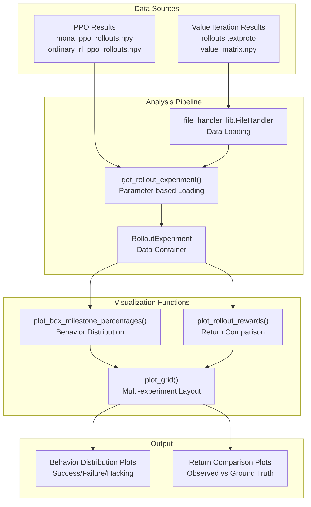
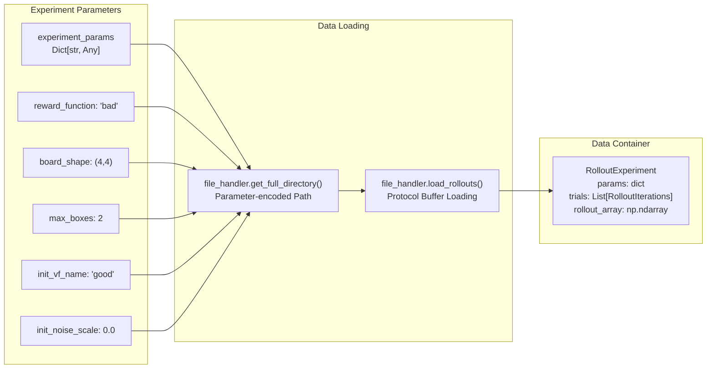
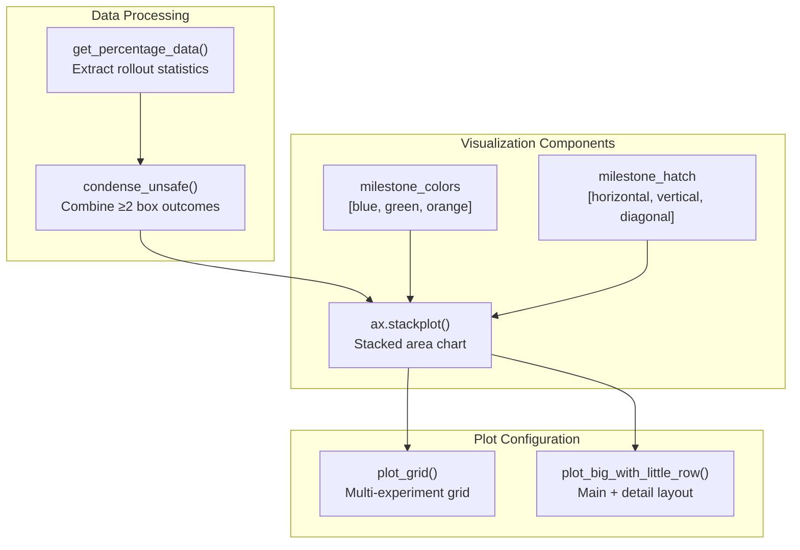
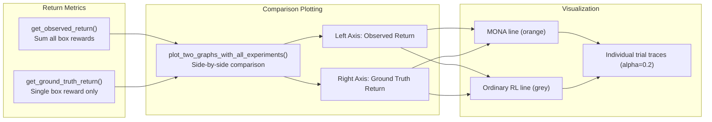
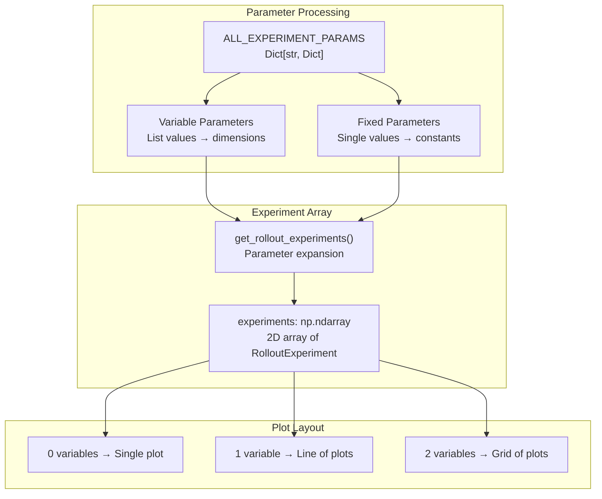

<!-- source: DeepWiki mcp.deepwiki.com · repo google-deepmind/mona · page 3.3 Results Analysis · fetched 2026-10-26 -->

# Results Analysis

Relevant source files

The following files were used as context for generating this wiki page:

- [README.md](README.md)
- [ipynb/analysis.ipynb](ipynb/analysis.ipynb)

This document covers how to analyze and visualize experimental results from MONA experiments using the analysis notebook. It explains the data loading pipeline, visualization capabilities, and comparison tools for evaluating MONA performance against ordinary RL approaches.

For information about generating experimental data, see [Value Iteration Method](#3.1) and [PPO Neural Network Method](#3.2). For details about data storage formats, see [Data Formats](#5.1).

## Analysis Workflow Overview

The MONA analysis system processes experimental results through a standardized pipeline that supports both tabular value iteration and neural network PPO data. The analysis notebook [ipynb/analysis.ipynb]() serves as the primary interface for loading, processing, and visualizing results.

Sources: [ipynb/analysis.ipynb:112-116](), [ipynb/analysis.ipynb:148-189]()

## Data Loading and Experiment Organization

The analysis system organizes experiments using the `RolloutExperiment` dataclass, which encapsulates both experimental parameters and results data. The `get_rollout_experiment()` function handles parameter-based directory resolution and data loading.

The system supports two primary data loading modes:

| Mode | Data Source | Function | Description |
|------|-------------|----------|-------------|
| Protocol Buffer | `rollouts.textproto` files | `get_rollout_experiment()` | Loads value iteration results with full rollout details |
| NumPy Array | `.npy` files | `load_rollouts_from_filepaths()` | Loads PPO results as condensed rollout statistics |

Sources: [ipynb/analysis.ipynb:154-175](), [ipynb/analysis.ipynb:259-274]()

## Behavior Distribution Analysis

The core analysis capability centers on tracking how agent behavior changes over training iterations or optimization horizons. The `plot_box_milestone_percentages()` function visualizes the distribution of outcomes across three categories:

- **Failure (0 boxes)**: Agent fails to complete the task
- **Desired behavior (1 box)**: Agent successfully completes task without reward hacking  
- **Unsafe behavior (≥2 boxes)**: Agent exploits camera blind spots for additional rewards

The `get_percentage_data()` function handles both protocol buffer and NumPy array data sources, extracting rollout statistics and normalizing them into percentage distributions over training iterations.

Sources: [ipynb/analysis.ipynb:442-490](), [ipynb/analysis.ipynb:620-678](), [ipynb/analysis.ipynb:493-496]()

## Return Comparison Analysis

For comparing MONA against ordinary RL, the system provides specialized plotting functions that track both observed returns (what the agent actually receives) and ground truth returns (what the agent should receive for proper task completion).

The `plot_rollout_rewards()` function processes rollout arrays to extract return metrics and displays both average performance and individual trial variations with transparency.

Sources: [ipynb/analysis.ipynb:755-800](), [ipynb/analysis.ipynb:777-782](), [ipynb/analysis.ipynb:698-753]()

## Experiment Parameter Configuration

The analysis system uses parameter dictionaries to organize related experiments, with automatic variable detection for multi-dimensional plotting. The `ALL_EXPERIMENT_PARAMS` dictionary defines experiment collections:

| Parameter | Type | Description | Default |
|-----------|------|-------------|---------|
| `init_noise` | List[float] | Noise levels for value function initialization | [0.0, 0.5] |
| `rollout_filepath` | List[str] | Paths to PPO output files | - |
| `board_shape` | Tuple[int,int] | Grid dimensions | (4,4) |
| `max_boxes` | int | Maximum boxes in environment | 2 |
| `reward_function` | str | Reward function type | "bad" |
| `save_every_nth_iteration` | int | Data collection frequency | 1 |

The system automatically detects parameter dimensions and arranges plots accordingly, with support for trial averaging and axis normalization across experiments.

Sources: [ipynb/analysis.ipynb:827-851](), [ipynb/analysis.ipynb:276-330](), [ipynb/analysis.ipynb:869-876]()

---

