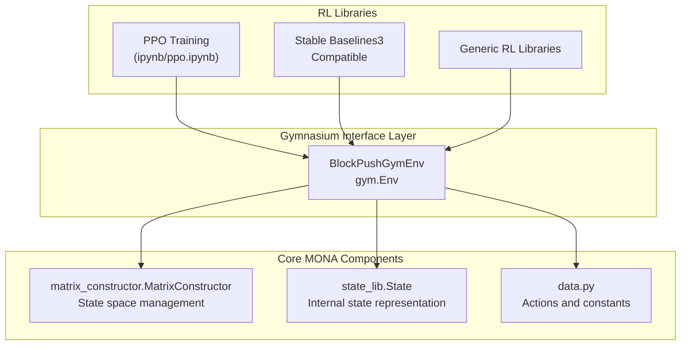
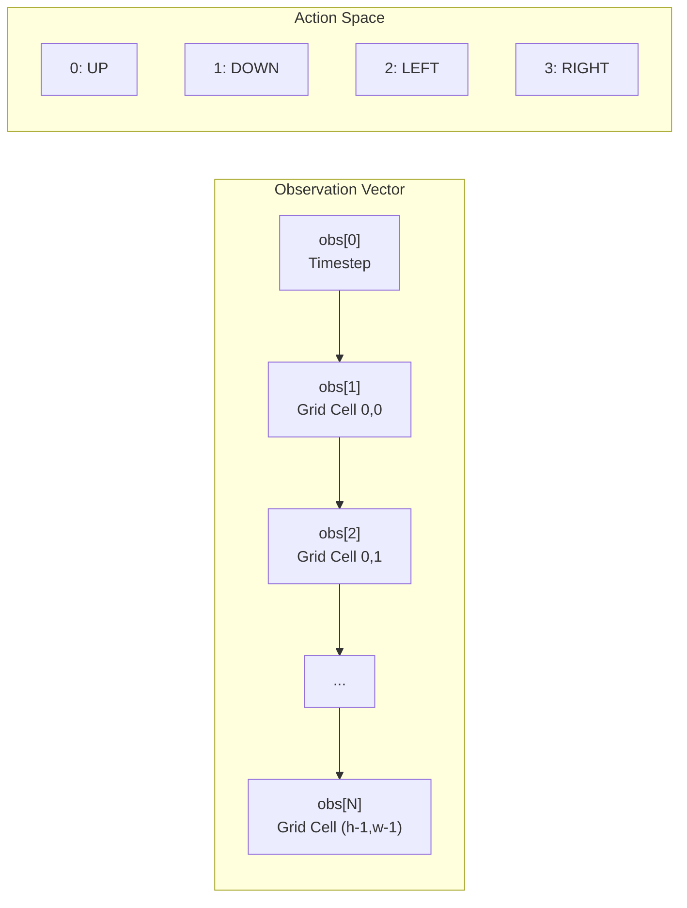
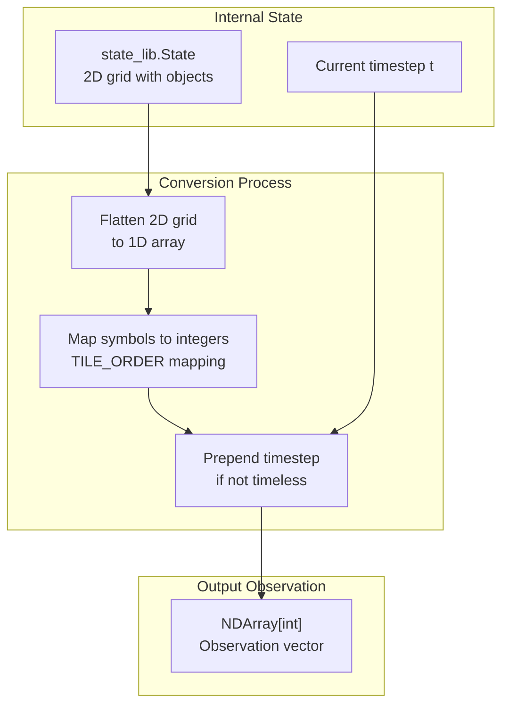
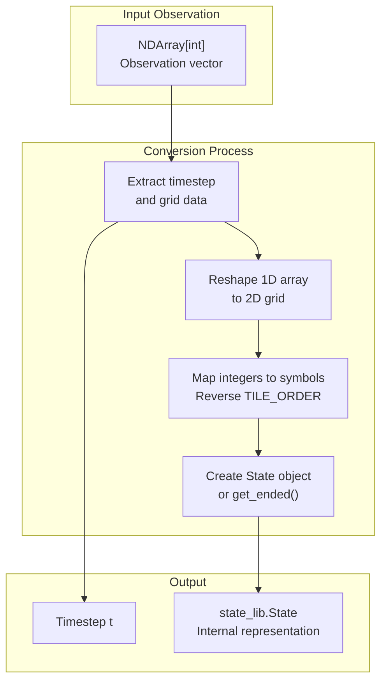
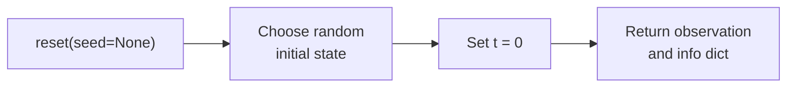
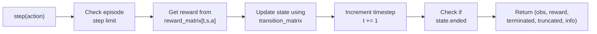
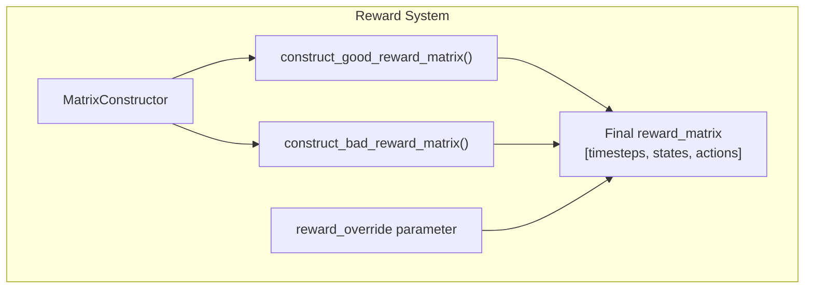
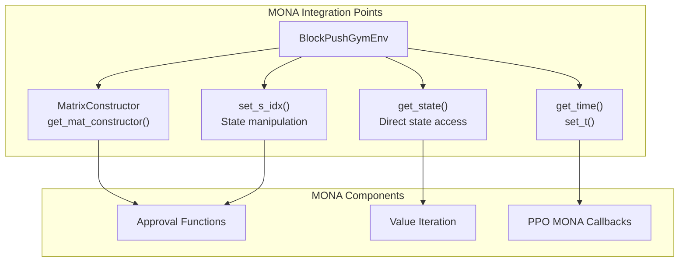

<!-- source: DeepWiki mcp.deepwiki.com · repo google-deepmind/mona · page 4.2 Gymnasium Interface · fetched 2026-10-26 -->

# Gymnasium Interface

Relevant source files

The following files were used as context for generating this wiki page:

- [src/block_push_gym_env.py](src/block_push_gym_env.py)
- [src/block_push_gym_env_test.py](src/block_push_gym_env_test.py)

The Gymnasium Interface provides a standard reinforcement learning API wrapper around the Camera Dropbox gridworld environment. This interface enables the use of modern RL libraries and frameworks with the MONA system through the widely-adopted Gymnasium standard.

For information about the core environment mechanics, see [Environment Mechanics](#4.1). For details about the underlying state representation, see [State Representation](#4.3).

## BlockPushGymEnv Wrapper

The `BlockPushGymEnv` class serves as the primary Gymnasium-compatible interface to the Camera Dropbox environment. This wrapper translates between the internal state-based representation used by MONA and the observation-based interface expected by RL algorithms.

Sources: [src/block_push_gym_env.py:34-41](), [src/block_push_gym_env.py:76-81]()

## Observation and Action Spaces

The environment defines discrete observation and action spaces compatible with Gymnasium's space definitions:

| Space Type | Definition | Details |
|------------|------------|---------|
| Action Space | `spaces.Discrete(4)` | Four possible agent actions: UP, DOWN, LEFT, RIGHT |
| Observation Space | `spaces.MultiDiscrete` | Time dimension + flattened grid representation |

The observation space structure consists of:
- **Time dimension**: Current timestep (0 to episode_step_limit)
- **Grid representation**: Flattened 2D grid where each cell can contain:
  - 0: Empty (`data.EMPTY_CHR`)
  - 1: Agent (`data.AGENT_CHR`) 
  - 2: Box (`data.BOX_CHR`)

Sources: [src/block_push_gym_env.py:126-134](), [src/block_push_gym_env.py:42]()

## State-Observation Conversion

The environment handles bidirectional conversion between internal `State` objects and external observation vectors through dedicated conversion methods:

### State to Observation

The `state_to_observation` method transforms internal state representations into flat observation vectors:

### Observation to State

The `observation_to_state` method performs the reverse transformation:

Sources: [src/block_push_gym_env.py:171-198](), [src/block_push_gym_env.py:139-169]()

## Environment Lifecycle

The Gymnasium interface follows the standard RL environment lifecycle with `reset()` and `step()` methods:

### Reset Process

### Step Process

Sources: [src/block_push_gym_env.py:220-249](), [src/block_push_gym_env.py:251-258]()

## Configuration and Reward Systems

The `BlockPushGymEnv` constructor accepts several key configuration parameters:

| Parameter | Type | Purpose |
|-----------|------|---------|
| `board_shape` | `Tuple[int, int]` | Dimensions of the gridworld |
| `use_good_reward` | `bool` | Whether to use good or bad reward function |
| `max_boxes` | `int` | Maximum number of boxes in environment |
| `per_step_penalty` | `float` | Penalty applied each timestep |
| `min_blocking_boxes` | `int` | Minimum boxes required to block camera |
| `episode_step_limit` | `int` | Maximum steps per episode |
| `reward_override` | `NDArray` | Optional custom reward matrix |

The environment supports both predefined reward functions (good/bad) through the `MatrixConstructor` and custom reward matrices via `reward_override`. When `reward_override` is provided, it must have shape `(episode_step_limit, num_states, num_actions)`.

Sources: [src/block_push_gym_env.py:44-67](), [src/block_push_gym_env.py:85-112]()

## Integration with MONA Framework

The Gymnasium interface enables seamless integration with the MONA framework for both value iteration and neural network-based experiments:

The environment provides direct access to internal MONA components through methods like `get_mat_constructor()`, `get_state()`, and `set_s_idx()`, enabling MONA-specific functionality while maintaining Gymnasium compatibility.

Sources: [src/block_push_gym_env.py:200-218](), [src/block_push_gym_env.py:217-218]()

---

