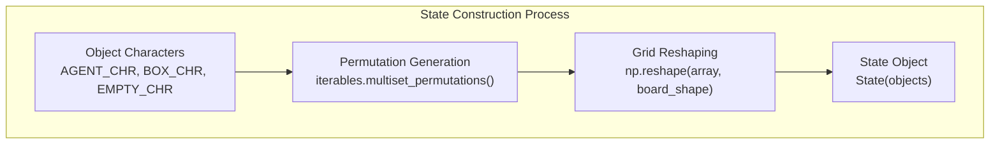
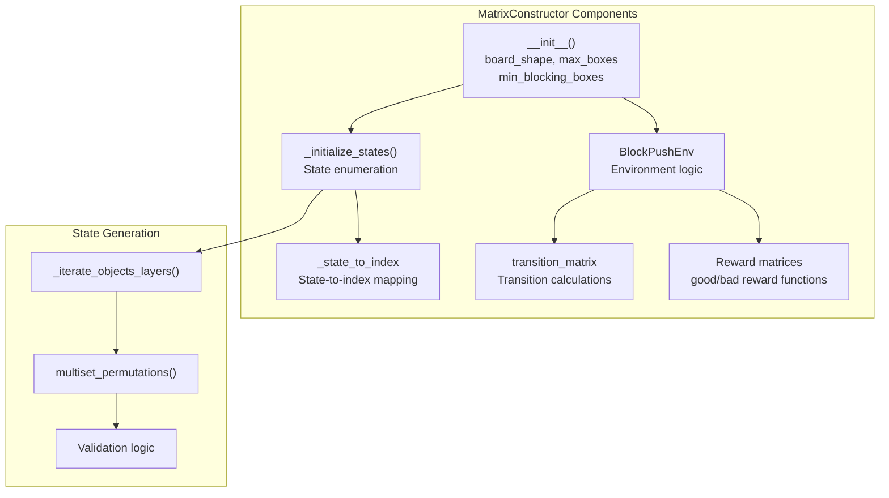
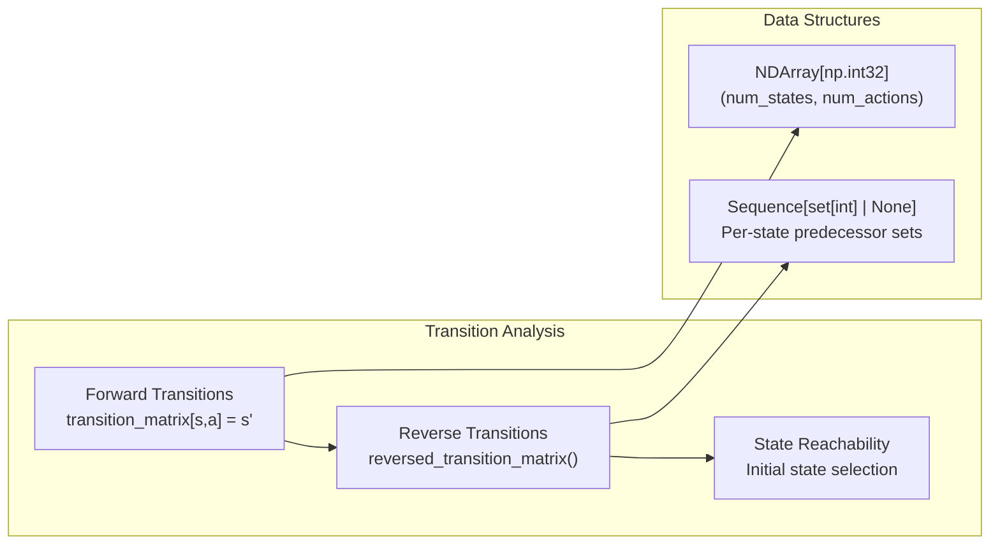

<!-- source: DeepWiki mcp.deepwiki.com · repo google-deepmind/mona · page 4.3 State Representation · fetched 2026-10-26 -->

# State Representation

<details>
<summary>Relevant source files</summary>

The following files were used as context for generating this wiki page:

- [src/data.py](src/data.py)
- [src/matrix_constructor.py](src/matrix_constructor.py)

</details>


This page explains how states, actions, and positions are represented within the Camera Dropbox environment. It covers the fundamental data structures used to encode the gridworld's state space and the mechanisms for enumerating and transitioning between states.

For information about the environment mechanics and rules, see [Environment Mechanics](#4.1). For details about the Gymnasium interface that wraps these representations, see [Gymnasium Interface](#4.2).

## Position and Action Representation

The system uses simple but precise representations for positions and actions within the gridworld.

### Position Type

Positions are represented as coordinate tuples using the `Pos` type alias defined in [src/data.py:21](). This provides a clean interface for 2D grid coordinates:

```python
Pos = Tuple[int, int]  # (row, col) coordinates
```

### Action Enumeration

Agent actions are defined using a standard enum structure in [src/data.py:24-28]():

```python
class Action(enum.Enum):
  UP = 0
  DOWN = 1
  LEFT = 2
  RIGHT = 3
```

The system also maintains a tuple of valid action values for iteration purposes at [src/data.py:31-33]():

```python
AGENT_ACTIONS: Tuple[int, ...] = tuple(
    [a.value for a in [Action.UP, Action.DOWN, Action.LEFT, Action.RIGHT]]
)
```

### Grid Object Characters

The gridworld uses single-character representations for different objects, defined as constants in [src/data.py:35-39]():

| Constant | Character | Purpose |
|----------|-----------|---------|
| `AGENT_CHR` | "A" | Agent position |
| `BORDER_CHR` | "#" | Boundary walls |
| `BOX_CHR` | "B" | Movable boxes |
| `HOLE_CHR` | "H" | Target hole |
| `EMPTY_CHR` | " " | Empty spaces |

**Sources:** [src/data.py:16-39]()

## State Objects and Structure

States in the system encapsulate the complete configuration of the gridworld at any point in time. While the `State` class implementation is in `src/state.py` (not directly provided), its usage throughout the codebase reveals its key properties.

### State Properties

Based on usage in [src/matrix_constructor.py](), `State` objects have the following key attributes:

- `objects`: A 2D numpy array representing the grid layout with character encodings
- `num_boxes`: Property returning the count of boxes in the state
- Special states like `State.get_ended()` for terminal conditions

### State Construction

States are constructed from object layers that represent the 2D grid configuration. The [src/matrix_constructor.py:40-50]() shows how states are built from permutations of grid objects:



**Sources:** [src/matrix_constructor.py:40-55](), [src/data.py:35-39]()

## State Space Enumeration

The `MatrixConstructor` class handles the systematic enumeration of all possible states in the gridworld.

### Matrix Constructor Architecture



### State Enumeration Process

The system generates states by iterating through all valid object layer configurations [src/matrix_constructor.py:40-55]():

1. **Variable Box Count**: For each possible number of boxes (0 to `max_boxes`)
2. **Object Placement**: Create permutations of agent, boxes, and empty spaces
3. **Grid Formation**: Reshape permutations into the specified `board_shape`
4. **State Creation**: Construct `State` objects from each valid configuration

### State Indexing

All states are stored in a list with a corresponding mapping dictionary [src/matrix_constructor.py:52-56]():

```python
self._states = [State.get_ended()]  # Terminal state at index 0
# ... enumerate all possible states
self._state_to_index = {s: i for i, s in enumerate(self._states)}
```

The system provides accessor methods for bidirectional state-index conversion [src/matrix_constructor.py:215-219]():

- `get_state_index(s: State) -> int`
- `get_state(index: int) -> State`

**Sources:** [src/matrix_constructor.py:37-56](), [src/matrix_constructor.py:215-227]()

## State Transitions and Matrices

The system precomputes and caches transition relationships between states to support efficient planning algorithms.

### Transition Matrix Construction

The transition matrix maps each `(state, action)` pair to the resulting next state [src/matrix_constructor.py:238-250]():

```python
result = np.zeros((self.num_states, len(data.AGENT_ACTIONS)), dtype=np.int32)
for s_i, s in enumerate(self._states):
    for a in data.AGENT_ACTIONS:
        result[s_i, a] = self._state_to_index[self._env.step(s, a)]
```

### Reverse Transition Analysis

The system can also compute reverse transitions to find all states that can reach a given state [src/matrix_constructor.py:66-76]():



### Initial State Selection

The system identifies valid initial states through reverse reachability analysis from terminal states [src/matrix_constructor.py:100-159]():

1. **Terminal States**: Start with states where the last box is in the hole
2. **Reverse Search**: Use reverse transitions to find all reachable predecessors  
3. **Filtering**: Remove states with boxes on edges (configurable)
4. **Categorization**: Group states by number of boxes

The `initial_states()` method provides access to valid starting configurations [src/matrix_constructor.py:258-299](), with options to filter by box count and enforce edge constraints.

**Sources:** [src/matrix_constructor.py:66-159](), [src/matrix_constructor.py:238-299]()

## Reward Matrix Construction

The system supports multiple reward functions through matrix precomputation [src/matrix_constructor.py:58-64]():

- `construct_good_reward_matrix()`: Uses true reward function from environment
- `construct_bad_reward_matrix()`: Uses false reward function for comparison

Both methods delegate to the underlying `BlockPushEnv` for reward calculation, ensuring consistency with environment mechanics.

**Sources:** [src/matrix_constructor.py:58-64](), [src/matrix_constructor.py:252-256]()

---

