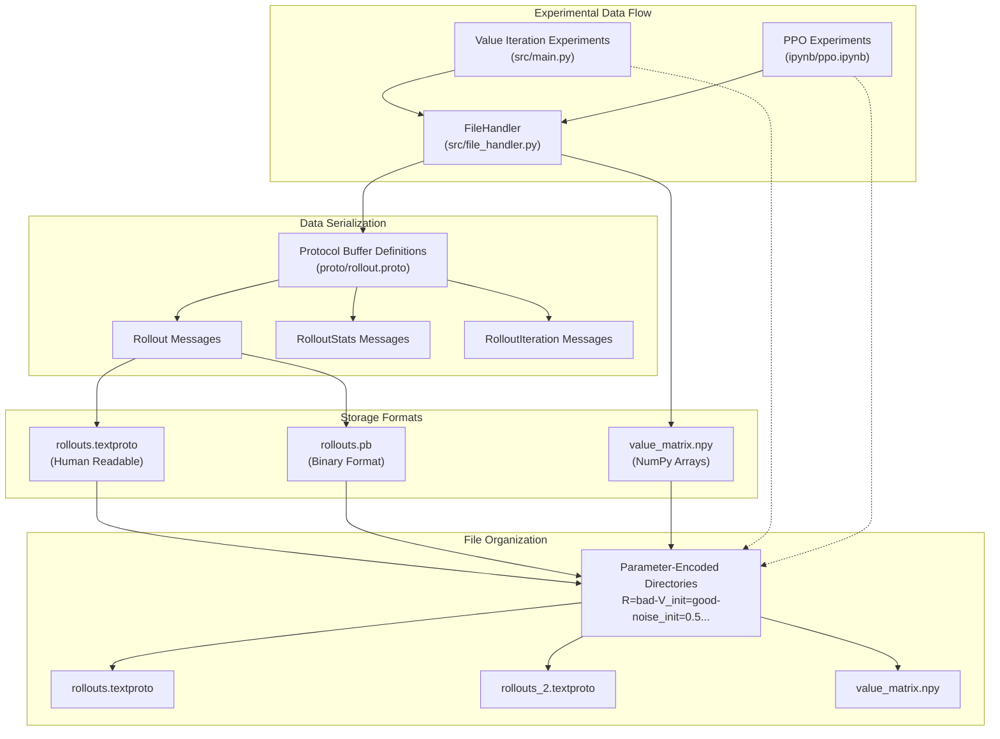
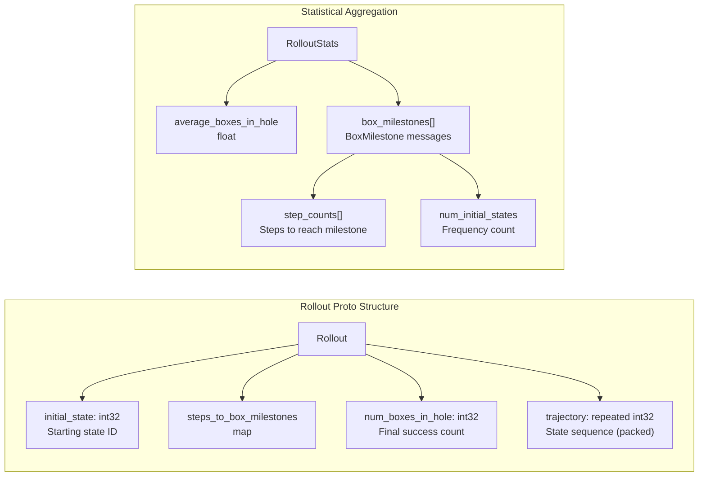
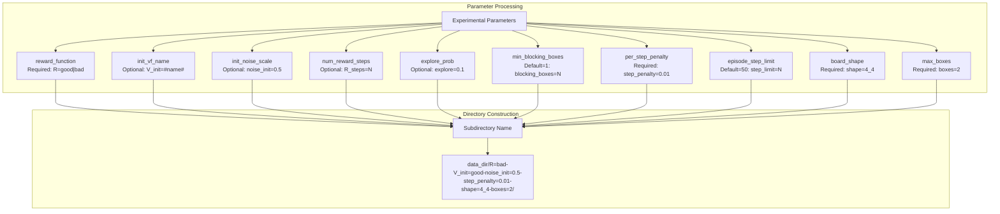
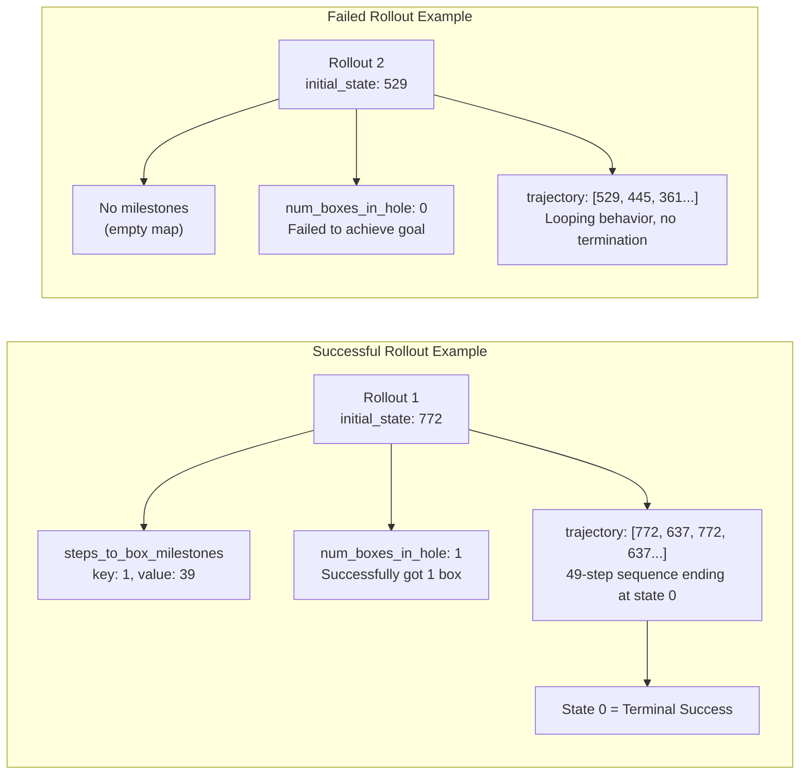
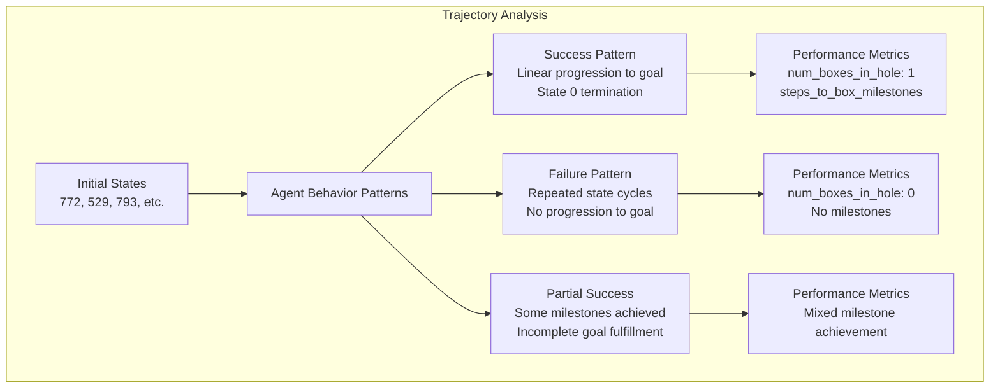

<!-- source: DeepWiki mcp.deepwiki.com · repo google-deepmind/mona · page 5 Data and Results · fetched 2026-10-26 -->

# Data and Results

<details>
<summary>Relevant source files</summary>

The following files were used as context for generating this wiki page:

- [data/R=bad-V_init=good-noise_init=0.5-step_penalty=0.01-shape=4_4-boxes=2/rollouts.textproto](data/R=bad-V_init=good-noise_init=0.5-step_penalty=0.01-shape=4_4-boxes=2/rollouts.textproto)
- [proto/rollout.proto](proto/rollout.proto)
- [src/file_handler.py](src/file_handler.py)

</details>


This document explains how experimental data is stored, organized, and accessed in the MONA research system. It covers the protocol buffer data formats used to store rollout results, the parameter-based file organization system, and how to interpret experimental outcomes.

For information about running experiments that generate this data, see [Experimental Approaches](#3). For details about analyzing results using the visualization tools, see [Results Analysis](#3.3).

## Data Storage Architecture

The MONA system uses a structured approach to store experimental data, with protocol buffers for serialization and a parameter-encoded directory structure for organization.



Sources: [src/file_handler.py:86-287](), [proto/rollout.proto:16-51](), [data/R=bad-V_init=good-noise_init=0.5-step_penalty=0.01-shape=4_4-boxes=2/rollouts.textproto:1-50]()

## Protocol Buffer Data Formats

The system uses protocol buffers defined in `rollout.proto` to structure experimental data. These provide a standardized format for storing rollout trajectories, statistics, and experimental outcomes.

### Core Data Structures

| Message Type | Purpose | Key Fields |
|--------------|---------|------------|
| `Rollout` | Single episode trajectory | `initial_state`, `trajectory`, `num_boxes_in_hole` |
| `RolloutStats` | Aggregate statistics | `average_boxes_in_hole`, `box_milestones` |
| `RolloutIteration` | Results from one iteration | `rollouts[]`, `stats` |
| `RolloutIterations` | Complete experimental run | `iterations[]` |

### Rollout Message Structure



Sources: [proto/rollout.proto:20-41]()

### Data Encoding Options

The `FileHandler` class supports two serialization formats through the `Encoding` enum:

- **TEXTPROTO** (`.textproto`): Human-readable format useful for debugging and manual inspection
- **BINARYPB** (`.pb`): Compact binary format for efficient storage and loading

Sources: [src/file_handler.py:32-40]()

## Parameter-Based File Organization

Experimental results are organized into directories whose names encode the experimental parameters. This allows for systematic organization and easy parameter-based filtering of results.

### Directory Naming Convention

The `FileHandler.get_full_directory()` method constructs directory names using the following pattern:

```
R={reward_function}-V_init={init_vf_name}-noise_init={init_noise_scale}-step_penalty={per_step_penalty}-shape={width}_{height}-boxes={max_boxes}
```

### Parameter Encoding Logic



Sources: [src/file_handler.py:97-151]()

### File Types per Directory

Each parameter directory contains:

- **Rollout files**: `rollouts.textproto`, `rollouts_2.textproto`, etc. (one per trial)
- **Value matrices**: `value_matrix.npy`, `value_matrix_2.npy`, etc. (when available)
- **Trial indexing**: Multiple trials use suffix `_N` for N > 1

Sources: [src/file_handler.py:74-84](), [src/file_handler.py:254-279]()

## Example Experimental Results

The provided rollout data demonstrates typical experimental outcomes in the Camera Dropbox environment. Each rollout shows how an agent's policy performs across different initial states.

### Rollout Interpretation

Looking at the example data from `R=bad-V_init=good-noise_init=0.5-step_penalty=0.01-shape=4_4-boxes=2/rollouts.textproto`:



Sources: [data/R=bad-V_init=good-noise_init=0.5-step_penalty=0.01-shape=4_4-boxes=2/rollouts.textproto:1-105]()

### Success Patterns

The example data reveals several behavioral patterns:

1. **Successful trajectories** reach state `0` (terminal success) after achieving box milestones
2. **Failed trajectories** show looping patterns between similar state values
3. **State transitions** represent agent movement and environment changes in the 4x4 grid
4. **Milestone tracking** records the number of steps required to get each box into the hole

### Behavioral Analysis



### Statistical Aggregation

The `RolloutStats` messages provide aggregate analysis across all rollouts in an iteration, including:

- **Average success rate**: `average_boxes_in_hole` across all initial states
- **Milestone distributions**: `BoxMilestone` entries showing step count histograms for reaching each box count
- **Initial state coverage**: `num_initial_states` showing how many starting positions were tested

Sources: [proto/rollout.proto:27-41](), [data/R=bad-V_init=good-noise_init=0.5-step_penalty=0.01-shape=4_4-boxes=2/rollouts.textproto:1-2800]()

---

