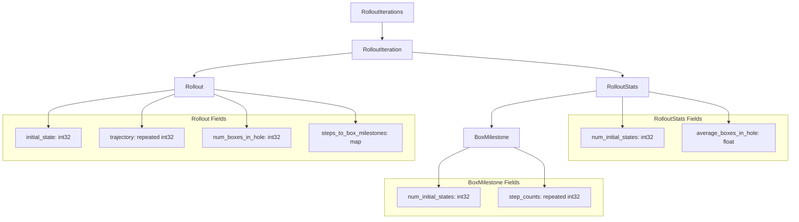
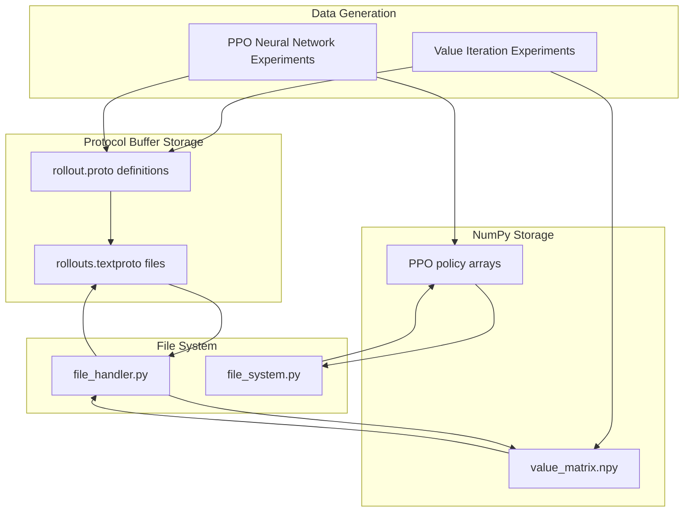

<!-- source: DeepWiki mcp.deepwiki.com · repo google-deepmind/mona · page 5.1 Data Formats · fetched 2026-10-26 -->

# Data Formats

Relevant source files

The following files were used as context for generating this wiki page:

- [proto/BUILD.bazel](proto/BUILD.bazel)
- [proto/rollout.proto](proto/rollout.proto)

This document describes the data formats used by the MONA system to store experimental results, rollout trajectories, and computed values. The MONA system uses primarily Protocol Buffers for structured experimental data and NumPy arrays for numerical computations.

For information about how these data formats are organized into files and directories, see [File Organization](#5.2). For examples of interpreting stored results, see [Example Results](#5.3).

## Protocol Buffer Definitions

The MONA system uses Protocol Buffers to define structured data formats for storing experimental results. All protocol buffer definitions are located in [proto/rollout.proto:16-51]().

### Core Message Types

The system defines four primary message types for organizing rollout data:

| Message Type | Purpose | Key Fields |
|-------------|---------|------------|
| `Rollout` | Single rollout execution | `initial_state`, `trajectory`, `num_boxes_in_hole` |
| `RolloutStats` | Aggregated statistics | `average_boxes_in_hole`, `box_milestones` |
| `RolloutIteration` | Collection of rollouts | `rollouts`, `stats` |
| `RolloutIterations` | Multiple iterations | `iterations` |

### Rollout Message Structure

**Sources:** [proto/rollout.proto:20-51]()

### Individual Message Specifications

#### Rollout Message
The `Rollout` message [proto/rollout.proto:20-25]() represents a single execution of the agent in the environment:

- `initial_state`: Starting state identifier as an integer
- `steps_to_box_milestones`: Map tracking how many steps to reach each box milestone  
- `num_boxes_in_hole`: Final count of boxes successfully placed in the hole
- `trajectory`: Packed array of state transitions during rollout execution

#### RolloutStats Message  
The `RolloutStats` message [proto/rollout.proto:27-41]() aggregates metrics across multiple rollouts:

- `num_initial_states`: Total number of different starting states tested
- `average_boxes_in_hole`: Mean number of boxes placed across all rollouts
- `box_milestones`: Array of `BoxMilestone` messages for different success levels

#### BoxMilestone Message
The nested `BoxMilestone` message [proto/rollout.proto:30-37]() tracks performance for specific box placement milestones:

- `num_initial_states`: Count of starting states where this milestone was the highest reached
- `step_counts`: Array where entry `i` represents rollouts reaching this milestone in `i` steps

**Sources:** [proto/rollout.proto:20-41]()

## Build Configuration

Protocol buffer compilation is configured through Bazel in [proto/BUILD.bazel:1-15](). The build file defines:

- `rollout_proto`: Core protocol buffer library target
- `rollout_py_pb2`: Python bindings for the protocol buffer definitions

**Sources:** [proto/BUILD.bazel:1-15]()

## Numerical Data Formats

### NumPy Arrays
The system uses NumPy arrays for storing computed numerical data:

- **Value Matrices**: Stored as `.npy` files containing state value functions computed during value iteration
- **Policy Arrays**: Neural network policy parameters and weights from PPO experiments

### Data Storage Integration

**Sources:** [proto/rollout.proto:16-51](), [proto/BUILD.bazel:1-15]()

## Usage Context

These data formats integrate with the broader MONA experimental pipeline:

1. **Experiment Execution**: Value iteration and PPO experiments generate rollout data conforming to the `Rollout` message format
2. **Statistics Computation**: The system computes `RolloutStats` and `BoxMilestone` data for analysis
3. **Persistence**: Protocol buffer messages are serialized to `.textproto` files while numerical data is saved as `.npy` arrays  
4. **Analysis**: Stored data is loaded for visualization and comparison between MONA and ordinary RL approaches

**Sources:** [proto/rollout.proto:16-51](), [proto/BUILD.bazel:1-15]()

---

