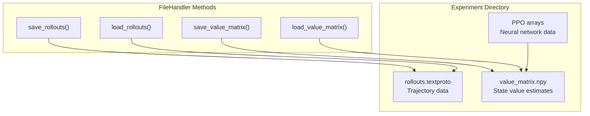
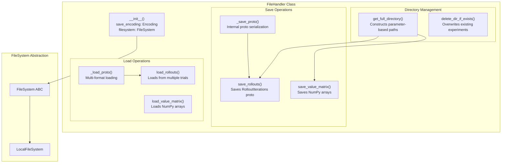
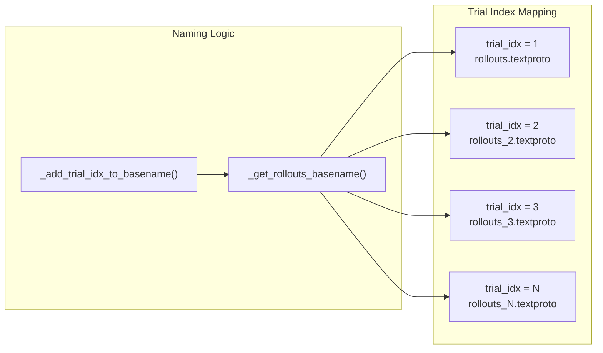

<!-- source: DeepWiki mcp.deepwiki.com · repo google-deepmind/mona · page 5.2 File Organization · fetched 2026-10-26 -->

# File Organization

<details>
<summary>Relevant source files</summary>

The following files were used as context for generating this wiki page:

- [data/R=bad-V_init=good-noise_init=0.5-step_penalty=0.01-shape=4_4-boxes=2/rollouts.textproto](data/R=bad-V_init=good-noise_init=0.5-step_penalty=0.01-shape=4_4-boxes=2/rollouts.textproto)
- [data/R=good-noise_init=0.5-step_penalty=0.01-shape=4_4-boxes=2/value_matrix.npy](data/R=good-noise_init=0.5-step_penalty=0.01-shape=4_4-boxes=2/value_matrix.npy)
- [src/file_handler.py](src/file_handler.py)
- [src/file_system.py](src/file_system.py)

</details>


This page explains how experimental results are organized into directories based on experimental parameters in the MONA system. The file organization system automatically creates descriptive directory names that encode all the experimental settings, making it easy to locate and compare results across different parameter combinations.

For information about the actual data formats stored in these directories, see [Data Formats](#5.1). For examples of analyzing these organized results, see [Example Results](#5.3).

## Parameter-Driven Directory Structure

The MONA system organizes experimental data using a hierarchical directory structure where each directory name encodes the complete set of experimental parameters. This allows experiments to be uniquely identified and easily compared.

### Directory Naming Convention

The `FileHandler.get_full_directory()` method constructs directory names by concatenating parameter key-value pairs with specific formatting rules:

```
data/R={reward_function}-V_init={init_vf_name}-noise_init={init_noise_scale}-step_penalty={per_step_penalty}-shape={board_shape[0]}_{board_shape[1]}-boxes={max_boxes}
```

### Parameter Encoding Rules

| Parameter | Key | Default | Encoding Rule |
|-----------|-----|---------|---------------|
| Reward Function | `R` | N/A | Always included |
| Initial Value Function | `V_init` | None | Omitted if None, wrapped in `#` if contains `=` or `-` |
| Initial Noise Scale | `noise_init` | 0 | Omitted if ≤ 0 |
| Reward Steps | `R_steps` | 1 | Omitted if = 1 |
| Exploration Probability | `explore` | None | Omitted if None |
| Min Blocking Boxes | `blocking_boxes` | 1 | Omitted if = 1 |
| Step Penalty | `step_penalty` | N/A | Always included |
| Episode Step Limit | `step_limit` | 50 | Omitted if = 50 |
| Board Shape | `shape` | N/A | Always included as `{height}_{width}` |
| Max Boxes | `boxes` | N/A | Always included |

Sources: [src/file_handler.py:97-150]()

## File Types and Storage Formats

Each experiment directory contains multiple file types storing different aspects of the experimental results.

### Primary Data Files



Sources: [src/file_handler.py:254-287]()

### File Format Options

The system supports multiple encoding formats for protocol buffer files:

| Format | Extension | Encoding Class | Use Case |
|--------|-----------|----------------|----------|
| Text Protocol Buffer | `.textproto` | `Encoding.TEXTPROTO` | Human-readable, debugging |
| Binary Protocol Buffer | `.pb` | `Encoding.BINARYPB` | Compact storage, production |
| NumPy Array | `.npy` | N/A | Numerical matrices |

The `FileHandler` attempts to load files in multiple formats automatically, trying each encoding in the order defined by `ENCODINGS`.

Sources: [src/file_handler.py:32-40](), [src/file_handler.py:152-186]()

## FileHandler Implementation

The `FileHandler` class provides the core functionality for managing experimental data organization and persistence.



Sources: [src/file_handler.py:86-287](), [src/file_system.py:24-65]()

## Trial Management System

The system supports multiple independent trials of the same experimental configuration through a trial indexing mechanism.

### Trial File Naming



The `_add_trial_idx_to_basename()` function implements the rule that trial 1 has no suffix, while subsequent trials append `_{trial_idx}` to the basename.

Sources: [src/file_handler.py:74-84]()

## Example Directory Structures

Based on the provided data files, here are real examples of how experimental parameters map to directory structures:

### Value Iteration Experiments

```
data/
├── R=bad-V_init=good-noise_init=0.5-step_penalty=0.01-shape=4_4-boxes=2/
│   ├── rollouts.textproto
│   └── value_matrix.npy
└── R=good-noise_init=0.5-step_penalty=0.01-shape=4_4-boxes=2/
    ├── rollouts.textproto  
    └── value_matrix.npy
```

### Parameter Interpretation

For the directory `R=bad-V_init=good-noise_init=0.5-step_penalty=0.01-shape=4_4-boxes=2`:

| Parameter | Value | Meaning |
|-----------|-------|---------|
| `R=bad` | "bad" reward function | Agent rewarded for reward hacking |
| `V_init=good` | "good" initial value function | Started with non-myopic policy |
| `noise_init=0.5` | 0.5 noise scale | Added exploration noise |
| `step_penalty=0.01` | 0.01 penalty per step | Small movement cost |
| `shape=4_4` | 4×4 grid | Board dimensions |
| `boxes=2` | 2 boxes | Number of pushable objects |

### Multi-Trial Storage

When multiple trials are run with identical parameters, the system creates numbered variants:

```
data/R=bad-V_init=good-noise_init=0.5-step_penalty=0.01-shape=4_4-boxes=2/
├── rollouts.textproto        # Trial 1
├── rollouts_2.textproto      # Trial 2  
├── rollouts_3.textproto      # Trial 3
├── value_matrix.npy          # Trial 1
├── value_matrix_2.npy        # Trial 2
└── value_matrix_3.npy        # Trial 3
```

Sources: [data/R=bad-V_init=good-noise_init=0.5-step_penalty=0.01-shape=4_4-boxes=2/rollouts.textproto:1-50](), [data/R=good-noise_init=0.5-step_penalty=0.01-shape=4_4-boxes=2/value_matrix.npy:1-10]()

---

