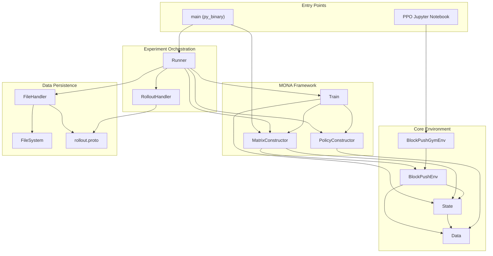
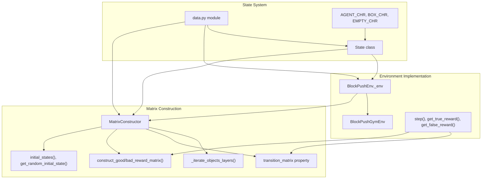
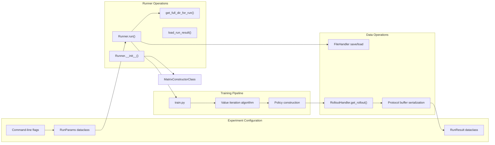
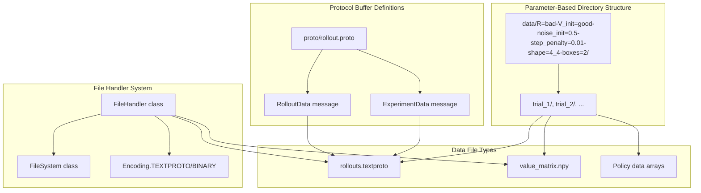
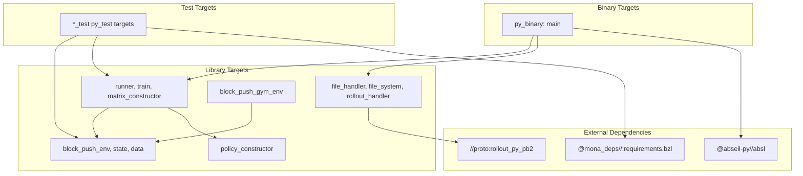

<!-- source: DeepWiki mcp.deepwiki.com · repo google-deepmind/mona · page 6 System Architecture · fetched 2026-10-26 -->

# System Architecture

Relevant source files

The following files were used as context for generating this wiki page:

- [src/BUILD.bazel](src/BUILD.bazel)
- [src/main.py](src/main.py)
- [src/matrix_constructor.py](src/matrix_constructor.py)

This document provides a technical overview of the internal architecture and key components of the MONA research system. It covers the modular design, component dependencies, data flow patterns, and build system organization.

For information about running experiments and using the system, see [Getting Started](#2). For details about the experimental approaches themselves, see [Experimental Approaches](#3). For information about data formats and organization, see [Data and Results](#5).

## Overall System Design

The MONA system follows a layered architecture with clear separation between the core environment, experimental methods, data persistence, and analysis components. The design supports both tabular value iteration and neural network-based approaches to test the MONA framework.

### High-Level Component Organization

**Sources:** [src/BUILD.bazel:1-201](), [src/main.py:1-365](), [src/matrix_constructor.py:1-313]()

## Core Components

The system is built around several key components that handle different aspects of the MONA research workflow.

### Environment and State Management

**Sources:** [src/BUILD.bazel:90-96](), [src/BUILD.bazel:42-50](), [src/matrix_constructor.py:37-313]()

| Component | File | Primary Responsibilities |
|-----------|------|-------------------------|
| `State` | `src/state.py` | Represents gridworld states with agent and box positions |
| `data` | `src/data.py` | Defines constants, actions, and data structures |
| `BlockPushEnv` | `src/block_push_env.py` | Core environment logic for agent movement, box pushing, rewards |
| `BlockPushGymEnv` | `src/block_push_gym_env.py` | Gymnasium-compatible wrapper for RL libraries |
| `MatrixConstructor` | `src/matrix_constructor.py` | Generates state space, transition matrices, reward matrices |

### Experiment Orchestration Pipeline

The system uses a `Runner` class to orchestrate experiments, handling parameter configuration, policy training, and result storage.

**Sources:** [src/BUILD.bazel:69-78](), [src/main.py:287-330]()

## Data Flow Architecture

The system implements a comprehensive data pipeline from experiment execution through persistent storage and analysis.

### File Organization and Storage

**Sources:** [src/BUILD.bazel:120-127](), [src/BUILD.bazel:148-150](), [src/main.py:30-53]()

### Matrix and State Space Generation

The `MatrixConstructor` handles the computationally intensive task of generating the complete state space and transition matrices for the tabular value iteration approach.

| Method | Purpose | Return Type |
|--------|---------|-------------|
| `_iterate_objects_layers()` | Generate all possible board configurations | `Iterator[NDArray]` |
| `_initialize_states()` | Create state objects and index mapping | `None` |
| `transition_matrix` | Lazy computation of state transitions | `NDArray[np.int32]` |
| `construct_good_reward_matrix()` | Generate reward matrix for true objective | `NDArray[np.float64]` |
| `construct_bad_reward_matrix()` | Generate reward matrix for exploitable objective | `NDArray[np.float64]` |
| `initial_states()` | Find valid starting states for experiments | `set[int]` |

**Sources:** [src/matrix_constructor.py:40-51](), [src/matrix_constructor.py:238-250](), [src/matrix_constructor.py:252-256]()

## Build and Dependency System

The system uses Bazel for build management with a clear dependency hierarchy and external package management.

### Build Target Organization

**Sources:** [src/BUILD.bazel:1-201]()

### Dependency Management

| Package Category | Examples | Purpose |
|------------------|----------|---------|
| Numerical Computing | `numpy`, `sympy` | Matrix operations, state enumeration |
| Data Structures | `frozendict` | Immutable mappings for state caching |
| RL Interface | `gymnasium` | Standard RL environment API |
| Command Line | `@abseil-py//absl` | Flag parsing and application framework |
| Data Serialization | `//proto:rollout_py_pb2` | Structured experiment result storage |
| Testing | `pytest` | Unit test framework |

The build system enforces clean separation between components through explicit dependency declarations, ensuring that core environment logic remains independent of specific experimental approaches or data persistence mechanisms.

**Sources:** [src/BUILD.bazel:1-4](), [src/BUILD.bazel:38](), [src/BUILD.bazel:189]()

---

