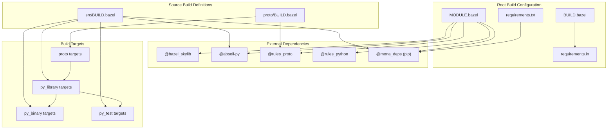
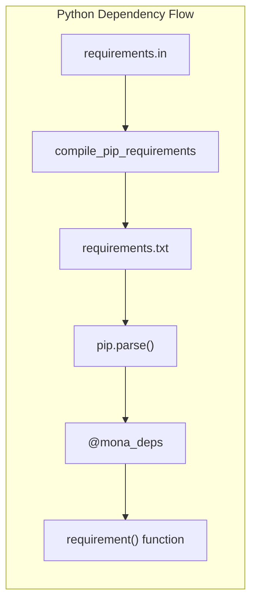
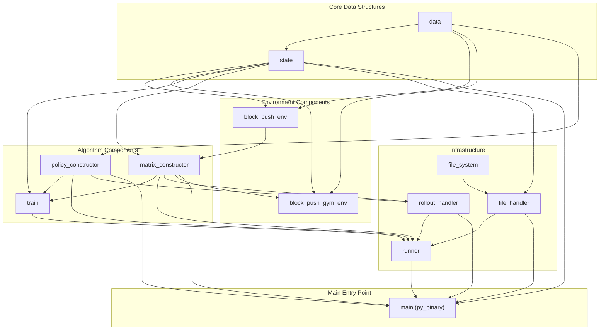
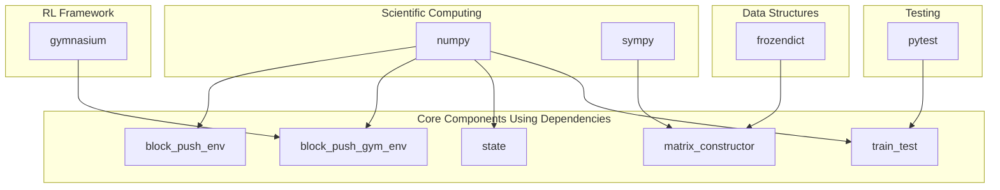
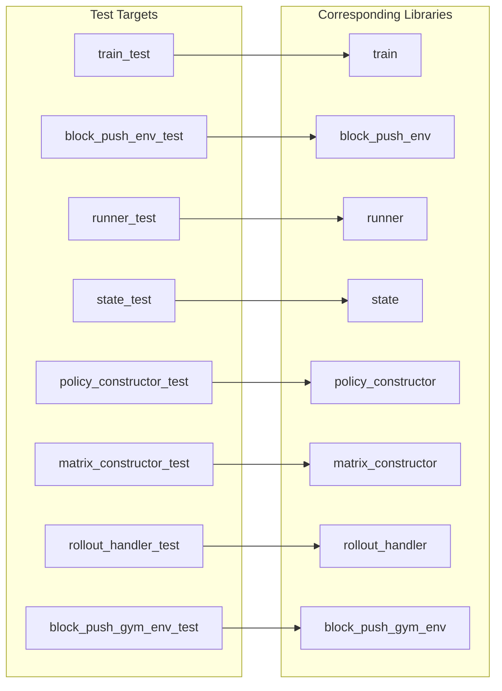

<!-- source: DeepWiki mcp.deepwiki.com · repo google-deepmind/mona · page 6.1 Build System · fetched 2026-10-26 -->

# Build System

Relevant source files

The following files were used as context for generating this wiki page:

- [BUILD.bazel](BUILD.bazel)
- [MODULE.bazel](MODULE.bazel)
- [src/BUILD.bazel](src/BUILD.bazel)

This document explains the Bazel-based build system used in the MONA repository, including dependency management, build targets, and the overall project structure. The build system orchestrates compilation of Python modules, protocol buffers, and manages external dependencies for both the core framework and experimental components.

For information about running experiments and using the built system, see [Getting Started](#2). For details about the core components that the build system assembles, see [Core Components](#6.2).

## Build System Architecture

The MONA repository uses Bazel as its primary build system, with support for Python libraries, binaries, tests, and protocol buffer compilation. The system is structured around three main BUILD files that define the complete build graph.

Sources: [BUILD.bazel:1-6](), [MODULE.bazel:1-18](), [src/BUILD.bazel:1-201]()

## Module Definition and External Dependencies

The `MODULE.bazel` file defines the MONA project as a Bazel module with version `1.0.0` and declares all external dependencies required for the build.

### Core Bazel Dependencies

| Dependency | Version | Purpose |
|------------|---------|---------|
| `bazel_skylib` | 1.7.1 | Bazel utility functions |
| `abseil-py` | 2.1.0 | Python utilities and flags |
| `rules_proto` | 7.1.0 | Protocol buffer compilation |
| `rules_python` | 1.0.0 | Python build rules |

### Python Dependency Management

The build system uses a two-stage approach for Python dependencies:

1. **Requirements Compilation**: The root `BUILD.bazel` uses `compile_pip_requirements` to generate `requirements.txt` from `requirements.in`
2. **Pip Integration**: `MODULE.bazel` configures the pip extension to parse `requirements.txt` and make dependencies available as `@mona_deps`

Sources: [BUILD.bazel:3-6](), [MODULE.bazel:11-17]()

## Python Package Structure

The `src/BUILD.bazel` file defines the complete Python package structure using Bazel's Python rules. All targets have default visibility set to `//:__subpackages__`, allowing access from any subpackage in the repository.

### Core Library Targets

The build system creates modular Python libraries that reflect the logical architecture:

Sources: [src/BUILD.bazel:6-151]()

### Key Build Targets

| Target Type | Name | Dependencies | Purpose |
|-------------|------|--------------|---------|
| `py_binary` | `main` | runner, state, matrix_constructor, policy_constructor, file_handler, rollout_handler, abseil-py | Main experiment entry point |
| `py_library` | `train` | data, matrix_constructor, policy_constructor, state | Value iteration training algorithms |
| `py_library` | `block_push_env` | data, state, numpy | Core gridworld environment |
| `py_library` | `block_push_gym_env` | data, matrix_constructor, state, gymnasium, numpy | Gymnasium interface wrapper |
| `py_library` | `matrix_constructor` | block_push_env, data, state, frozendict, sympy | State space matrix generation |

## External Dependency Integration

The build system integrates external Python packages through the `requirement()` function, which references packages made available by the `@mona_deps` pip repository.

### Required Python Packages

Sources: [src/BUILD.bazel:38-39](), [src/BUILD.bazel:48-49](), [src/BUILD.bazel:58-60](), [src/BUILD.bazel:94-95](), [src/BUILD.bazel:114-116](), [src/BUILD.bazel:189-191]()

## Protocol Buffer Integration

The build system includes protocol buffer support through references to `//proto:rollout_py_pb2`, indicating that protocol buffer definitions are compiled and made available to Python modules.

### Protocol Buffer Usage

| Component | Protocol Dependency | Purpose |
|-----------|-------------------|---------|
| `file_handler` | `//proto:rollout_py_pb2` | Serialize/deserialize rollout data |
| `rollout_handler` | `//proto:rollout_py_pb2` | Create and manipulate rollout records |

Sources: [src/BUILD.bazel:125-126](), [src/BUILD.bazel:135-136]()

## Testing Infrastructure

The build system defines comprehensive test coverage using `py_test` targets that mirror the library structure:

### Test Target Configuration

Each test target includes its corresponding library as a dependency, along with any additional testing dependencies like `pytest` or `numpy` for test utilities.

Sources: [src/BUILD.bazel:32-40](), [src/BUILD.bazel:52-61](), [src/BUILD.bazel:80-87](), [src/BUILD.bazel:98-105](), [src/BUILD.bazel:152-159](), [src/BUILD.bazel:162-167](), [src/BUILD.bazel:169-180](), [src/BUILD.bazel:194-200]()

---

