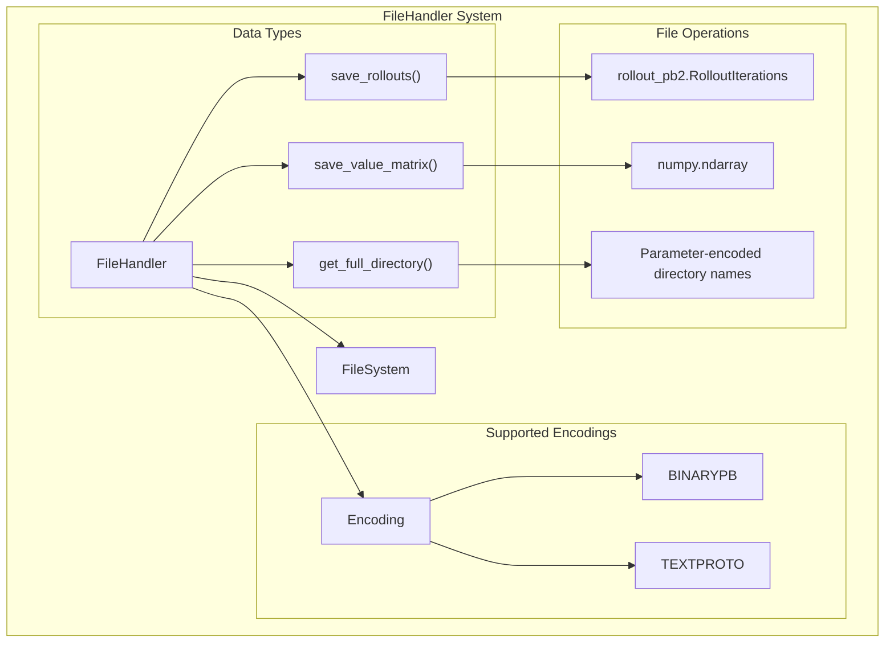
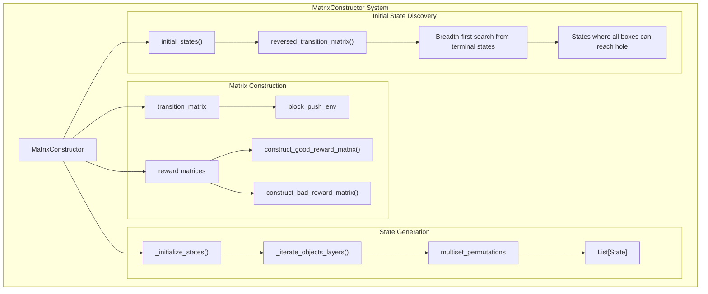
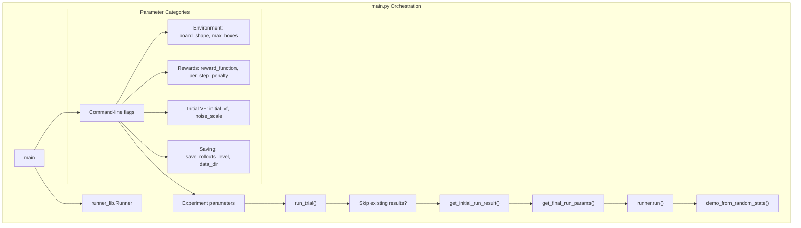
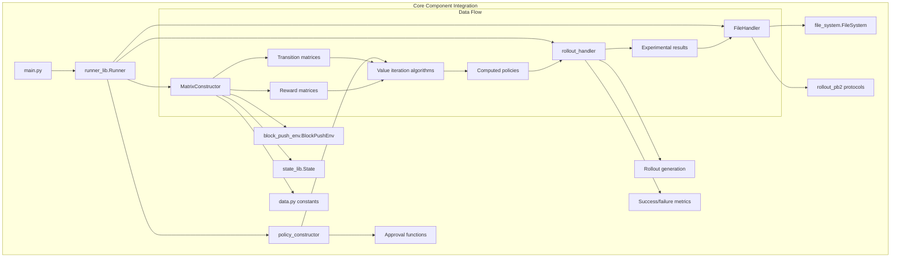

<!-- source: DeepWiki mcp.deepwiki.com · repo google-deepmind/mona · page 6.2 Core Components · fetched 2026-10-26 -->

# Core Components

<details>
<summary>Relevant source files</summary>

The following files were used as context for generating this wiki page:

- [src/file_handler.py](src/file_handler.py)
- [src/main.py](src/main.py)
- [src/matrix_constructor.py](src/matrix_constructor.py)

</details>


This document provides a deep dive into the key classes and modules that comprise the MONA system's internal architecture. It focuses on the core data structures, algorithms, and orchestration components that enable MONA experiments to run.

For information about the build system and dependencies, see [Build System](#6.1). For details about data formats and file organization, see [Data and Results](#5).

## Data Persistence System

The `FileHandler` class in [src/file_handler.py]() serves as the central component for all data persistence operations in the MONA system. This class abstracts file system operations and handles serialization/deserialization of experimental data.

### Core FileHandler Architecture



The `FileHandler` supports two encoding formats defined in the `Encoding` enum [src/file_handler.py:32-36]():
- **BINARYPB**: Binary protocol buffer format (`.pb` extension)
- **TEXTPROTO**: Human-readable text protocol format (`.textproto` extension)

Key methods include:
- `get_full_directory()` [src/file_handler.py:97-150](): Generates parameter-encoded directory paths
- `save_rollouts()` [src/file_handler.py:254-260](): Persists experimental rollout data
- `save_value_matrix()` [src/file_handler.py:262-278](): Saves numpy arrays containing value functions
- `load_rollouts()` [src/file_handler.py:196-226](): Loads experimental results with trial indexing support

**Sources:** [src/file_handler.py:1-287]()

## State Space Construction System

The `MatrixConstructor` class [src/matrix_constructor.py]() is responsible for enumerating all possible states in the gridworld environment and constructing the mathematical representations needed for value iteration.

### MatrixConstructor Architecture



The class performs several critical functions:

**State Enumeration** [src/matrix_constructor.py:40-56](): Generates all possible board configurations by permuting agent, boxes, and empty spaces across grid positions.

**Transition Matrix Construction** [src/matrix_constructor.py:238-250](): Creates an `(num_states, num_actions)` matrix where entry `[s, a]` contains the index of the state reached by taking action `a` from state `s`.

**Reward Matrix Construction** [src/matrix_constructor.py:58-64](): Builds reward vectors for both "good" and "bad" reward functions by applying the reward function to each state.

**Initial State Discovery** [src/matrix_constructor.py:100-159](): Uses reverse reachability analysis to identify states where all boxes can potentially be pushed into the hole without triggering the camera.

**Sources:** [src/matrix_constructor.py:1-313]()

## Experiment Orchestration

The main entry point [src/main.py]() orchestrates the complete experimental workflow, from parameter parsing to result demonstration.

### Main Execution Flow



The main execution involves these key stages:

**Parameter Configuration** [src/main.py:30-149](): Defines command-line flags for all experimental parameters including board dimensions, reward functions, initial value functions, and data persistence options.

**Trial Management** [src/main.py:287-329](): Handles multiple experimental trials with optional skipping of existing results and trial indexing.

**Initial Value Function Handling** [src/main.py:178-255](): Supports multiple initialization strategies including loading from files, using "good"/"bad" pre-computed values, or zero initialization.

**Policy Demonstration** [src/main.py:153-175](): Provides rollout visualization starting from random valid initial states.

**Sources:** [src/main.py:1-365]()

## Component Integration Architecture

The following diagram shows how the core components integrate to enable MONA experiments:



This architecture enables the MONA framework by:

1. **MatrixConstructor** generates the complete state space and mathematical representations
2. **Runner** coordinates value iteration with MONA approval functions  
3. **FileHandler** persists results in parameter-encoded directory structures
4. **main.py** orchestrates the complete experimental workflow

Each component maintains clear separation of concerns while enabling flexible experimental configurations through the parameter system.

**Sources:** [src/main.py:1-365](), [src/matrix_constructor.py:1-313](), [src/file_handler.py:1-287]()

## Matrix Constructor State Management

The `MatrixConstructor` implements sophisticated state space management that handles the complexity of the gridworld environment:

| Component | Purpose | Key Methods |
|-----------|---------|-------------|
| State enumeration | Generate all valid board configurations | `_iterate_objects_layers()`, `_initialize_states()` |
| Transition computation | Map state-action pairs to next states | `transition_matrix` property |
| Reward calculation | Apply reward functions to states | `construct_good_reward_matrix()`, `construct_bad_reward_matrix()` |
| Initial state discovery | Find states where all boxes can reach holes | `initial_states()`, `_get_initial_states_mapping()` |

The state space includes an "ended" state [src/matrix_constructor.py:53]() plus all permutations of agent and box positions. The transition matrix is lazily computed [src/matrix_constructor.py:238-250]() and cached for efficiency.

**Sources:** [src/matrix_constructor.py:37-313]()

## File Handler Directory Encoding

The `FileHandler.get_full_directory()` method [src/file_handler.py:97-150]() implements a parameter encoding scheme that creates self-describing directory names:

```
data/R=bad-V_init=good-noise_init=0.5-step_penalty=0.01-shape=4_4-boxes=2/
```

This encoding includes:
- `R={reward_function}`: Reward function name
- `V_init={init_vf_name}`: Initial value function (if specified)  
- `noise_init={init_noise_scale}`: Noise scale (if > 0)
- `step_penalty={per_step_penalty}`: Per-step penalty
- `shape={height}_{width}`: Board dimensions
- `boxes={max_boxes}`: Maximum number of boxes

Default values are omitted to keep directory names concise while maintaining uniqueness across parameter combinations.

**Sources:** [src/file_handler.py:97-150]()

---

