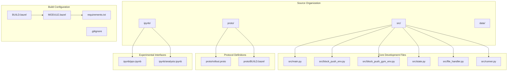
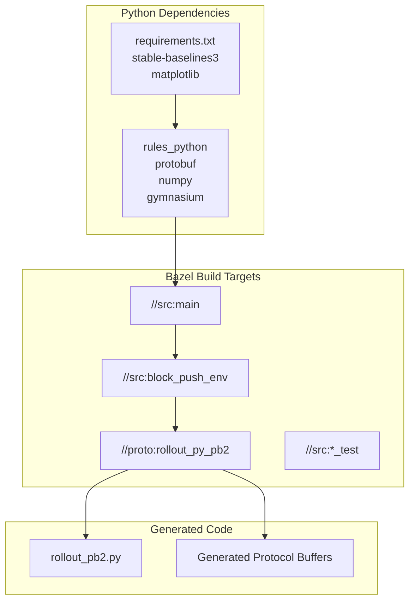
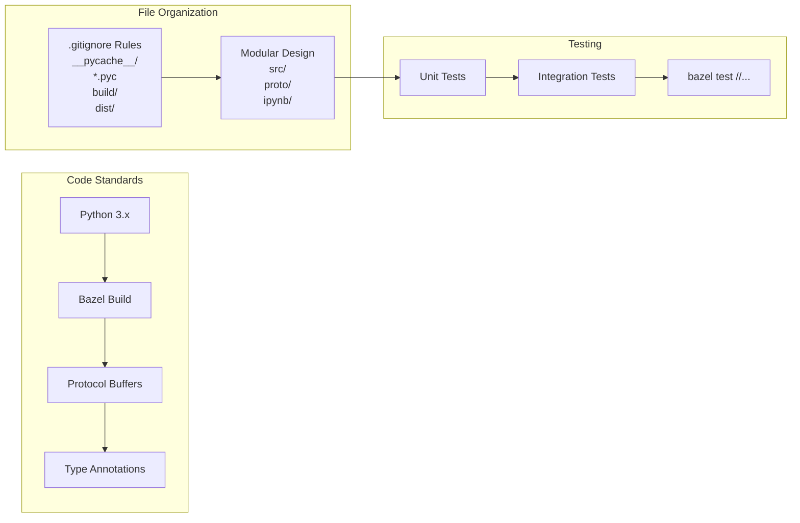

<!-- source: DeepWiki mcp.deepwiki.com · repo google-deepmind/mona · page 7 Development · fetched 2026-10-26 -->

# Development

Relevant source files

The following files were used as context for generating this wiki page:

- [.gitignore](.gitignore)
- [CONTRIBUTING.md](CONTRIBUTING.md)
- [LICENSE](LICENSE)

This page provides information for developers who want to contribute to or extend the MONA research system. It covers development setup, project structure, contribution workflows, and extension points for researchers implementing new MONA experiments.

For information about running existing experiments, see [Getting Started](#2). For details about the build system architecture, see [Build System](#6.1).

## Development Environment

The MONA system uses Bazel for build management and follows Google's development practices for open source projects. The development environment supports both tabular value iteration experiments and neural network-based PPO experiments.

### Repository Structure for Developers

*Sources: [.gitignore:1-25](), [CONTRIBUTING.md:1-26](), directory structure from system analysis*

### Development Workflow

The development workflow follows standard GitHub practices with additional requirements for Google's Contributor License Agreement:

```mermaid
graph LR
    subgraph "Contribution Process"
        CLA["Contributor License Agreement<br/>cla.developers.google.com"]
        FORK["Fork Repository"]
        BRANCH["Create Feature Branch"]
        DEVELOP["Implement Changes"]
    end
    
    subgraph "Code Quality"
        BUILD["bazel build //..."]
        TEST["bazel test //..."]
        LINT["Code Review Checks"]
    end
    
    subgraph "Submission"
        PR["GitHub Pull Request"]
        REVIEW["Code Review Process"]
        MERGE["Merge to Main"]
    end
    
    CLA --> FORK
    FORK --> BRANCH
    BRANCH --> DEVELOP
    
    DEVELOP --> BUILD
    BUILD --> TEST
    TEST --> LINT
    
    LINT --> PR
    PR --> REVIEW
    REVIEW --> MERGE
```

*Sources: [CONTRIBUTING.md:4-10](), [CONTRIBUTING.md:15-20](), [CONTRIBUTING.md:22-25]()*

## Code Organization for Extension

### Core Extension Points

The MONA system provides several key extension points for researchers:

| Component | File Path | Extension Purpose |
|-----------|-----------|------------------|
| Environment Logic | `src/block_push_env.py` | Add new gridworld mechanics |
| State Representation | `src/state.py` | Modify state encoding |
| Approval Functions | `src/main.py` | Implement new approval strategies |
| Data Persistence | `proto/rollout.proto` | Add experimental metrics |
| Neural Networks | `ipynb/ppo.ipynb` | Integrate new RL algorithms |

### Build System Integration

*Sources: Build system analysis, [MODULE.bazel]() reference, [requirements.txt]() reference*

## Contributing Guidelines

### Licensing Requirements

All contributions must comply with the Apache 2.0 license terms and include the Contributor License Agreement:

- **License**: Apache License 2.0 with standard copyright notice
- **CLA Required**: Submit at https://cla.developers.google.com/
- **Copyright Retention**: Contributors retain copyright while granting usage rights
- **Patent Grant**: Includes patent license grant for contributions

*Sources: [LICENSE:1-203](), [CONTRIBUTING.md:4-13]()*

### Code Review Process

- **All submissions require review**: Including contributions from project members
- **GitHub Pull Requests**: Standard GitHub PR workflow for code reviews  
- **Community Guidelines**: Follow Google's Open Source Community Guidelines
- **Review Standards**: Focus on code quality, test coverage, and documentation

*Sources: [CONTRIBUTING.md:15-20](), [CONTRIBUTING.md:22-25]()*

### Development Standards

The codebase follows these development standards:

*Sources: [.gitignore:1-25](), [CONTRIBUTING.md](), development practices inferred from codebase structure*

## Research Extension Points

### Adding New Experimental Methods

Researchers can extend the MONA framework by:

1. **New RL Algorithms**: Extend the PPO notebook approach in `ipynb/ppo.ipynb`
2. **Modified Environments**: Extend `BlockPushEnv` class in `src/block_push_env.py` 
3. **Alternative Approval Functions**: Modify approval logic in `src/main.py`
4. **New Metrics**: Extend `rollout.proto` message definitions
5. **Analysis Tools**: Add visualization methods to `ipynb/analysis.ipynb`

### Data Format Extensions

To add new experimental data:

1. Modify protocol buffer definitions in `proto/rollout.proto`
2. Regenerate Python bindings using Bazel
3. Update file handler logic in `src/file_handler.py`
4. Add analysis support in the analysis notebook

*Sources: System architecture analysis, experimental framework design from codebase structure*

## License Information

This project is released under the Apache License 2.0. Key points for developers:

- **Open Source**: Free to use, modify, and distribute
- **Patent Grant**: Includes patent license for contributions
- **Attribution Required**: Must include license notice in distributions  
- **No Warranty**: Software provided "as is" without warranties
- **Contributor Protection**: CLA protects both contributors and project

For complete license terms, see [LICENSE:1-203]().

*Sources: [LICENSE:1-203](), [CONTRIBUTING.md:4-13]()*

---

