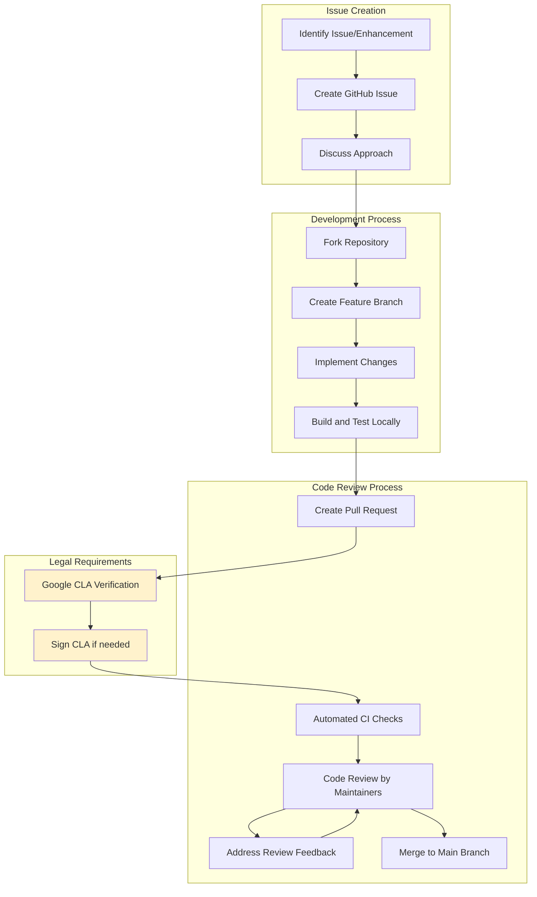
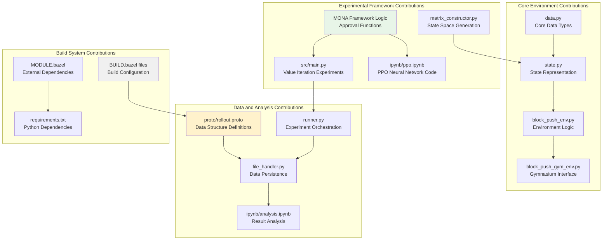

<!-- source: DeepWiki mcp.deepwiki.com · repo google-deepmind/mona · page 7.1 Contributing Guidelines · fetched 2026-10-26 -->

# Contributing Guidelines

Relevant source files

The following files were used as context for generating this wiki page:

- [CONTRIBUTING.md](CONTRIBUTING.md)

This page provides guidelines for developers who want to contribute code, report issues, or enhance the MONA research system. It covers the contribution workflow, coding standards, testing practices, and community guidelines specific to this repository.

For information about the overall system architecture and component relationships, see [System Architecture](#6). For details about building and running experiments, see [Getting Started](#2).

## Prerequisites

Before contributing to MONA, ensure you have the necessary development environment set up:

| Requirement | Description | Reference |
|-------------|-------------|-----------|
| Bazel Build System | Required for building protobuf definitions and managing dependencies | See [Build System](#6.1) |
| Python Dependencies | NumPy, Gymnasium, JAX for neural network experiments | [requirements.txt:1-10]() |
| Git and GitHub | For version control and pull request workflow | GitHub account required |
| Google CLA | Contributor License Agreement must be signed | Required before first contribution |

Sources: [CONTRIBUTING.md:1-26](), [requirements.txt:1-10](), [BUILD.bazel:1-20]()

## Contribution Workflow

### Contribution Process Flow

Sources: [CONTRIBUTING.md:15-20](), [CONTRIBUTING.md:3-13]()

### Legal Requirements

All contributions must be accompanied by a signed Contributor License Agreement (CLA). This process:

- Retains copyright with you or your employer
- Grants permission for use and redistribution as part of the project
- Only needs to be completed once across Google projects
- Is verified automatically for each pull request

Visit [https://cla.developers.google.com/](https://cla.developers.google.com/) to check your current agreements or sign a new one.

Sources: [CONTRIBUTING.md:3-13]()

## Code Organization for Contributions

### Component-Based Contribution Areas

Sources: [src/main.py:1-50](), [src/block_push_env.py:1-30](), [proto/rollout.proto:1-20](), [BUILD.bazel:1-20]()

## Code Standards

### Python Code Style

Follow these standards when contributing Python code:

| Standard | Description | Example Files |
|----------|-------------|---------------|
| Type Hints | Use type annotations for function parameters and returns | [src/state.py:20-30]() |
| Docstrings | Document all public functions and classes | [src/block_push_env.py:40-60]() |
| Import Organization | Group imports by standard library, third-party, local | [src/main.py:1-15]() |
| Naming Conventions | Use descriptive names for variables and functions | [src/data.py:10-20]() |

### Environment and Experiment Code

When contributing to the core environment or experimental frameworks:

- **Environment Changes**: Modify [src/block_push_env.py:1-200]() for core logic, ensure backward compatibility
- **State Representation**: Update [src/state.py:1-100]() if adding new state components
- **Experimental Parameters**: Add new parameters to [src/data.py:1-50]() with appropriate defaults
- **Protocol Buffer Updates**: Modify [proto/rollout.proto:1-50]() for new data structures

Sources: [src/block_push_env.py:1-200](), [src/state.py:1-100](), [proto/rollout.proto:1-50]()

### Build System Changes

For changes to the build system:

- Update [BUILD.bazel:1-50]() files when adding new source files or dependencies
- Modify [MODULE.bazel:1-30]() for external dependency changes
- Update [requirements.txt:1-15]() for Python package dependencies
- Ensure protocol buffer definitions are properly declared in BUILD files

Sources: [BUILD.bazel:1-50](), [MODULE.bazel:1-30](), [requirements.txt:1-15]()

## Testing and Validation

### Testing Requirements

| Component Type | Testing Approach | Validation Method |
|----------------|------------------|-------------------|
| Environment Logic | Unit tests for state transitions | Run value iteration experiments |
| MONA Framework | Integration tests with known scenarios | Compare against baseline results |
| Data Handling | Serialization/deserialization tests | Verify protocol buffer compatibility |
| Experimental Code | End-to-end experiment runs | Check rollout data consistency |

### Pre-submission Validation

Before submitting a pull request:

1. **Build Verification**: Run `bazel build //...` to ensure all targets build successfully
2. **Experiment Testing**: Execute [src/main.py:1-50]() with minimal parameters to verify basic functionality
3. **Protocol Buffer Validation**: Test data serialization with [file_handler.py:1-100]() functions
4. **Analysis Compatibility**: Ensure [ipynb/analysis.ipynb:1-50]() can load and process new data formats

Sources: [src/main.py:1-50](), [file_handler.py:1-100](), [ipynb/analysis.ipynb:1-50]()

## Documentation Requirements

### Code Documentation

- **Function Docstrings**: Document all public functions with parameter types, return values, and usage examples
- **Class Documentation**: Explain the purpose and key methods of each class, especially in [src/state.py:1-100]()
- **Module Documentation**: Add module-level docstrings explaining the component's role in the system
- **Inline Comments**: Use comments for complex algorithms, especially in [matrix_constructor.py:1-200]()

### Experimental Documentation

When contributing new experiments or analysis:

- **Notebook Documentation**: Add markdown cells explaining experiment purpose and methodology
- **Parameter Documentation**: Update parameter descriptions in [src/data.py:1-50]()
- **Result Documentation**: Include interpretation guidance for new metrics or outputs

Sources: [src/data.py:1-50](), [matrix_constructor.py:1-200](), [ipynb/analysis.ipynb:1-100]()

## Review Process

### Code Review Requirements

All submissions require review by project maintainers. The review process includes:

- **Functionality Review**: Verify the contribution works as intended and doesn't break existing functionality
- **Code Quality**: Check adherence to coding standards and architectural patterns
- **Documentation Review**: Ensure adequate documentation for new features or changes
- **Integration Testing**: Verify compatibility with existing experimental workflows

### Pull Request Guidelines

Structure your pull requests with:

- **Clear Title**: Describe the change concisely
- **Detailed Description**: Explain the problem solved and approach taken
- **Testing Notes**: Document how the change was tested
- **Breaking Changes**: Highlight any backward-incompatible changes

Sources: [CONTRIBUTING.md:15-20]()

## Community Guidelines

This project follows [Google's Open Source Community Guidelines](https://opensource.google/conduct/). Key principles include:

- **Respectful Communication**: Maintain professional and constructive interactions
- **Inclusive Environment**: Welcome contributors from diverse backgrounds and experience levels  
- **Technical Focus**: Keep discussions focused on technical merit and project goals
- **Collaborative Problem-Solving**: Work together to find the best solutions

Sources: [CONTRIBUTING.md:22-25]()

## Getting Help

For questions about contributing:

- **GitHub Issues**: Use for bug reports and feature requests
- **Pull Request Comments**: Ask questions during the review process
- **Documentation**: Refer to [Getting Started](#2) for setup help and [System Architecture](#6) for technical details

Sources: [CONTRIBUTING.md:1-26]()

---

