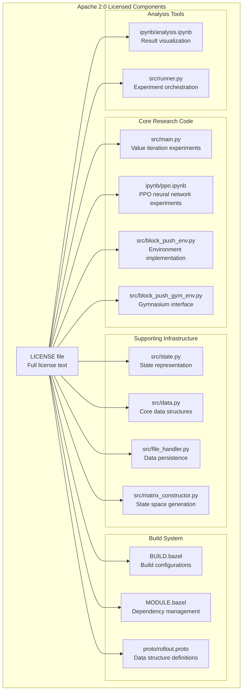
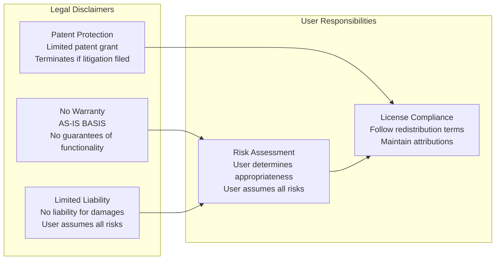

<!-- source: DeepWiki mcp.deepwiki.com · repo google-deepmind/mona · page 7.2 License · fetched 2026-10-26 -->

# License

<details>
<summary>Relevant source files</summary>

The following files were used as context for generating this wiki page:

- [LICENSE](LICENSE)

</details>


This document provides legal information about the Apache 2.0 license that governs the MONA (Myopic Optimization with Non-myopic Approval) research codebase and explains the terms and conditions for use, modification, and distribution of the code.

For information about contributing code changes, see [Contributing Guidelines](#7.1). For technical details about the system architecture, see [System Architecture](#6).

## License Overview

The MONA repository is licensed under the Apache License, Version 2.0. This is a permissive open-source license that allows for both commercial and non-commercial use with minimal restrictions.

| License Type | Apache License 2.0 |
|--------------|-------------------|
| **File Location** | [LICENSE:1-203]() |
| **License URL** | http://www.apache.org/licenses/ |
| **Effective Date** | January 2004 |

**Sources:** [LICENSE:1-5]()

## Key Permissions and Restrictions

The Apache 2.0 license grants users broad permissions while requiring certain conditions to be met:

### Permissions Granted

The license provides the following rights under [LICENSE:67-72]():

- **Use**: Run the software for any purpose
- **Modify**: Create derivative works and modifications  
- **Distribute**: Share the original work and derivative works
- **Sublicense**: Grant sublicenses to others
- **Commercial Use**: Use for commercial purposes without royalty payments
- **Patent Rights**: Limited patent protection under [LICENSE:74-88]()

### Required Conditions

When redistributing or creating derivative works, you must comply with [LICENSE:90-129]():

| Requirement | Description |
|-------------|-------------|
| **Include License** | Provide copy of Apache 2.0 license text |
| **Notice Modified Files** | Mark changed files with prominent notices |
| **Preserve Notices** | Retain copyright, patent, and attribution notices |
| **Include NOTICE File** | If present, include attribution notices in derivative works |

**Sources:** [LICENSE:67-129]()

## License Application to MONA Components

The Apache 2.0 license applies to all components of the MONA research system:



**Sources:** [LICENSE:1-203]()

## Using MONA Code in Derivative Works

When creating derivative works or modifications of the MONA codebase, you must follow specific attribution requirements:

### Copyright Header Template

The license provides a template for copyright headers at [LICENSE:179-202](). When creating new files based on MONA code, include:

```
Copyright [year] [your name/organization]

Licensed under the Apache License, Version 2.0 (the "License");
you may not use this file except in compliance with the License.
You may obtain a copy of the License at

    http://www.apache.org/licenses/LICENSE-2.0

Unless required by applicable law or agreed to in writing, software
distributed under the License is distributed on an "AS IS" BASIS,
WITHOUT WARRANTIES OR CONDITIONS OF ANY KIND, either express or implied.
See the License for the specific language governing permissions and
limitations under the License.
```

### Modification Requirements

When modifying existing MONA files, you must [LICENSE:98-99]():

1. **Mark Changes**: Add prominent notices stating that you changed the files
2. **Preserve Notices**: Keep existing copyright and attribution notices
3. **Include License**: Distribute the Apache 2.0 license with your derivative work

**Sources:** [LICENSE:90-129](), [LICENSE:179-202]()

## Liability and Warranty Disclaimers

The Apache 2.0 license includes important disclaimers:



### Key Disclaimer Points

- **No Warranty**: Software provided "AS IS" without warranties of any kind [LICENSE:144-152]()
- **Limitation of Liability**: Contributors not liable for damages from use [LICENSE:154-164]()
- **User Responsibility**: Users must assess appropriateness and assume risks [LICENSE:150-152]()

**Sources:** [LICENSE:144-176]()

## Patent License Provisions

The Apache 2.0 license includes specific patent-related terms:

| Patent Aspect | Terms |
|---------------|--------|
| **Grant** | Contributors grant patent rights for their contributions [LICENSE:74-82]() |
| **Scope** | Covers patents necessarily infringed by contributions [LICENSE:80-82]() |
| **Termination** | Patent rights terminate if licensee files patent litigation [LICENSE:83-88]() |
| **Defensive** | Protects against patent litigation while encouraging open collaboration |

**Sources:** [LICENSE:74-88]()

## Contribution License Terms

When contributing to the MONA repository, the Apache 2.0 license governs how contributions are handled:

- **Default Terms**: Unless explicitly stated otherwise, contributions are under Apache 2.0 [LICENSE:131-134]()
- **No Additional Terms**: Contributions don't require additional license conditions [LICENSE:134-137]()  
- **Integration**: Contributed code becomes part of the licensed work

**Sources:** [LICENSE:131-137]()