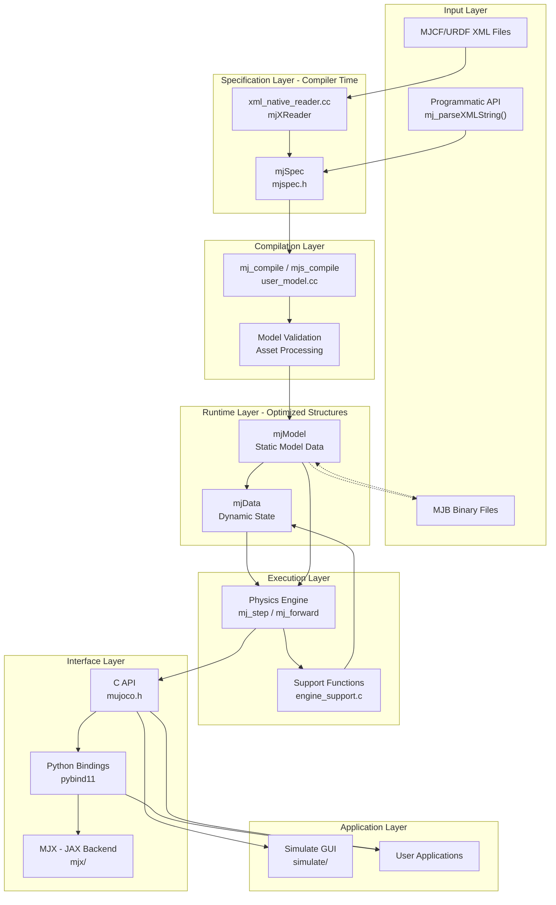
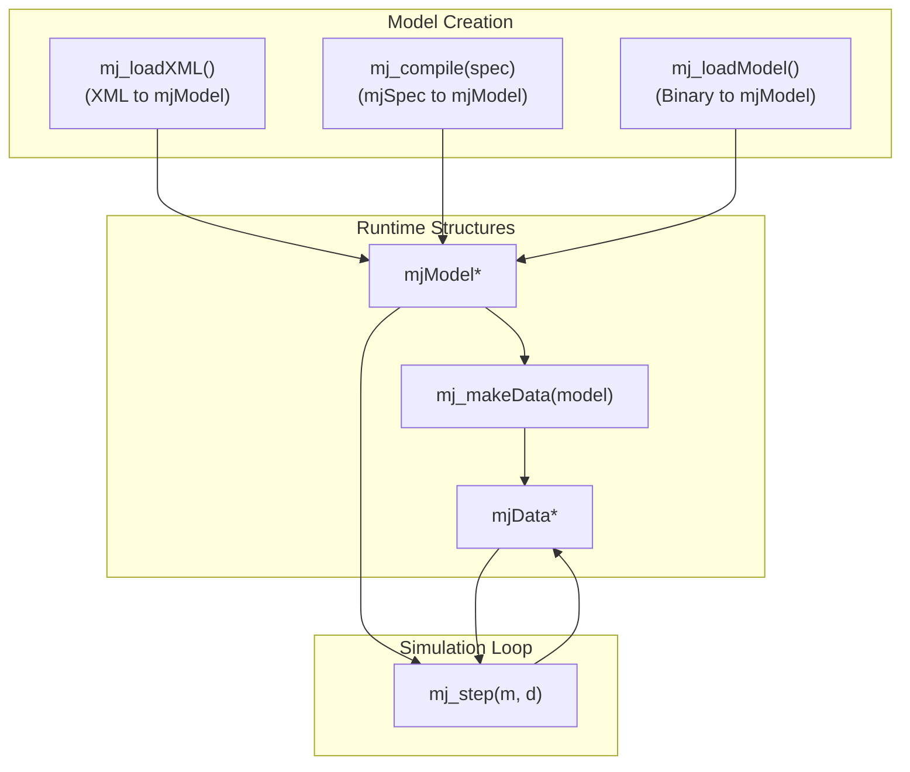

<!-- source: DeepWiki mcp.deepwiki.com · repo google-deepmind/mujoco · page 1 Overview · fetched 2026-10-26 -->

# Overview

Relevant source files

The following files were used as context for generating this wiki page:

- [CONTRIBUTING.md](CONTRIBUTING.md)
- [README.md](README.md)
- [cmake/CheckAvxSupport.cmake](cmake/CheckAvxSupport.cmake)
- [cmake/third_party_deps/lodepng.cmake](cmake/third_party_deps/lodepng.cmake)
- [cmake/third_party_deps/lodepng/CMakeLists.txt](cmake/third_party_deps/lodepng/CMakeLists.txt)
- [doc/APIreference/APIglobals.rst](doc/APIreference/APIglobals.rst)
- [doc/APIreference/functions.rst](doc/APIreference/functions.rst)
- [doc/APIreference/functions_override.rst](doc/APIreference/functions_override.rst)
- [doc/computation/index.rst](doc/computation/index.rst)
- [doc/includes/references.h](doc/includes/references.h)
- [doc/modeling.rst](doc/modeling.rst)
- [doc/overview.rst](doc/overview.rst)
- [doc/programming/simulation.rst](doc/programming/simulation.rst)
- [include/mujoco/mjdata.h](include/mujoco/mjdata.h)
- [include/mujoco/mjmodel.h](include/mujoco/mjmodel.h)
- [include/mujoco/mjspec.h](include/mujoco/mjspec.h)
- [include/mujoco/mjxmacro.h](include/mujoco/mjxmacro.h)
- [include/mujoco/mujoco.h](include/mujoco/mujoco.h)
- [python/MANIFEST.in](python/MANIFEST.in)
- [python/README.md](python/README.md)
- [python/make_sdist.sh](python/make_sdist.sh)
- [python/mujoco/callbacks.cc](python/mujoco/callbacks.cc)
- [python/mujoco/enums.cc](python/mujoco/enums.cc)
- [python/mujoco/errors.cc](python/mujoco/errors.cc)
- [python/mujoco/errors.h](python/mujoco/errors.h)
- [python/mujoco/experimental/studio/web/CMakeLists.txt](python/mujoco/experimental/studio/web/CMakeLists.txt)
- [python/mujoco/gil.h](python/mujoco/gil.h)
- [python/mujoco/introspect/functions.py](python/mujoco/introspect/functions.py)
- [python/mujoco/introspect/structs.py](python/mujoco/introspect/structs.py)
- [python/mujoco/util/crossplatform.h](python/mujoco/util/crossplatform.h)
- [src/engine/engine_io.c](src/engine/engine_io.c)
- [src/engine/engine_io.h](src/engine/engine_io.h)
- [src/engine/engine_print.c](src/engine/engine_print.c)
- [test/engine/engine_io_test.cc](test/engine/engine_io_test.cc)
- [unity/Runtime/Bindings/MjBindings.cs](unity/Runtime/Bindings/MjBindings.cs)

This page provides a high-level introduction to the MuJoCo physics engine architecture, core concepts, and major subsystems. It outlines the fundamental data structures, API organization, and system components that form the foundation of MuJoCo's physics simulation capabilities.

For detailed information about specific foundational topics, see the child pages:
- [Key Concepts](#1.1) — Fundamental concepts including mjModel vs mjData separation, state representation, forward dynamics, and the compilation pipeline
- [Build System and Dependencies](#1.2) — CMake build configuration, external dependencies (Eigen, Abseil, pybind11, Filament, OpenUSD), options files, and how to build MuJoCo from source
- [Testing, Benchmarks, and CI](#1.3) — GoogleTest-based C++ tests, test fixtures, benchmark suite, Bazel/CMake test targets, and GitHub Actions CI/release workflows

---

## What is MuJoCo

**MuJoCo** stands for **Mu**lti-**Jo**int dynamics with **Co**ntact. It is a general-purpose physics engine designed to facilitate research and development in robotics, biomechanics, graphics and animation, machine learning, and other areas requiring fast and accurate simulation of articulated structures interacting with their environment.

MuJoCo is implemented primarily as a C/C++ library exposing a C API tailored for high performance. It operates directly on low-level data structures preallocated by an internal compiler. The runtime simulation engine is optimized for speed and accuracy, while also exposing numerous utility functions for physics-related computations. Model definitions are typically given in MuJoCo's native MJCF XML format or imported from URDF files, which are parsed and compiled into efficient runtime data structures [include/mujoco/mujoco.h:128-157]().

Sources: [README.md:17-31](), [doc/overview.rst:7-25](), [include/mujoco/mujoco.h:128-157]()

---

## System Architecture

MuJoCo’s architecture is layered to cleanly separate model definition, compilation, and simulation runtime. The figure below summarizes these layers and the data flows between them.

### Overall System Layers and Data Flow

Sources: [doc/overview.rst:84-106](), [doc/modeling.rst:43-57](), [include/mujoco/mujoco.h:125-161]()

---

## Core Data Structures

MuJoCo relies on three primary data structures that separate static model properties from dynamic simulation state:

| Structure | Purpose | Mutability | Applicable Phase |
|:---------:|---------|------------|------------------|
| `mjSpec`  | High-level model specification | Editable | Compiler-time [include/mujoco/mujoco.h:133-146]() |
| `mjModel` | Compiled, optimized model | Read-only | Runtime [include/mujoco/mujodel.h:79-124]() |
| `mjData`  | Simulation state and workspace | Mutable | Runtime [include/mujoco/mjdata.h:99-150]() |

For detailed information on the separation of `mjModel` and `mjData`, memory layout, state representation, and forward dynamics, see [Key Concepts](#1.1).

Sources: [include/mujoco/mjspec.h:33-33](), [include/mujoco/mjmodel.h:79-124](), [include/mujoco/mjdata.h:99-150]()

---

## Key API Functions

MuJoCo’s C API provides functions for model loading, compilation, state management, and simulation stepping [include/mujoco/mujoco.h:126-164]().

### Model Creation and Compilation Pipeline

Sources: [include/mujoco/mujoco.h:126-172](), [doc/APIreference/functions.rst:10-30]()

---

## Further Exploration

For more details on building the codebase, configuring CMake, managing third-party dependencies (such as Eigen, Abseil, pybind11, Filament, and OpenUSD), running the GoogleTest suite, benchmarks, and CI pipelines, please refer to the child pages:
- [Key Concepts](#1.1)
- [Build System and Dependencies](#1.2)
- [Testing, Benchmarks, and CI](#1.3)

Sources: [README.md:1-100]()

---

