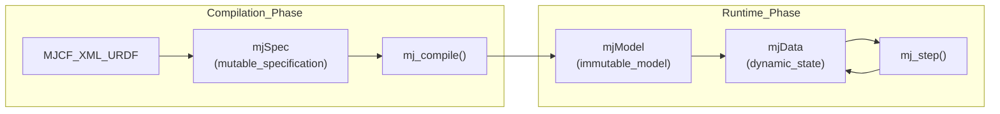
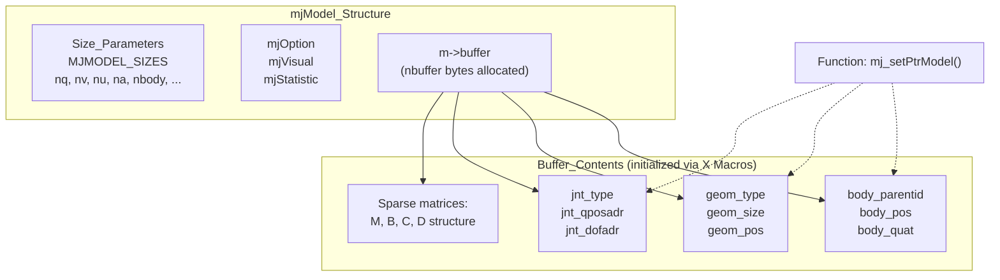
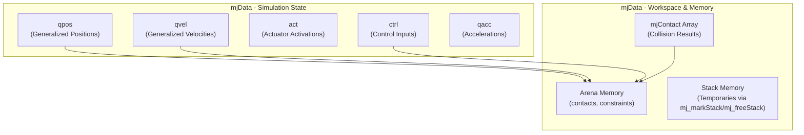
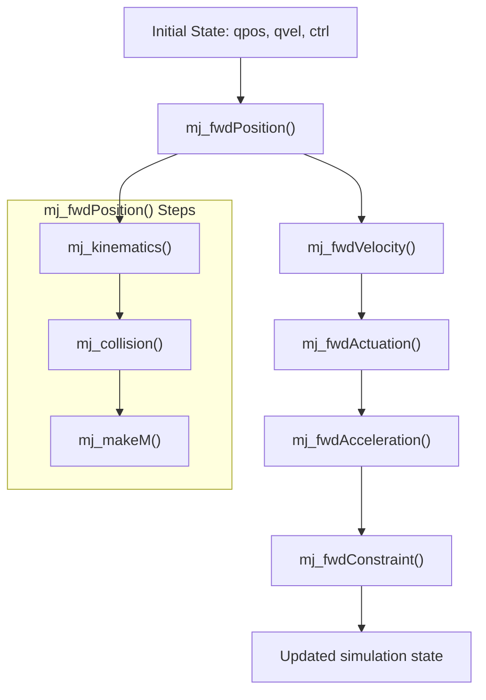

<!-- source: DeepWiki mcp.deepwiki.com · repo google-deepmind/mujoco · page 1.1 Key Concepts · fetched 2026-10-26 -->

# Key Concepts

<details>
<summary>Relevant source files</summary>

The following files were used as context for generating this wiki page:

- [doc/APIreference/APIglobals.rst](doc/APIreference/APIglobals.rst)
- [doc/APIreference/functions.rst](doc/APIreference/functions.rst)
- [doc/APIreference/functions_override.rst](doc/APIreference/functions_override.rst)
- [doc/computation/index.rst](doc/computation/index.rst)
- [doc/includes/references.h](doc/includes/references.h)
- [doc/modeling.rst](doc/modeling.rst)
- [doc/overview.rst](doc/overview.rst)
- [doc/programming/simulation.rst](doc/programming/simulation.rst)
- [include/mujoco/mjdata.h](include/mujoco/mjdata.h)
- [include/mujoco/mjmodel.h](include/mujoco/mjmodel.h)
- [include/mujoco/mjspec.h](include/mujoco/mjspec.h)
- [include/mujoco/mjxmacro.h](include/mujoco/mjxmacro.h)
- [include/mujoco/mujoco.h](include/mujoco/mujoco.h)
- [python/mujoco/introspect/functions.py](python/mujoco/introspect/functions.py)
- [python/mujoco/introspect/structs.py](python/mujoco/introspect/structs.py)
- [src/engine/engine_io.c](src/engine/engine_io.c)
- [src/engine/engine_io.h](src/engine/engine_io.h)
- [src/engine/engine_print.c](src/engine/engine_print.c)
- [test/engine/engine_io_test.cc](test/engine/engine_io_test.cc)
- [unity/Runtime/Bindings/MjBindings.cs](unity/Runtime/Bindings/MjBindings.cs)

</details>


## Purpose and Scope

This page explains the fundamental architectural concepts of MuJoCo that are essential for understanding the codebase. It covers the separation between static model data (`mjModel`) and dynamic simulation state (`mjData`), the compilation workflow, state representation, and the forward dynamics pipeline. 

For details on model creation and editing, see [Model Definition Pipeline](2). For runtime simulation APIs, see [C and Python APIs](5). For the physics engine implementation, see [Physics Simulation Pipeline](4).

---

## The Two-Phase Architecture: Compilation vs Runtime

MuJoCo's core architecture separates model specification from execution through a two-phase system:

**Diagram: Two-Phase Model Lifecycle**


Sources: [include/mujoco/mujoco.h:128-164](), [include/mujoco/mjmodel.h:49-125](), [include/mujoco/mjdata.h:99-149]()

### Phase 1: Compilation (mjSpec → mjModel)

`mjSpec` is a high-level, mutable, editable representation of a model, used as an intermediate representation before compilation [include/mujoco/mjspec.h:1-100](). It can be created by:
- Parsing XML files via `mj_parseXML()` [include/mujoco/mujoco.h:136]()
- Parsing XML strings via `mj_parseXMLString()` [include/mujoco/mujoco.h:140]()

The compilation process transforms `mjSpec` into `mjModel` via `mj_compile()` [include/mujoco/mujoco.h:156](). Key compilation steps include:
- Computing memory requirements, element sizes, and buffer sizes [src/engine/engine_io.c:177-224]()
- Allocating and initializing a contiguous memory buffer for model data and arrays
- Processing assets such as meshes, textures, and heightfields
- Building sparse matrix structures for efficient dynamics computation
- Performing validation and error checking; errors reported via `mjs_getError()` [doc/APIreference/functions.rst:84-86]()

### Phase 2: Runtime (mjModel + mjData)

At runtime, the compiled `mjModel` contains the static, read-only description of the physical model:
- Defines all model parameters: bodies, joints, geometries, actuators, sensors, and dynamics matrices [include/mujoco/mjxmacro.h:160-214]()
- Preallocates buffers for data arrays and sparse matrix storage [src/engine/engine_io.c:145-174]()

The simulation state is stored and advanced in `mjData`, created from an `mjModel`:
- Holds dynamic state vectors such as positions (`qpos`), velocities (`qvel`), actuator states (`act`), controls (`ctrl`), accelerations (`qacc`) [include/mujoco/mjdata.h:99-149]()
- Contains workspace buffers and arena memory for intermediate quantities and contacts [include/mujoco/mjdata.h:100-111]()
- Stores contact and constraint data computed during collision detection and constraint solving [include/mujoco/mjdata.h:29-69]()

Sources: [src/engine/engine_io.c:145-174](), [include/mujoco/mjdata.h:99-149]()

---

## mjModel: Static Model Description

**Diagram: mjModel Memory Layout and Buffer Initialization**


Sources: [src/engine/engine_io.c:145-174](), [include/mujoco/mjxmacro.h:160-214]()

### Key Characteristics

- **Immutability**: After compilation, `mjModel` is not modified during runtime. Structural changes require recompiling the `mjSpec` or using `mj_recompile()` which updates `mjModel` and `mjData` in place while preserving simulation state [include/mujoco/mujoco.h:163]().

- **Buffer-Based Layout**: All array data is stored contiguously within the `m->buffer` region for cache efficiency. Pointer members of `mjModel` are initialized at fixed offsets with 64-byte alignment using the `SKIP` macro [src/engine/engine_io.c:135-174]():

```c
// Example of pointer assignment in mj_setPtrModel():
m->name = (type*)(ptr + SKIP((intptr_t)ptr));
ptr += SKIP((intptr_t)ptr) + sizeof(type) * (m->nr) * (nc);
```

### Size Parameters

The `mjModel` contains multiple integer size fields that specify counts of model elements. These are enumerated in the `MJMODEL_SIZES` macro [include/mujoco/mjxmacro.h:162-214]():

| Category            | Examples                          |
|---------------------|---------------------------------|
| **Degrees of Freedom** | `nq` (position dimension), `nv` (velocity dimension), `nu` (controls), `na` (activations) |
| **Elements**          | `nbody`, `njnt` (joints), `ngeom` (geoms), `nsite`, `ncam` (cameras), `nlight`            |
| **Sparse Matrices**   | `nM`, `nB`, `nC`, `nD` (sizes of dynamics and constraint matrices)                      |
| **Assets**            | `nmesh`, `nhfield`, `ntex`, `nmat`                                                    |
| **Constraints**       | `neq` (equalities), `ntendon`, `npair`, `nexclude`                                    |

Sources: [src/engine/engine_io.c:135-174](), [include/mujoco/mjxmacro.h:160-214]()

---

## mjData: Dynamic State and Workspace

**Diagram: mjData Organization and State Vectors**


Sources: [include/mujoco/mjdata.h:99-149](), [doc/includes/references.h:19-67]()

### State Components (mjtState)

MuJoCo defines state components for fine-grained state management. The `mjtState` enumeration marks different parts of the integrator state that can be extracted or set [doc/includes/references.h:19-28]():

| State Flag        | Description                     |
|-------------------|--------------------------------|
| `mjSTATE_TIME`    | Simulation time                |
| `mjSTATE_QPOS`    | Generalized joint positions   |
| `mjSTATE_QVEL`    | Generalized joint velocities  |
| `mjSTATE_ACT`     | Actuator activations          |
| `mjSTATE_CTRL`    | Control inputs                |
| `mjSTATE_WARMSTART` | Constraint solver warmstart accelerations |

These are used in functions like `mj_getState()` and `mj_setState()` to manipulate simulation state snapshots [doc/includes/references.h:19-28]()

### Memory Management

`mjData` uses multiple memory regions and strategies:

| Memory Region      | Purpose                                       | Allocation Method                   |
|--------------------|-----------------------------------------------|-----------------------------------|
| `buffer`           | Fixed-size state arrays and workspace buffers | Allocated at creation; contiguous |
| `arena`            | Variable-size data such as contacts, constraints | Dynamic, grows as needed up to allowed arena size |
| `stack`            | Temporary workspace within computations         | Push/pop semantics via `mj_markStack()` and `mj_freeStack()` |

This layout allows efficient management of memory with minimal allocation overhead during simulation steps [include/mujoco/mjdata.h:99-111]()

Sources: [include/mujoco/mjdata.h:99-149]()

---

## Forward Dynamics Pipeline

MuJoCo advances simulation using a modular five-stage forward dynamics pipeline implemented in `mj_forward()` [doc/APIreference/functions.rst:178-188]():

**Diagram: Five-Stage Forward Dynamics Pipeline**


Sources: [doc/APIreference/functions.rst:178-188]()

### Stage Descriptions and Dependencies

| Stage            | Dependencies           | Computes                                      | Updated `mjData` Fields                      |
|------------------|-----------------------|-----------------------------------------------|----------------------------------------------|
| **Position**     | Initial `qpos`         | Forward kinematics, collision detection, inertia computations, contact and constraint instantiation | Positions of bodies/geoms, mass matrix `M`, contacts, constraints data |
| **Velocity**     | After position, `qvel` | Bias forces, passive forces, velocity-related Jacobians | `qfrc_bias`, `qfrc_passive`, velocity Jacobians |
| **Actuation**    | Velocity and `ctrl`    | Actuator forces and input processing          | `actuator_force`, `qfrc_actuator`             |
| **Acceleration** | Actuation stage output | Unconstrained accelerations from dynamics     | `qacc_smooth`, `qfrc_smooth`                  |
| **Constraint**   | Acceleration stage output| Constraint forces solve and projection onto state accelerations | `efc_force`, `qfrc_constraint`, updated `qacc`|

Integration then advances states, using e.g. implicit Euler [doc/APIreference/functions.rst:178-188](), [doc/includes/references.h:68-84]()

---

## Coordinate Representations

MuJoCo uses mixed representations for state variables to balance efficiency and accuracy [include/mujoco/mjmodel.h:162-167]():

### Position (qpos) — Mixed Representations

| Joint Type   | qpos Dimension | Representation                  |
|--------------|----------------|---------------------------------|
| Free joint (`mjJNT_FREE`) | 7              | 3D position + 4D quaternion (unit) |
| Ball joint (`mjJNT_BALL`) | 4              | Quaternion rotation only           |
| Slide/Hinge   | 1              | Single translation or angle       |

### Velocity (qvel) — Tangent Space Representation

| Joint Type   | qvel Dimension | Representation                   |
|--------------|----------------|----------------------------------|
| Free joint   | 6              | 3D linear velocity + 3D angular velocity |
| Ball joint   | 3              | 3D angular velocity only         |
| Slide/Hinge  | 1              | 1D linear or angular velocity    |

Because quaternions have unit-norm constraints, linear velocities are represented as tangent vectors to avoid singularities and over-parameterization. Therefore, `nq` (position vector length) is often larger than `nv` (velocity vector length) [include/mujoco/mjxmacro.h:162-164]().

Sources: [include/mujoco/mjmodel.h:162-167](), [include/mujoco/mjxmacro.h:162-164]()

---

## Options and Configuration

Global simulation parameters are controlled by the `mjOption` structure, described by the `MJOPTION_FIELDS` macro [include/mujoco/mjxmacro.h:23-52]().

### Examples of mjOption fields

| Category      | Example Fields                               |
|---------------|----------------------------------------------|
| Physics       | `timestep`, `gravity`, `density`, `viscosity` |
| Solver        | `integrator` (e.g. Euler, RK4), `solver` (e.g. PGS), `iterations`, `tolerance` |
| Contact       | `impratio` (friction-to-normal impedance ratio), `noslip_tolerance`                        |
| Flags         | `disableflags` (`mjtDisableBit`), `enableflags` (`mjtEnableBit`) |

### Common Disable Flags (`mjtDisableBit` Enum)

| Flag                 | Effect                                  |
|----------------------|-----------------------------------------|
| `mjDSBL_CONSTRAINT`   | Disable the entire constraint solver    |
| `mjDSBL_CONTACT`      | Disable contact constraint processing   |
| `mjDSBL_FRICTIONLOSS` | Disable frictional energy loss          |
| `mjDSBL_LIMIT`        | Disable joint limit constraints          |

These flags allow fine tuning of simulation features to improve performance or debug behavior [unity/Runtime/Bindings/MjBindings.cs:129-151]().

Sources: [include/mujoco/mjxmacro.h:23-52](), [unity/Runtime/Bindings/MjBindings.cs:129-151]()

---

# Summary

MuJoCo cleanly separates the model specification and compilation phase from runtime simulation. Static data is stored in an immutable `mjModel` memory buffer allocated and aligned in bulk, while mutable dynamic simulation state uses `mjData`. The runtime physics engine advances the simulation using a well-defined multi-stage forward dynamics pipeline. This architecture enables efficient simulation while allowing flexible model editing via the `mjSpec` intermediate representation and recompilation.

---

Sources:

- include/mujoco/mujoco.h:128-164
- include/mujoco/mjmodel.h:49-125, 162-167
- include/mujoco/mjxmacro.h:23-52, 160-214
- include/mujoco/mjdata.h:29-149
- doc/includes/references.h:19-84
- src/engine/engine_io.c:135-174, 177-224
- doc/APIreference/functions.rst:84-86, 178-188
- unity/Runtime/Bindings/MjBindings.cs:129-151

---

