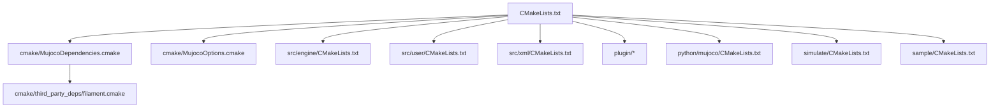
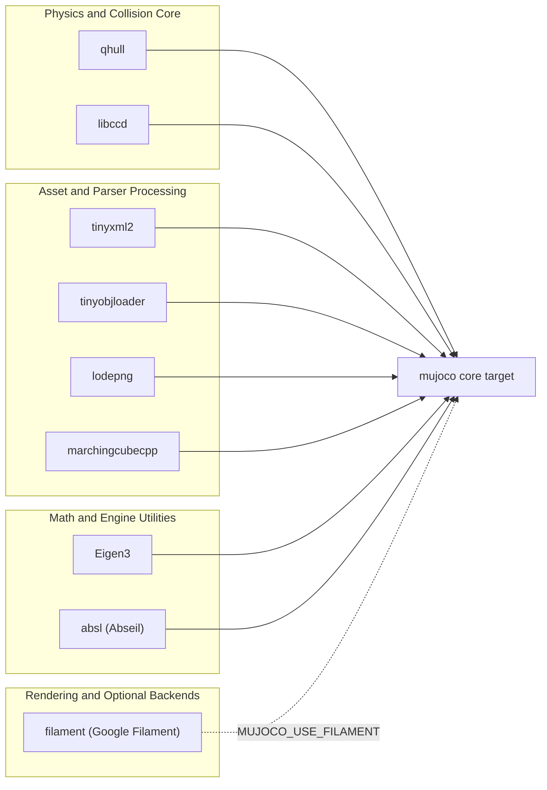
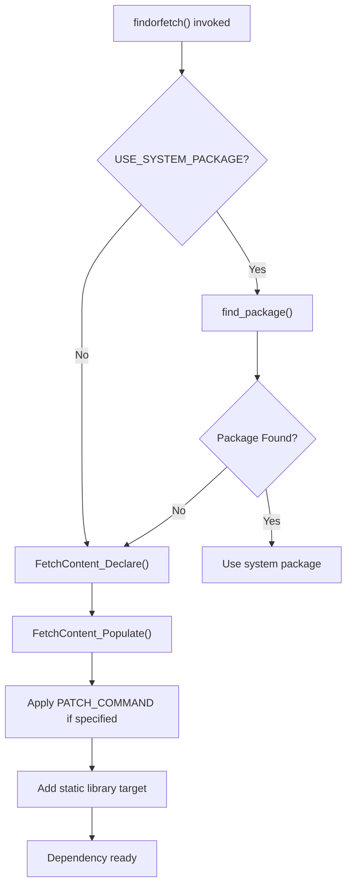

<!-- source: DeepWiki mcp.deepwiki.com · repo google-deepmind/mujoco · page 1.2 Build System and Dependencies · fetched 2026-10-26 -->

# Build System and Dependencies

<details>
<summary>Relevant source files</summary>

The following files were used as context for generating this wiki page:

- [CMakeLists.txt](CMakeLists.txt)
- [cmake/FindOrFetch.cmake](cmake/FindOrFetch.cmake)
- [cmake/MujocoDependencies.cmake](cmake/MujocoDependencies.cmake)
- [cmake/MujocoOptions.cmake](cmake/MujocoOptions.cmake)
- [cmake/filament-allow-clang-windows.patch](cmake/filament-allow-clang-windows.patch)
- [cmake/libwebp-apple-float16.patch](cmake/libwebp-apple-float16.patch)
- [cmake/third_party_deps/dear_imgui.cmake](cmake/third_party_deps/dear_imgui.cmake)
- [cmake/third_party_deps/filament.cmake](cmake/third_party_deps/filament.cmake)
- [cmake/third_party_deps/font_awesome.cmake](cmake/third_party_deps/font_awesome.cmake)
- [cmake/third_party_deps/font_awesome/CMakeLists.txt](cmake/third_party_deps/font_awesome/CMakeLists.txt)
- [cmake/third_party_deps/implot.cmake](cmake/third_party_deps/implot.cmake)
- [cmake/third_party_deps/libwebp.cmake](cmake/third_party_deps/libwebp.cmake)
- [dist/mujoco.rc](dist/mujoco.rc)
- [dist/simulate.rc](dist/simulate.rc)
- [doc/unity.rst](doc/unity.rst)
- [python/mujoco/CMakeLists.txt](python/mujoco/CMakeLists.txt)
- [python/mujoco/experimental/dear_imgui/dear_imgui.cc](python/mujoco/experimental/dear_imgui/dear_imgui.cc)
- [python/mujoco/experimental/dear_imgui/dear_imgui_macros.h](python/mujoco/experimental/dear_imgui/dear_imgui_macros.h)
- [python/mujoco/experimental/implot/LICENSE-2.0.txt](python/mujoco/experimental/implot/LICENSE-2.0.txt)
- [python/mujoco/experimental/implot/implot.cc](python/mujoco/experimental/implot/implot.cc)
- [python/mujoco/experimental/studio/viewer_app_events.py](python/mujoco/experimental/studio/viewer_app_events.py)
- [sample/CMakeLists.txt](sample/CMakeLists.txt)
- [sample/cmake/FindOrFetch.cmake](sample/cmake/FindOrFetch.cmake)
- [sample/cmake/SampleOptions.cmake](sample/cmake/SampleOptions.cmake)
- [simulate/CMakeLists.txt](simulate/CMakeLists.txt)
- [simulate/cmake/FindOrFetch.cmake](simulate/cmake/FindOrFetch.cmake)
- [simulate/cmake/SimulateOptions.cmake](simulate/cmake/SimulateOptions.cmake)
- [src/engine/engine_support.c](src/engine/engine_support.c)
- [unity/Editor/Bindings/MujocoBinaryRetriever.cs](unity/Editor/Bindings/MujocoBinaryRetriever.cs)
- [unity/package.json](unity/package.json)

</details>


## Purpose and Scope

This document provides a comprehensive technical overview of the MuJoCo build infrastructure based on CMake. It covers the configuration of the build system, management of external dependencies (such as Eigen, Abseil, pybind11, Filament, and OpenUSD), platform-specific considerations, Unity binary retrieval, and instructions on how to build MuJoCo from source. The page also outlines specific targets and their relationships, including core engine libraries, Python bindings, and UI applications.

Sources: [CMakeLists.txt:1-53](), [cmake/MujocoDependencies.cmake:1-15]()

## Build System Overview

MuJoCo employs a modular CMake setup (requiring at least CMake 3.16), split into distinct directories for the physics core, user-level APIs, XML parsing, plugins, visualization, Python bindings, sample programs, and WebAssembly targets. This modularity simplifies organization and allows selective builds of components via options defined in `CMakeLists.txt` [CMakeLists.txt:42-52]().

The root `CMakeLists.txt` defines the overarching `mujoco` project and includes important CMake modules for dependency resolution, compiler options, macOS platform handling, and security hardening [CMakeLists.txt:30-113]().

### CMake Project Structure



**Diagram 1: MuJoCo CMake Project Structure and Code Entities**

The project sets up key CMake policies for modern behavior, including policies related to `INTERPROCEDURAL_OPTIMIZATION` and shared library builds (`CMP0069`, `CMP0072`, `CMP0077`) [CMakeLists.txt:18-26](). It also configures compiler standard requirements and visibility settings for symbol exports [python/mujoco/CMakeLists.txt:38-40]().

Sources: [CMakeLists.txt:1-180](), [cmake/MujocoDependencies.cmake:1-74]()

## Core Build Targets

| Target Name | Target Type | Description | Output Artifact / Location |
|-------------|-------------|-------------|----------------------------|
| `mujoco` | Shared library (or static on WASM) | Core MuJoCo physics engine | `libmujoco.so`, `mujoco.dll`, or `libmujoco.3.17.0.dylib` [CMakeLists.txt:144-146](), [python/mujoco/CMakeLists.txt:90-126]() |
| `simulate` | Executable | Interactive simulation viewer binary | `simulate` binary or macOS `.app` bundle [simulate/CMakeLists.txt:141-174]() |
| `platform_ui_adapter` | Object library | Platform abstraction layer for GLFW and windowing | Object files [simulate/CMakeLists.txt:83-103]() |
| `libmujoco_simulate` | Static library | Simulate library containing platform UI adapter and UI logic | `libmujoco_simulate.a` / `simulate.lib` [simulate/CMakeLists.txt:105-124]() |
| `compile`, `basic`, `record`, `testspeed` | Executables | Sample programs demonstrating API usage | Standalone binaries in `sample/` [sample/CMakeLists.txt:75-115]() |
| `mujoco_python` | Shared modules | Python bindings modules built via pybind11 | Python `.so` / `.pyd` modules [python/mujoco/CMakeLists.txt:15-95]() |

Sources: [CMakeLists.txt:137-180](), [simulate/CMakeLists.txt:40-190](), [sample/CMakeLists.txt:70-120](), [python/mujoco/CMakeLists.txt:80-200]()

---

# External Dependencies

MuJoCo integrates several third-party libraries to handle diverse functionality such as image loading, mesh parsing, collision detection, linear algebra, and advanced rendering. These dependencies are either found on the system or fetched and built statically if needed via `cmake/MujocoDependencies.cmake` and specialized modules.

### Overview of Core Dependencies and Rendering Backends



**Diagram 2: MuJoCo Dependencies and Renderer Integration**

#### Details on Key Dependencies

- **qhull**: Provides convex hull computations essential for collision mesh processing [cmake/MujocoDependencies.cmake:33-36](). Includes internal handling for `libqhull_r` sources [cmake/MujocoDependencies.cmake:124-128]().
- **libccd**: Implements GJK and EPA algorithms for narrow-phase collision detection [cmake/MujocoDependencies.cmake:29-32](). Configured with `ENABLE_DOUBLE_PRECISION` depending on `mjUSESINGLE` [cmake/MujocoDependencies.cmake:176-181]().
- **tinyxml2**: Tiny and efficient XML parser used for processing MJCF and other XML assets [cmake/MujocoDependencies.cmake:132-147]().
- **tinyobjloader**: Parses OBJ mesh files used in model assets [cmake/MujocoDependencies.cmake:156-170]().
- **lodepng**: PNG image loading library for textures and rendering utilities [cmake/MujocoDependencies.cmake:86]().
- **MarchingCubeCpp**: Maintains code for converting signed distance fields (SDF) into triangle meshes [cmake/MujocoDependencies.cmake:25-28]().
- **Eigen3**: The primary linear algebra library for matrix and vector operations [cmake/MujocoDependencies.cmake:41-44]().
- **Abseil (`absl`)**: Provides common C++ utility components like `flat_hash_map`, `span`, and synchronization primitives [cmake/MujocoDependencies.cmake:46-49]().
- **Filament**: Google's real-time physically based rendering engine, enabled via `-DMUJOCO_USE_FILAMENT=ON` [CMakeLists.txt:49](), managed via [cmake/third_party_deps/filament.cmake:1-83]().
- **OpenUSD**: Experimental OpenUSD support enabled via `-DMUJOCO_WITH_USD=ON` [CMakeLists.txt:48]().

Sources: [cmake/MujocoDependencies.cmake:10-230](), [cmake/third_party_deps/filament.cmake:1-83](), [python/mujoco/CMakeLists.txt:130-200]()

---

# Dependency Resolution and Fetching

MuJoCo employs an intelligent CMake macro (`findorfetch`) that attempts to locate a dependency system-wide or else downloads, patches, and builds a specified version automatically using CMake's `FetchContent`. This mechanism provides flexibility between using system installations and ensuring consistent, pinned dependency versions.

### Dependency Resolution Flow



**Diagram 3: Dependency Resolution Flow via FindOrFetch**

Additionally, to ensure static linking of external dependencies, the build system overrides the CMake variable `BUILD_SHARED_LIBS` to `OFF` during dependency fetch and build to avoid shared library incompatibilities [cmake/MujocoDependencies.cmake:80-84]().

Sources: [cmake/MujocoDependencies.cmake:71-123]()

---

# Compilation Configuration and Compiler Settings

## Compiler Standards and Language Support

- MuJoCo requires **C++17** as the minimum standard on most platforms, enabled via `set(CMAKE_CXX_STANDARD 17)` [python/mujoco/CMakeLists.txt:32]().  
- On Windows, if MSVC version is 1927 or higher, C++20 is enabled to support features like forced inline lambdas (`/Gy /Gw /Oi`) [python/mujoco/CMakeLists.txt:29-33]().

```cmake
if(MSVC AND MSVC_VERSION GREATER_EQUAL 1927)
  set(CMAKE_CXX_STANDARD 20) # For forceinline lambdas.
else()
  set(CMAKE_CXX_STANDARD 17)
endif()
set(CMAKE_CXX_STANDARD_REQUIRED ON)
set(CMAKE_CXX_EXTENSIONS OFF)
```

## Symbol Visibility and Compilation Flags

- The build presets symbol visibility to hidden for both C and C++ to reduce exported symbols and improve linking times:  
  `CMAKE_C_VISIBILITY_PRESET hidden` and `CMAKE_CXX_VISIBILITY_PRESET hidden` [python/mujoco/CMakeLists.txt:38-39]().
- Position-independent code is enforced globally with `set(CMAKE_POSITION_INDEPENDENT_CODE ON)` [python/mujoco/CMakeLists.txt:37]().

Sources: [python/mujoco/CMakeLists.txt:15-70]()

## SIMD and AVX Intrinsics

MuJoCo is optimized through SIMD instructions. The macro guard `mjUSEPLATFORMSIMD` enables AVX intrinsics if supported on the platform and build mode [src/engine/engine_support.c:37-42]():

```c
#ifdef mjUSEPLATFORMSIMD
  #if defined(__AVX__) && !defined(mjUSESINGLE)
    #define mjUSEAVX
    #include "immintrin.h"
  #endif
#endif
```

This conditional inclusion allows vectorized operations for better performance, provided the compiler and platform support these extensions.

Sources: [src/engine/engine_support.c:37-42](), [CMakeLists.txt:185-188]()

---

# Hardening and Security Options

The build system optionally enables security hardening flags via the `MujocoHarden` CMake module [python/mujoco/CMakeLists.txt:68-70](). This includes:

- On **Windows**: linker option `/DYNAMICBASE` enabling ASLR (Address Space Layout Randomization) [simulate/CMakeLists.txt:68]().
- On **Linux/macOS**: compile and link with `-fPIE -fPIC` and `-pie` options for position-independent executables [simulate/CMakeLists.txt:70-74]().
- On **macOS**, Objective-C and Objective-C++ languages are enabled for UI and rendering components where needed, such as CoreVideo integration [simulate/CMakeLists.txt:35-38]().

Sources: [simulate/CMakeLists.txt:66-77](), [python/mujoco/CMakeLists.txt:68-70]()

---

# Platform-Specific Considerations and Unity Integration

## Windows

- Uses resource files (`dist/mujoco.rc` and `dist/simulate.rc`) to embed version information, company name, and product descriptions into `mujoco.dll` and `simulate.exe` [dist/mujoco.rc:1-25](), [dist/simulate.rc:1-27]().

## macOS

- Supports building MuJoCo as a `.framework` bundle.  
- The build system detects installed `mujoco.framework` and configures include paths using `-F` framework search paths instead of normal include directories [python/mujoco/CMakeLists.txt:97-120]().

## WebAssembly (Emscripten)

- Emscripten builds are restricted to **static libraries** since dynamic shared libraries are not supported by Emscripten [CMakeLists.txt:141-147]().
- Multi-threading support is conditionally enabled by adding `-pthread` flags when `MUJOCO_WASM_THREADS` is active [CMakeLists.txt:58-63]().
- Cross-compilation requires a separate native host build directory (`MUJOCO_NATIVE_BUILD_DIR`) for asset processor tools (`matc`, `resgen`, `cmgen`) [CMakeLists.txt:77-98]().

## Unity Plugin & Binary Retrieval

The Unity plug-in (`unity/package.json`) integrates MuJoCo into the Unity Editor [unity/package.json:1-17](). The `MujocoBinaryRetriever` script (`unity/Editor/Bindings/MujocoBinaryRetriever.cs`) automatically locates and copies the platform-specific native binary (`mujoco.dll`, `libmujoco.so`, or `mujoco.dylib`) from user directories or application bundles into the Unity package path upon package registration [unity/Editor/Bindings/MujocoBinaryRetriever.cs:23-64]().

Sources: [CMakeLists.txt:40-99](), [dist/mujoco.rc:1-25](), [dist/simulate.rc:1-27](), [unity/package.json:1-17](), [unity/Editor/Bindings/MujocoBinaryRetriever.cs:23-64]()

---

# How to Build MuJoCo From Source

## Prerequisites

- CMake ≥ 3.16 (`MUJOCO_CMAKE_MIN_REQ`) [CMakeLists.txt:15]().
- C and C++ compiler supporting C++17 (or C++20 for recent MSVC) [python/mujoco/CMakeLists.txt:29-35]().
- Python 3 and development headers (for Python bindings) [python/mujoco/CMakeLists.txt:72]().

## Basic Build Steps

1. **Configure build**:

   ```bash
   mkdir build
   cd build
   cmake .. -DCMAKE_BUILD_TYPE=Release
   ```

2. **Build core library and tools**:

   - Build MuJoCo core physics library:

     ```bash
     cmake --build . --target mujoco
     ```

   - Build sample binaries:

     ```bash
     cmake --build . --target basic
     ```

   - Build simulation viewer:

     ```bash
     cmake --build . --target simulate
     ```

3. **Build Python bindings**:

   The Python binding project located in `python/mujoco/CMakeLists.txt` depends on the built core MuJoCo library and pybind11 [python/mujoco/CMakeLists.txt:90-148]().

Sources: [CMakeLists.txt:40-180](), [python/mujoco/CMakeLists.txt:60-146](), [simulate/CMakeLists.txt:40-190]()

---

# Python Bindings Build Details

The Python bindings use pybind11 and Abseil libraries and require Python 3 interpreter and development components [python/mujoco/CMakeLists.txt:72]().

- Python 3 interpreter and headers are found via `find_package(Python3 COMPONENTS Interpreter Development)` [python/mujoco/CMakeLists.txt:72]().
- The build system detects whether the Python interpreter is "free-threaded" by querying `Py_GIL_DISABLED` via `sysconfig`, and defines the `Py_GIL_DISABLED` macro accordingly for static libraries [python/mujoco/CMakeLists.txt:77-85]().

Sources: [python/mujoco/CMakeLists.txt:60-200](), [cmake/MujocoDependencies.cmake:50-61]()

---

# References

- [CMakeLists.txt:1-180]()
- [cmake/MujocoDependencies.cmake:1-230]()
- [cmake/third_party_deps/filament.cmake:1-83]()
- [python/mujoco/CMakeLists.txt:1-200]()
- [simulate/CMakeLists.txt:1-190]()
- [sample/CMakeLists.txt:1-205]()
- [src/engine/engine_support.c:35-42]()
- [dist/mujoco.rc:1-25]()
- [dist/simulate.rc:1-27]()
- [unity/package.json:1-17]()
- [unity/Editor/Bindings/MujocoBinaryRetriever.cs:23-64]()

---

