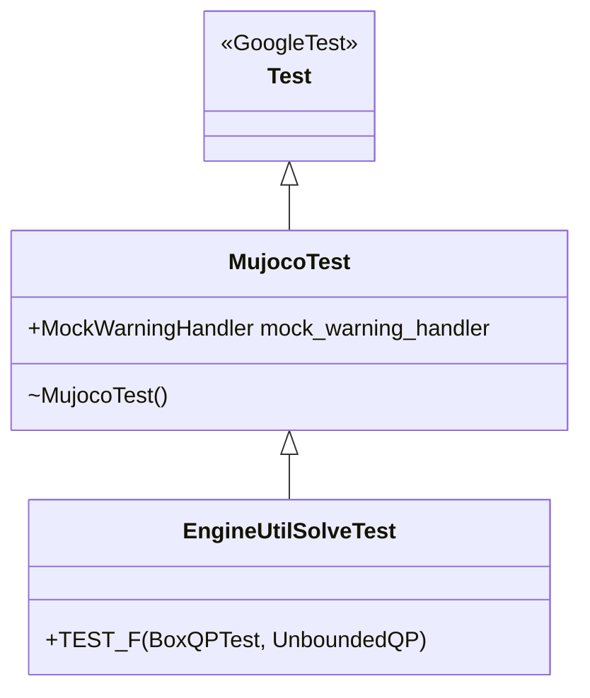
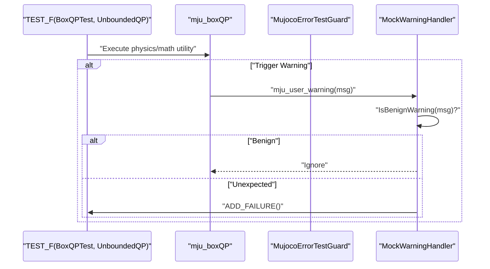
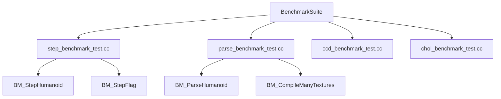
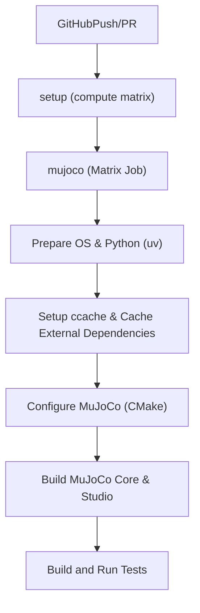

<!-- source: DeepWiki mcp.deepwiki.com · repo google-deepmind/mujoco · page 1.3 Testing, Benchmarks, and CI · fetched 2026-10-26 -->

# Testing, Benchmarks, and CI

<details>
<summary>Relevant source files</summary>

The following files were used as context for generating this wiki page:

- [.github/actions/notify-chat/action.yml](.github/actions/notify-chat/action.yml)
- [.github/actions/notify-chat/notify_chat.py](.github/actions/notify-chat/notify_chat.py)
- [.github/workflows/README.md](.github/workflows/README.md)
- [.github/workflows/build.yml](.github/workflows/build.yml)
- [.github/workflows/build_steps.sh](.github/workflows/build_steps.sh)
- [.github/workflows/lint.yml](.github/workflows/lint.yml)
- [.github/workflows/live.yml](.github/workflows/live.yml)
- [.github/workflows/publish-wasm.yml](.github/workflows/publish-wasm.yml)
- [.github/workflows/update_live.yml](.github/workflows/update_live.yml)
- [src/engine/engine_util_solve.c](src/engine/engine_util_solve.c)
- [src/engine/engine_util_solve.h](src/engine/engine_util_solve.h)
- [test/BUILD.bazel](test/BUILD.bazel)
- [test/benchmark/CMakeLists.txt](test/benchmark/CMakeLists.txt)
- [test/benchmark/ccd_benchmark_test.cc](test/benchmark/ccd_benchmark_test.cc)
- [test/benchmark/chol_benchmark_test.cc](test/benchmark/chol_benchmark_test.cc)
- [test/benchmark/engine_util_solve_benchmark_test.cc](test/benchmark/engine_util_solve_benchmark_test.cc)
- [test/benchmark/parse_benchmark_test.cc](test/benchmark/parse_benchmark_test.cc)
- [test/benchmark/step_benchmark_test.cc](test/benchmark/step_benchmark_test.cc)
- [test/benchmark/testdata/cache_hits.xml](test/benchmark/testdata/cache_hits.xml)
- [test/benchmark/testdata/highres_sphere.obj](test/benchmark/testdata/highres_sphere.obj)
- [test/benchmark/testdata/noise.png](test/benchmark/testdata/noise.png)
- [test/engine/BUILD.bazel](test/engine/BUILD.bazel)
- [test/engine/engine_util_solve_test.cc](test/engine/engine_util_solve_test.cc)
- [test/fixture.cc](test/fixture.cc)
- [test/fixture.h](test/fixture.h)
- [test/plugin/actuator/BUILD.bazel](test/plugin/actuator/BUILD.bazel)
- [test/plugin/elasticity/BUILD.bazel](test/plugin/elasticity/BUILD.bazel)
- [test/plugin/sensor/BUILD.bazel](test/plugin/sensor/BUILD.bazel)
- [test/user/BUILD.bazel](test/user/BUILD.bazel)
- [test/xml/BUILD.bazel](test/xml/BUILD.bazel)
- [test/xml/mjz/BUILD.bazel](test/xml/mjz/BUILD.bazel)
- [wasm/README.md](wasm/README.md)
- [wasm/tests/run_benchmarks.mjs](wasm/tests/run_benchmarks.mjs)
- [wasm/tests/run_tests.mjs](wasm/tests/run_tests.mjs)

</details>


This page documents the testing infrastructure, GoogleTest-based C++ tests, test fixtures, benchmarking suite, Bazel and CMake test targets, and GitHub Actions continuous integration and release workflows for MuJoCo.

## Purpose and Scope

MuJoCo maintains a comprehensive test suite to verify physics correctness, numerical accuracy, API stability, and performance across platforms (Linux, macOS, Windows, and WebAssembly). The test suite includes unit tests for engine utility functions, integration tests for the physics pipeline, model loading and parsing tests, benchmark targets, and regression tests.

Sources: [.github/workflows/build.yml](.github/workflows/build.yml), [test/fixture.h](.github/fixture.h)

---

## GoogleTest-based C++ Tests and Test Fixtures

MuJoCo uses GoogleTest and GoogleMock for C++ unit and integration testing. Test files are organized mirroring the source tree under the `test/` directory.

### The `MujocoTest` Fixture

Most C++ tests inherit from the `MujocoTest` fixture defined in `test/fixture.h`. This fixture manages global plugin loading, warning/error interception, and resource cleanups [test/fixture.h:169-190]().



*Figure 1: Test fixture inheritance hierarchy bridging GoogleTest base classes with MuJoCo test utilities.*

Sources: [test/fixture.h](.github/fixture.h), [test/fixture.cc](.github/fixture.cc), [test/engine/engine_util_solve_test.cc](.github/engine/engine_util_solve_test.cc)

### Error and Warning Interception

MuJoCo errors and warnings are intercepted during testing via `MujocoErrorTestGuard` and `MockWarningHandler`. By default, any unexpected warning or error causes a test failure unless explicitly handled or whitelisted as benign [test/fixture.cc:51-81]().



*Figure 2: Sequence flow for warning interception and validation in `MockWarningHandler`.*

Sources: [test/fixture.cc](.github/fixture.cc), [test/fixture.h](.github/fixture.h)

### Precision-Aware Tolerances

To support both double-precision (`mjtNum` as `double`) and single-precision (`mjUSESINGLE` float builds), MuJoCo test assertions use precision-aware matchers and scaling macros (`MjNear`, `MjTol`, `MjEps`) [test/fixture.h:78-121](). The environment variable `MJTOL_SCALE` can be set to scale test tolerances dynamically [test/fixture.h:53-73]().

Sources: [test/fixture.h](.github/fixture.h)

---

## Benchmark Suite

MuJoCo includes a comprehensive benchmarking suite built on the Google Benchmark library, located under `test/benchmark/`. Benchmarks cover physics stepping (`step_benchmark_test.cc`), XML parsing and compilation (`parse_benchmark_test.cc`), collision detection, and mathematical solvers [test/benchmark/CMakeLists.txt:16-104]().



*Figure 3: Structure of the Google Benchmark test targets and key routines.*

Sources: [test/benchmark/CMakeLists.txt](.github/benchmark/CMakeLists.txt), [test/benchmark/parse_benchmark_test.cc](.github/benchmark/parse_benchmark_test.cc), [test/benchmark/step_benchmark_test.cc](.github/benchmark/step_benchmark_test.cc)

---

## Build System Test Targets (Bazel and CMake)

MuJoCo supports both Bazel and CMake build systems. Tests are integrated as native test targets in both environments.

### CMake Test Integration

In CMake, tests are registered using custom helper macros like `mujoco_test` [test/benchmark/CMakeLists.txt:16-20](). CTest executes the resulting binaries.

```cmake
mujoco_test(
  step_benchmark_test
  MAIN_TARGET benchmark::benchmark_main
  ADDITIONAL_LINK_LIBRARIES benchmark::benchmark absl::core_headers
)
```
*Snippet: CMake test target definition from `test/benchmark/CMakeLists.txt`.*

Sources: [test/benchmark/CMakeLists.txt](.github/benchmark/CMakeLists.txt)

---

## GitHub Actions CI and Release Workflows

Continuous integration is managed through GitHub Actions workflows in `.github/workflows/`.

### Workflow Matrix and Build Steps

The main CI workflow (`build.yml`) triggers on pushes and pull requests [.github/workflows/build.yml:27-38](). It uses a dynamically generated build matrix (`build_matrix.json`) controlled by `build_steps.sh` [__github/workflows/build.yml:58-62](), [.github/workflows/build_steps.sh:38-54]().



*Figure 4: GitHub Actions CI pipeline execution flow.*

Sources: [.github/workflows/build.yml](.github/workflows/build.yml), [.github/workflows/build_steps.sh](.github/workflows/build_steps.sh)

### WASM and Release Publication

Dedicated workflows handle WebAssembly builds and publishing, such as `publish-wasm.yml` which triggers on version tags to build and package the JS/WASM bindings [__github/workflows/publish-wasm.yml:1-54]().

Sources: [.github/workflows/publish-wasm.yml](.github/workflows/publish-wasm.yml), [wasm/README.md](wasm/README.md)

---

