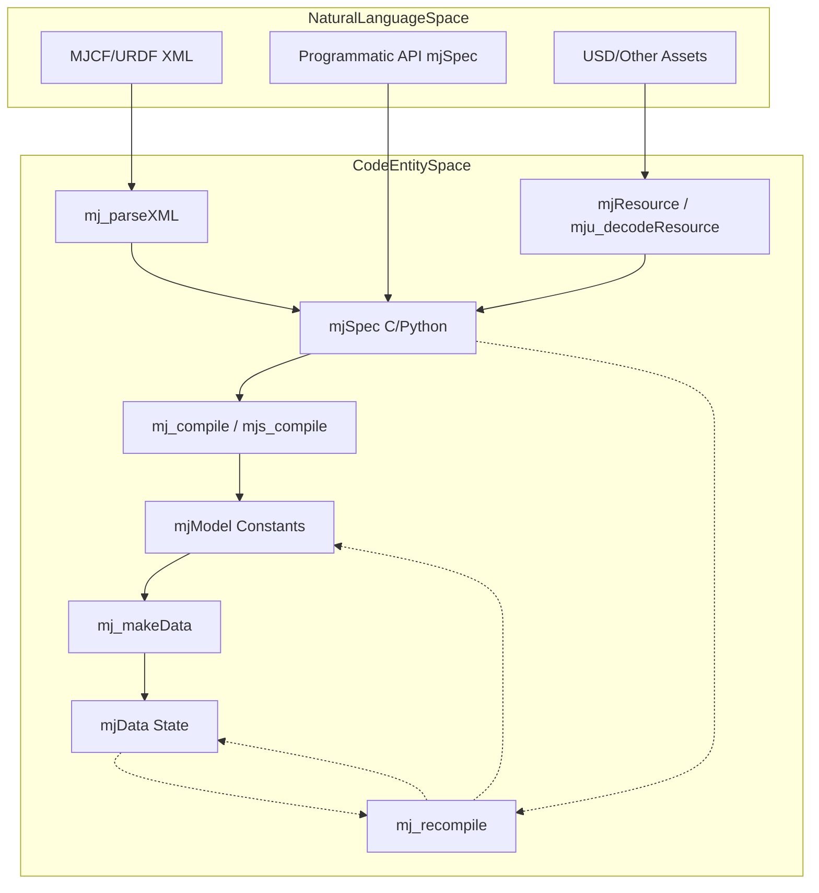
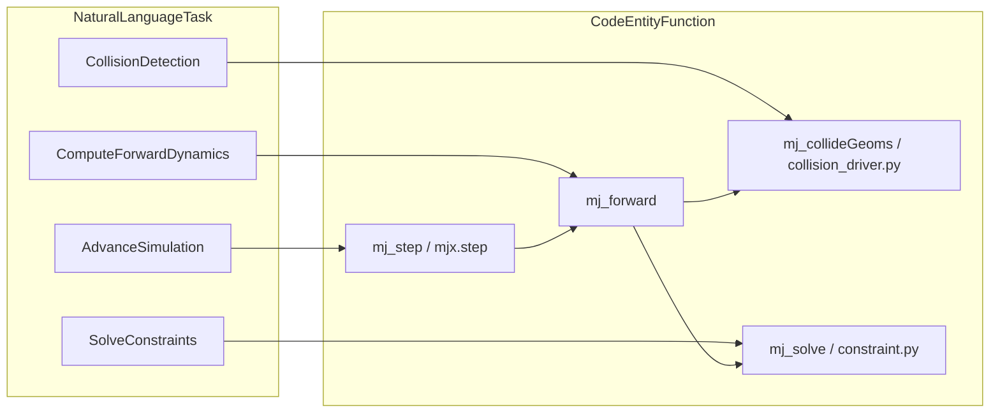

<!-- source: DeepWiki mcp.deepwiki.com · repo google-deepmind/mujoco · page 10 Glossary · fetched 2026-10-26 -->

# Glossary

Relevant source files

The following files were used as context for generating this wiki page:

- [doc/APIreference/APIglobals.rst](doc/APIreference/APIglobals.rst)
- [doc/APIreference/functions.rst](doc/APIreference/functions.rst)
- [doc/APIreference/functions_override.rst](doc/APIreference/functions_override.rst)
- [doc/XMLreference.rst](doc/XMLreference.rst)
- [doc/XMLschema.rst](doc/XMLschema.rst)
- [doc/changelog.rst](doc/changelog.rst)
- [doc/includes/references.h](doc/includes/references.h)
- [include/mujoco/mjdata.h](include/mujoco/mjdata.h)
- [include/mujoco/mjmodel.h](include/mujoco/mjmodel.h)
- [include/mujoco/mjspec.h](include/mujoco/mjspec.h)
- [include/mujoco/mjxmacro.h](include/mujoco/mjxmacro.h)
- [include/mujoco/mujoco.h](include/mujoco/mujoco.h)
- [model/flex/hollow_vs_solid.xml](model/flex/hollow_vs_solid.xml)
- [python/mujoco/introspect/functions.py](python/mujoco/introspect/functions.py)
- [python/mujoco/introspect/structs.py](python/mujoco/introspect/structs.py)
- [src/engine/engine_core_constraint.c](src/engine/engine_core_constraint.c)
- [src/engine/engine_core_constraint.h](src/engine/engine_core_constraint.h)
- [src/engine/engine_io.c](src/engine/engine_io.c)
- [src/engine/engine_io.h](src/engine/engine_io.h)
- [src/engine/engine_print.c](src/engine/engine_print.c)
- [src/engine/engine_solver.c](src/engine/engine_solver.c)
- [src/engine/engine_util_sparse.c](src/engine/engine_util_sparse.c)
- [src/engine/engine_util_sparse.h](src/engine/engine_util_sparse.h)
- [src/engine/engine_util_sparse_avx.h](src/engine/engine_util_sparse_avx.h)
- [src/user/user_api.cc](src/user/user_api.cc)
- [src/user/user_api.h](src/user/user_api.h)
- [src/user/user_mesh.cc](src/user/user_mesh.cc)
- [src/user/user_model.cc](src/user/user_model.cc)
- [src/user/user_model.h](src/user/user_model.h)
- [src/user/user_objects.cc](src/user/user_objects.cc)
- [src/user/user_objects.h](src/user/user_objects.h)
- [src/xml/xml_native_reader.cc](src/xml/xml_native_reader.cc)
- [src/xml/xml_native_writer.cc](src/xml/xml_native_writer.cc)
- [test/benchmark/engine_util_sparse_benchmark_test.cc](test/benchmark/engine_util_sparse_benchmark_test.cc)
- [test/engine/engine_core_constraint_test.cc](test/engine/engine_core_constraint_test.cc)
- [test/engine/engine_io_test.cc](test/engine/engine_io_test.cc)
- [test/engine/engine_util_sparse_test.cc](test/engine/engine_util_sparse_test.cc)
- [test/user/user_api_test.cc](test/user/user_api_test.cc)
- [test/user/user_mesh_test.cc](test/user/user_mesh_test.cc)
- [test/user/user_objects_test.cc](test/user/user_objects_test.cc)
- [test/xml/xml_native_reader_test.cc](test/xml/xml_native_reader_test.cc)
- [test/xml/xml_native_writer_test.cc](test/xml/xml_native_writer_test.cc)
- [unity/Runtime/Bindings/MjBindings.cs](unity/Runtime/Bindings/MjBindings.cs)

This page provides definitions and technical details for core terms, abbreviations, and domain-specific concepts used throughout the MuJoCo codebase. It serves as a bridge between high-level physical concepts and their specific implementations in C, C++, and Python.

## Core Data Structures

MuJoCo's architecture is built around the separation of model definition, runtime constants, and simulation state.

| Term | Definition | Implementation Pointer |
| :--- | :--- | :--- |
| **mjSpec** | The high-level model specification used for editing and procedural generation. It contains a tree of `mjCBase` objects. | [include/mujoco/mjspec.h:23-23]() |
| **mjModel** | The compiled, read-only (at runtime) structure containing physical constants, geometry data, and solver parameters. | [include/mujoco/mjmodel.h:674-674]() |
| **mjData** | The mutable simulation state, including positions, velocities, forces, and workspace buffers. | [include/mujoco/mjdata.h:476-476]() |
| **mjVFS** | Virtual File System used to load assets (meshes, textures) from memory rather than disk. | [include/mujoco/mujoco.h:79-83]() |
| **mjCModel** | The C++ internal representation of a model during the compilation phase, managing the hierarchy of `mjCBody`, `mjCGeom`, etc. | [src/user/user_model.h:34-34]() |
| **mjResource** | An abstraction for loading data from files or VFS, supporting custom decoders (e.g., USD). | [src/user/user_api.cc:100-109]() |

**Sources:** [include/mujoco/mjspec.h:23-23](), [include/mujoco/mjmodel.h:674-674](), [include/mujoco/mjdata.h:476-476](), [include/mujoco/mujoco.h:79-83](), [src/user/user_model.h:34-34](), [src/user/user_api.cc:100-109]()

## System Architecture: Data Flow

The following diagram illustrates how high-level specifications are transformed into runtime structures and how the `mjSpec` API integrates into the pipeline.

### Model Compilation Pipeline

**Sources:** [src/user/user_api.cc:78-147](), [src/user/user_model.cc:152-201](), [src/engine/engine_io.c:227-240]()

## Physics and Simulation Jargon

### State Vectors
*   **qpos**: Generalized positions. The dimension is `nq`. For a free joint, this includes a 3D position and a 4D unit quaternion. [include/mujoco/mjdata.h:476]()
*   **qvel**: Generalized velocities. The dimension is `nv`. Note that `nv` may be smaller than `nq` (e.g., 3D angular velocity vs 4D quaternion). [include/mujoco/mjdata.h:476]()
*   **qacc**: Generalized accelerations. [include/mujoco/mjdata.h:476]()
*   **ctrl**: Control inputs for actuators. [include/mujoco/mjdata.h:476]()

### Constraints and Solver
*   **efc**: "Extended Finite Constraints." Internal arrays in `mjData` that store Jacobian rows and solver parameters for active constraints. [include/mujoco/mjdata.h:476]()
*   **Island**: A subset of bodies and joints connected by constraints but independent of other bodies. Island decomposition allows for parallel constraint solving via `mju_threadpool`. [doc/changelog.rst:38-40](), [doc/includes/references.h:116-116]()
*   **Warmstart**: Using the acceleration solution from the previous time step to initialize the solver, accelerating convergence. [doc/includes/references.h:51-52]()
*   **Margin and Gap**: Parameters controlling contact detection. `margin` is geometric inflation; `gap` is a detection buffer. [doc/includes/references.h:32-52]()

### Geometry and Collision
*   **Geom**: A geometric primitive (sphere, box, etc.) or mesh attached to a body for collision and rendering. [include/mujoco/mjmodel.h:160-180]()
*   **Mocap Body**: A "motor-capture" body that is kinematically controlled rather than subject to forces. [doc/includes/references.h:30-31]()
*   **Flex**: Deformable objects (soft bodies, cloths) represented by nodes and elements, created via `mjs_makeFlex`. [doc/changelog.rst:69-71](), [src/user/user_mesh.cc:200-235]()

**Sources:** [include/mujoco/mjdata.h:476](), [doc/includes/references.h:25-139](), [doc/changelog.rst:38-71](), [src/user/user_mesh.cc:200-235]()

## Implementation-Specific Terms

### Memory Management
*   **Arena**: A fast, stack-based memory allocator used within `mjData` for temporary workspace. [include/mujoco/mjdata.h:137-138]()
*   **SKIP Macro**: A utility used during `mjModel` construction to ensure 64-byte alignment for pointers. [src/engine/engine_io.c:131-136]()
*   **mj_markStack / mj_freeStack**: Functions for managing the temporary memory stack within the `mjData` arena. [doc/includes/references.h:81-82]()

### Compilation and Utilities
*   **mj_recompile**: A function that updates an `mjModel` in-place while attempting to preserve the simulation state in `mjData`. [include/mujoco/mujoco.h:158-160]()
*   **mjtNum**: The basic floating-point type used in MuJoCo, typically `double`. [include/mujoco/mjtnum.h:35-35]()
*   **X-Macros**: Preprocessor macros (e.g., `MJMODEL_POINTERS`, `MJMODEL_SIZES`) used to automate structure field generation and serialization. [src/engine/engine_io.c:75-88](), [src/engine/engine_io.c:149-154]()

## Code Entity Association

This diagram maps common physical simulation tasks to the specific C and MJX functions that implement them.

### Simulation Step Logic

**Sources:** [include/mujoco/mujoco.h:195-200](), [mjx/mujoco/mjx/_src/io.py:28-29](), [src/engine/engine_io.c:29-32]()

## Abbreviations Table

| Abbreviation | Full Name | Context |
| :--- | :--- | :--- |
| **MJCF** | MuJoCo Format | The native XML modeling format. [doc/XMLreference.rst:8-8]() |
| **URDF** | Unified Robot Description Format | External format supported via translation. [src/user/user_api.cc:85-88]() |
| **CSR** | Compressed Sparse Row | Format used for sparse mass matrices (M). [doc/changelog.rst:28-29]() |
| **GJK** | Gilbert-Johnson-Keerthi | Algorithm used for narrow-phase collision detection. [src/engine/engine_collision_gjk.c:1-20]() |
| **PGS** | Projected Gauss-Seidel | A type of constraint solver. [doc/changelog.rst:10-12]() |
| **MJX** | MuJoCo JAX | The JAX-accelerated implementation of MuJoCo. [mjx/mujoco/mjx/_src/io.py:1-15]() |
| **VFS** | Virtual File System | Memory-based file management. [src/user/user_api.cc:80-98]() |

**Sources:** [doc/XMLreference.rst:8-8](), [src/user/user_api.cc:80-98](), [doc/changelog.rst:10-29](), [mjx/mujoco/mjx/_src/io.py:1-15]()