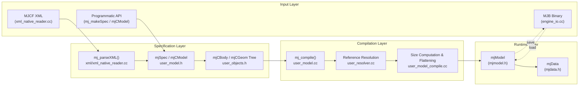
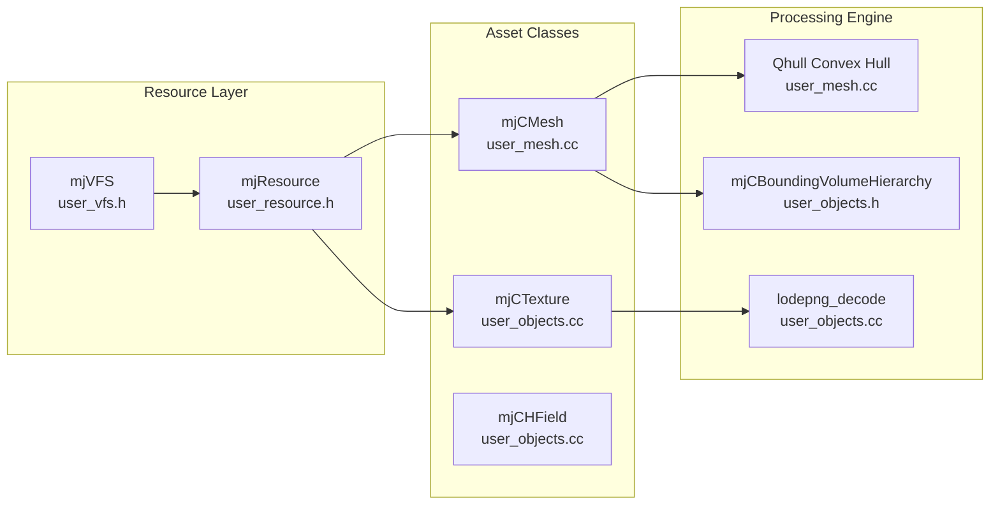

<!-- source: DeepWiki mcp.deepwiki.com · repo google-deepmind/mujoco · page 2 Model Definition Pipeline · fetched 2026-10-26 -->

# Model Definition Pipeline

Relevant source files

The following files were used as context for generating this wiki page:

- [doc/XMLreference.rst](doc/XMLreference.rst)
- [doc/XMLschema.rst](doc/XMLschema.rst)
- [doc/changelog.rst](doc/changelog.rst)
- [src/user/user_api.cc](src/user/user_api.cc)
- [src/user/user_api.h](src/user/user_api.h)
- [src/user/user_mesh.cc](src/user/user_mesh.cc)
- [src/user/user_model.cc](src/user/user_model.cc)
- [src/user/user_model.h](src/user/user_model.h)
- [src/user/user_objects.cc](src/user/user_objects.cc)
- [src/user/user_objects.h](src/user/user_objects.h)
- [src/xml/xml_native_reader.cc](src/xml/xml_native_reader.cc)
- [src/xml/xml_native_writer.cc](src/xml/xml_native_writer.cc)
- [test/user/user_api_test.cc](test/user/user_api_test.cc)
- [test/user/user_mesh_test.cc](test/user/user_mesh_test.cc)
- [test/user/user_objects_test.cc](test/user/user_objects_test.cc)
- [test/xml/xml_native_reader_test.cc](test/xml/xml_native_reader_test.cc)
- [test/xml/xml_native_writer_test.cc](test/xml/xml_native_writer_test.cc)

## Purpose and Scope

This document describes the **complete model creation workflow** in MuJoCo, from high-level model descriptions to compiled runtime structures. It covers the input formats (MJCF XML and programmatic APIs), the intermediate specification representation (`mjSpec`), asset management, and the compilation process that produces `mjModel`.

For information about runtime simulation with `mjModel` and `mjData`, see [Core Runtime System](#3). For details on the physics simulation algorithms, see [Physics Simulation Pipeline](#4). For language bindings, see [C and Python APIs](#5).

---

## Overview

The Model Definition Pipeline transforms human-readable model descriptions into optimized runtime structures through three distinct phases:

**Phase 1: Specification** - Models are defined using MJCF XML files or the programmatic `mjSpec` API via `mj_makeSpec()` [src/user/user_api.cc:60](). This creates a tree of mutable `mjC*` objects (`mjCModel`, `mjCBody`, `mjCGeom`, etc.) [src/user/user_model.h:41](), [src/user/user_objects.h:40]() representing the kinematic structure and physical properties.

**Phase 2: Compilation** - The `mj_compile()` function validates, processes, and flattens the specification tree into the immutable `mjModel` structure with contiguous arrays and pre-computed sparse matrices optimized for fast simulation [src/user/user_model.cc:152]().

**Phase 3: Instantiation** - The compiled `mjModel` is used to instantiate `mjData` instances that hold simulation state, intermediates, and workspace memory.

### Workflow Diagram

Sources: [src/user/user_model.h:1-100](), [src/user/user_model.cc:152-201](), [src/user/user_api.cc:60-76]()

---

## Input Formats and APIs

### 2.1 MJCF XML Format
MJCF is an XML-based declarative language for describing mechanical systems. It defines a rich schema of elements (bodies, joints, geoms, sensors, actuators) and attributes configuring physical and visual properties. Elements are parsed into mutable `mjC*` objects. Special meta-elements like `<include>`, `<frame>`, and `<replicate>` enable modular modeling.
For details, see [MJCF XML Format](#2.1).
Sources: [doc/XMLreference.rst:1-100](), [src/xml/xml_native_reader.cc:170-215]()

### 2.2 mjSpec C++ API
MuJoCo provides a low-level C++ programmatic API (`mjSpec`, `mjCModel`, `mjCBase`) for constructing and editing models without XML files. Elements are built dynamically and initialized via `mjs_defaultSpec` and related builder functions.
For details, see [mjSpec C++ API](#2.2).
Sources: [src/user/user_model.cc:130-180](), [src/user/user_api.cc:60-77]()

### 2.3 Python MjSpec API
The Python interface wraps `mjSpec` via `mujoco.MjSpec`, offering high-level Pythonic element manipulation, attachment systems, asset embedding, and code generation.
For details, see [Python MjSpec API](#2.3).
Sources: [src/user/user_api.cc:60-76]()

### 2.4 XML Parsing and Writing
The XML parsing layer (`xml_native_reader.cc`) reads MJCF structures, verifies against the XSD schema (`mjcf.xsd`), and tracks authored attributes. The XML writer (`xml_native_writer.cc`) serializes `mjSpec` trees back into formatted XML files.
For details, see [XML Parsing and Writing](#2.4).
Sources: [src/xml/xml_native_reader.cc:190-215](), [src/xml/xml_native_writer.cc:63-132]()

---

## Asset Management and VFS

### 2.5 Asset Management and VFS
Models frequently reference external files such as meshes (`.obj`, `.stl`), heightfields (`.hfield`), and textures (`.png`). 
- Assets are managed through the Virtual File System (`mjVFS`) and resource provider infrastructure (`mju_openResource`).
- `mjCMesh` processes geometry to generate convex hulls via Qhull and bounding volume hierarchies (BVH).
- Textures are decoded (e.g., using `lodepng` in `user_objects.cc`) or kept by reference.

For details, see [Asset Management and VFS](#2.5).

### Asset Pipeline Diagram

Sources: [src/user/user_objects.cc:57-136](), [src/user/user_mesh.cc:190-235](), [src/user/user_objects.h:95-185]()

---

## Compilation Process

### 2.6 Compilation Process
The compilation engine (`mj_compile` in `src/user/user_model.cc`) converts the specification hierarchy into the flat runtime structure `mjModel`:
- **Validation & Resolution**: Resolves string references to pointers and checks semantic constraints.
- **Size Computation**: Computes required buffer dimensions (`nq`, `nv`, `nu`, `nbody`, etc.) [src/user/user_model.h:55-135]().
- **Flattening**: Allocates contiguous memory arrays for simulation structures.
- **Sparse Matrix Construction**: Builds compressed sparse row (CSR) representations for matrices like :math:`M`, :math:`B`, :math:`C`, and :math:`D`.
- **In-Place Updates**: `mj_recompile` allows runtime modifications.

For details, see [Compilation Process](#2.6).
Sources: [src/user/user_model.h:55-135](), [src/user/user_model.cc:152-233]()

### 2.7 Model Composition and Attachment
Sub-models can be attached to parent specifications at specified frames, sites, or bodies using namespace management prefixes/suffixes and the `deepcopy` flag. This enables hierarchical assembly of complex multi-robot scenes.
For details, see [Model Composition and Attachment](#2.7).
Sources: [src/user/user_model.h:43-46](), [src/user/user_model.cc:189-220]()

---

## Summary of Child Pages

- **[MJCF XML Format](#2.1)** — MJCF XML schema, element hierarchy, attribute reference, and URDF support.
- **[mjSpec C++ API](#2.2)** — C++ API for programmatic model creation using `mjCModel` and `mjCBase`.
- **[Python MjSpec API](#2.3)** — Python interface for `MjSpec` element manipulation and attachments.
- **[XML Parsing and Writing](#2.4)** — XML reader (`xml_native_reader.cc`) and writer (`xml_native_writer.cc`).
- **[Asset Management and VFS](#2.5)** — Asset loading, VFS, caching, BVH, and SDF generation.
- **[Compilation Process](#2.6)** — Compilation workflows (`mj_compile`), sizing, and sparse matrices.
- **[Model Composition and Attachment](#2.7)** — Model attachments, namespaces, and deepcopy behaviors.

Sources: [src/user/user_model.h:1-150](), [src/user/user_api.cc:55-120]()

---

