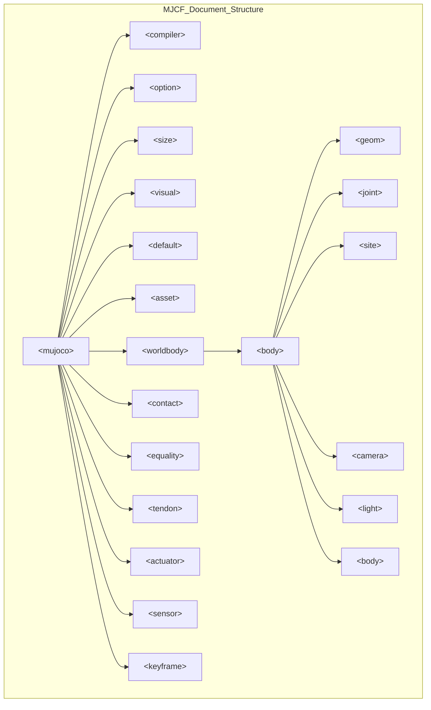
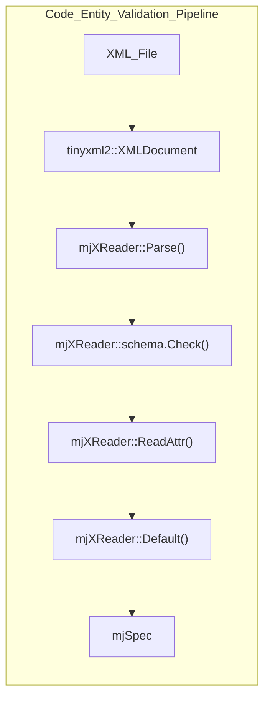
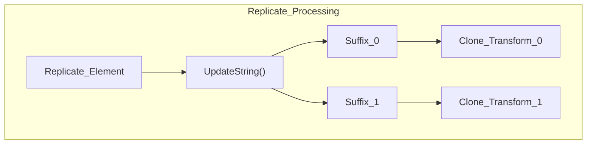
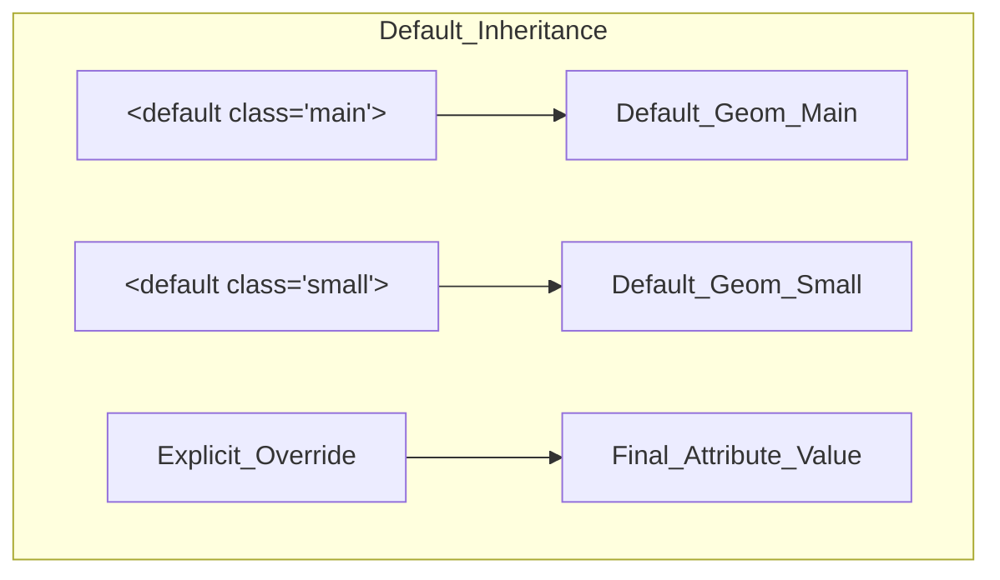
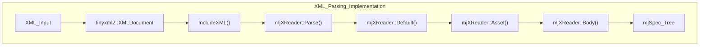
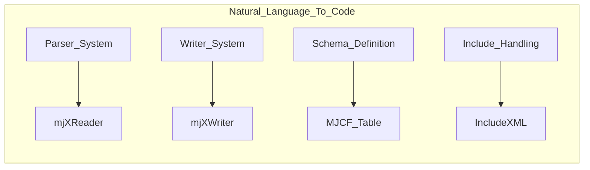
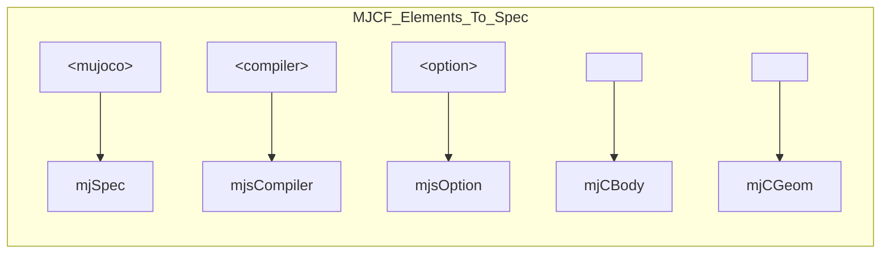

<!-- source: DeepWiki mcp.deepwiki.com · repo google-deepmind/mujoco · page 2.1 MJCF XML Format · fetched 2026-10-26 -->

# MJCF XML Format

Relevant source files

The following files were used as context for generating this wiki page:

- [cmake/ShellTests.cmake](cmake/ShellTests.cmake)
- [doc/XMLreference.rst](doc/XMLreference.rst)
- [doc/XMLschema.rst](doc/XMLschema.rst)
- [doc/changelog.rst](doc/changelog.rst)
- [plugin/obj_decoder/CMakeLists.txt](plugin/obj_decoder/CMakeLists.txt)
- [plugin/stl_decoder/CMakeLists.txt](plugin/stl_decoder/CMakeLists.txt)
- [src/user/user_api.cc](src/user/user_api.cc)
- [src/user/user_api.h](src/user/user_api.h)
- [src/user/user_mesh.cc](src/user/user_mesh.cc)
- [src/user/user_model.cc](src/user/user_model.cc)
- [src/user/user_model.h](src/user/user_model.h)
- [src/user/user_objects.cc](src/user/user_objects.cc)
- [src/user/user_objects.h](src/user/user_objects.h)
- [src/xml/generated/dmcontrol_schema.xml](src/xml/generated/dmcontrol_schema.xml)
- [src/xml/generated/mjcf.xsd](src/xml/generated/mjcf.xsd)
- [src/xml/generated/mjcf_default_table.inc](src/xml/generated/mjcf_default_table.inc)
- [src/xml/generated/mjcf_map.h](src/xml/generated/mjcf_map.h)
- [src/xml/generated/mjcf_read_table.inc](src/xml/generated/mjcf_read_table.inc)
- [src/xml/generated/mjcf_table.inc](src/xml/generated/mjcf_table.inc)
- [src/xml/mjcf.schema](src/xml/mjcf.schema)
- [src/xml/xml_native_reader.cc](src/xml/xml_native_reader.cc)
- [src/xml/xml_native_writer.cc](src/xml/xml_native_writer.cc)
- [src/xml/xml_urdf.cc](src/xml/xml_urdf.cc)
- [src/xml/xml_urdf.h](src/xml/xml_urdf.h)
- [test/user/CMakeLists.txt](test/user/CMakeLists.txt)
- [test/user/user_api_test.cc](test/user/user_api_test.cc)
- [test/user/user_mesh_test.cc](test/user/user_mesh_test.cc)
- [test/user/user_objects_test.cc](test/user/user_objects_test.cc)
- [test/xml/CMakeLists.txt](test/xml/CMakeLists.txt)
- [test/xml/xml_native_reader_test.cc](test/xml/xml_native_reader_test.cc)
- [test/xml/xml_native_writer_test.cc](test/xml/xml_native_writer_test.cc)
- [test/xml/xml_urdf_test.cc](test/xml/xml_urdf_test.cc)
- [wasm/CMakeLists.txt](wasm/CMakeLists.txt)

## Purpose and Scope

This page documents the MJCF (MuJoCo XML Format) modeling language, which is the primary method for defining physics models in MuJoCo. MJCF is a declarative XML-based format describing all aspects of a simulation model, including geometry, kinematics, dynamics, appearance, sensors, and actuators.

For programmatic model creation and editing, see the [mjSpec C++ API](#2.2) and [Python MjSpec API](#2.3). Parsing and serialization details are covered in [XML Parsing and Writing](#2.4), and model compilation from MJCF to runtime structures is detailed in [Compilation Process](#2.6).

Sources: `[doc/XMLreference.rst:1-96]()`, `[src/xml/xml_native_reader.cc:1-50]()`

---

## MJCF Structure Overview

MJCF files contain a single top-level `<mujoco>` element, which may include multiple optional sections. The document is hierarchical; for example, the `<worldbody>` section contains a tree of `<body>` elements representing the system's kinematic structure.

The parser reads and validates the XML against a comprehensive schema, then builds an internal `mjSpec` representation. This is compiled into the runtime model structures (`mjModel`/`mjData`).

### Element Hierarchy Diagram

**Figure 1:** MJCF Document Element Hierarchy

Sources: `[doc/XMLreference.rst:98-117]()`, `[src/xml/xml_native_reader.cc:98-511]()`

---

## Schema Definition and Validation

The MJCF schema is internally represented as the `MJCF` array in `[src/xml/xml_native_reader.cc]`. It enumerates valid XML elements, cardinality, and their allowed attributes.

- Cardinality Indicators:
  - `!` — Required element, appears exactly once.
  - `?` — Optional, appears at most once.
  - `R` — Recursive element (e.g., `<body>` can include child `<body>`).
  - `*` — Optional, may appear multiple times.

Parsing follows strict validation of element hierarchy and attribute types, aided by numerous keyword maps (e.g., coordinate systems, solvers). Errors in schema or attributes produce detailed exceptions.

### Schema Validation Pipeline (Code Entity Bridge)

**Figure 2:** Schema Validation Pipeline mapped to `mjXReader` and TinyXML2

Sources: `[src/xml/xml_native_reader.cc:100-511]()`, `[doc/XMLreference.rst:14-46]()`

---

## Attribute Types and Parsing

MJCF attributes are strongly typed, with the following primary attribute data types:

| Type       | Format                  | Example                 | Parsing Implementation        |
|------------|-------------------------|-------------------------|-------------------------------|
| `string`   | Arbitrary string        | `name="box"`            | `mjXUtil::ReadAttrTxt`         |
| `int(N)`   | N integers              | `group="3"`             | `mjXUtil::ReadAttrInt`         |
| `real(N)`  | N real numbers          | `pos="1 2 3"`           | `mjXReader::ReadAttr`          |
| `[...]`    | Enum keywords           | `type="sphere"`         | `mjXReader::MapValue`          |

Attribute parsing accounts for special values like `inf`, `-inf`, or `nan` for floating-point numbers. Memory size attributes support suffixes such as `K`, `M`, `G`. Quaternions are normalized automatically if specified with nonzero values.

Sources: `[doc/XMLreference.rst:48-91]()`, `[src/xml/xml_native_reader.cc:75-130]`, `[test/xml/xml_native_reader_test.cc:279-329]()`

---

## Meta-Elements

Certain MJCF elements do not correspond to runtime objects but serve as procedural or structural directives during parsing. They are removed after processing.

### Frame Element

The `<frame>` element represents a pure coordinate transform that wraps subtrees in the kinematic tree. Upon compilation, frames disappear and their transformations aggregate into child elements.

### Include Element

The `<include>` element merges external XML files into the current model. The parser recursively loads and consolidates these files at the include's location.

### Replicate Element

The `<replicate>` element duplicates kinematic subtrees multiple times with incremental transformations and namespace suffixes. The `UpdateString` helper generates suffixes. This facilitates compact repetition of similar elements.

### Replicate Processing Diagram

**Figure 3:** Replicate Processing and Suffix Generation

Sources: `[doc/XMLreference.rst:179-260]()`, `[src/xml/xml_native_reader.cc:155-164]`, `[test/xml/xml_native_reader_test.cc:1087-1139]()`

---

## Default System and Inheritance

MJCF supports an inheritance mechanism via `<default>` elements that define attribute templates grouped by `class` names. Model elements can reference these default classes to inherit attribute values unless explicitly set.

### Default Inheritance Resolution

**Figure 4:** Default Class Attribute Inheritance

Sources: `[src/xml/xml_native_reader.cc:151-172]()`, `[test/xml/xml_native_reader_test.cc:479-510]()`

---

## Key Element Sections

### Compiler Section

Controls compilation options influencing preprocessing and optimization. Attributes include `angle`, `coordinate`, resource directories (`meshdir`, `texturedir`, `assetdir`), and flags like `boundmass`.

### Option Section

Defines runtime simulation parameters stored in `mjModel.opt`, including `timestep`, `gravity`, `integrator`, and solver tolerances.

### Asset Section

Declares external assets such as meshes, textures, and materials. Asset loading performs caching and path resolution leveraging resource directories and virtual file systems (`mjVFS`).

### Worldbody Section

Root of the kinematic hierarchy, containing nested `<body>` elements representing rigid bodies, including joints, geoms, sites, cameras, and lights.

### Actuator Section

Defines actuators applying forces or torques using types such as motors, position actuators, and velocity actuators.

Sources: `[doc/XMLreference.rst:661-841]()`, `[src/xml/xml_native_reader.cc:1852-2280]()`, `[test/user/user_objects_test.cc:159-243]()`, `[doc/changelog.rst:17-34]`

---

## XML Parsing Implementation

Parsing is performed by `mjXReader` in `[src/xml/xml_native_reader.cc]()`. The pipeline handles DOM parsing, include resolution, frame accumulation, replication, schema validation, default population, asset loading, and spec tree construction.

### XML Parsing Pipeline (Code Entity Bridge)

**Figure 5:** XML Parsing Data Flow via `mjXReader`

Sources: `[src/xml/xml_native_reader.cc:46-215]`, `[src/xml/xml.cc:102-230]()`

---

## XML Writing and Round-Tripping

The `mjXWriter` class in `[src/xml/xml_native_writer.cc]()` serializes an `mjSpec` model back to MJCF XML using `mj_XMLPrinter` for compact indentation.

Sources: `[src/xml/xml_native_writer.cc:15-132]()`, `[test/xml/xml_native_writer_test.cc:49-237]()`

---

## Validation and Error Reporting

The parser enforces strict validation rules, including unique element constraints and exclusive orientation attributes, emitting `mjXError` exceptions on failure.

Sources: `[test/xml/xml_native_reader_test.cc:49-150, 1100-1150]()`

---

## References to Key Code Entities

### Natural Language to Code Entity Mappings

**Figure 6:** System Concepts Mapped to Code Entities

**Figure 7:** MJCF Elements Mapped to `mjSpec` Components

Sources: `[src/xml/xml_native_reader.cc:46-164]()`, `[src/xml/xml_native_writer.cc:15-124]`, `[doc/XMLreference.rst:1-300]()`

---

