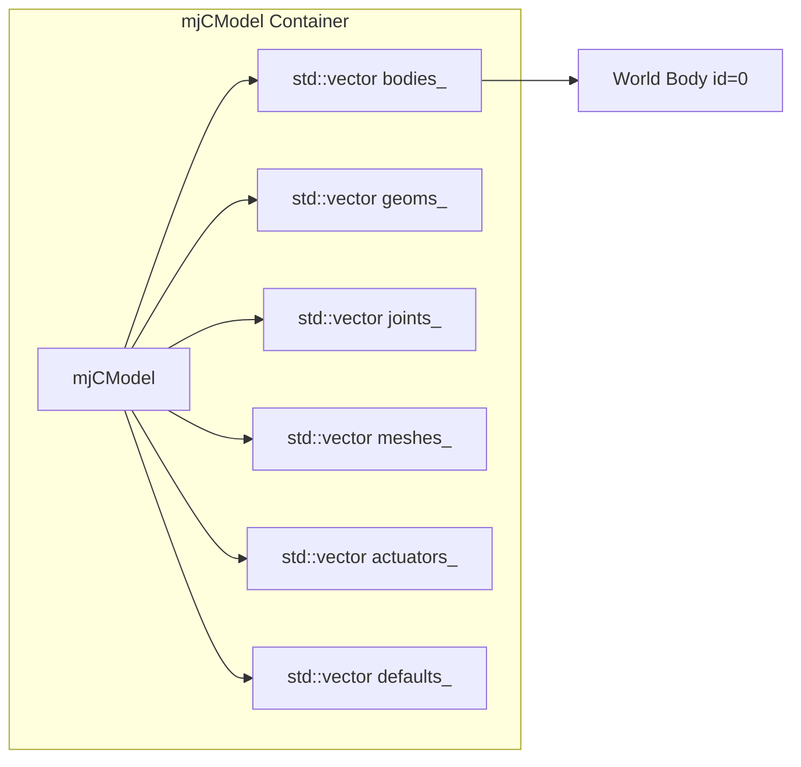
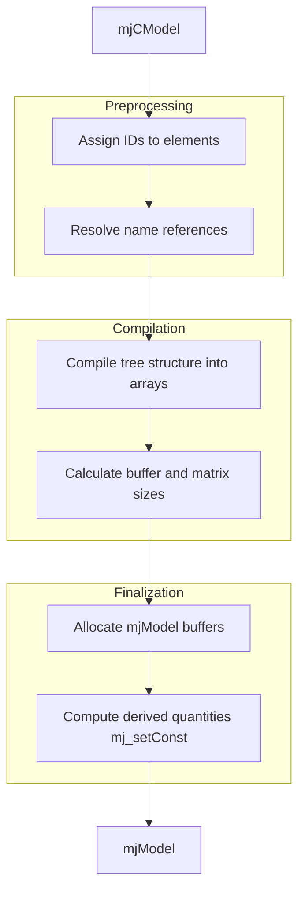

<!-- source: DeepWiki mcp.deepwiki.com · repo google-deepmind/mujoco · page 2.2 mjSpec C++ API · fetched 2026-10-26 -->

# mjSpec C++ API

<details>
<summary>Relevant source files</summary>

The following files were used as context for generating this wiki page:

- [doc/XMLreference.rst](doc/XMLreference.rst)
- [doc/XMLschema.rst](doc/XMLschema.rst)
- [doc/changelog.rst](doc/changelog.rst)
- [src/user/user_api.cc](src/user/user_api.cc)
- [src/user/user_api.h](src/user/user_api.h)
- [src/user/user_init.c](src/user/user_init.c)
- [src/user/user_mesh.cc](src/user/user_mesh.cc)
- [src/user/user_model.cc](src/user/user_model.cc)
- [src/user/user_model.h](src/user/user_model.h)
- [src/user/user_objects.cc](src/user/user_objects.cc)
- [src/user/user_objects.h](src/user/user_objects.h)
- [src/user/user_util.cc](src/user/user_util.cc)
- [src/user/user_util.h](src/user/user_util.h)
- [src/xml/xml_native_reader.cc](src/xml/xml_native_reader.cc)
- [src/xml/xml_native_writer.cc](src/xml/xml_native_writer.cc)
- [test/user/user_api_test.cc](test/user/user_api_test.cc)
- [test/user/user_mesh_test.cc](test/user/user_mesh_test.cc)
- [test/user/user_objects_test.cc](test/user/user_objects_test.cc)
- [test/user/user_util_test.cc](test/user/user_util_test.cc)
- [test/xml/xml_native_reader_test.cc](test/xml/xml_native_reader_test.cc)
- [test/xml/xml_native_writer_test.cc](test/xml/xml_native_writer_test.cc)

</details>


This document provides a detailed technical overview of MuJoCo’s C++ API for programmatic model creation and editing via the `mjSpec` system. It covers the hierarchical object model (`mjCBase` and subclasses), the top-level model container class (`mjCModel`), and the C API wrapper interface, explaining data flow, key classes and functions, along with architecture diagrams.

## Overview

MuJoCo model construction programmatically uses the `mjSpec` interface wrapping a C++ object tree rooted at `mjCModel`. This system allows direct creation, modification, and compilation of models to the runtime `mjModel` structure, bypassing XML if desired.

Key components:

- **`mjCBase` and subclasses**: C++ class hierarchy representing all modeling elements (bodies, joints, geoms, sites, actuators, etc.) [src/user/user_objects.h:40-70]().
- **`mjCModel`**: The top-level model class managing all elements, defaults, and compilation [src/user/user_model.h:41-140]().
- **`mjSpec`**: C API handle wrapping `mjCModel` for public API exposure [src/user/user_api.cc:60-63]().

Sources: [src/user/user_objects.h:40-70](), [src/user/user_model.h:41-140](), [src/user/user_api.cc:60-63]()

---

## `mjCBase` Class Hierarchy: Model Element Representation

All model elements derive from `mjCBase`, an abstract base providing naming, hierarchical relationships, and common behavioral interfaces. The inheritance structure includes body elements, geometric primitives, sensors, actuators, and assets.

### Key Classes

- `mjCBody`: Rigid body container forming the tree hierarchy [src/user/user_objects.h:42]().
- `mjCFrame`: Coordinate frames for pose transforms [src/user/user_objects.h:43]().
- `mjCGeom`: Collision geometry elements [src/user/user_objects.h:45]().
- `mjCJoint`: DOFs that connect bodies [src/user/user_objects.h:44]().
- `mjCSite`: Markers or reference frames [src/user/user_objects.h:46]().
- `mjCCamera`, `mjCLight`: Visual elements [src/user/user_objects.h:47-48]().
- Asset classes: `mjCMesh`, `mjCTexture`, `mjCMaterial`, `mjCHField`, `mjCSkin` [src/user/user_objects.h:49-54]().
- Control/sensing elements: `mjCActuator`, `mjCSensor`, `mjCTendon`, `mjCEquality`, `mjCPair` [src/user/user_objects.h:55-60]().

### `mjCBase` Inheritance Diagram

```mermaid
graph TB
    mjCBase["mjCBase"]
    
    mjCBase --> mjCBody["mjCBody"]
    mjCBase --> mjCFrame["mjCFrame"]
    mjCBase --> mjCGeom["mjCGeom"]
    mjCBase --> mjCJoint["mjCJoint"]
    mjCBase --> mjCSite["mjCSite"]
    mjCBase --> mjCCamera["mjCCamera"]
    mjCBase --> mjCLight["mjCLight"]
    
    mjCBase --> mjCMesh["mjCMesh"]
    mjCBase --> mjCTexture["mjCTexture"]
    mjCBase --> mjCMaterial["mjCMaterial"]
    mjCBase --> mjCHField["mjCHField"]
    mjCBase --> mjCSkin["mjCSkin"]
    
    mjCBase --> mjCActuator["mjCActuator"]
    mjCBase --> mjCSensor["mjCSensor"]
    mjCBase --> mjCTendon["mjCTendon"]
    mjCBase --> mjCEquality["mjCEquality"]
    mjCBase --> mjCPair["mjCPair"]
    
    style mjCBase stroke-width:2px
```



Sources: [src/user/user_objects.h:40-70]()

---

## `mjCModel`: Main Model Container and Compiler

`mjCModel` inherits from `mjCModel_` (which in turn inherits `mjsElement`) and is the primary class collecting all model elements and defaults. It provides APIs to build a complete model tree programmatically and to trigger compilation to the runtime `mjModel`.

### Internal Elements Storage

- `std::vector<mjCBody*> bodies_`: All bodies including the root world body [src/user/user_model.cc:172]().
- Vectors for geoms, joints, meshes, actuators, and other elements [src/user/user_model.cc:150-180]().
- `std::vector<mjCDef*> defaults_`: Default classes for inheritance of properties [src/user/user_model.cc:154]().

### Construction and Ownership

- The root "world" body is created automatically in the constructor [src/user/user_model.cc:161-174]().
- Defaults hierarchy is initialized with a "main" base default [src/user/user_model.cc:153-155]().
- The `mjCModel` instance manages object lifetimes and references.

### `mjCModel` Structure Diagram



### Important `mjCModel` Members

- Compilation status flags and size counters (`nbody`, `njnt`, `nq`, `nv`, etc.) [src/user/user_model.h:54-140]().
- Auto-computed model metrics (e.g., mean inertia, extent) [src/user/user_model.cc:141-147]().
- Reference counting and deep copy flags for model composition.

Sources: [src/user/user_model.h:41-140](), [src/user/user_model.cc:130-220]()

---

## C API Wrappers and Construction Functions

The public C API exposes the underlying C++ spec model via `mjSpec` pointers, which point to `mjCModel->spec` [src/user/user_api.cc:60-63](). Construction and manipulation are performed using functions declared in `src/user/user_api.h`.

### Creating and Copying Specs

- `mjSpec* mj_makeSpec();` — Creates a new `mjCModel` and returns its `mjSpec` interface [src/user/user_api.cc:60-63]().
- `mjSpec* mj_copySpec(const mjSpec* s);` — Creates a deep copy of an existing spec, cloning the entire element tree [src/user/user_api.cc:67-76]().

### Adding Elements to Model

| API Function | Description | Returns |
| --- | --- | --- |
| `mjsBody* mjs_addBody(mjsBody* body, const mjsDefault* def)` | Add a new child body | Pointer to new body |
| `mjsGeom* mjs_addGeom(mjsBody* body, const mjsDefault* def)` | Add a geometry to the body | Pointer to geom |
| `mjsJoint* mjs_addJoint(mjsBody* body, const mjsDefault* def)` | Add a joint DOF | Pointer to joint |
| `mjsSite* mjs_addSite(mjsBody* body, const mjsDefault* def)` | Add a site marker | Pointer to site |

Sources: [src/user/user_api.cc:56-76](), [test/user/user_api_test.cc:55-67]()

---

## Model Compilation Process

After model specification, compilation transforms the editable `mjCModel` tree into an efficient low-level `mjModel` representation used at runtime.

### Compilation Pipeline



Sources: [src/user/user_model.cc:150-220](), [src/user/user_api.cc:200-240]()

---

## Default Class System (`mjCDef`)

The default system supports property inheritance. Default classes (`mjCDef`) can be defined hierarchically (e.g., "main", "robot", "arm"). Elements specify a default class to inherit properties [src/user/user_model.cc:153-156]().

Sources: [src/user/user_model.cc:130-180]()

---

## Error Handling and Diagnostics

Errors during model construction and compilation are thrown as exceptions of type `mjCError`. This class provides detailed messages including object context and error text [src/user/user_objects.h:77-83]().

```cpp
class [[nodiscard]] mjCError {
 public:
  mjCError(const mjCBase* obj = 0, const char* msg = 0, const char* str = 0, int pos1 = 0, int pos2 = 0);
  char message[500];
};
```

Sources: [src/user/user_objects.h:77-83](), [src/user/user_objects.cc:80-111]()

---

## Natural Language to Code Entity Space Mapping

### Diagram: Model Construction Workflow

```mermaid
graph LR
    UserIntent[""User Intent: Create Model Spec""] --> MakeSpec[""mj_makeSpec() / mjCModel""]
    MakeSpec --> AddBody[""mjs_addBody() / mjCBody""]
    AddBody --> AddGeom[""mjs_addGeom() / mjCGeom""]
    AddBody --> AddJoint[""mjs_addJoint() / mjCJoint""]
    MakeSpec --> Compile[""mj_compile() / mjModel""]
```

Sources: [src/user/user_api.cc:60-76](), [src/user/user_objects.h:40-70]()

---

