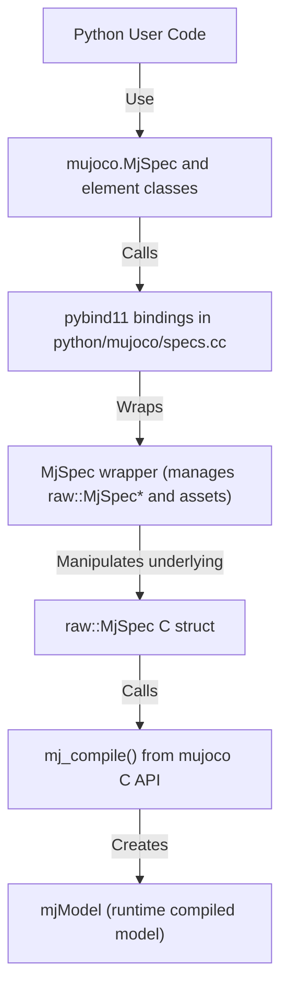
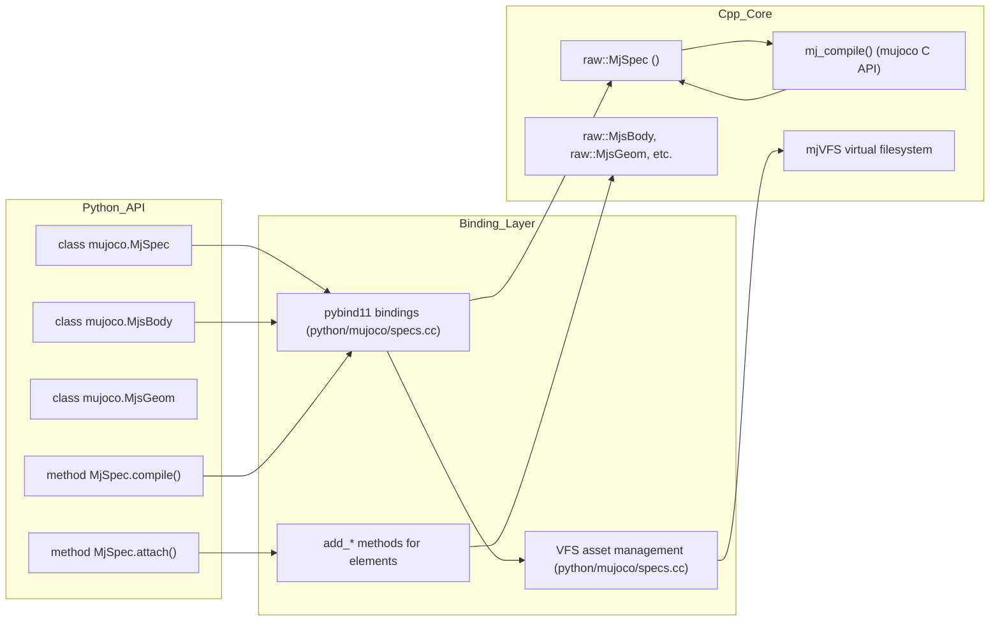

<!-- source: DeepWiki mcp.deepwiki.com · repo google-deepmind/mujoco · page 2.3 Python MjSpec API · fetched 2026-10-26 -->

# Python MjSpec API

<details>
<summary>Relevant source files</summary>

The following files were used as context for generating this wiki page:

- [python/mujoco/codegen/generate_spec_bindings.py](python/mujoco/codegen/generate_spec_bindings.py)
- [python/mujoco/specs.cc](python/mujoco/specs.cc)
- [python/mujoco/specs_test.py](python/mujoco/specs_test.py)

</details>


## Purpose and Scope

The Python MjSpec API offers a comprehensive Python interface to MuJoCo's intermediate model specification representation, `mjSpec`. It facilitates programmatic creation, manipulation, and composition of MuJoCo models directly from Python without the need for XML. The API provides classes for model elements, supports an efficient attachment system for model composition, and exposes functionality to compile the specification into runtime MuJoCo models.

This page covers the internal structure and the usage patterns of the Python MjSpec API, focusing on the `MjSpec` class, element manipulation APIs, the attachment mechanism, and the code generation strategy used to create the bindings. For underlying C++ details, see the C++ mjSpec API [2.2](). For XML reference, see the MJCF XML Format [2.1]().

---

## Architecture Overview

### Layered Structure and Data Flow

The Python MjSpec API is layered to bridge Python usage and the C++ core intermediate representation. The data flow from Python user code to the native MuJoCo compilation can be summarized as:



- `mujoco.MjSpec` acts as the primary Python class wrapping a raw pointer to `raw::MjSpec`.
- Element classes like `MjsBody`, `MjsGeom` hold lightweight references to sub-elements in the raw spec.
- The `Compile()` method converts the spec into an `mjModel*` by invoking native MuJoCo runtime compilation.
- Assets added to the `MjSpec` (like meshes or textures as bytes) are injected into an optional virtual file system (`mjVFS`) during compilation.

This layering ensures efficient memory management and seamless integration into Python workflows without compromising the rich functionality of underlying C++ structs.

Sources: [python/mujoco/specs.cc:25-154](), [python/mujoco/specs_test.py:67-146]()

---

### Class Hierarchy and Element Composition

The Python MjSpec API models the MJCF element hierarchy with dedicated Python classes matching MuJoCo's `mjs*` structs. This includes `MjsBody`, `MjsGeom`, `MjsSite`, `MjsJoint`, `MjsFrame`, `MjsCamera`, `MjsLight`, `MjsMesh`, `MjsTexture`, `MjsMaterial`, `MjsActuator`, and others.

#### Key Relationships:

```mermaid
graph TB
    MjSpec["mujoco.MjSpec\n(Root - containing all model data)"]
    MjsBody["mujoco.MjsBody\n(Body element)"]
    MjsGeom["mujoco.MjsGeom"]
    MjsSite["mujoco.MjsSite"]
    MjsJoint["mujoco.MjsJoint"]
    MjsFrame["mujoco.MjsFrame"]
    MjsCamera["mujoco.MjsCamera"]
    MjsLight["mujoco.MjsLight"]
    MjsMesh["mujoco.MjsMesh"]
    MjsTexture["mujoco.MjsTexture"]
    MjsMaterial["mujoco.MjsMaterial"]
    MjsActuator["mujoco.MjsActuator"]
    MjsSensor["mujoco.MjsSensor"]
    MjsTendon["mujoco.MjsTendon"]

    MjSpec -->|worldbody| MjsBody
    MjSpec -->|add_mesh()| MjsMesh
    MjSpec -->|add_texture()| MjsTexture
    MjSpec -->|add_material()| MjsMaterial
    MjSpec -->|add_actuator()| MjsActuator
    MjSpec -->|add_sensor()| MjsSensor
    MjSpec -->|add_tendon()| MjsTendon

    MjsBody -->|add_body()| MjsBody
    MjsBody -->|add_geom()| MjsGeom
    MjsBody -->|add_site()| MjsSite
    MjsBody -->|add_joint()| MjsJoint
    MjsBody -->|add_frame()| MjsFrame
    MjsBody -->|add_camera()| MjsCamera
    MjsBody -->|add_light()| MjsLight
```

- `MjSpec.worldbody` is the root body tree of the model.
- Nested bodies and other elements (geoms, sites, joints, frames, cameras, lights) can be recursively added under bodies.
- Other assets such as meshes, textures, materials, actuators, sensors, and tendons are attached to the root `MjSpec`.

These classes are reference-like wrappers: they do not copy underlying data but reflect and modify the native C++ structures in-place.

Sources: [python/mujoco/specs.cc:139-179](), [python/mujoco/specs_test.py:38-146]()

---

## Loading and Parsing Model Specifications

### Creating MjSpec from XML or Files

The Python API allows creating an `MjSpec` from various sources:

- **from_string(xml: str, assets: Optional[dict])**  
  Loads a spec by parsing MJCF XML or a similar format provided as a string.  
  Optional `assets` dictionary can provide additional files (meshes, textures) as binary buffers to be injected into a virtual file system (VFS).

- **from_file(path: str, assets: Optional[dict])**  
  Loads a spec from an XML file on disk, similarly with optional asset injection.

Internally, when assets are provided, a MuJoCo VFS (`mjVFS`) is constructed, and assets are added as virtual buffers before compilation, enabling seamless referencing in XML (e.g., mesh files).

```python
spec = mujoco.MjSpec.from_string(xml_string, assets={'mesh.stl': mesh_bytes})
model = spec.compile()
```

Assets can be used to avoid filesystem dependencies and enable precise control of all model resources in memory.

Source snippets implementing loading with assets and VFS usage are found in [python/mujoco/specs.cc:85-113]() and tested via [python/mujoco/specs_test.py:20-146]().

---

## Constructing and Manipulating Model Elements

### Adding Elements with Initialization kwargs

The Python bindings provide `add_*` methods for elements with optional keyword arguments to initialize any element attributes upon creation. This allows concise and declarative element construction, e.g.:

```python
spec = mujoco.MjSpec()
body = spec.worldbody.add_body(name='my_body', pos=[1, 2, 3])
geom = body.add_geom(type=mujoco.mjtGeom.mjGEOM_SPHERE, size=[0.1])
```

This mechanism is broadly supported across element types including `body`, `geom`, `site`, `joint`, `mesh`, `material`, `actuator`, `equalities`, `pair`, etc. [python/mujoco/codegen/generate_spec_bindings.py:30-55]()

- Keyword arguments map directly to struct fields.
- Array fields map to NumPy arrays or sequences.
- Enums are exposed as Python enum constants for clarity and safety.
- The system validates bounds (e.g., list indices) and value types. [python/mujoco/specs.cc:126-140]()

### Orientation Resolution Helper

The `MjSpec` class provides a static helper to resolve orientation specifications (Euler angles, axis-angle) into quaternions respecting the spec compiler's settings like Euler sequence and degree/radian mode. This allows users to specify orientations flexibly and consistently.

Example usage:

```python
quat = mujoco.MjSpec.resolve_orientation(
    degree=spec.compiler.degree,
    sequence=spec.compiler.eulerseq,
    orientation=body.alt,
)
```

Sources: [python/mujoco/specs_test.py:173-184]()

---

## Element Access, Traversal, and Queries

### Finding Elements

Elements support traversal and querying functions:

- `find_all(objtype: mujoco.mjtObj, recursive: bool = False) -> List[MjStruct]`  
  Retrieve a list of child elements of a specified object type (e.g., `mjOBJ_BODY`, `mjOBJ_GEOM`) optionally searching recursively down the tree. [python/mujoco/specs.cc:147-187]()

Traversal uses the underlying C API traversal functions (`mjs_firstChild`, `mjs_nextChild`), raising exceptions if errors occur. [python/mujoco/specs.cc:149-153]()

Example:

```python
geoms = body.find_all(mujoco.mjtObj.mjOBJ_GEOM, recursive=True)
```

### Direct Property Access

Child elements are also often exposed as list properties on parent elements (e.g., `spec.meshes`, `body.geoms`), providing Pythonic direct array-like access.

Sources: [python/mujoco/specs.cc:147-187](), [python/mujoco/codegen/generate_spec_bindings.py:30-55]()

---

## Model Composition via Attachment System

### Attaching Specs to Frames/Sites

The Python API supports the MuJoCo attachment system whereby one `MjSpec` or sub-element can be attached to a host frame or site in another spec, enabling modular model composition.

Example:

```python
parent_spec = mujoco.MjSpec.from_string(parent_xml)
child_spec = mujoco.MjSpec.from_string(child_xml)

parent_spec.attach(child_spec, site="mount", prefix="child_", suffix="_v1")
```

- The `attach` method modifies names in the attached subtree to prevent collisions using the specified `prefix` and `suffix`.
- Attachments can be targeted to a `frame` or a `site` in the host spec.
- The system ensures that assets in the child spec are either merged into the parent or managed via a shared virtual file system.

This mechanism enables reuse and dynamic composition of modularly developed models.

Sources: [python/mujoco/specs.cc:85-113]()

---

## Compilation to Runtime Model

### Compile Method

The `MjSpec.compile()` method invokes MuJoCo's compiler on the specification, producing a `mjModel` (runtime model) usable for simulation. [python/mujoco/specs_test.py:75-75]()

- It accepts an optional `mjVFS*` for virtual filesystem overrides [python/mujoco/specs.cc:85-112]().
- Throws exceptions if compilation fails [python/mujoco/specs.cc:150-153]().
- Ensures assets are correctly loaded into VFS if specified [python/mujoco/specs.cc:90-106]().

On success, the returned `mjModel` can be combined with `mjData` and other runtime APIs for simulation. [python/mujoco/specs_test.py:147-149]()

Example:

```python
model = spec.compile()
data = mujoco.MjData(model)
mujoco.mj_forward(model, data)
```

Sources: [python/mujoco/specs.cc:85-112](), [python/mujoco/specs_test.py:75-78]()

---

## Code Generation of Bindings

### generate_spec_bindings.py Script

This Python script automates the generation of pybind11 binding code for `mjs*` structs: [python/mujoco/codegen/generate_spec_bindings.py:15-25]()

- Parses introspection AST for structs and enums. [python/mujoco/codegen/generate_spec_bindings.py:21-23]()
- For each spec element struct (`mjsBody`, `mjsGeom`, etc.), it outputs: [python/mujoco/codegen/generate_spec_bindings.py:30-55]()
  - Getter/setter property code for scalar fields (integers, floats, enums). [python/mujoco/codegen/generate_spec_bindings.py:68-130]()
  - Array access wrappers via `MjTypeVec` template classes. [python/mujoco/specs.cc:115-145]()
  - Nested anonymous struct property bindings. [python/mujoco/codegen/generate_spec_bindings.py:132-150]()
- The generated code is inserted into `specs.cc` for building the Python extension.

This automated approach ensures consistency, coverage, and maintenance ease for the large set of spec element types and fields.

---

## Summary Diagram: Python MjSpec API Entities to Code Entities



Sources: [python/mujoco/specs.cc:30-187](), [python/mujoco/codegen/generate_spec_bindings.py:30-65]()

---

## Summary Table: Core Python MjSpec API Components

| Python API Class/Method | Purpose | Implementation Location |
|------------------------|---------|-------------------------|
| `mujoco.MjSpec` | Root model specification wrapper | [python/mujoco/specs.cc:85-112]() |
| `MjSpec.worldbody` | Root body element, base of body tree | [python/mujoco/specs_test.py:59-59]() |
| `add_body()`, `add_geom()` etc. | Methods to add sub-elements with kwargs support | [python/mujoco/codegen/generate_spec_bindings.py:30-65]() |
| `MjSpec.compile()` | Compile spec to runtime `mjModel` | [python/mujoco/specs_test.py:75-75]() |
| `MjSpec.attach()` | Attach another spec or subtree to body/site/frame | [python/mujoco/specs.cc:180-224]() |
| `resolve_orientation()` | Static helper for quaternion conversion | [python/mujoco/specs_test.py:173-184]() |
| VFS Asset Injection | Support for in-memory assets mapped into virtual filesystem | [python/mujoco/specs.cc:85-112]() |

---

# Sources

- [python/mujoco/specs.cc:25-187]()
- [python/mujoco/specs_test.py:20-184]()
- [python/mujoco/codegen/generate_spec_bindings.py:15-150]()

---

