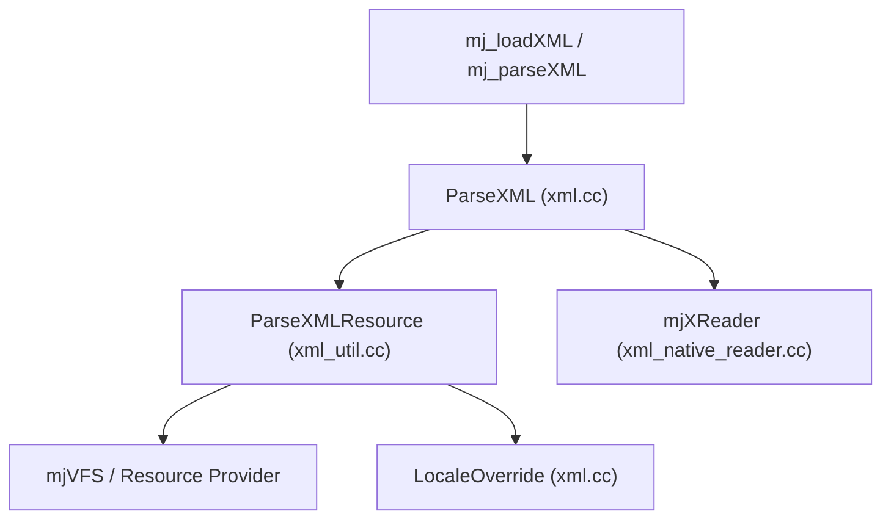
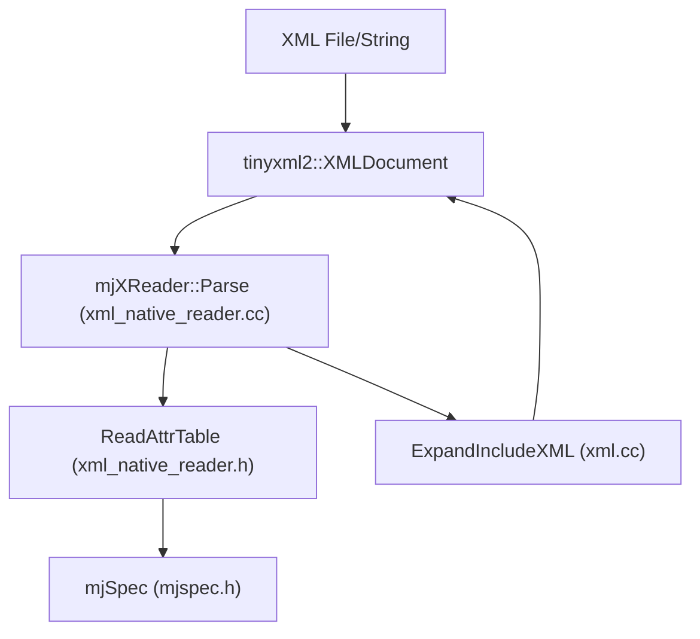
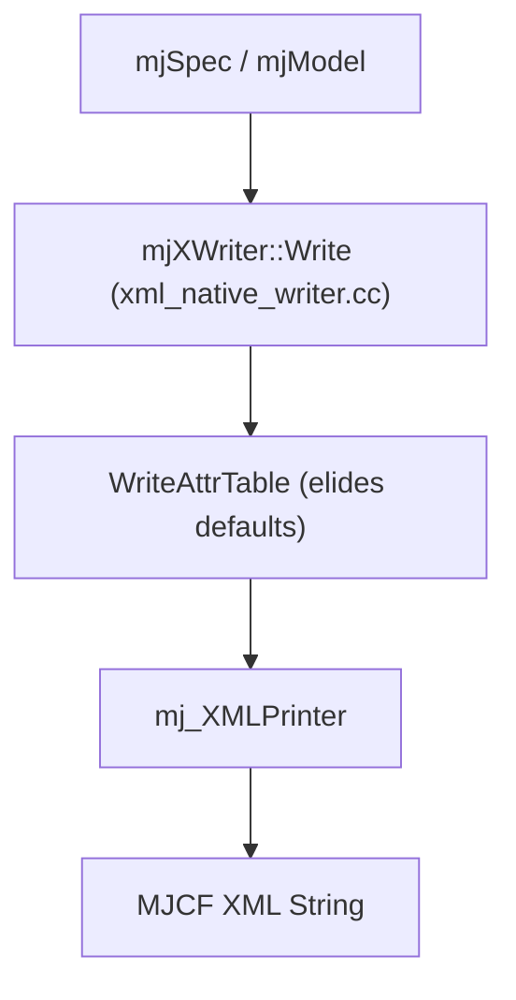
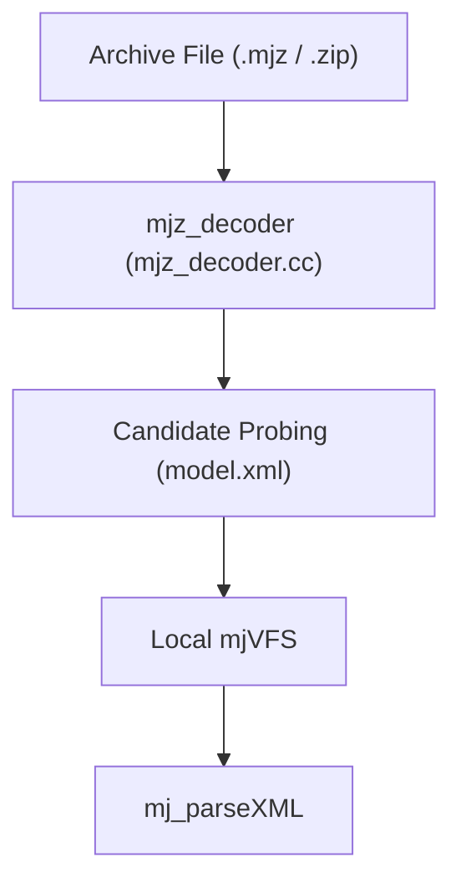
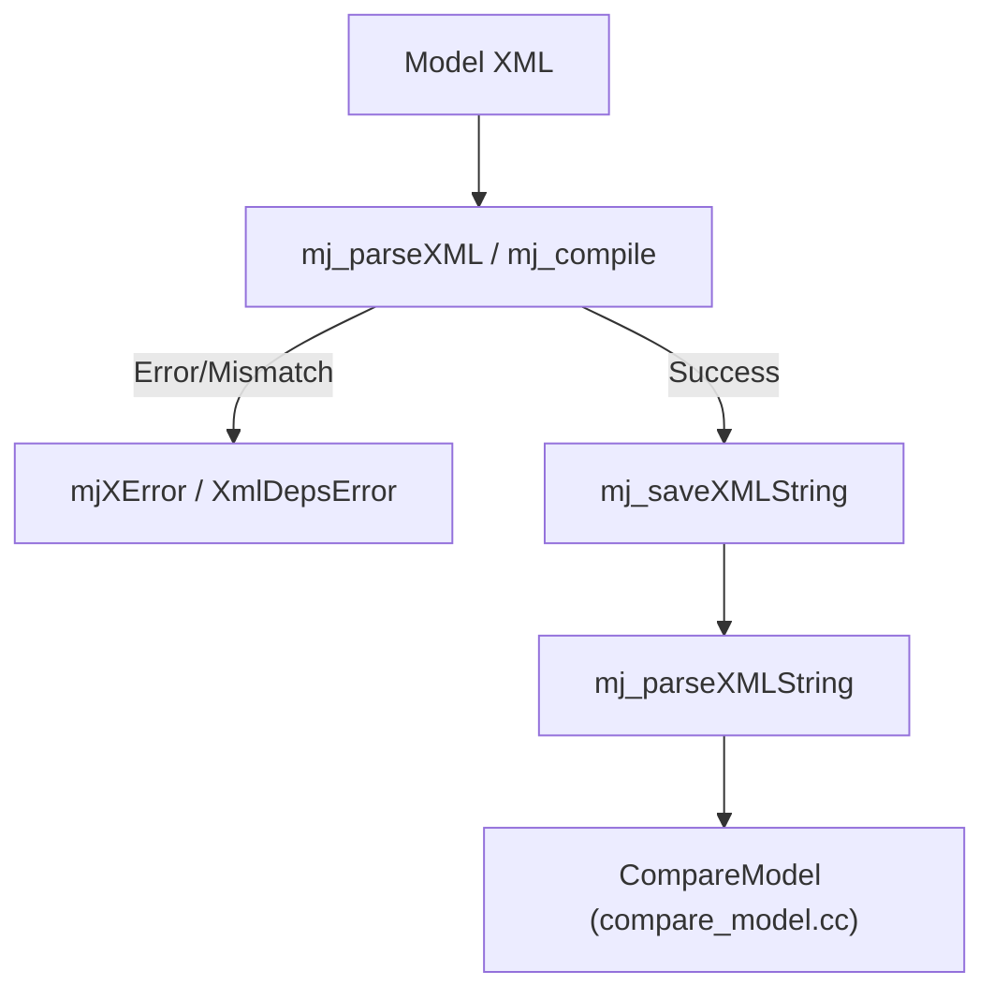

<!-- source: DeepWiki mcp.deepwiki.com · repo google-deepmind/mujoco · page 2.4 XML Parsing and Writing · fetched 2026-10-26 -->

# XML Parsing and Writing

Relevant source files

The following files were used as context for generating this wiki page:

- [src/xml/mjz/CMakeLists.txt](src/xml/mjz/CMakeLists.txt)
- [src/xml/mjz/mjz_archive_provider.cc](src/xml/mjz/mjz_archive_provider.cc)
- [src/xml/mjz/mjz_decoder.cc](src/xml/mjz/mjz_decoder.cc)
- [src/xml/mjz/mjz_encoder.cc](src/xml/mjz/mjz_encoder.cc)
- [src/xml/xml.cc](src/xml/xml.cc)
- [src/xml/xml.h](src/xml/xml.h)
- [src/xml/xml_api.cc](src/xml/xml_api.cc)
- [src/xml/xml_base.cc](src/xml/xml_base.cc)
- [src/xml/xml_base.h](src/xml/xml_base.h)
- [src/xml/xml_native_reader.h](src/xml/xml_native_reader.h)
- [src/xml/xml_native_writer.h](src/xml/xml_native_writer.h)
- [src/xml/xml_util.cc](src/xml/xml_util.cc)
- [src/xml/xml_util.h](src/xml/xml_util.h)
- [test/user/user_recompile_test.cc](test/user/user_recompile_test.cc)
- [test/xml/mjz/CMakeLists.txt](test/xml/mjz/CMakeLists.txt)
- [test/xml/mjz/mjz_archive_provider_test.cc](test/xml/mjz/mjz_archive_provider_test.cc)
- [test/xml/mjz/mjz_decoder_test.cc](test/xml/mjz/mjz_decoder_test.cc)
- [test/xml/mjz/mjz_encoder_test.cc](test/xml/mjz/mjz_encoder_test.cc)
- [test/xml/mjz/testdata/meshdir_rewrite_test/assets/mesh.obj](test/xml/mjz/testdata/meshdir_rewrite_test/assets/mesh.obj)
- [test/xml/mjz/testdata/meshdir_rewrite_test/mesh.obj](test/xml/mjz/testdata/meshdir_rewrite_test/mesh.obj)
- [test/xml/mjz/testdata/meshdir_rewrite_test/model.xml](test/xml/mjz/testdata/meshdir_rewrite_test/model.xml)
- [test/xml/xml_schema_test.cc](test/xml/xml_schema_test.cc)
- [test/xml/xml_utils_test.cc](test/xml/xml_utils_test.cc)
- [test/xml/xml_write_read_test.cc](test/xml/xml_write_read_test.cc)

## Purpose and Scope

This page describes the XML parsing (`src/xml/xml_native_reader.cc`) and writing (`src/xml/xml_native_writer.cc`) infrastructure in MuJoCo. It covers high-level API entry points (`src/xml/xml_api.cc`), utility functions and schema validation (`src/xml/xml_util.cc`), virtual archive encoding and decoding (`mjz` archives), round-trip preservation, and rigorous error handling.

For details on the MJCF XML format itself, see [MJCF XML Format](#2.1). For information on the `mjSpec` API populated by the parser, see [mjSpec C++ API](#2.2) and [Python MjSpec API](#2.3). For compilation into runtime `mjModel` structures, see [Compilation Process](#2.6).

---

## XML API Infrastructure (`xml_api.cc` & `xml_util.cc`)

MuJoCo exposes high-level C functions for loading, saving, and querying XML models and specs. These functions wrap the internal reader, writer, and compiler engines.

### Key API Functions

- `mj_loadXML`: Parses an XML file (MJCF or URDF) via `ParseXML()`, compiles it using `mj_compile()`, and returns an allocated `mjModel*` [src/xml/xml_api.cc:40-70]().
- `mj_parseXML` / `mj_parseXMLString`: Parses XML files or strings directly into an `mjSpec*` structure without compilation [src/xml/xml_api.cc:153-161]().
- `mj_saveXML` / `mj_saveXMLString`: Serializes an `mjSpec*` back into an XML file or string buffer [src/xml/xml_api.cc:165-198]().
- `mj_printSchema`: Outputs the internal XML schema as plain text or HTML for documentation generation [src/xml/xml_api.cc:104-126]().

### Locale Independence via `LocaleOverride`

When MuJoCo runs inside host applications (e.g., Unity) that modify the system locale (such as European locales where commas `,` replace periods `.` as decimal separators), number parsing and formatting can fail. MuJoCo uses a thread-safe `LocaleOverride` RAII wrapper to temporarily enforce the `"C"` locale during XML operations [src/xml/xml.cc:55-97]().

### File Path Resolution and Resources

`ResolveFilePath` and `ParseXMLResource` in `xml_util.cc` handle locating files through the MuJoCo resource provider infrastructure, supporting standard OS file paths, VFS buffers, and remote resource URIs [src/xml/xml_util.cc:85-164]().

Sources: [src/xml/xml_api.cc:40-198](), [src/xml/xml_util.cc:85-164](), [src/xml/xml.cc:55-97]()

---

## XML Parsing Architecture (`xml_native_reader.cc`)

The parser uses the `tinyxml2` DOM library to read elements into `mjSpec` data structures.

### Core Parsing Components

- `mjXReader`: The primary reader class implementing element-by-element parsing, attribute table reading, and default class management [src/xml/xml_native_reader.h:29-121]().
- Table-Driven Attribute Reading: Driven by auto-generated `mjXAttr` schema rows (`mjcf_read_table.inc`), `ReadAttrTable` and `ReadAttrTableCore` parse attributes directly into spec fields with type safety and validation [src/xml/xml_native_reader.h:76-83]().
- Meta-Elements (`<include>`): `ExpandIncludeXML` recursively loads included XML files, mounting subtrees into the DOM while checking for circular dependencies [src/xml/xml.cc:107-188]().

#### Parsing Code Entity Flow

Sources: [src/xml/xml_native_reader.h:29-121](), [src/xml/xml.cc:107-188]()

---

## XML Writing Architecture (`xml_native_writer.cc`)

The writer serializes `mjSpec` (and optionally runtime `mjModel` data) back into clean MJCF XML strings.

### Key Writing Mechanisms

- `mjXWriter`: Main writer class responsible for traversing the model spec and writing elements [src/xml/xml_native_writer.h:29-37]().
- Attribute Elision: To ensure concise output, `WriteAttrTable` compares each attribute value against its default class counterpart (`def`), omitting attributes that match their defaults [src/xml/xml_native_writer.h:78-85]().
- Custom Formatting: Uses custom indentation and blank line insertion before major top-level sections (e.g., `<worldbody>`, `<actuator>`).

Sources: [src/xml/xml_native_writer.h:29-137]()

---

## MJZ Archive Encode/Decode Infrastructure

MuJoCo supports compressed archives (`.mjz` and `.zip` files) containing a model XML file alongside its associated assets (meshes, textures).

### Decoder Plugin (`mjz_decoder.cc`)

Registered via the plugin system (`mjpDecoder`), the MJZ decoder identifies `.mjz` and `.zip` files, mounts them into a VFS, and probes for candidate model entry points (e.g., `model.xml`, `<stem>.xml`, `<stem>/model.xml`) before parsing [src/xml/mjz/mjz_decoder.cc:25-78]().

### Encoder (`mjz_encoder.cc`)

The MJZ encoder packs an `mjSpec` and compiled `mjModel` into a zip archive, ensuring root XML files are named `model.xml` and asset paths maintain forward slashes [test/xml/mjz/mjz_encoder_test.cc:150-200]().

Sources: [src/xml/mjz/mjz_decoder.cc:25-78]()

---

## Round-Trip Preservation and Error Handling

### Round-Trip Validation

MuJoCo tests model round-tripping across its entire test suite via `WriteReadCompareTest` [test/xml/xml_write_read_test.cc:75-171]() and `GetRecompileTestModels()` [test/user/user_recompile_test.cc:50-76](). Models are parsed, compiled, saved back to XML, re-parsed, re-compiled, and compared against the original runtime model to ensure numerical and structural equivalence.

### Error Handling

Parsing and validation errors throw `mjXError` exceptions containing descriptive messages and element context [src/xml/xml_util.h:40-49](). Internal utility `ThrowXmlDepsError` safely catches and formats dependency analysis failures before propagating through language bindings [src/xml/xml_util.cc:114-123]().

Sources: [src/xml/xml_util.h:40-49](), [src/xml/xml_util.cc:114-123](), [test/xml/xml_write_read_test.cc:75-171]()

---

