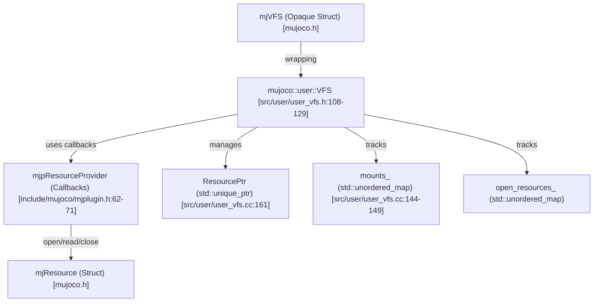
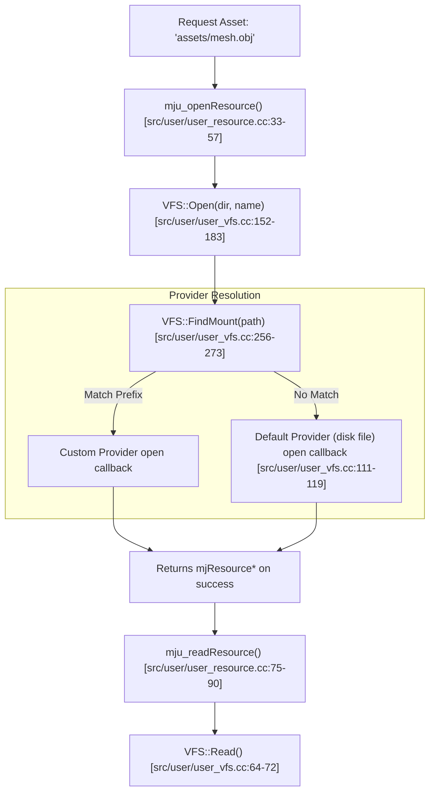
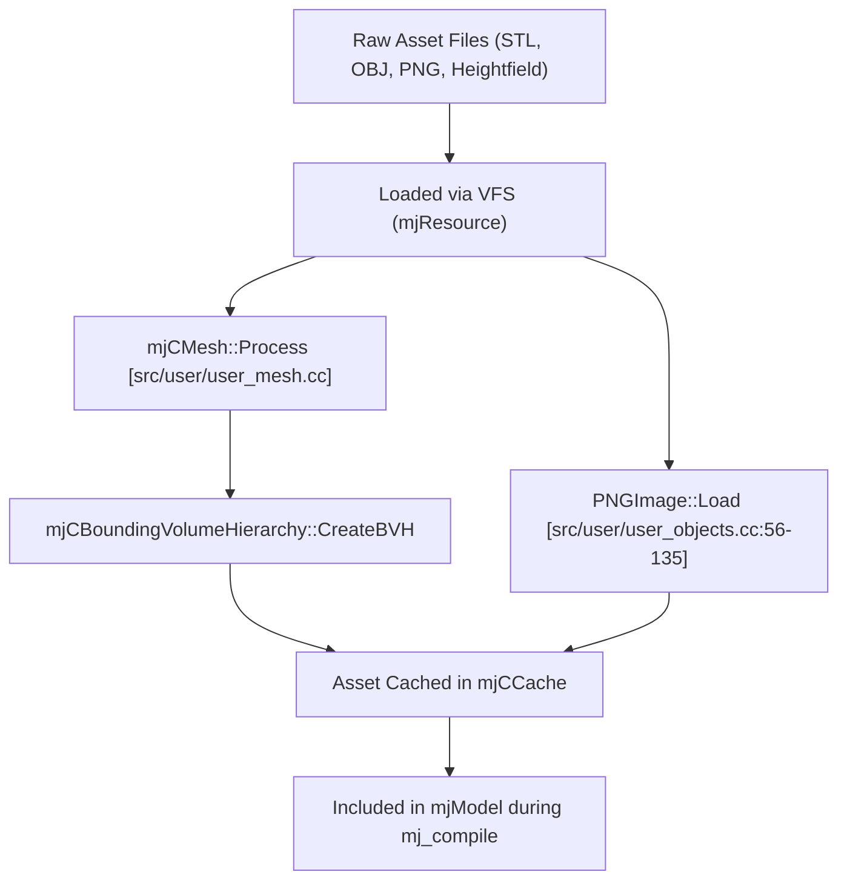

<!-- source: DeepWiki mcp.deepwiki.com · repo google-deepmind/mujoco · page 2.5 Asset Management and VFS · fetched 2026-10-26 -->

# Asset Management and VFS

Relevant source files

The following files were used as context for generating this wiki page:

- [doc/XMLreference.rst](doc/XMLreference.rst)
- [doc/XMLschema.rst](doc/XMLschema.rst)
- [doc/changelog.rst](doc/changelog.rst)
- [doc/programming/extension.rst](doc/programming/extension.rst)
- [include/mujoco/mjplugin.h](include/mujoco/mjplugin.h)
- [src/engine/engine_plugin.cc](src/engine/engine_plugin.cc)
- [src/engine/engine_plugin.h](src/engine/engine_plugin.h)
- [src/user/user_api.cc](src/user/user_api.cc)
- [src/user/user_api.h](src/user/user_api.h)
- [src/user/user_cache.cc](src/user/user_cache.cc)
- [src/user/user_cache.h](src/user/user_cache.h)
- [src/user/user_mesh.cc](src/user/user_mesh.cc)
- [src/user/user_model.cc](src/user/user_model.cc)
- [src/user/user_model.h](src/user/user_model.h)
- [src/user/user_objects.cc](src/user/user_objects.cc)
- [src/user/user_objects.h](src/user/user_objects.h)
- [src/user/user_resource.cc](src/user/user_resource.cc)
- [src/user/user_resource.h](src/user/user_resource.h)
- [src/user/user_vfs.cc](src/user/user_vfs.cc)
- [src/user/user_vfs.h](src/user/user_vfs.h)
- [src/xml/xml_native_reader.cc](src/xml/xml_native_reader.cc)
- [src/xml/xml_native_writer.cc](src/xml/xml_native_writer.cc)
- [test/plugin/decoder/decoder_test.cc](test/plugin/decoder/decoder_test.cc)
- [test/user/user_api_test.cc](test/user/user_api_test.cc)
- [test/user/user_cache_test.cc](test/user/user_cache_test.cc)
- [test/user/user_mesh_test.cc](test/user/user_mesh_test.cc)
- [test/user/user_objects_test.cc](test/user/user_objects_test.cc)
- [test/user/user_resource_test.cc](test/user/user_resource_test.cc)
- [test/user/user_vfs_test.cc](test/user/user_vfs_test.cc)
- [test/xml/xml_api_test.cc](test/xml/xml_api_test.cc)
- [test/xml/xml_native_reader_test.cc](test/xml/xml_native_reader_test.cc)
- [test/xml/xml_native_writer_test.cc](test/xml/xml_native_writer_test.cc)

## Purpose and Scope

This page documents the MuJoCo asset management system, focusing on the loading, processing, caching, and deduplication of external resources such as meshes, textures, and heightfields. It details the Virtual File System (VFS) architecture, which allows for flexible asset handling from various sources (disk, memory, custom providers), and the resource provider system that enables custom loading logic. Additionally, it covers processing pipelines for geometry, including bounding volume hierarchy (BVH) construction, signed distance field (SDF) generation, texture embedding vs. passthrough modes, and asset deduplication.

---

## Virtual File System (VFS) and Resource Providers

MuJoCo abstracts resource loading via a Virtual File System implemented in C++ (`mujoco::user::VFS`) and exposed through a C API type `mjVFS`. Instead of direct disk I/O, MuJoCo handles assets through `mjResource` handles obtained via VFS operations. This architecture supports loading resources from memory buffers, custom data sources (network, archives), or standard filesystem transparently.

### VFS Architecture

The core class `mujoco::user::VFS` manages mounts and resource providers. A **resource provider** (`mjpResourceProvider`) implements callbacks to open, read, close, mount, unmount, and check modification times of resources. The VFS maintains a map of mounts keyed by path, delegating resource I/O to the correct provider based on prefix matching.

**Code Entities and Relationships in VFS**

The **mount system** allows mounting multiple resource providers at various path prefixes, enabling layered resource resolution (e.g., memory buffers overriding files on disk).

Key methods:
- `VFS::Open(const char* dir, const char* name)` opens a resource, selects provider by mount prefix, calls its open callback, manages resource lifetime.
- `VFS::Mount(const FilePath& path, const mjpResourceProvider* provider)` mounts a provider at a given path prefix.
- `VFS::Close(mjResource* res)` closes the resource, invoking provider close callback.
- `VFS::ContainsFile()` and `ContainsBuffer()` query mounted resources.

Sources: [src/user/user_vfs.h:108-129](), [src/user/user_vfs.cc:108-250]()

### Resource Loading Flow

When MuJoCo needs to load an asset such as a mesh or texture, it calls `mju_openResource()`, which delegates to the `VFS` instance to open the requested file or name.

The flow is as follows:

The resource provider's `open` callback initializes `mjResource`, sets `data` and timestamp, and on success the engine can read from it via `mju_readResource`.

Sources: [src/user/user_resource.cc:33-90](), [src/user/user_vfs.cc:152-184](), [src/user/user_vfs.cc:64-72]()

---

## Asset Caching System

To improve compilation performance for reusable assets like large meshes or textures, MuJoCo caches processed assets linked to timestamps.

### `mjCCache` Global Cache

`mjCCache` manages a global cache of `mjCAsset` objects representing loaded and processed assets. This cache supports:

- **Timestamp Validation**: With timestamps encoded from resource modification times, cache validity is checked via `mju_isModifiedResource` to detect changed files [src/user/user_cache.cc:114-120]().

- **LRU Eviction**: Cache entries are kept under a global size limit (default 500 MB) and trimmed by least-recently-used policy to free memory [src/user/user_cache.cc:189]().

- **Reference Counting**: Each cached asset tracks which models reference it to avoid premature release [src/user/user_cache.cc:131-140]().

- **Configurable Cache Size**: A default size constant `kGlobalCacheSize` (500MB) is specified in the API layer, modifiable as needed [src/user/user_api.cc:53-54]().

This cache enables workflows like model recompilation (`mj_recompile`) to reuse unchanged asset data efficiently.

| Feature                | Details                                                   |
|------------------------|-----------------------------------------------------------|
| Cache Key              | Asset file path or unique identifier                      |
| Cache Entries          | `mjCAsset` (processed asset data with timestamps)        |
| Validity Check         | `mju_isModifiedResource` compares timestamps              |
| Eviction Strategy      | Least Recently Used based on usage order                   |
| Reference Management   | Tracks referencing models to manage asset lifetimes       |
| Default Max Size       | 500 MB (configurable via `kGlobalCacheSize`)              |

Sources: [src/user/user_cache.cc:40-150](), [src/user/user_cache.h:18-130](), [src/user/user_api.cc:53-54]()

---

## Asset Processing: Meshes, Textures, and BVH

MuJoCo transforms raw assets into efficient runtime representations during model compilation.

### Mesh Processing (`mjCMesh`)

The class `mjCMesh` encapsulates geometry loading and processing for mesh assets. It supports STL, OBJ, MSH file formats and processes them into internal data structures.

Features include:
- **File Decoding**: Uses format-specific loaders to parse vertex, normal, and face data.
- **Convex Hull Generation**: For collision shapes, a hull is computed using `qhull` library integration to generate convex decomposition when needed [src/user/user_mesh.cc:71-73]().
- **Inertia and Volume Computation**: Computes triangle areas, surface normals, and mesh centers to estimate mass properties required by the physics engine [src/user/user_mesh.cc:154-188]().
- **Signed Distance Field (SDF)**: Meshes can interact with SDF plugins for collision and sensor purposes [src/user/user_mesh.cc:62-64]().
- **Auxiliary Data**: Maintains transformed vertex positions, bounding boxes, and mesh statistics.

`mjCMesh` maintains flags for tracking processing state (`processed_`), convexity (`needhull_`), and orientation needs (`needreorient_`).

Sources: [src/user/user_mesh.cc:190-250]()

### Texture Loading, Embedding, and Passthrough

MuJoCo supports PNG textures using the `LodePNG` decoder wrapped by the `PNGImage` class.
- `PNGImage::Load` reads a PNG resource buffer, decodes pixels, and interprets color profiles (sRGB) [src/user/user_objects.cc:56-135]().
- **Texture Embedding vs. Passthrough**: Textures can be kept by reference instead of being fully decoded into `mjModel` memory. By configuring `compiler/passthrough` to `"textures"` or setting `texture/embed` to `"false"`, a texture loaded from a single file is not read at compile time; the model holds its path and content type rather than decoded pixels (`tex_adr` is set to `-1`, reducing loaded model memory significantly).
- **Asset Deduplication**: Functions like `mjs_dedupAssets` (`MjSpec.dedup_assets`) merge textures and meshes within an `mjSpec` that compile to identical assets, pointing all references to the first instance.

Sources: [src/user/user_objects.cc:56-135]()

### Bounding Volume Hierarchies (BVH)

To accelerate collision detection on complex meshes and heightfields, MuJoCo builds bounding volume hierarchies:
- `mjCBoundingVolumeHierarchy` represents the hierarchy with nodes containing axis-aligned bounding boxes (AABB), child indices, and references to elements like triangles or voxels [src/user/user_objects.h:95-153]().
- The BVH is built during compilation from mesh face data or heightfield cells, supporting both static and dynamic hierarchies for efficiency.
- BVHs enable fast spatial queries and collision broadphase pruning.

Sources: [src/user/user_objects.h:95-153]()

**Summary Diagram: Asset Processing Pipeline**

Sources: [src/user/user_mesh.cc:190-250](), [src/user/user_objects.cc:56-135](), [src/user/user_objects.h:95-153](), [src/user/user_cache.cc]()

---

## Summary of Key Functions and Classes

| Code Entity            | File Path                 | Role                                                                                   |
|-----------------------|---------------------------|----------------------------------------------------------------------------------------|
| `mjVFS`               | `include/mujoco/mujoco.h` | Opaque struct representing Virtual File System at the API level.                      |
| `mujoco::user::VFS`   | [src/user/user_vfs.h:108-129]() | Main C++ implementation of VFS, manages mounts and open resources.                    |
| `mjpResourceProvider` | `include/mujoco/mjplugin.h` | Struct defining resource provider callbacks for open/read/close/etc.                 |
| `mjResource`          | `include/mujoco/mjplugin.h` | Resource handle representing an opened asset via VFS.                                |
| `mjCCache`            | [src/user/user_cache.h:18-130]() | Global asset cache for processed assets with timestamp validation and LRU eviction.  |
| `mjCAsset`            | [src/user/user_cache.cc]() | Represents single cached asset and manages references and timestamps.                 |
| `mjCMesh`             | [src/user/user_mesh.cc:190-236]() | Handles mesh asset loading, processing (convex hull, inertia), and storage.           |
| `PNGImage`            | [src/user/user_objects.cc:56-135]() | Loads PNG textures from decoded resources via LodePNG.                                |
| `mjCBoundingVolumeHierarchy` | [src/user/user_objects.h:95-153]() | Manages BVH construction for fast collision queries.                                 |
| `mju_openResource()`  | [src/user/user_resource.cc:33-80]() | Opens a resource through VFS, obtaining a handle for reading asset data.              |
| `mj_compile()`        | [src/user/user_api.cc:43-185]() | High-level compile function that triggers asset processing and builds mjModel.        |

Sources: [src/user/user_vfs.h:108-129](), [src/user/user_vfs.cc:50-250](), [src/user/user_resource.cc:30-90](), [src/user/user_cache.cc:40-150](), [src/user/user_cache.h:10-130](), [src/user/user_mesh.cc:130-250](), [src/user/user_objects.cc:56-135](), [src/user/user_objects.h:90-153](), [src/user/user_api.cc:40-185]()

---

