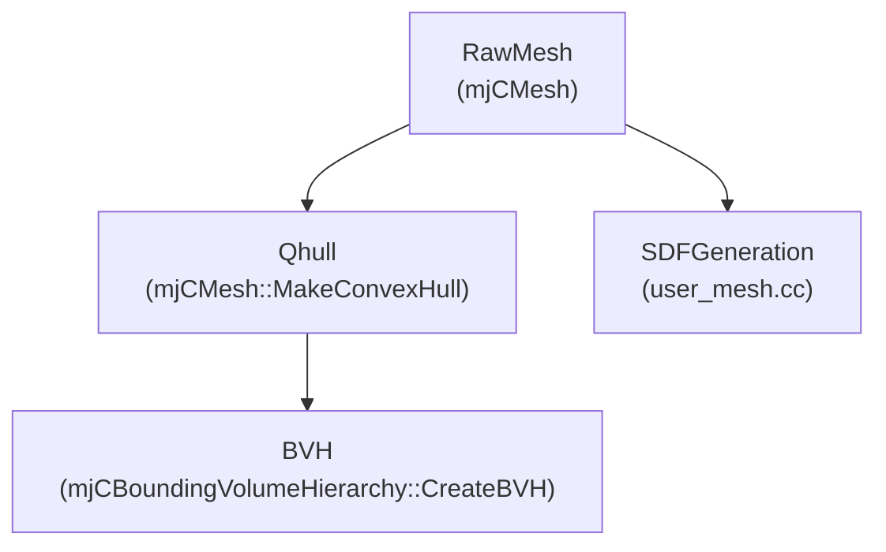
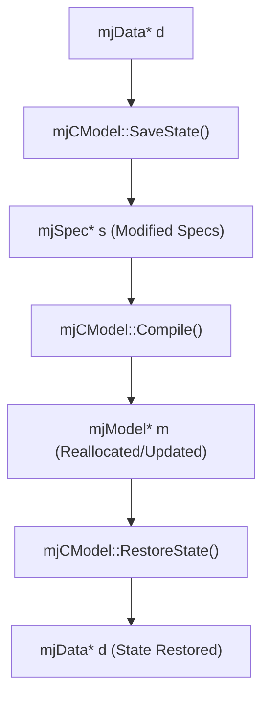

<!-- source: DeepWiki mcp.deepwiki.com · repo google-deepmind/mujoco · page 2.6 Compilation Process · fetched 2026-10-26 -->

# Compilation Process

<details>
<summary>Relevant source files</summary>

The following files were used as context for generating this wiki page:

- [doc/XMLreference.rst](doc/XMLreference.rst)
- [doc/XMLschema.rst](doc/XMLschema.rst)
- [doc/changelog.rst](doc/changelog.rst)
- [src/user/user_api.cc](src/user/user_api.cc)
- [src/user/user_api.h](src/user/user_api.h)
- [src/user/user_mesh.cc](src/user/user_mesh.cc)
- [src/user/user_model.cc](src/user/user_model.cc)
- [src/user/user_model.h](src/user/user_model.h)
- [src/user/user_objects.cc](src/user/user_objects.cc)
- [src/user/user_objects.h](src/user/user_objects.h)
- [src/xml/xml_native_reader.cc](src/xml/xml_native_reader.cc)
- [src/xml/xml_native_writer.cc](src/xml/xml_native_writer.cc)
- [test/user/user_api_test.cc](test/user/user_api_test.cc)
- [test/user/user_mesh_test.cc](test/user/user_mesh_test.cc)
- [test/user/user_model_test.cc](test/user/user_model_test.cc)
- [test/user/user_objects_test.cc](test/user/user_objects_test.cc)
- [test/xml/xml_native_reader_test.cc](test/xml/xml_native_reader_test.cc)
- [test/xml/xml_native_writer_test.cc](test/xml/xml_native_writer_test.cc)

</details>


## Purpose and Scope

This document details the compilation process within MuJoCo, focusing on the workflow from the high-level model specification (`mjSpec` or its internal C++ representation `mjCModel`) to the immutable runtime structure (`mjModel`). It covers the internal mechanics of key compilation functions such as `mj_compile` and `mjs_compile`, including size computation, asset indexing, sparse matrix construction, and `mj_recompile` for in-place model updates.

Sources: [src/user/user_api.cc:59-241](), [src/user/user_model.cc:1173-1259]()

---

## Overview and Entry Points

The compilation process transforms user-friendly model specifications into the optimized, memory-contiguous structures required by the simulation engine. The primary entry points exposed by the C API are `mj_compile` and `mj_recompile`.

### `mj_compile`

```c
mjModel* mj_compile(mjSpec* s, const mjVFS* vfs);
```

- Converts the user-level `mjSpec` (backed by `mjCModel` in `src/user/user_model.cc`) into a flat, runtime-ready `mjModel`.
- Validates structural consistency, allocates a contiguous memory block via `mj_makeModel`, copies and flattens hierarchical elements, and constructs sparse matrices.

Sources: [src/user/user_api.cc:207-210](), [src/user/user_model.cc:1173-1259]()

### `mj_recompile`

```c
int mj_recompile(mjSpec* s, const mjVFS* vfs, mjModel* m, mjData* d);
```

- Performs in-place model updates without discarding the active simulation state.
- Caches current simulation state (positions, velocities, controls, activations) from `mjData` to `mjSpec`.
- Recompiles the model into the existing `mjModel` buffer (reallocating if array sizes expanded).
- Restores the saved state into the updated `mjData`.

Sources: [src/user/user_api.cc:215-241](), [src/user/user_model.cc:2041-2110]()

---

## Detailed Compilation Phases

The internal compilation workflow executed by `mjCModel::TryCompile` follows a rigid sequence of transformations:

| Phase | Function / Class Entity | Description |
| :--- | :--- | :--- |
| **Asset Indexing** | `mjCModel::IndexAssets()` | Assigns unique sequential integer IDs (0 upwards) to all meshes, textures, and heightfields. |
| **Size Computation** | `mjCModel::SetSizes()` | Computes generalized coordinates (`nq`), degrees of freedom (`nv`), actuator counts (`nu`), and sparse matrix non-zero counts (`nM`, `nB`, `nC`, `nD`). |
| **Memory Allocation** | `mj_makeModel()` | Allocates a single contiguous memory buffer for all `mjModel` fields, applying proper alignment constraints. |
| **Object Flattening** | `mjCModel::CopyObjects()` | Serializes hierarchical objects (bodies, geoms, joints, tendons, actuators) into flat runtime arrays. |
| **Sparse Matrix Build** | `mjCModel::MakeSparse()` | Constructs compressed sparse row (CSR) index structures for mass matrices, constraints, and Jacobians. |

Sources: [src/user/user_model.cc:1173-1369](), [src/user/user_model.cc:1589-2039]()

---

## Asset Indexing and Mesh Processing

Assets such as triangle meshes, textures, and heightfields are indexed during compilation. Triangle meshes undergo geometric preprocessing, including convex hull generation via Qhull and Bounding Volume Hierarchy (BVH) construction for fast collision queries.


Sources: [src/user/user_mesh.cc:1115-1163](), [src/user/user_objects.cc:396-543]()

---

## Size Computation and Memory Layout

The `mjCModel::SetSizes()` function calculates exact array dimensions. To maximize cache locality, MuJoCo packs an entire `mjModel` into a single contiguous memory block allocated by `mj_makeModel()`.

- **`nq`**: Dimension of generalized coordinates (`qpos`).
- **`nv`**: Dimension of degrees of freedom (`qvel`).
- **`nM`, `nB`, `nC`, `nD`**: Non-zero counts for sparse matrix structures (`M`, `B`, `C`, `D`).

Pointer offsets within the allocated buffer are calculated using the `SKIP` macro to ensure strict SIMD/AVX alignment requirements.

Sources: [src/user/user_model.h:54-135](), [src/user/user_model.cc:1589-2039](), [src/engine/engine_io.c:131-164]()

---

## Sparse Matrix Construction

Physics calculations rely heavily on sparse matrix representations in Compressed Sparse Row (CSR) format. During compilation, sparsity patterns are determined by analyzing joint trees, body connectivity, and constraint topologies.

- **`mj_makeDofDofSparse()`**: Populates sparsity patterns for the mass matrix `M` and constraint matrix `D`.
- **`mj_makeBSparse()`**: Computes non-zero indices for the body-DOF Jacobian matrix `B`.

Sources: [src/engine/engine_support.c:1027-1049](), [src/user/user_model.cc:3878-3978]()

---

## In-Place Model Recompilation Flow

When `mj_recompile` is invoked, the simulation preserves continuity by saving state vector values before re-allocating runtime structures and restoring configuration parameters.


Sources: [src/user/user_api.cc:215-241](), [src/user/user_model.cc:2041-2110]()

---

## Error Handling in Compilation

Compilation errors are managed via the C++ `mjCError` exception class. If an invalid attribute, missing resource, or malformed specification is encountered, an `mjCError` is thrown containing a detailed diagnostic message and pointer context.

```cpp
class [[nodiscard]] mjCError {
 public:
  mjCError(const mjCBase* obj = 0, const char* msg = 0, const char* str = 0, int pos1 = 0, int pos2 = 0);
  char message[500];
};
```
Sources: [src/user/user_objects.h:77-83](), [src/user/user_objects.cc:194-231]()

---

