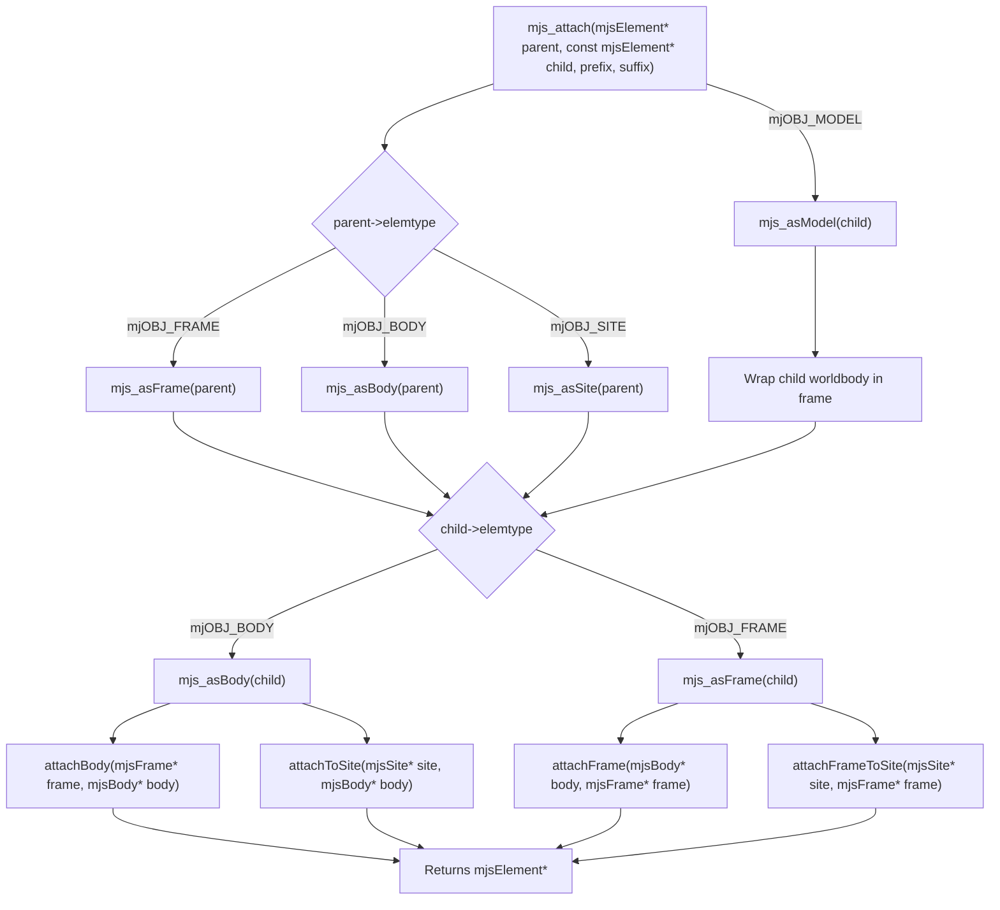
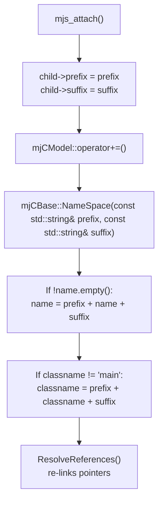
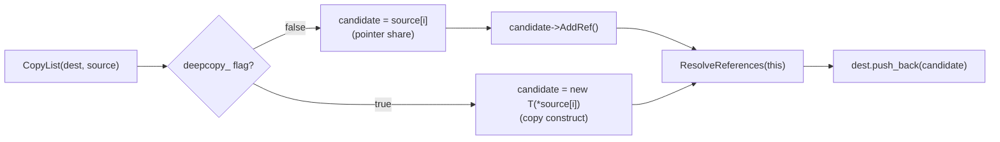

<!-- source: DeepWiki mcp.deepwiki.com · repo google-deepmind/mujoco · page 2.7 Model Composition and Attachment · fetched 2026-10-26 -->

# Model Composition and Attachment

<details>
<summary>Relevant source files</summary>

The following files were used as context for generating this wiki page:

- [python/mujoco/codegen/generate_spec_bindings.py](python/mujoco/codegen/generate_spec_bindings.py)
- [python/mujoco/specs.cc](python/mujoco/specs.cc)
- [python/mujoco/specs_test.py](python/mujoco/specs_test.py)
- [src/user/user_composite.cc](src/user/user_composite.cc)
- [src/user/user_composite.h](src/user/user_composite.h)
- [src/user/user_flexcomp.cc](src/user/user_flexcomp.cc)
- [src/user/user_flexcomp.h](src/user/user_flexcomp.h)
- [test/user/user_flex_test.cc](test/user/user_flex_test.cc)

</details>


## Purpose and Scope

This page documents the **model attachment system** and procedural element generators (`composite` and `flexcomp`) in MuJoCo, which enable the composition of independently developed sub-models into a parent model and the programmatic generation of complex geometric structures (such as cables, grids, meshes, and deformable flexes). The attachment and composition mechanisms allow users to:

- Attach child models or subtrees to parent bodies, frames, or sites (`mjs_attach`, `attachBody`, `attachFrame`) [src/user/user_api.cc:248-323]().
- Manage namespaces with prefix and suffix strings to avoid naming collisions (`mjCBase::NameSpace`) [src/user/user_model.cc:246-285]().
- Control copy behavior (deep vs. shallow) for different use cases via the `deepcopy` flag in `mjCModel` [src/user/user_model.cc:171]().
- Generate procedural multi-body structures using `mjCComposite` (cables, deprecated particles/grids/ropes/loops/cloths) [src/user/user_composite.cc:125-223]() and `mjCFlexcomp` (grids, boxes, cylinders, ellipsoids, meshes, GMSH files) [src/user/user_flexcomp.cc:137-206]().

This system is implemented within the `mjSpec` layer (using internal C++ classes like `mjCModel`, `mjCComposite`, and `mjCFlexcomp`), providing a high-level programmatic and declarative alternative to static XML includes.

**Sources:** [src/user/user_api.h:73-78](), [src/user/user_model.h:51-54](), [src/user/user_api.cc:58-61](), [src/user/user_composite.h:57-124](), [src/user/user_flexcomp.h:54-128]()

---

## Overview of Model Attachment

Model attachment is the primary mechanism for composing complex models from reusable sub-models. Unlike static XML includes, attachment operates on model specification objects (`mjSpec` / `mjCModel`) and provides precise control over namespacing and memory management.

**Key Concepts:**
- **Parent Element**: The attachment point (body, frame, or site) represented by `mjsElement` / `mjCBase` [src/user/user_api.cc:248-253]().
- **Child Element**: The sub-model or subtree being attached (body, frame, or entire model) [src/user/user_api.cc:254-257]().
- **Namespace Management**: Prefix and suffix strings applied to names and classes within the attached subtree [src/user/user_model.h:53-54]().
- **Copy Mode**: Controlled by the `deepcopy_` flag, determining if elements are duplicated or shared [src/user/user_model.cc:171]().

**Sources:** [src/user/user_api.cc:248-323](), [src/user/user_model.cc:152-201](), [src/user/user_model.h:50-55]()

---

## Attachment Points and API

The attachment system supports multiple types of attachment points. The primary C API function is `mjs_attach`, which handles various combinations of parent and child types by delegating to internal C++ routines.

### Core Attachment API

**Function Signature:**
```c
mjsElement* mjs_attach(mjsElement* parent, 
                       const mjsElement* child,
                       const char* prefix, 
                       const char* suffix);
```
[src/user/user_api.h:76-77](), [src/user/user_api.cc:248-251]()

### mjs_attach Logic and Data Flow

The following diagram bridges system-level attachment concepts to code entities within `src/user/user_api.cc`.

**Title: Code Entity Routing in mjs_attach**


### Internal Attachment Implementation

When attaching to a site, MuJoCo creates an intermediate frame to represent the site's relative pose before merging the child body.

**attachToSite Internal Flow (Simplified):**
1. A new frame is added to the parent body: `body->AddFrame(parent->frame)` [src/user/user_api.cc:231]().
2. The frame's position and orientation are set to match the site: `frame->pos = parent->pos` [src/user/user_api.cc:233-234]().
3. Alternative orientations (euler, axisangle) are resolved to quaternions using `mjs_resolveOrientation` [src/user/user_api.cc:236-240](), [src/user/user_objects.cc:238-240]().
4. `attachBody` is called to merge the child body into this new frame [src/user/user_api.cc:242]().

**Sources:** [src/user/user_api.cc:167-323](), [src/user/user_objects.cc:139-148](), [src/user/user_objects.h:89-92]()

---

## Namespace Management

To prevent naming collisions when merging multiple models, the attachment system applies a prefix and suffix to all named entities in the child model.

### Namespace Transformation Logic

When `mjs_attach` is called, it assigns the `prefix` and `suffix` fields on the child `mjCModel` [src/user/user_api.cc:184-185](). During the merge process (triggered by `mjCModel::operator+=`), the `mjCBase::NameSpace` function is invoked on all elements in the subtree.

**Title: NameSpace Transformation Data Flow**


### Elements Affected
- **Names**: All objects inheriting from `mjCBase` (bodies, joints, geoms, sites, etc.) have their `name` updated.
- **Classes**: The `classname` attribute used for MJCF default inheritance is transformed unless it is the default `"main"` class.
- **References**: Internal references (e.g., an actuator targeting a joint name) are updated to match the new namespaced names during the resolution phase [src/user/user_model.cc:280-285]().

**Sources:** [src/user/user_model.cc:246-285](), [src/user/user_model.h:53-54](), [src/user/user_objects.cc:139-148]()

---

## Deep Copy vs. Shallow Copy

The attachment behavior is controlled by the `deepcopy_` flag in `mjCModel` [src/user/user_model.cc:171](). This flag determines whether attached elements are fully duplicated or share ownership pointers with the source.

### Copy Modes

| Mode | API Setting | Behavior |
| :--- | :--- | :--- |
| **Shallow Copy** | `mjs_setDeepCopy(s, 0)` | Increments reference counts (`AddRef`). Changes to the child spec may affect the parent model depending on shared ownership [src/user/user_model.cc:213-215](). |
| **Deep Copy** | `mjs_setDeepCopy(s, 1)` | Invokes copy constructors for all elements in the subtree, creating a fully independent copy [src/user/user_model.cc:213](). |

### Copy Implementation (`CopyList`)

The internal template helper `CopyList` handles duplication logic during model merging.

**Title: CopyList Execution Flow**


**Sources:** [src/user/user_model.cc:171-242](), [src/user/user_api.cc:66-75](), [src/user/user_api.h:66-67]()

---

## Model Composition (`operator+=`)

The core of model composition is the `mjCModel::operator+=` method. It merges two `mjCModel` instances by iterating through all object lists.

### Composition Pipeline
1. **Tree List Management**: Resets and rebuilds the kinematic tree lists (`ResetTreeLists`, `MakeTreeLists`) [src/user/user_model.cc:232-233]().
2. **Asset Merging**: Copies meshes, textures, and materials from the source model to the destination [src/user/user_model.cc:439-450]().
3. **Element Merging**: Merges actuators, sensors, tendons, and equality constraints using `CopyList` [src/user/user_model.cc:451-470]().
4. **Plugin Mapping**: Plugin instances are copied and their namespaced names are mapped to maintain element-to-plugin associations [src/user/user_model.cc:383-422]().
5. **Reference Resolution**: All elements in the merged model re-resolve their internal pointers via `ResolveReferences` [src/user/user_model.cc:280-285]().

### Keyframe Management
When models are composed, keyframes must be resized to accommodate the expanded state space (`nq`, `nv`, `na`). `ExpandAllKeyframes` creates new keyframe objects and maps the old state data into the expanded vectors based on element names [src/user/user_model.cc:1737-1789]().

**Sources:** [src/user/user_model.cc:212-242](), [src/user/user_model.cc:383-422](), [src/user/user_model.cc:1737-1789]()

---

## Composite and Flexcomp Generators

In addition to static model attachment, MuJoCo provides programmatic procedural generators for multi-body systems and deformable structures via `mjCComposite` and `mjCFlexcomp`.

### `mjCComposite` (Composite Objects)
`mjCComposite` generates composite chains, cables, and particle/grid structures [src/user/user_composite.cc:48-124](). While several legacy types (`mjCOMPTYPE_PARTICLE`, `mjCOMPTYPE_GRID`, `mjCOMPTYPE_ROPE`, `mjCOMPTYPE_LOOP`) are deprecated in favor of `flex` and `replicate` [src/user/user_composite.cc:194-218](), `mjCOMPTYPE_CABLE` remains fully supported for modeling elastic cables with plugin-based elasticity (`mujoco.elasticity.cable`) [src/user/user_composite.cc:176-183]().

- **Key Functions**: `mjCComposite::Make` [src/user/user_composite.cc:125](), `mjCComposite::MakeCable` [src/user/user_composite.cc:220](), and skin generators like `MakeSkin2` and `MakeCableBones` [src/user/user_composite.h:67-70]().
- **Namespace Prefix**: Supports custom prefixes per composite instance (`prefix`) for naming generated internal bodies and geoms [src/user/user_composite.h:73]().

### `mjCFlexcomp` (Flexible and Deformable Components)
`mjCFlexcomp` generates structured or unstructured volumetric flexes, cloths, ropes, and deformable bodies from primitives (grids, boxes, cylinders, ellipsoids, squares, discs, circles) or files (meshes and GMSH formats) [src/user/user_flexcomp.cc:65-206](), [src/user/user_flexcomp.h:27-37]().

- **Key Functions**: `mjCFlexcomp::Make` [src/user/user_flexcomp.cc:137](), `MakeGrid`, `MakeBox`, `MakeSquare`, `MakeMesh`, and `MakeGMSH` [src/user/user_flexcomp.h:59-71]().
- **Cell Markings & Pining**: `MarkEmptyCells` identifies empty volumetric cells and automatically pins nodes located exclusively within empty regions [src/user/user_flexcomp.cc:94-133]().
- **Degrees of Freedom**: Configurable via `doftype` (`mjFCOMPDOF_FULL`, `mjFCOMPDOF_RADIAL`, `mjFCOMPDOF_TRILINEAR`, `mjFCOMPDOF_QUADRATIC`, `mjFCOMPDOF_2D`) [src/user/user_flexcomp.h:43-51]().

**Sources:** [src/user/user_composite.cc:48-223](), [src/user/user_composite.h:57-124](), [src/user/user_flexcomp.cc:65-206](), [src/user/user_flexcomp.h:27-128]()

---

## Python API Usage

The Python bindings provide a high-level interface to the attachment system via the `MjSpec`, `MjsBody`, and `MjsSite` classes.

**Example: Attaching a gripper to a robot arm**
```python
import mujoco

# Load robot and gripper specs
robot_spec = mujoco.MjSpec.from_string("<mujoco>...</mujoco>")
gripper_spec = mujoco.MjSpec.from_string("<mujoco>...</mujoco>")

# Find the attachment site on the robot
mount_site = robot_spec.worldbody.find_site("end_effector_site")

# Attach the gripper worldbody to the site with a namespace prefix
attached_body = mount_site.attach(gripper_spec.worldbody, prefix="gripper_")

# Compile the combined spec into an mjModel and mjData
model = robot_spec.compile()
data = mujoco.MjData(model)
```

**Sources:** [python/mujoco/specs.cc:147-187](), [python/mujoco/specs_test.py:178-210](), [python/mujoco/specs_test.py:790-850]()

---

