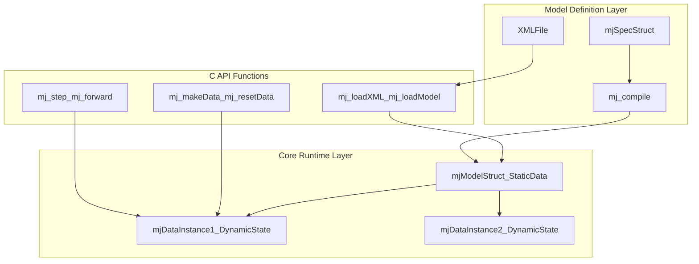
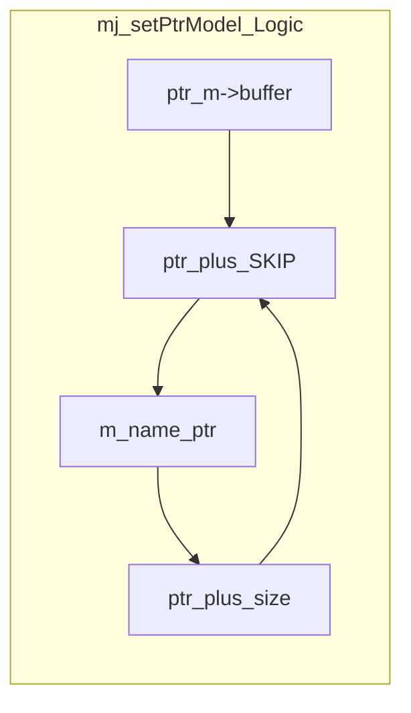
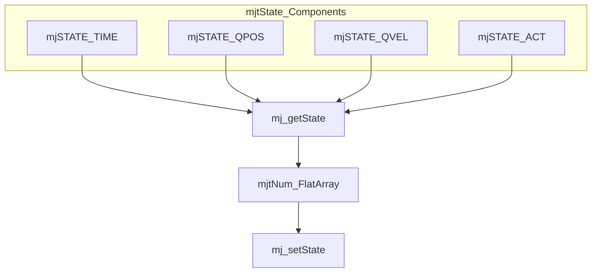

<!-- source: DeepWiki mcp.deepwiki.com · repo google-deepmind/mujoco · page 3 Core Runtime System · fetched 2026-10-26 -->

# Core Runtime System

Relevant source files

The following files were used as context for generating this wiki page:

- [doc/APIreference/APIglobals.rst](doc/APIreference/APIglobals.rst)
- [doc/APIreference/functions.rst](doc/APIreference/functions.rst)
- [doc/APIreference/functions_override.rst](doc/APIreference/functions_override.rst)
- [doc/includes/references.h](doc/includes/references.h)
- [include/mujoco/mjdata.h](include/mujoco/mjdata.h)
- [include/mujoco/mjmodel.h](include/mujoco/mjmodel.h)
- [include/mujoco/mjspec.h](include/mujoco/mjspec.h)
- [include/mujoco/mjxmacro.h](include/mujoco/mjxmacro.h)
- [include/mujoco/mujoco.h](include/mujoco/mujoco.h)
- [python/mujoco/introspect/functions.py](python/mujoco/introspect/functions.py)
- [python/mujoco/introspect/structs.py](python/mujoco/introspect/structs.py)
- [src/engine/engine_io.c](src/engine/engine_io.c)
- [src/engine/engine_io.h](src/engine/engine_io.h)
- [src/engine/engine_print.c](src/engine/engine_print.c)
- [test/engine/engine_io_test.cc](test/engine/engine_io_test.cc)
- [unity/Runtime/Bindings/MjBindings.cs](unity/Runtime/Bindings/MjBindings.cs)

The Core Runtime System provides the fundamental data structures and C API functions that enable MuJoCo simulation. At its heart are two structures: `mjModel` (compiled static model data) and `mjData` (dynamic simulation state). The C API provides functions for model lifecycle management, data allocation, state serialization, and simulation execution.

This is a parent page. For detailed technical breakdowns, see the following child pages:
- [mjModel Structure](#3.1) — Detailed breakdown of memory layout and model properties.
- [mjData Structure](#3.2) — mjData fields, state vectors, and arena memory.
- [Model I/O and Serialization](#3.3) — Loading, saving, and binary MJB format.
- [State Management](#3.4) — State signatures, `mj_getState`, and keyframes.
- [Sparse Matrix Structures](#3.5) — CSR format and sparse matrix construction.

## Architecture Overview

**Core Data Structure Separation**

MuJoCo strictly separates static model information from dynamic simulation state (`mjModel` vs `mjData`). This separation enables efficient simulation with multiple instances sharing the same model, and supports safe multi-threading with shared read-only models.

Sources: [include/mujoco/mjmodel.h:15-30](), [include/mujoco/mjdata.h:98-120](), [include/mujoco/mujoco.h:130-165]()

**The mjModel Structure**

`mjModel` contains all compiled static data that describes the physical model. Once compiled, it is read-only during simulation and can be safely shared across threads. Key content includes:

- **Size parameters**: `nq` (generalized coordinates), `nv` (degrees of freedom), `nu` (actuators) [include/mujoco/mjxmacro.h:160-170]().
- **Configuration options**: `mjOption opt` (physics settings), `mjVisual vis` (visualizer settings) [include/mujoco/mjmodel.h:80-130]().
- **Static arrays**: Body positions (`body_pos`), joint types (`jnt_type`), and geometry properties [include/mujoco/mjxmacro.h:200-300]().
- **Buffer management**: A single `void* buffer` containing all arrays to minimize fragmentation [src/engine/engine_io.c:145-175]().

For details, see [mjModel Structure](#3.1).
Sources: [include/mujoco/mjmodel.h:80-130](), [include/mujoco/mjxmacro.h:160-300](), [src/engine/engine_io.c:145-175]()

**The mjData Structure**

`mjData` holds all dynamic simulation state and temporary computation buffers. Each simulation instance requires its own `mjData` that references a shared `mjModel`. Key content includes:

- **Integration state**: `qpos` (positions), `qvel` (velocities), `act` (actuator activations) [doc/includes/references.h:85-110]().
- **Computed quantities**: `qacc` (accelerations), `xpos` (Cartesian body positions), `cfrc_ext` (external forces) [doc/includes/references.h:110-140]().
- **Workspace Memory**: The `arena` and `stack` for high-speed temporary allocations during the physics pipeline [include/mujoco/mjdata.h:100-115]().

For details, see [mjData Structure](#3.2).
Sources: [include/mujoco/mjdata.h:100-115](), [doc/includes/references.h:85-140]()

## Model Lifecycle Management

**Model Creation and Loading**

MuJoCo provides multiple pathways for creating `mjModel` instances. The modern workflow utilizes `mjSpec` for programmatic editing before compilation via `mj_compile` or `mj_loadXML`.

| Function | Purpose | Source |
|----------|---------|--------|
| `mj_loadXML` | Parse XML and compile to `mjModel` | [include/mujoco/mujoco.h:130-134]() |
| `mj_compile` | Compile an `mjSpec` to a new `mjModel` | [include/mujoco/mujoco.h:154-158]() |
| `mj_recompile` | Update an existing `mjModel`/`mjData` in-place | [include/mujoco/mujoco.h:160-165]() |
| `mj_makeModel` | Low-level allocation of model buffers | [src/engine/engine_io.c:145-175]() |

For details, see [Model I/O and Serialization](#3.3).
Sources: [include/mujoco/mujoco.h:130-165](), [src/engine/engine_io.c:145-175]()

**Memory Layout and Alignment**

To maximize SIMD performance, MuJoCo uses a specific alignment strategy for its internal buffers via `mj_setPtrModel`. The `SKIP` macro ensures that array pointers within the `buffer` are 64-byte aligned (`BUFFER_ALIGN`).

Sources: [src/engine/engine_io.c:135-175]()

For details, see [mjModel Structure](#3.1).
Sources: [src/engine/engine_io.c:135-175]()

## Data and State Management

**Data Initialization**

Simulation state is initialized via `mj_makeData`, which calculates the required workspace sizes based on the provided `mjModel`.

| Function | Purpose | Source |
|----------|---------|--------|
| `mj_makeData` | Allocate `mjData` and workspace buffers | [include/mujoco/mjdata.h:100-115]() |
| `mj_resetData` | Set state to model defaults (`qpos0`, etc.) | [include/mujoco/mjdata.h:100-115]() |
| `mj_copyData` | Deep copy of all dynamic state | [include/mujoco/mjdata.h:100-115]() |

**State Serialization**

MuJoCo supports partial state extraction using bitmasks (`mjtState`). This is used for checkpointing, sub-sampling, or parallel rollouts via `mj_getState` and `mj_setState`.

Sources: [include/mujoco/mjtype.h:1-50](), [include/mujoco/mujoco.h:130-165]()

For details, see [State Management](#3.4).
Sources: [include/mujoco/mjtype.h:1-50](), [include/mujoco/mujoco.h:130-165]()

## Sparse Matrix Operations

Large-scale physics involves high-dimensional matrices. MuJoCo uses specialized sparse formats to maintain $O(N)$ or $O(N^2)$ complexity relative to the kinematic tree.

- **Mass Matrix ($M$)**: Stored in a custom sparse format (`nM`, `nM` nonzeros) or dense depending on `mjOption` [include/mujoco/mjxmacro.h:170-180]().
- **Constraint Jacobian ($J$)**: Stored in Compressed Sparse Row (CSR) format (`nJ` nonzeros) [include/mujoco/mjdata.h:130-140]().

For details, see [Sparse Matrix Structures](#3.5).
Sources: [include/mujoco/mjmodel.h:35-48](), [include/mujoco/mjdata.h:130-140](), [include/mujoco/mjxmacro.h:170-180]()

---

