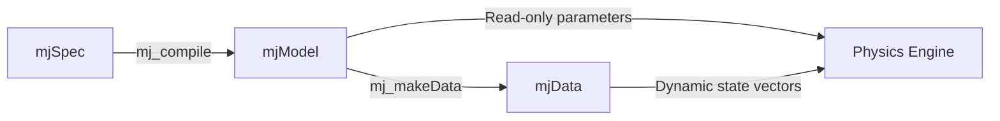
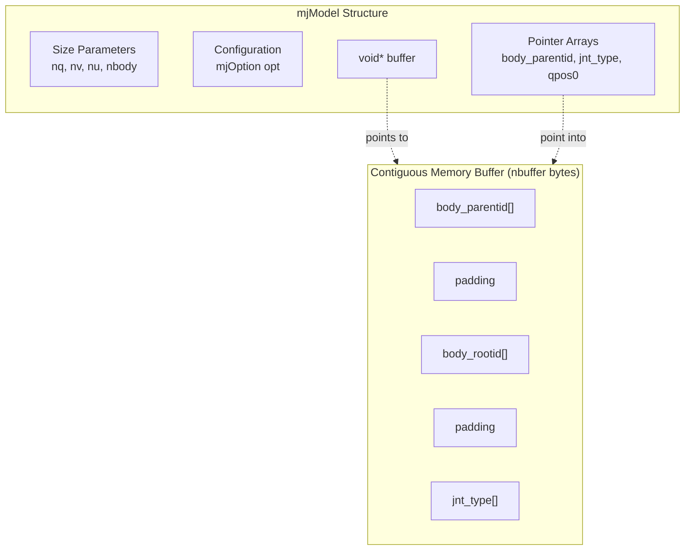
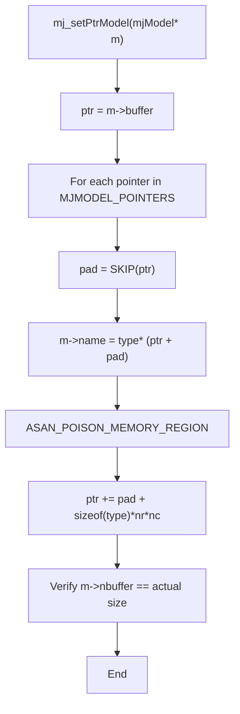
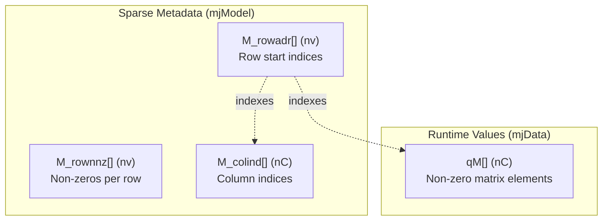

<!-- source: DeepWiki mcp.deepwiki.com · repo google-deepmind/mujoco · page 3.1 mjModel Structure · fetched 2026-10-26 -->

# mjModel Structure

<details>
<summary>Relevant source files</summary>

The following files were used as context for generating this wiki page:

- [doc/APIreference/APIglobals.rst](doc/APIreference/APIglobals.rst)
- [doc/APIreference/functions.rst](doc/APIreference/functions.rst)
- [doc/APIreference/functions_override.rst](doc/APIreference/functions_override.rst)
- [doc/includes/references.h](doc/includes/references.h)
- [include/mujoco/mjdata.h](include/mujoco/mjdata.h)
- [include/mujoco/mjmodel.h](include/mujoco/mjmodel.h)
- [include/mujoco/mjspec.h](include/mujoco/mjspec.h)
- [include/mujoco/mjxmacro.h](include/mujoco/mjxmacro.h)
- [include/mujoco/mujoco.h](include/mujoco/mujoco.h)
- [python/mujoco/introspect/functions.py](python/mujoco/introspect/functions.py)
- [python/mujoco/introspect/structs.py](python/mujoco/introspect/structs.py)
- [src/engine/engine_io.c](src/engine/engine_io.c)
- [src/engine/engine_io.h](src/engine/engine_io.h)
- [src/engine/engine_print.c](src/engine/engine_print.c)
- [test/engine/engine_io_test.cc](test/engine/engine_io_test.cc)
- [unity/Runtime/Bindings/MjBindings.cs](unity/Runtime/Bindings/MjBindings.cs)

</details>


## Purpose and Scope

This page provides a detailed technical reference for the `mjModel` structure, which represents the compiled, immutable runtime model in MuJoCo. `mjModel` contains all static model data organized in contiguous memory buffers for efficient simulation.

For information about creating and editing models before compilation, see [mjSpec C++ API](2.2) and [Python MjSpec API](2.3). For the companion dynamic state structure used during simulation, see [mjData Structure](3.2). For the compilation process that produces `mjModel`, see [Compilation Process](2.6).

Sources: [include/mujoco/mjmodel.h:1](), [src/engine/engine_io.c:1]()

---

## Overview

`mjModel` is the central data structure representing a compiled MuJoCo model. It is:

- **Immutable**: Once compiled via `mj_compile` [include/mujoco/mujoco.h:156](), the model cannot be modified during simulation (though it can be recompiled in-place via `mj_recompile` [include/mujoco/mujoco.h:163]()).
- **Optimized**: All data is stored in flat arrays within a single contiguous buffer (`buffer`) for cache efficiency.
- **Self-contained**: Contains all sizing parameters, physical options (`mjOption`), visual settings (`mjVisual`), and pointers to domain arrays.

The structure is processed extensively by routines in `src/engine/engine_io.c` [src/engine/engine_io.c:1]() and defined across headers included by `include/mujoco/mjmodel.h` [include/mujoco/mjmodel.h:1]().

**Relationship to Other Structures:**


Sources: [include/mujoco/mujoco.h:156-163](), [include/mujoco/mjmodel.h:1]()

---

## Memory Layout and Buffer Organization

`mjModel` uses a **single contiguous buffer** (`buffer`) to store all array data, with pointers initialized to reference locations within this buffer.

### Buffer Structure and Alignment



All array pointers are aligned to **64-byte boundaries** (`BUFFER_ALIGN`) for optimal cache line utilization. The `SKIP` function computes the padding required to reach the next alignment boundary.

```c
// alignment of the arrays in the mjModel and mjData buffers
#define BUFFER_ALIGN 64

// number of bytes to be skipped to achieve BUFFER_ALIGN-byte alignment
static inline unsigned int SKIP(intptr_t offset) {
  // compute skipped bytes
  return (BUFFER_ALIGN - (offset % BUFFER_ALIGN)) % BUFFER_ALIGN;
}
```

Sources: [src/engine/engine_io.c:134-142]()

### Pointer Initialization via `mj_setPtrModel`

The `mj_setPtrModel` function populates all pointer fields in `mjModel` by iterating through the model pointers defined by X-macros, applying `SKIP` padding, poisoning unused or padding regions when AddressSanitizer (`mjUSEASAN`) is active, and verifying the total buffer size.



Sources: [src/engine/engine_io.c:148-174]()

---

## Size Parameters and X-Macro System

The size parameters define the dimensions of all arrays in the model. They are managed via the `MJMODEL_SIZES` X-macro (`include/mujoco/mjxmacro.h`) and counted using `getnsize` [src/engine/engine_io.c:75-83]().

### Core Size Fields

| Field | Type | Description |
|-------|------|-------------|
| `nq` | int | Number of generalized coordinates (configuration space dimension) |
| `nv` | int | Number of degrees of freedom (velocity space dimension) |
| `nu` | int | Number of control inputs (actuators) |
| `na` | int | Number of activation states |
| `nbody` | int | Number of bodies |
| `njnt` | int | Number of joints |
| `ngeom` | int | Number of geometries |
| `nsite` | int | Number of sites |

Sources: [include/mujoco/mjxmacro.h:162-254](), [src/engine/engine_io.c:75-83]()

---

## Pointer Arrays by Category

All model arrays are categorized by element type and accessed via pointers initialized in `mj_setPtrModel`.

### Body Arrays

Body-related fields describe the kinematic tree structure and inertial properties:

| Array | Type | Size | Description |
|-------|------|------|-------------|
| `body_parentid` | int | nbody | Parent body ID (-1 for world) |
| `body_rootid` | int | nbody | Root body ID of the kinematic tree |
| `body_pos` | mjtNum | nbody x 3 | Local position relative to parent frame |
| `body_quat` | mjtNum | nbody x 4 | Local orientation relative to parent frame |
| `body_mass` | mjtNum | nbody | Mass of each body |
| `body_inertia` | mjtNum | nbody x 3 | Diagonal inertia tensor in inertial frame |

Sources: [include/mujoco/mjmodel.h:554-577](), [include/mujoco/mjxmacro.h:261-290]()

### Joint and DOF Arrays

| Array | Type | Size | Description |
|-------|------|------|-------------|
| `jnt_type` | int | njnt | Joint type (`mjtJoint`) |
| `jnt_qposadr` | int | njnt | Start index in `qpos` |
| `jnt_dofadr` | int | njnt | Start index in `qvel`/`qacc` |
| `dof_bodyid` | int | nv | Body ID associated with each DOF |
| `dof_jntid` | int | nv | Joint ID associated with each DOF |
| `dof_damping` | mjtNum | nv | Damping coefficient per DOF |

Sources: [include/mujoco/mjmodel.h:91-96](), [include/mujoco/mjxmacro.h:292-325]()

---

## Sparse Matrix Structures

MuJoCo uses Compressed Sparse Row (CSR) storage for large system matrices such as the mass matrix **M** and body-dof matrix **B**.



Sources: [include/mujoco/mjmodel.h:729-738](), [src/engine/engine_print.c:170-189]()

---

## Configuration Structures

`mjModel` embeds configuration structs that govern physics and rendering:
- `mjOption opt`: Physics options including `timestep`, `gravity`, `integrator`, `solver`, and tolerances [include/mujoco/mjmodel.h:81-124]().
- `mjVisual vis`: Rendering options, graphical flags, and default camera/light settings [include/mujoco/mjmodel.h:129]().

Sources: [include/mujoco/mjmodel.h:81-130](), [include/mujoco/mjxmacro.h:23-156]()

---

## Model Lifecycle and Serialization

Models are allocated via `mj_makeModel` [src/engine/engine_io.c:227](), which relies on `safeAddToBufferSize` [src/engine/engine_io.c:177](). Binary persistence uses the `.mjb` file format, bundling the magic ID `ID` [src/engine/engine_io.c:63](), configuration structs, size parameters, and the contiguous memory buffer.

Sources: [src/engine/engine_io.c:60-260]()

---

