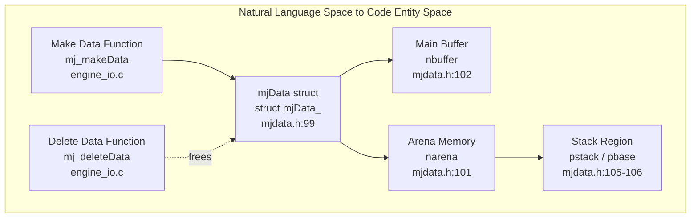
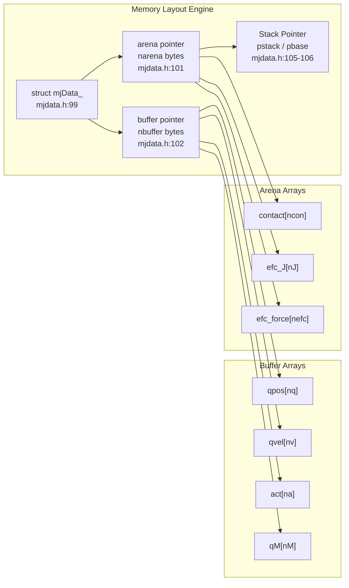
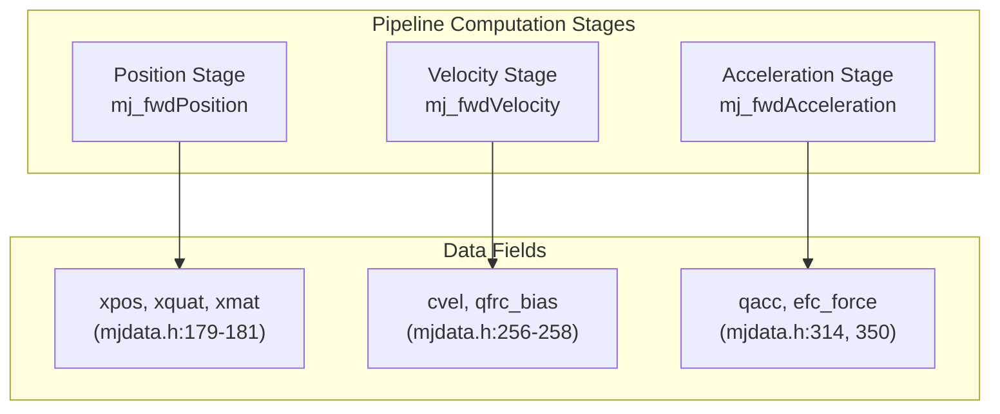
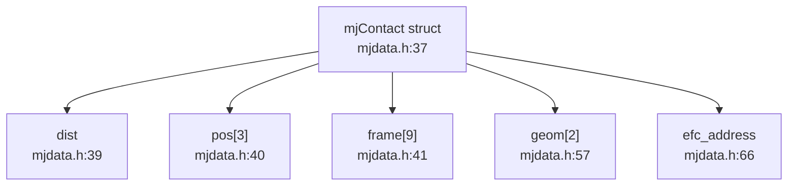
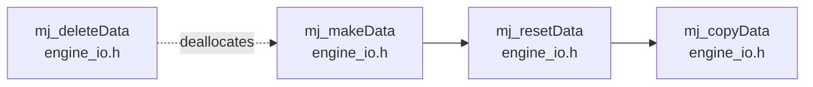

<!-- source: DeepWiki mcp.deepwiki.com · repo google-deepmind/mujoco · page 3.2 mjData Structure · fetched 2026-10-26 -->

# mjData Structure

Relevant source files

The following files were used as context for generating this wiki page:

- [doc/APIreference/APIglobals.rst](doc/APIreference/APIglobals.rst)
- [doc/APIreference/functions.rst](doc/APIreference/functions.rst)
- [doc/APIreference/functions_override.rst](doc/APIreference/functions_override.rst)
- [doc/includes/references.h](doc/includes/references.h)
- [include/mujoco/mjdata.h](include/mujoco/mjdata.h)
- [include/mujoco/mjmodel.h](include/mujoco/mjmodel.h)
- [include/mujoco/mjsan.h](include/mujoco/mjsan.h)
- [include/mujoco/mjspec.h](include/mujoco/mjspec.h)
- [include/mujoco/mjxmacro.h](include/mujoco/mjxmacro.h)
- [include/mujoco/mujoco.h](include/mujoco/mujoco.h)
- [python/mujoco/introspect/functions.py](python/mujoco/introspect/functions.py)
- [python/mujoco/introspect/structs.py](python/mujoco/introspect/structs.py)
- [src/engine/engine_callback.c](src/engine/engine_callback.c)
- [src/engine/engine_crossplatform.cc](src/engine/engine_crossplatform.cc)
- [src/engine/engine_crossplatform.h](src/engine/engine_crossplatform.h)
- [src/engine/engine_io.c](src/engine/engine_io.c)
- [src/engine/engine_io.h](src/engine/engine_io.h)
- [src/engine/engine_macro.h](src/engine/engine_macro.h)
- [src/engine/engine_memory.c](src/engine/engine_memory.c)
- [src/engine/engine_memory.h](src/engine/engine_memory.h)
- [src/engine/engine_print.c](src/engine/engine_print.c)
- [src/engine/engine_thread.cc](src/engine/engine_thread.cc)
- [src/engine/engine_util_errmem.c](src/engine/engine_util_errmem.c)
- [test/engine/engine_io_test.cc](test/engine/engine_io_test.cc)
- [unity/Runtime/Bindings/MjBindings.cs](unity/Runtime/Bindings/MjBindings.cs)

## Purpose and Scope

The `mjData` structure is the central runtime data container in MuJoCo, holding all dynamic simulation state, control inputs, computational workspace, constraint data, and diagnostic statistics. It is paired with an `mjModel` instance (which holds static model definitions) to execute physics simulation steps. 

This document details the memory layout, field organization, arena/stack memory management strategies, and lifecycle management functions of `mjData`.

For information about the static model structure, see [mjModel Structure](3.1). For state serialization, see [Model I/O and Serialization](3.3). For state manipulation routines, see [State Management](3.4).

Sources: [include/mujoco/mjdata.h:98-150](), [include/mujoco/mujoco.h:26]()

---

## Structure Overview

The `mjData` structure (`struct mjData_`) is partitioned into fixed-size buffers for state vectors and workspace, and a dynamic arena for variable-sized simulation artifacts like contacts and constraints.

Sources: [include/mujoco/mjdata.h:99-110](), [src/engine/engine_io.c:113-138]()

---

## Memory Layout and Pointer Structure

The `mjData` structure follows a header-plus-buffers design. Fixed-size data resides in a main buffer initialized at creation, while variable-size constraint and contact data reside in an arena that is cleared and reused every timestep.

Sources: [include/mujoco/mjdata.h:99-115](), [src/engine/engine_io.c:131-165]()

---

## Field Categories

### Header and Metadata Section

The initial segment of `mjData` contains configuration fields, sizing parameters, pointers, and performance counters.

| Field | Type | Purpose |
|-------|------|---------|
| `narena` | `mjtSize` | Total arena size in bytes (inclusive of stack) [include/mujoco/mjdata.h:101]() |
| `nbuffer` | `mjtSize` | Size of main buffer in bytes [include/mujoco/mjdata.h:102]() |
| `nplugin` | `int` | Number of active plugin instances [include/mujoco/mjdata.h:103]() |
| `pstack` | `size_t` | First available byte in stack (mutable) [include/mujoco/mjdata.h:106]() |
| `pbase` | `size_t` | Value of `pstack` when `mj_markStack` was last called [include/mujoco/mjdata.h:107]() |
| `parena` | `size_t` | First available byte in arena [include/mujoco/mjdata.h:110]() |

Sources: [include/mujoco/mjdata.h:100-111]()

### Memory Utilization Statistics

MuJoCo tracks peak resource consumption to help users tune workspace and arena capacities.

*   `maxuse_stack`: Maximum stack allocation in bytes (mutable) [include/mujoco/mjdata.h:117]().
*   `maxuse_arena`: Maximum arena allocation in bytes [include/mujoco/mjdata.h:118]().
*   `maxuse_con`: Maximum number of detected contacts [include/mujoco/mjdata.h:119]().
*   `maxuse_efc`: Maximum number of scalar constraints [include/mujoco/mjdata.h:120]().

Sources: [include/mujoco/mjdata.h:116-121]()

### Solver and Diagnostic Statistics

*   `solver`: Per-island, per-iteration solver statistics array (`mjSolverStat`) [include/mujoco/mjdata.h:123]().
*   `solver_niter`: Number of solver iterations per island [include/mujoco/mjdata.h:124]().
*   `solver_nnz`: Number of nonzeros in solver matrix per island [include/mujoco/mjdata.h:125]().
*   `warning`: Warning statistics array (`mjWarningStat`) [include/mujoco/mjdata.h:129]().
*   `timer`: Timer statistics array (`mjTimerStat`) [include/mujoco/mjdata.h:130]().

Sources: [include/mujoco/mjdata.h:122-131]()

### Variable Sizes

These fields track dynamic quantities re-evaluated at each simulation timestep:
*   `ncon`: Number of detected contacts [include/mujoco/mjdata.h:133]()
*   `ne`: Number of equality constraints [include/mujoco/mjdata.h:134]()
*   `nf`: Number of friction constraints [include/mujoco/mjdata.h:135]()
*   `nl`: Number of limit constraints [include/mujoco/mjdata.h:136]()
*   `nefc`: Total scalar constraints [include/mujoco/mjdata.h:137]()
*   `nJ`: Number of non-zeros in constraint Jacobian [include/mujoco/mjdata.h:138]()

Sources: [include/mujoco/mjdata.h:132-139]()

---

## State and Control Vectors

The core dynamic state of the simulation is represented via fixed-size buffer arrays located in the main buffer:

| Array Name | Size / Dimensions | Purpose |
|------------|-------------------|---------|
| `qpos` | `nq` | Generalized positions [include/mujoco/mjdata.h:167]() |
| `qvel` | `nv` | Generalized velocities [include/mujoco/mjdata.h:168]() |
| `act` | `na` | Actuator activation states [include/mujoco/mjdata.h:169]() |
| `ctrl` | `nu` | Control inputs [include/mujoco/mjdata.h:176]() |
| `qfrc_applied` | `nv` | Applied generalized forces [include/mujoco/mjdata.h:177]() |
| `xfrc_applied` | `nbody x 6` | Applied Cartesian forces/torques per body [include/mujoco/mjdata.h:178]() |
| `qacc` | `nv` | Generalized accelerations [include/mujoco/mjdata.h:314]() |

Sources: [include/mujoco/mjdata.h:167-314]()

---

## Position, Velocity, and Acceleration Dependent Quantities

Sources: [include/mujoco/mjdata.h:179-350]()

---

## Arena-Allocated Arrays

### Contact Data

The `contact` array stores results from narrowphase collision detection (`mjContact`).

Sources: [include/mujoco/mjdata.h:37-69]()

---

## Lifecycle and Memory Management

`mjData` instances are dynamically managed via core engine routines.

Sources: [src/engine/engine_io.h:110-138](), [src/engine/engine_io.c:131-165]()

### Memory Alignment and Stack Allocation

MuJoCo enforces strict 64-byte alignment across all buffer arrays for SIMD vectorization. Pointers are offset using the `SKIP` macro [src/engine/engine_io.c:139-142](). Temporary workspace within the arena is managed via stack mark/free primitives (`mj_markStack` and `mj_freeStack`).

Sources: [src/engine/engine_io.c:131-142](), [include/mujoco/mjdata.h:105-107]()

---

