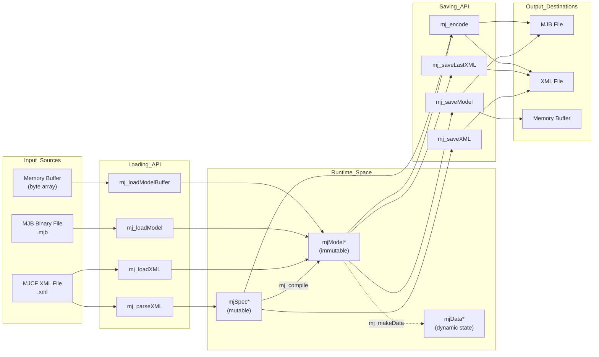
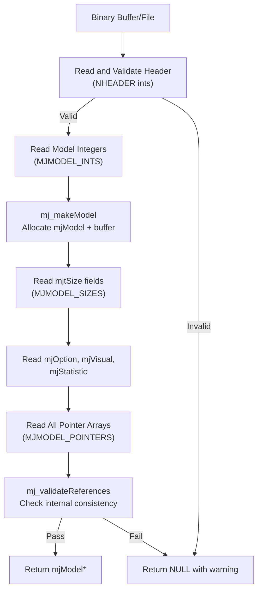
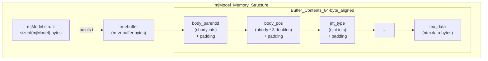

<!-- source: DeepWiki mcp.deepwiki.com · repo google-deepmind/mujoco · page 3.3 Model I/O and Serialization · fetched 2026-10-26 -->

# Model I/O and Serialization

Relevant source files

The following files were used as context for generating this wiki page:

- [doc/APIreference/APIglobals.rst](doc/APIreference/APIglobals.rst)
- [doc/APIreference/functions.rst](doc/APIreference/functions.rst)
- [doc/APIreference/functions_override.rst](doc/APIreference/functions_override.rst)
- [doc/includes/references.h](doc/includes/references.h)
- [include/mujoco/mjdata.h](include/mujoco/mjdata.h)
- [include/mujoco/mjmodel.h](include/mujoco/mjmodel.h)
- [include/mujoco/mjspec.h](include/mujoco/mjspec.h)
- [include/mujoco/mjxmacro.h](include/mujoco/mjxmacro.h)
- [include/mujoco/mujoco.h](include/mujoco/mujoco.h)
- [python/mujoco/introspect/functions.py](python/mujoco/introspect/functions.py)
- [python/mujoco/introspect/structs.py](python/mujoco/introspect/structs.py)
- [src/engine/engine_io.c](src/engine/engine_io.c)
- [src/engine/engine_io.h](src/engine/engine_io.h)
- [src/engine/engine_print.c](src/engine/engine_print.c)
- [test/engine/engine_io_test.cc](test/engine/engine_io_test.cc)
- [unity/Runtime/Bindings/MjBindings.cs](unity/Runtime/Bindings/MjBindings.cs)

This document describes MuJoCo's model input/output operations and binary serialization format. It covers loading models from various sources, saving models to binary and XML formats, the internal binary format specification, model memory management, and validation procedures.

For information about creating models programmatically using `mjSpec`, see [mjSpec C++ API](#2.2) and [Python MjSpec API](#2.3). For XML parsing specifics, see [XML Parsing and Writing](#2.4). For the structure of `mjModel` and `mjData`, see [mjModel Structure](#3.1) and [mjData Structure](#3.2).

## Overview

MuJoCo models can be loaded from three sources:
1. **MJCF XML files** - Human-readable text format (see [MJCF XML Format](#2.1)).
2. **MJB binary files** - Optimized binary format for fast loading.
3. **Memory buffers** - In-memory binary representations for distributed systems.

Once loaded, models exist as `mjModel` structures in memory. Models can be saved back to either binary MJB format or XML format.

### Data Flow for Model I/O

**Sources:** [src/engine/engine_io.c:483-661](), [include/mujoco/mujoco.h:125-178](), [doc/APIreference/functions.rst:10-120]()

## Binary Format Specification

### MJB File Structure

The MJB (MuJoCo Binary) format provides fast model loading without parsing overhead. The format is platform-specific and depends on the floating-point precision (`mjtNum`) used during compilation [src/engine/engine_io.c:59-63]().

### Header Validation

When loading a binary model, the header is validated to ensure compatibility:

| Field | Value | Purpose |
|-------|-------|---------|
| `header[0]` | `54321` | Magic ID (`ID`) to identify MJB files [src/engine/engine_io.c:60]() |
| `header[1]` | `sizeof(mjtNum)` | Float precision (4 for single, 8 for double) [src/engine/engine_io.c:545]() |
| `header[2]` | `getnint()` | Number of integer fields in `mjModel` [src/engine/engine_io.c:546]() |
| `header[3]` | `getnsize()` | Number of `mjtSize` fields in `mjModel` [src/engine/engine_io.c:547]() |
| `header[4]` | `getnptr()` | Number of pointer arrays in `mjModel` [src/engine/engine_io.c:548]() |

**Sources:** [src/engine/engine_io.c:59-63](), [src/engine/engine_io.c:543-577]()

### Integer and Pointer Iteration Macros

The binary format relies on X-macros to iterate over all `mjModel` fields systematically:

- **`MJMODEL_INTS`**: All integer fields [include/mujoco/mjxmacro.h:233-301]().
- **`MJMODEL_SIZES`**: All `mjtSize` fields used for buffer dimensions [include/mujoco/mjxmacro.h:162-230]().
- **`MJMODEL_POINTERS`**: All pointer arrays with their dimensions [src/engine/engine_io.c:149-152]().

**Sources:** [include/mujoco/mjxmacro.h:162-301](), [src/engine/engine_io.c:71-91]()

## Model Loading

### Loading from Binary (MJB)

The `mj_loadModelBuffer` function loads a model from a memory buffer, which is the underlying implementation for file-based binary loading [src/engine/engine_io.c:539-661]().

**Key Implementation Details:**
1. **Buffer Boundaries**: `bufread` checks that it doesn't exceed the model buffer size [src/engine/engine_io.c:113-127]().
2. **Size Consistency**: The `nbuffer` field is validated against the actual calculated size [src/engine/engine_io.c:157-164]().
3. **Reference Validation**: `mj_validateReferences` ensures all internal indices (body IDs, geom IDs, etc.) are valid [src/engine/engine_io.c:653-658]().

**Sources:** [src/engine/engine_io.c:539-661](), [include/mujoco/mujoco.h:125-130]()

### Loading from XML

Loading from XML is a multi-stage process handled by the compiler. The primary entry point is `mj_loadXML` [include/mujoco/mujoco.h:132](). This process parses the XML (optionally using a Virtual File System `mjVFS`) into an `mjSpec` and then compiles it into a runtime `mjModel`. 

For programmatic use, `mj_parseXML` and `mj_parseXMLString` return an `mjSpec` which can be modified before calling `mj_compile` [include/mujoco/mujoco.h:136-156]().

**Sources:** [include/mujoco/mujoco.h:125-164](), [doc/APIreference/functions.rst:10-120]()

## Model Saving

### Saving to Binary

The `mj_saveModel` function serializes an `mjModel` to either a file or memory buffer [src/engine/engine_io.c:483-535]().

**Serialization Order:**
1. **Header**: Magic ID and metadata (precision, counts) [src/engine/engine_io.c:492-498]().
2. **Model Ints/Sizes**: Dimensions like `nq`, `nv`, `nbody` [src/engine/engine_io.c:500-510]().
3. **Configuration Structs**: `mjOption`, `mjVisual`, `mjStatistic` [src/engine/engine_io.c:512-523]().
4. **Pointer Arrays**: Data for bodies, joints, geoms, etc., iterating via `MJMODEL_POINTERS` [src/engine/engine_io.c:525-534]().

**Sources:** [src/engine/engine_io.c:483-535](), [include/mujoco/mujoco.h:182]()

### Saving to XML and Text

- **`mj_saveXML`**: Saves a compiled `mjSpec` to an XML file [include/mujoco/mujoco.h:180]().
- **`mj_saveLastXML`**: Updates internal XML structures from an `mjModel` (loaded via `mj_loadXML`) and saves as MJCF [include/mujoco/mujoco.h:168]().
- **`mj_encode`**: Unified entry point that encodes to MJCF, MJB, or TXT based on file extension [doc/APIreference/functions.rst:62-80]().
- **`mj_printModel`**: Generates a human-readable text dump (TXT) of the model [doc/APIreference/functions.rst:77]().

**Sources:** [include/mujoco/mujoco.h:162-180](), [doc/APIreference/functions.rst:62-152]()

## Model Memory Management

### Memory Layout

Models are constructed using `mj_makeModel`, which allocates a single contiguous memory block for the `mjModel` struct and its internal data buffer [src/engine/engine_io.c:227-396]().

**Alignment**: Each pointer array in the buffer is aligned to 64-byte boundaries using the `SKIP` macro [src/engine/engine_io.c:132-136](). This is enforced during pointer assignment in `mj_setPtrModel` [src/engine/engine_io.c:142-165]().

**Sources:** [src/engine/engine_io.c:132-165](), [src/engine/engine_io.c:227-396]()

### Buffer Size Calculation

The buffer size is computed safely to avoid integer overflow using `safeAddToBufferSize` [src/engine/engine_io.c:173-217](). This function uses compiler builtins like `__builtin_mul_overflow` and `__builtin_add_overflow` to ensure validity before allocation.

**Sources:** [src/engine/engine_io.c:173-217]()

## Validation

### Reference Validation

The `mj_validateReferences` function checks the internal consistency of an `mjModel`. It ensures that:
- Body parent IDs are within the range `[0, nbody-1]`.
- Joint body IDs are valid.
- Asset indices (meshes, textures) exist in the model.

This is automatically called during `mj_loadModelBuffer` to prevent memory corruption from malformed binary files [src/engine/engine_io.c:653-658]().

**Sources:** [src/engine/engine_io.c:653-658](), [include/mujoco/mujoco.h:189]()

## API Summary

| Function | Description | Source |
|----------|-------------|--------|
| `mj_loadXML` | Parses XML (MJCF/URDF) and compiles to `mjModel`. | [include/mujoco/mujoco.h:132]() |
| `mj_loadModel` | Loads `mjModel` from a binary MJB file. | [include/mujoco/mujoco.h:181]() |
| `mj_loadModelBuffer` | Loads `mjModel` from a binary memory buffer. | [src/engine/engine_io.c:539]() |
| `mj_saveModel` | Saves `mjModel` to binary MJB format. | [src/engine/engine_io.c:483]() |
| `mj_saveXML` | Saves `mjSpec` to XML file. | [include/mujoco/mujoco.h:180]() |
| `mj_saveLastXML` | Saves the last XML loaded via `mj_loadXML`. | [include/mujoco/mujoco.h:168]() |
| `mj_recompile` | Recompiles `mjSpec` to `mjModel` in-place, preserving state. | [include/mujoco/mujoco.h:163]() |
| `mj_makeModel` | Allocates and initializes an `mjModel`. | [src/engine/engine_io.c:227]() |
| `mj_deleteModel` | Deallocates an `mjModel` and its internal buffer. | [src/engine/engine_io.c:665]() |
| `mj_validateReferences` | Validates internal indices in `mjModel`. | [src/engine/engine_io.c:653]() |

**Sources:** [src/engine/engine_io.c:15-840](), [include/mujoco/mujoco.h:125-190](), [doc/APIreference/functions.rst:10-150]()

---

