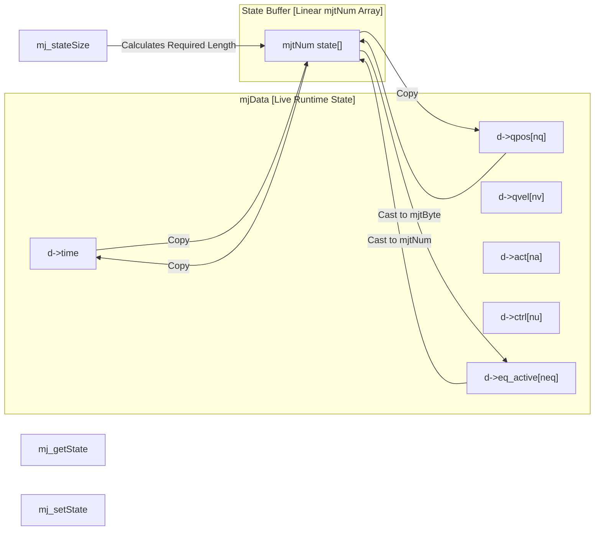
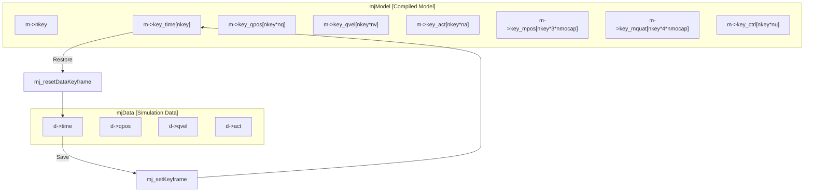

<!-- source: DeepWiki mcp.deepwiki.com · repo google-deepmind/mujoco · page 3.4 State Management · fetched 2026-10-26 -->

# State Management

<details>
<summary>Relevant source files</summary>

The following files were used as context for generating this wiki page:

- [CMakeLists.txt](CMakeLists.txt)
- [dist/mujoco.rc](dist/mujoco.rc)
- [dist/simulate.rc](dist/simulate.rc)
- [doc/unity.rst](doc/unity.rst)
- [python/mujoco/CMakeLists.txt](python/mujoco/CMakeLists.txt)
- [sample/CMakeLists.txt](sample/CMakeLists.txt)
- [simulate/CMakeLists.txt](simulate/CMakeLists.txt)
- [src/engine/engine_support.c](src/engine/engine_support.c)
- [src/engine/engine_support.h](src/engine/engine_support.h)
- [test/engine/engine_support_test.cc](test/engine/engine_support_test.cc)
- [unity/Editor/Bindings/MujocoBinaryRetriever.cs](unity/Editor/Bindings/MujocoBinaryRetriever.cs)
- [unity/package.json](unity/package.json)

</details>


## Purpose and Scope

State Management provides functions for serializing, deserializing, and manipulating the dynamic simulation state stored in `mjData`. This includes:

- **State serialization**: Saving and loading simulation state to/from memory buffers (`mj_getState`, `mj_setState`) [src/engine/engine_support.c:217-238](), [src/engine/engine_support.c:265-298]().
- **Keyframe storage**: Capturing snapshots of simulation state in the model (`mj_setKeyframe`) [src/engine/engine_support.c:302-320]().
- **Position integration**: Converting between positions and velocities for different joint types (`mj_integratePos`, `mj_differentiatePos`) [src/engine/engine_support.c:533-563](), [src/engine/engine_support.c:499-529]().
- **State preservation**: Maintaining continuity during model transitions and copy operations (`mj_copyState`) [src/engine/engine_support.c:466-495]().

State management is essential for checkpointing, state replay, deterministic testing, and model editing workflows.

Sources: [src/engine/engine_support.c:126-574](), [include/mujoco/mjdata.h:1-100]()

---

## State Elements and Signatures

### State Element Enumeration

MuJoCo defines state as a collection of **state elements**, each representing a different component of simulation state. The `mjtState` enum defines these elements as bit flags.

```mermaid
graph TB
    subgraph "mjtState Enum (Bit Flags)"
        TIME["mjSTATE_TIME<br/>Simulation time"]
        QPOS["mjSTATE_QPOS<br/>Joint positions"]
        QVEL["mjSTATE_QVEL<br/>Joint velocities"]
        ACT["mjSTATE_ACT<br/>Actuator activations"]
        HISTORY["mjSTATE_HISTORY<br/>Sensor history"]
        WARMSTART["mjSTATE_WARMSTART<br/>Solver warmstart data"]
        CTRL["mjSTATE_CTRL<br/>Control inputs"]
        QFRC["mjSTATE_QFRC_APPLIED<br/>Applied generalized forces"]
        XFRC["mjSTATE_XFRC_APPLIED<br/>Applied Cartesian forces"]
        EQ["mjSTATE_EQ_ACTIVE<br/>Equality constraint flags"]
        MOCAP_POS["mjSTATE_MOCAP_POS<br/>Mocap body positions"]
        MOCAP_QUAT["mjSTATE_MOCAP_QUAT<br/>Mocap body orientations"]
        USERDATA["mjSTATE_USERDATA<br/>User-defined state"]
        PLUGIN["mjSTATE_PLUGIN<br/>Plugin state"]
    end
    
    SIG["State Signature<br/>(unsigned int)<br/>Bitwise OR of flags"]
    
    TIME --> SIG
    QPOS --> SIG
    QVEL --> SIG
    ACT --> SIG
    HISTORY --> SIG
    WARMSTART --> SIG
    CTRL --> SIG
    QFRC --> SIG
    XFRC --> SIG
    EQ --> SIG
    MOCAP_POS --> SIG
    MOCAP_QUAT --> SIG
    USERDATA --> SIG
    PLUGIN --> SIG
```



**State Element Sizes and Data Types**

| State Element | Size Formula | mjData Field | Data Type | Notes |
|---------------|--------------|--------------|-----------|-------|
| `mjSTATE_TIME` | 1 | `d->time` | `mjtNum` | Single scalar [src/engine/engine_support.c:140]() |
| `mjSTATE_QPOS` | `m->nq` | `d->qpos` | `mjtNum*` | Joint positions [src/engine/engine_support.c:141]() |
| `mjSTATE_QVEL` | `m->nv` | `d->qvel` | `mjtNum*` | Joint velocities [src/engine/engine_support.c:142]() |
| `mjSTATE_ACT` | `m->na` | `d->act` | `mjtNum*` | Actuator activations [src/engine/engine_support.c:143]() |
| `mjSTATE_HISTORY` | `m->nhistory` | `d->history` | `mjtNum*` | Sensor history buffer [src/engine/engine_support.c:144]() |
| `mjSTATE_WARMSTART` | `m->nv` | `d->qacc_warmstart` | `mjtNum*` | Constraint solver cache [src/engine/engine_support.c:145]() |
| `mjSTATE_CTRL` | `m->nu` | `d->ctrl` | `mjtNum*` | Control signals [src/engine/engine_support.c:146]() |
| `mjSTATE_QFRC_APPLIED` | `m->nv` | `d->qfrc_applied` | `mjtNum*` | Generalized forces [src/engine/engine_support.c:147]() |
| `mjSTATE_XFRC_APPLIED` | `6*m->nbody` | `d->xfrc_applied` | `mjtNum*` | Cartesian forces/torques [src/engine/engine_support.c:148]() |
| `mjSTATE_EQ_ACTIVE` | `m->neq` | `d->eq_active` | `mjtByte*` | Stored as `mjtNum` in state vector [src/engine/engine_support.c:149]() |
| `mjSTATE_MOCAP_POS` | `3*m->nmocap` | `d->mocap_pos` | `mjtNum*` | XYZ positions [src/engine/engine_support.c:150]() |
| `mjSTATE_MOCAP_QUAT` | `4*m->nmocap` | `d->mocap_quat` | `mjtNum*` | Quaternion orientations [src/engine/engine_support.c:151]() |
| `mjSTATE_USERDATA` | `m->nuserdata` | `d->userdata` | `mjtNum*` | User-defined array [src/engine/engine_support.c:152]() |
| `mjSTATE_PLUGIN` | `m->npluginstate` | `d->plugin_state` | `mjtNum*` | Plugin-managed state [src/engine/engine_support.c:153]() |

Sources: [src/engine/engine_support.c:138-158](), [src/engine/engine_support.c:162-181]()

---

## State Serialization API

### Overview Diagram



### Function: `mj_stateSize`

Computes the total size (in `mjtNum` elements) required to store a state with the given signature.

```c
int mj_stateSize(const mjModel* m, int sig)
```

**Implementation:** Iterates through the bits of the signature and sums the sizes returned by the internal `mj_stateElemSize` helper for each enabled component [src/engine/engine_support.c:205-210]().

Sources: [src/engine/engine_support.c:190-210]()

### Function: `mj_getState`

Serializes selected state elements from `mjData` into a contiguous `mjtNum` buffer.

```c
void mj_getState(const mjModel* m, const mjData* d, mjtNum* state, int sig)
```

**Behavior:**
- Elements are stored in order of their bit position in `mjtState` [src/engine/engine_support.c:229-232]().
- Special handling for `mjSTATE_EQ_ACTIVE`: converts `mjtByte` flags to `mjtNum` values during copy [src/engine/engine_support.c:235-240]().
- Uses `mju_copy` for standard numeric components.

Sources: [src/engine/engine_support.c:214-247]()

### Function: `mj_setState`

Deserializes state from a buffer back into `mjData`.

```c
void mj_setState(const mjModel* m, mjData* d, const mjtNum* state, int sig)
```

**Behavior:**
- Reads elements in the same order as `mj_getState`.
- Converts `mjtNum` values back to `mjtByte` for equality constraint activation flags.
- Does **not** trigger recomputation of dependent kinematics or dynamics (user must call `mj_forward` or similar).

Sources: [src/engine/engine_support.c:265-298]()

### Function: `mj_extractState`

Extracts a sub-state from an existing state buffer without requiring an `mjData` instance. This is useful for manipulating saved checkpoints or filtering data.

Sources: [src/engine/engine_support.c:251-261]()

---

## Keyframe System

### Overview

Keyframes store snapshots of simulation state **inside the model** (`mjModel`), allowing instant state reset without external memory management. Each keyframe captures a specific subset of state elements including time, joint positions, velocities, activations, mocap data, and control inputs.



### Function: `mj_setKeyframe`

Copies the current simulation state from `mjData` into the k-th keyframe slot in `mjModel`.

```c
void mj_setKeyframe(mjModel* m, const mjData* d, int k)
```

**Saved Elements:**
- Time, Joint positions (`qpos`), Joint velocities (`qvel`), Actuator activations (`act`), Mocap positions/quaternions, and Control inputs (`ctrl`).

Sources: [src/engine/engine_support.c:302-320]()

---

## Position Integration and Differentiation

MuJoCo joints (hinge, slide, ball, free) have different mathematical representations for positions and velocities. State management provides functions to bridge these spaces.

### Function: `mj_integratePos`

Integrates position from velocity over a timestep `dt`, handling the unit-quaternion manifold for ball and free joints.

```c
void mj_integratePos(const mjModel* m, mjtNum* qpos, const mjtNum* qvel, mjtNum dt)
```

**Algorithm Details:**
- **Hinge/Slide**: Performs standard additive integration.
- **Ball/Free (Rotation)**: Uses `mju_quatIntegrate` to update the orientation quaternion based on the angular velocity vector.

Sources: [src/engine/engine_support.c:533-563]()

### Function: `mj_differentiatePos`

Computes the velocity required to move from `qpos1` to `qpos2` in time `dt`.

```c
void mj_differentiatePos(const mjModel* m, mjtNum* qvel, mjtNum dt, 
                         const mjtNum* qpos1, const mjtNum* qpos2)
```

**Algorithm Details:**
- **Rotation**: Uses `mju_subQuat` to compute the 3D angular velocity vector that represents the rotation from `qpos1` to `qpos2`.

Sources: [src/engine/engine_support.c:499-529]()

### Function: `mj_normalizeQuat`

Ensures all quaternions in the `qpos` vector have unit length. This should be called after manual position updates to prevent numerical drift.

Sources: [src/engine/engine_support.c:567-574]()

---

## State Components and Memory Layout

The state buffer is a linear array of `mjtNum`. The order is fixed by the bit order in `mjtState`.

| Order | Component | `mjModel` size reference |
|:---:|:---|:---|
| 1 | Time | 1 [src/engine/engine_support.c:143]() |
| 2 | Qpos | `m->nq` [src/engine/engine_support.c:144]() |
| 3 | Qvel | `m->nv` [src/engine/engine_support.c:145]() |
| 4 | Act | `m->na` [src/engine/engine_support.c:146]() |
| 5 | History | `m->nhistory` [src/engine/engine_support.c:147]() |
| 6 | Warmstart | `m->nv` [src/engine/engine_support.c:148]() |
| 7 | Ctrl | `m->nu` [src/engine/engine_support.c:149]() |
| 8 | Qfrc_applied | `m->nv` [src/engine/engine_support.c:150]() |
| 9 | Xfrc_applied | `6 * m->nbody` [src/engine/engine_support.c:151]() |
| 10 | Eq_active | `m->neq` [src/engine/engine_support.c:152]() |
| 11 | Mocap_pos | `3 * m->nmocap` [src/engine/engine_support.c:153]() |
| 12 | Mocap_quat | `4 * m->nmocap` [src/engine/engine_support.c:154]() |
| 13 | Userdata | `m->nuserdata` [src/engine/engine_support.c:155]() |
| 14 | Plugin | `m->npluginstate` [src/engine/engine_support.c:156]() |

Sources: [src/engine/engine_support.c:138-158](), [src/engine/engine_support.c:214-238]()

### Implementation of `mj_copyState`

The function `mj_copyState` is a high-level utility that copies the entire state (defined by a signature) from one `mjData` structure to another.

```c
void mj_copyState(const mjModel* m, const mjData* src, mjData* dst, int sig)
```

**Implementation:**
1. Validates the signature range.
2. Iterates through all state elements.
3. For each element, uses `mj_stateElemConstPtr` and `mj_stateElemPtr` to find the source and destination pointers.
4. Performs a direct memory copy using `mju_copy` (or special logic for `eq_active`).

Sources: [src/engine/engine_support.c:466-495]()

---

