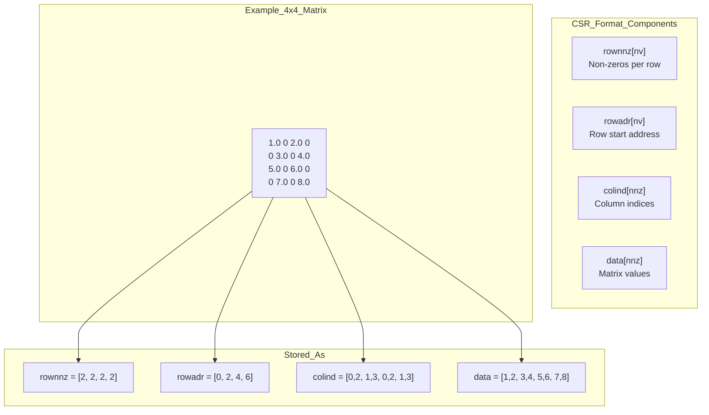
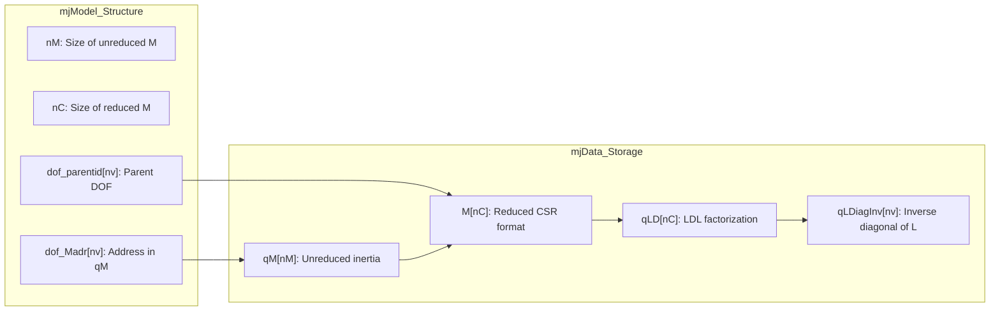
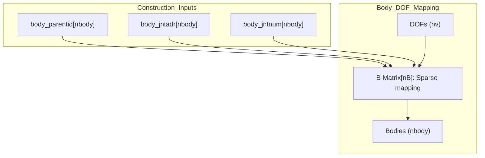
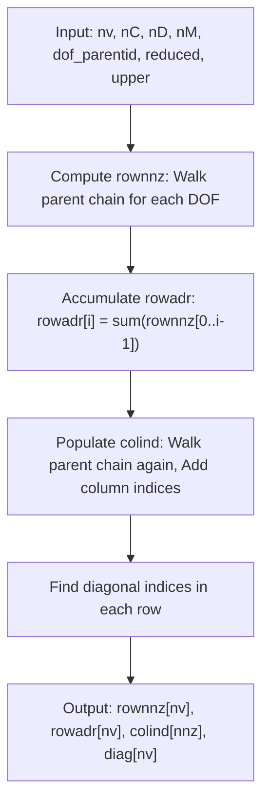
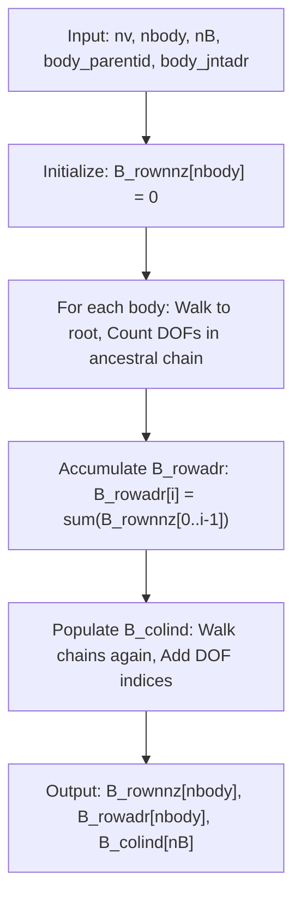

<!-- source: DeepWiki mcp.deepwiki.com · repo google-deepmind/mujoco · page 3.5 Sparse Matrix Structures · fetched 2026-10-26 -->

# Sparse Matrix Structures

Relevant source files

The following files were used as context for generating this wiki page:

- [doc/APIreference/APIglobals.rst](doc/APIreference/APIglobals.rst)
- [doc/APIreference/functions.rst](doc/APIreference/functions.rst)
- [doc/APIreference/functions_override.rst](doc/APIreference/functions_override.rst)
- [doc/includes/references.h](doc/includes/references.h)
- [include/mujoco/mjdata.h](include/mujoco/mjdata.h)
- [include/mujoco/mjmodel.h](include/mujoco/mjmodel.h)
- [include/mujoco/mjspec.h](include/mujoco/mjspec.h)
- [include/mujoco/mjxmacro.h](include/mujoco/mjxmacro.h)
- [include/mujoco/mujoco.h](include/mujoco/mujoco.h)
- [model/flex/hollow_vs_solid.xml](model/flex/hollow_vs_solid.xml)
- [python/mujoco/introspect/functions.py](python/mujoco/introspect/functions.py)
- [python/mujoco/introspect/structs.py](python/mujoco/introspect/structs.py)
- [src/engine/engine_core_constraint.c](src/engine/engine_core_constraint.c)
- [src/engine/engine_core_constraint.h](src/engine/engine_core_constraint.h)
- [src/engine/engine_io.c](src/engine/engine_io.c)
- [src/engine/engine_io.h](src/engine/engine_io.h)
- [src/engine/engine_print.c](src/engine/engine_print.c)
- [src/engine/engine_solver.c](src/engine/engine_solver.c)
- [src/engine/engine_util_sparse.c](src/engine/engine_util_sparse.c)
- [src/engine/engine_util_sparse.h](src/engine/engine_util_sparse.h)
- [src/engine/engine_util_sparse_avx.h](src/engine/engine_util_sparse_avx.h)
- [test/benchmark/engine_util_sparse_benchmark_test.cc](test/benchmark/engine_util_sparse_benchmark_test.cc)
- [test/engine/engine_core_constraint_test.cc](test/engine/engine_core_constraint_test.cc)
- [test/engine/engine_io_test.cc](test/engine/engine_io_test.cc)
- [test/engine/engine_util_sparse_test.cc](test/engine/engine_util_sparse_test.cc)
- [unity/Runtime/Bindings/MjBindings.cs](unity/Runtime/Bindings/MjBindings.cs)

## Purpose and Scope

This page documents the sparse matrix data structures used in MuJoCo's physics engine to efficiently represent and manipulate large, sparse matrices that arise in dynamics computations. These matrices are stored in Compressed Sparse Row (CSR) format and are constructed during model compilation.

For information about `mjModel` and `mjData` structures that contain these matrices, see [mjModel Structure](3.1) and [mjData Structure](3.2). For details on how these matrices are used during physics simulation, see [Physics Simulation Pipeline](4).

Sources: `[include/mujoco/mjmodel.h:174-177]()`, `[include/mujoco/mjdata.h:100-149]()`

## Overview

MuJoCo uses sparse matrix representations for several key matrices in the dynamics computation. These matrices are critical for handling complex kinematic chains where dense representations would be computationally prohibitive.

| Matrix | Symbol | Size | Description |
|--------|--------|------|-------------|
| Inertia | M | `nM` | Joint-space inertia matrix (reduced or unreduced form) |
| Body-DOF | B | `nB` | Maps DOF velocities to body velocities |
| Factorization | C | `nC` | L'DL factorization of M (compressed) |
| Derivative | D | `nD` | Derivative information for implicit integration |

All sparse matrices in MuJoCo use the **Compressed Sparse Row (CSR)** format, which stores only the non-zero elements along with their column indices and row pointers.

Sources: `[include/mujoco/mjmodel.h:174-177]()`, `[src/engine/engine_core_smooth.h:58-85]()`

## CSR Format Structure

The CSR format represents a sparse matrix using three primary arrays:

### CSR Arrays in mjModel and mjData

For a sparse matrix with `nv` rows (degrees of freedom):

- **`rownnz[nv]`**: Number of non-zero elements in each row.
- **`rowadr[nv]`**: Starting index in `colind` and data arrays for each row.
- **`colind[nnz]`**: Column index for each non-zero element.
- **`diag[nv]`** (optional): Index of diagonal element within each row.

The actual matrix values are stored in data arrays like `qM`, `M`, and `qLD` in `mjData`.

Sources: `[src/engine/engine_core_smooth.h:67-77]()`, `[include/mujoco/mjmodel.h:236-249]()`

## Sparse Matrix Types

### M Matrix (Inertia)

The joint-space inertia matrix M is a symmetric, positive-definite matrix of size `nv × nv`. MuJoCo stores it in three forms to balance computational efficiency and memory:

- **`qM[nM]`**: Full (unreduced) sparse representation, one entry per ancestor DOF.
- **`M[nC]`**: Reduced CSR format.
- **`qLD[nC]`**: L'DL factorization of M for efficient solving via `mj_solveLD`.
- **`qLDiagInv[nv]`**: Precomputed inverse of the diagonal elements of the factorization for faster back-substitution.

Sources: `[src/engine/engine_core_smooth.h:58-85]()`, `[include/mujoco/mjdata.h:302-307]()`, `[include/mujoco/mjmodel.h:236-240]()`

### B Matrix (Body-DOF)

The B matrix maps DOF velocities to body spatial velocities. It has dimensions `nbody × nv`. The B matrix structure follows the kinematic tree, where each body's velocity depends on DOFs in its ancestral chain. This is utilized in functions like `mj_jacSparse` to compute Jacobians efficiently.

Sources: `[src/engine/engine_core_smooth.c:62-102]`, `[include/mujoco/mjmodel.h:236-249]()`

### C and D Matrices

- **C Matrix** (`nC`): Compressed storage for the factorized inertia matrix (L'DL factorization).
- **D Matrix** (`nD`): Stores derivative information for implicit integration, includes both reduced and unreduced terms.

Sources: `[include/mujoco/mjmodel.h:174-177]()`

## Construction Functions

### mj_makeDofDofSparse

Constructs the sparse structure for DOF-DOF matrices (M, C, D). This function is responsible for analyzing the kinematic tree (via `dof_parentid`) to determine which DOF pairs have non-zero entries in the mass matrix.

Key parameters:
- **`reduced`**: If true, skip "simple" DOFs (those with no children).
- **`upper`**: If true, include upper triangle for symmetric storage.

Sources: `[src/engine/engine_core_smooth.h:67-77]()`, `[include/mujoco/mjmodel.h:236-240]()`

### mj_makeBSparse

Constructs the sparse structure for the body-DOF matrix B. This mapping is critical for sparse Jacobian operations (`mj_jacSparse`) and forward kinematics.

Sources: `[src/engine/engine_core_smooth.c:55-103]()`, `[include/mujoco/mjmodel.h:236-249]()`

## Sparse Matrix Operations

MuJoCo provides high-performance utilities for operating on these sparse structures, often optimized with SIMD (AVX) when available.

### Factorization and Solvers

The primary use of the sparse M matrix is solving the system $Mx = y$.

- **`mj_factorI`**: Performs a sparse $L'DL$ factorization of an inertia-like matrix. It uses the `rownnz`, `rowadr`, and `colind` structures to perform the decomposition in-place or into a separate buffer.
- **`mj_solveLD`**: Performs in-place sparse back-substitution $x = (L'DL)^{-1}x$. It can handle multiple vectors simultaneously for performance.
- **`mj_solveM`**: A top-level wrapper that uses the factorization stored in `mjData` to solve the mass matrix system.

Sources: `[src/engine/engine_core_smooth.h:67-85]()`

### Sparse Jacobians

The `mj_jacSparse` function (and related utilities) uses the B-matrix sparsity pattern to compute body Jacobians. Instead of a dense $6 \times nv$ matrix, it only computes the entries for DOFs that actually affect the body, significantly speeding up constraint manifold projections.

Sources: `[src/engine/engine_core_constraint.c:85-87]()`, `[src/engine/engine_core_smooth.c:198-210]()`

## Implementation Notes

### Simple DOF Optimization

DOFs with no children in the kinematic tree are considered "simple". When the `reduced` flag is set during sparse construction, these DOFs are treated differently to minimize the size of `nC` (the compressed factorization size).

- **Unreduced M** (`nM`): Includes all DOF pairs.
- **Reduced M** (`nC`): Excludes simple DOFs where possible, resulting in a smaller memory footprint for `qLD`.

Sources: `[src/engine/engine_core_smooth.h:67-73]()`, `[include/mujoco/mjmodel.h:236-240]()`

### Memory and Alignment

Sparse matrix metadata is stored directly in `mjModel`. To ensure high-performance access (especially for SIMD operations), matrix data in `mjData` is aligned to 64-byte boundaries.

Sources: `[src/engine/engine_core_constraint.c:130-154]()`, `[include/mujoco/mjdata.h:100-149]()`

---

