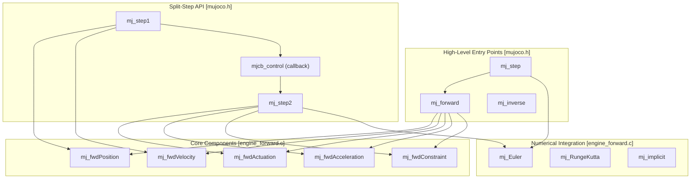
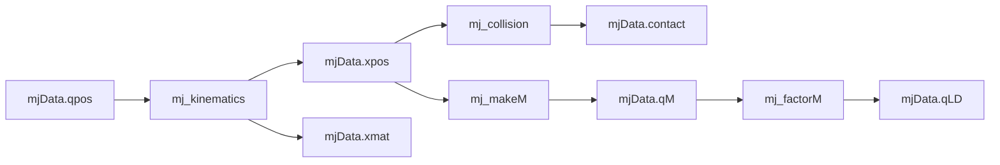

<!-- source: DeepWiki mcp.deepwiki.com · repo google-deepmind/mujoco · page 4 Physics Simulation Pipeline · fetched 2026-10-26 -->

# Physics Simulation Pipeline

Relevant source files

The following files were used as context for generating this wiki page:

- [src/engine/engine_core_util.c](src/engine/engine_core_util.c)
- [src/engine/engine_core_util.h](src/engine/engine_core_util.h)
- [src/engine/engine_derivative.c](src/engine/engine_derivative.c)
- [src/engine/engine_derivative.h](src/engine/engine_derivative.h)
- [src/engine/engine_forward.c](src/engine/engine_forward.c)
- [src/engine/engine_passive.c](src/engine/engine_passive.c)
- [src/engine/engine_setconst.c](src/engine/engine_setconst.c)
- [test/engine/engine_derivative_test.cc](test/engine/engine_derivative_test.cc)
- [test/engine/engine_forward_test.cc](test/engine/engine_forward_test.cc)
- [test/engine/engine_passive_test.cc](test/engine/engine_passive_test.cc)

## Purpose and Scope

This page provides an overview of MuJoCo's physics computation pipeline, covering the sequence of calculations from kinematics through constraint solving to numerical integration. The pipeline implements the forward dynamics computation that advances simulation state through time.

For specific implementation details:
- **Forward Dynamics Pipeline**: Detailed walkthrough of `mj_fwdPosition`, `mj_fwdVelocity`, `mj_fwdActuation`, `mj_fwdAcceleration`, and `mj_fwdConstraint` stages, plus inverse dynamics. See [Forward Dynamics Pipeline](#4.1).
- **Kinematics and Inertia**: `mj_kinematics`, `mj_comPos`, Composite Rigid Body algorithm (`mj_crb`), mass matrix construction (`mj_makeM`), and factorization. See [Kinematics and Inertia](#4.2).
- **Integration Methods**: Euler, RK4, and implicit integrators; handling of DOF damping and derivative computation. See [Integration Methods](#4.3).
- **Constraint System**: Constraint instantiation, Jacobian computation, constraint types (equality, friction, limits, contacts), and arena allocation. See [Constraint System](#4.4).
- **Constraint Solvers**: PGS, CG, and Newton solvers; dual vs primal formulations; island decomposition; sleeping; warmstarting. See [Constraint Solvers](#4.5).
- **Collision Detection**: Broadphase, narrowphase, GJK algorithm, EPA algorithm, support functions, primitive/box/flex/continuous collision, multi-contact generation. See [Collision Detection](#4.6).
- **Support Functions and Utilities**: Force application, perturbations, Jacobian operations, inertia operations, geom distance queries, spatial/BLAS/misc math utilities. See [Support Functions and Utilities](#4.7).
- **Sparse Matrix Operations**: Sparse matrix utilities: transpose, multiply, dot products, sqrMatTDSparse, AVX optimizations. See [Sparse Matrix Operations](#4.8).
- **Sensors and Ray Casting**: Sensor evaluation stages (`mj_sensorPos/Vel/Acc`), sensor types, ray casting (`mj_ray`) and interaction queries used by sensors and visualization. See [Sensors and Ray Casting](#4.9).

## Pipeline Architecture

The physics simulation pipeline in MuJoCo consists of distinct computational stages that transform the current state (positions, velocities) into accelerations and integrate forward in time. The pipeline is exposed through multiple API entry points that provide different levels of control.

### API Entry Points and Code Entities

The following diagram bridges the high-level simulation concepts to the specific functions defined in the MuJoCo engine.

Title: Simulation API Mapping

**Sources:** [src/engine/engine_forward.c:131-172](), [src/engine/engine_forward.c:176-218](), [src/engine/engine_forward.c:632-680](), [src/engine/engine_forward.c:684-748]()

## Main Simulation Functions

MuJoCo provides several entry points into the simulation pipeline, each serving different use cases:

| Function | Purpose | Integration | Control Callback |
|----------|---------|-------------|------------------|
| `mj_step` | Complete simulation step | Yes (Euler, RK4, or Implicit) | Called automatically |
| `mj_step1` + `mj_step2` | Split step for manual control | Yes (Euler only) | User calls between |
| `mj_forward` | Forward dynamics only | No | Called automatically |
| `mj_inverse` | Inverse dynamics | No | Not applicable |

### mj_step
The primary simulation function that advances the simulation by one timestep (`mjModel.opt.timestep`). It executes validation checks (`mj_checkPos`, `mj_checkVel`), forward dynamics (`mj_forward`), and numerical integration.
**Sources:** [src/engine/engine_forward.c:54-68](), [src/engine/engine_forward.c:72-89](), [src/engine/engine_forward.c:93-113]()

### mj_step1 and mj_step2
These functions split `mj_step` to allow explicit control signal computation between stages. `mj_step1` computes position and velocity-dependent quantities, while `mj_step2` computes acceleration and integrates.
**Sources:** [src/engine/engine_forward.c:131-172](), [src/engine/engine_forward.c:176-218]()

### mj_forward and mj_inverse
`mj_forward` maps from force to acceleration, while `mj_inverse` maps from acceleration to force. `mj_forward` is essential for putting `mjData` in a valid state after a reset, as it populates all derived fields in `mjData`.
**Sources:** [src/engine/engine_forward.c:108-109](), [src/engine/engine_forward.c:632-680]()

## Forward Dynamics Pipeline

The forward dynamics computation (`mj_forward`) is organized into primary stages. For details, see [Forward Dynamics Pipeline](#4.1).

### Stage 1: Position-Dependent (`mj_fwdPosition`)
Computes all quantities that depend only on generalized positions (`mjData.qpos`). This stage handles kinematics, inertia matrix construction, and collision detection. It also handles "wake" logic for tendons and constraints if the model uses sleep features.

**Key computations in `mj_fwdPosition` [src/engine/engine_forward.c:131-172]():**
- `mj_fwdKinematics`: Cartesian positions, centers of mass, and cameras/lights.
- `mj_makeM` & `mj_factorM`: Joint-space inertia matrix construction and LDL factorization.
- `mj_collision`: Narrowphase collision detection resulting in the `contact` array.
- `mj_makeConstraint`: Instantiation of constraints and island decomposition.

Title: Position Stage Data Flow

**Sources:** [src/engine/engine_forward.c:131-172](), [src/engine/engine_core_smooth.c:40-187](), [src/engine/engine_core_smooth.c:65-72]()

### Stage 2: Velocity-Dependent (`mj_fwdVelocity`)
Computes quantities depending on both positions and velocities (`mjData.qpos`, `mjData.qvel`). This includes Coriolis, centrifugal, and passive forces. It also computes velocities for flexible objects and tendons via sparse Jacobian multiplications. For details, see [Forward Dynamics Pipeline](#4.1).
**Sources:** [src/engine/engine_forward.c:176-218]()

### Stage 3: Actuation (`mj_fwdActuation`)
Converts control signals (`mjData.ctrl`) to generalized forces (`mjData.qfrc_actuator`) through actuator gains, biases, and dynamics. This stage includes checks for activation limits and damping actuators. For details, see [Forward Dynamics Pipeline](#4.1).
**Sources:** [src/engine/engine_forward.c:300-586](), [test/engine/engine_forward_test.cc:86-134]()

### Stage 4: Acceleration (`mj_fwdAcceleration`)
Computes the unconstrained acceleration `mjData.qacc_smooth` by solving $M a = f$ using the precomputed LDL factorization. It also computes `qfrc_smooth`, the sum of all non-constraint forces. For details, see [Forward Dynamics Pipeline](#4.1).
**Sources:** [src/engine/engine_forward.c:590-623]()

### Stage 5: Constraint (`mj_fwdConstraint`)
Solves for constraint forces (`mjData.efc_force`) that satisfy contacts and limits while minimizing deviation from the smooth acceleration. This results in the final `qacc` and `qfrc_constraint`. For details, see [Forward Dynamics Pipeline](#4.1).
**Sources:** [src/engine/engine_forward.c:755-843]()

## Data Flow Through mjData

The simulation pipeline reads inputs from and writes outputs to specific `mjData` fields.

| Category | Field | Stage Written | Usage |
|----------|-------|---------------|-------|
| **State** | `qpos`, `qvel`, `act` | Input | System configuration, velocity, and actuator state |
| **Kinematics** | `xpos`, `xmat` | Stage 1 | Global body Cartesian state |
| **Inertia** | `qM`, `qLD` | Stage 1 | Mass matrix and its factorization |
| **Forces** | `qfrc_bias` | Stage 2 | Coriolis and centrifugal terms |
| | `qfrc_actuator`| Stage 3 | Forces generated by actuators |
| | `qfrc_constraint`| Stage 5 | Forces enforcing constraints |
| **Output** | `qacc` | Stage 5 | Final generalized acceleration |

**Sources:** [src/engine/engine_forward.c:131-843](), [src/engine/engine_core_smooth.c:191-210]()

## Numerical Integration

After `mj_forward` computes the final accelerations (`mjData.qacc`), the integrator advances the state. For details on integration methods, see [Integration Methods](#4.3).

- **Euler**: Semi-implicit Euler (`mj_Euler`).
- **RK4**: 4th-order Runge-Kutta (`mj_RungeKutta`).
- **Implicit**: Handles stiff systems using Newton iterations (`mj_implicit`). It uses derivatives computed via functions like `mjd_smooth_vel` for efficiency.

**Sources:** [src/engine/engine_forward.c:93-113](), [src/engine/engine_derivative.c:15-31](), [test/engine/engine_forward_test.cc:230-245]()

---

