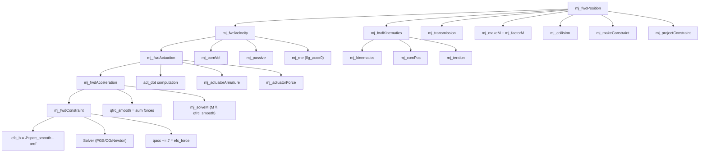
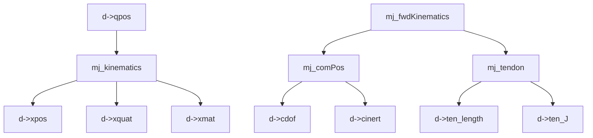
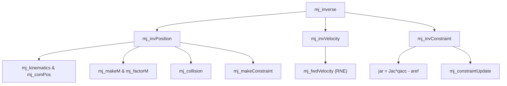

<!-- source: DeepWiki mcp.deepwiki.com · repo google-deepmind/mujoco · page 4.1 Forward Dynamics Pipeline · fetched 2026-10-26 -->

# Forward Dynamics Pipeline

<details>
<summary>Relevant source files</summary>

The following files were used as context for generating this wiki page:

- [src/engine/engine_core_util.c](src/engine/engine_core_util.c)
- [src/engine/engine_core_util.h](src/engine/engine_core_util.h)
- [src/engine/engine_derivative.c](src/engine/engine_derivative.c)
- [src/engine/engine_derivative.h](src/engine/engine_derivative.h)
- [src/engine/engine_forward.c](src/engine/engine_forward.c)
- [src/engine/engine_inverse.c](src/engine/engine_inverse.c)
- [src/engine/engine_passive.c](src/engine/engine_passive.c)
- [src/engine/engine_setconst.c](src/engine/engine_setconst.c)
- [test/engine/engine_derivative_test.cc](test/engine/engine_derivative_test.cc)
- [test/engine/engine_forward_test.cc](test/engine/engine_forward_test.cc)
- [test/engine/engine_passive_test.cc](test/engine/engine_passive_test.cc)

</details>


The purpose and scope of this leaf page is to provide a comprehensive, technical walkthrough of the five-stage forward dynamics pipeline in MuJoCo (`mj_fwdPosition`, `mj_fwdVelocity`, `mj_fwdActuation`, `mj_fwdAcceleration`, and `mj_fwdConstraint`), alongside its counterpart inverse dynamics pipeline (`mj_inverse`). It covers the internal implementation, data flows, and major code symbols across engine files like `src/engine/engine_forward.c` and `src/engine/engine_inverse.c`.

## Pipeline Overview

The forward dynamics pipeline transforms the current physical state (`qpos`, `qvel`, `ctrl`, `act`) into accelerations (`qacc`) and constraint forces (`efc_force`). It is structured into sequential stages, which can be executed together via `mj_forward` or partially via `mj_step1`.

### Pipeline Logic Flow


Sources: [src/engine/engine_forward.c:131-172](), [src/engine/engine_forward.c:176-218](), [src/engine/engine_forward.c:299-586](), [src/engine/engine_forward.c:589-623](), [src/engine/engine_forward.c:755-843]()

## Position-Dependent Stage

The position-dependent stage (`mj_fwdPosition` in [src/engine/engine_forward.c:131-172]()) computes all quantities that depend exclusively on joint positions `qpos`.

### Kinematics Computation
Forward kinematics is performed by `mj_fwdKinematics` [src/engine/engine_forward.c:119-128](), which invokes tree traversals and spatial geometry mapping:



The `mj_kinematics` function (called at [src/engine/engine_forward.c:120]()) traverses the body tree to calculate Cartesian positions and orientations. `mj_comPos` ([src/engine/engine_forward.c:121]()) evaluates subtree centers of mass and spatial axes (`cdof`).

### Inertia Matrix and Collision Detection
- **`mj_makeM`**: Computes the joint-space inertia matrix via the Composite Rigid Body (CRB) algorithm [src/engine/engine_forward.c:144]() and `src/engine/engine_setconst.c:41`().
- **`mj_factorM`**: Performs a sparse $L^\top DL$ factorization of the inertia matrix [src/engine/engine_forward.c:145]().
- **`mj_collision`**: Executes broadphase and narrowphase collision checks, producing `d->contact` [src/engine/engine_forward.c:148]().

### Constraint Generation and Metric Building
- **`mj_makeConstraint`**: Instantiates active constraints (contacts, limits, equality constraints) [src/engine/engine_forward.c:160]().
- **`mj_island`**: Decomposes the constraint network into independent islands [src/engine/engine_forward.c:161]().
- **`mj_projectConstraint`**: Computes constraint transmission and projections [src/engine/engine_forward.c:165]().
- **`mj_effBuild`**: Builds the implicit effective metric matrix $\tilde{M} = M + K$ [src/engine/engine_forward.c:175]().

Sources: [src/engine/engine_forward.c:119-178](), [src/engine/engine_setconst.c:41-65]()

## Velocity-Dependent Stage

The velocity-dependent stage (`mj_fwdVelocity` in [src/engine/engine_forward.c:182-218]()) computes quantities dependent on both positions and velocities.

### Velocity Transmission Products
Velocities map through transmission arrays using sparse matrix vector products:
- `flexedge_velocity = flexedge_J * qvel` [src/engine/engine_forward.c:195-198]()
- `ten_velocity = ten_J * qvel` [src/engine/engine_forward.c:201-202]()
- `actuator_velocity = actuator_moment * qvel` [src/engine/engine_forward.c:206-207]()

### Passive Forces and Bias Forces
- **`mj_passive`**: Computes spring, damper, fluid, and flex deformation forces into `qfrc_passive` [src/engine/engine_forward.c:214]() and `src/engine/engine_passive.c:41-186]().
- **`mj_rne`**: Executes the Recursive Newton-Euler algorithm with zero acceleration (`flg_acc=0`) to calculate Coriolis and centrifugal bias forces (`qfrc_bias`) [src/engine/engine_forward.c:218]().

Sources: [src/engine/engine_forward.c:182-218](), [src/engine/engine_passive.c:41-186]()

## Actuation Stage

The actuation stage (`mj_fwdActuation`) computes actuator forces from control inputs (`ctrl`) and internal states (`act`).

### Activation Dynamics
Stateful actuators update their internal activation derivatives (`act_dot`) based on configured dynamics types (`dyntype`) [src/engine/engine_forward.c:337-406]().

### Force Computation
Actuator forces are evaluated as a function of gains, biases, and control signals, then projected into joint space:
```c
mju_mulMatTVecSparse(d->qfrc_actuator, d->actuator_moment, d->actuator_force, ...)
```
[src/engine/engine_forward.c:559-561]()

Sources: [src/engine/engine_forward.c:299-586]()

## Acceleration Stage

The acceleration stage (`mj_fwdAcceleration` in [src/engine/engine_forward.c:589-623]()) resolves unconstrained accelerations (`qacc_smooth`).

### Smooth Force Summation
The total generalized smooth force vector `qfrc_smooth` combines passive, applied, and actuator forces minus bias forces:
$$qfrc_{smooth} = qfrc_{passive} + qfrc_{applied} + qfrc_{actuator} - qfrc_{bias}$$
[src/engine/engine_forward.c:596-607]()

### Mass Matrix Solution
MuJoCo solves the linear system $M \cdot qacc_{smooth} = qfrc_{smooth}$ using `mj_solveM` backed by the factorization from `mj_factorM` [src/engine/engine_forward.c:612-618]().

Sources: [src/engine/engine_forward.c:589-623]()

## Constraint Stage

The constraint stage (`mj_fwdConstraint` in [src/engine/engine_forward.c:755-843]()) handles inequality and equality constraints via numerical solvers.

### Constraint Right-Hand Side
The constraint acceleration residual `efc_b` is calculated as:
$$efc\_b = J \cdot qacc_{smooth} - efc\_aref$$
[src/engine/engine_forward.c:771-772]()

### Constraint Solving
The engine invokes the configured solver (PGS, CG, or Newton) across decoupled constraint islands to compute constraint forces (`efc_force`) [src/engine/engine_forward.c:779-814]().

### Acceleration Update
The final constrained acceleration `qacc` updates via:
$$qacc = qacc_{smooth} + M^{-1} \cdot J^\top \cdot efc\_force$$
[src/engine/engine_forward.c:831-835]()

Sources: [src/engine/engine_forward.c:755-843]()

## Inverse Dynamics Pipeline

Inverse dynamics (`mj_inverse` / `mj_invPosition`, `mj_invVelocity`, `mj_invConstraint` in `src/engine/engine_inverse.c`) solves the reverse problem: computing required forces or controls from known positions, velocities, and accelerations.

### Inverse Pipeline Flow


Sources: [src/engine/engine_inverse.c:40-78](), [src/engine/engine_inverse.c:82-84](), [src/engine/engine_inverse.c:201-222]()

## Data Flow Summary

| Stage | Input | Output | Primary Logic Symbols |
| :--- | :--- | :--- | :--- |
| **Position** | `qpos` | `xpos`, `qM`, `qLD` | `mj_kinematics`, `mj_makeM`, `mj_factorM`, `mj_collision` [src/engine/engine_forward.c:131-178]() |
| **Velocity** | `qvel` | `qfrc_bias`, `qfrc_passive` | `mj_rne`, `mj_passive` [src/engine/engine_forward.c:182-218]() |
| **Actuation** | `ctrl`, `act` | `qfrc_actuator`, `act_dot` | `mj_fwdActuation` [src/engine/engine_forward.c:299-586]() |
| **Acceleration** | Forces | `qacc_smooth` | `mj_solveM` [src/engine/engine_forward.c:589-623]() |
| **Constraint** | `qacc_smooth` | `qacc`, `efc_force` | `mj_solCG`, `mj_solNewton`, `mj_solPGS` [src/engine/engine_forward.c:755-843]() |

Sources: [src/engine/engine_forward.c:131-843](), [src/engine/engine_inverse.c:40-222]()

---

