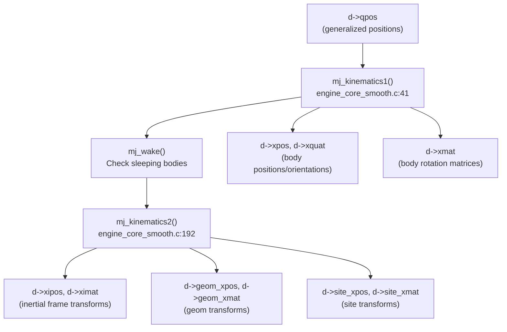
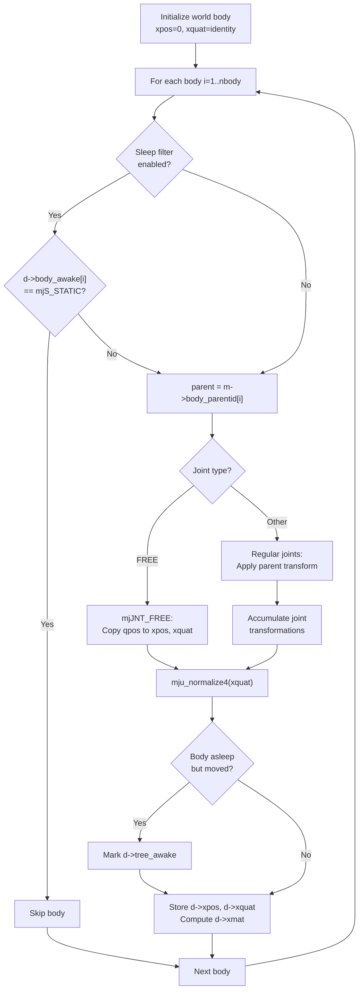
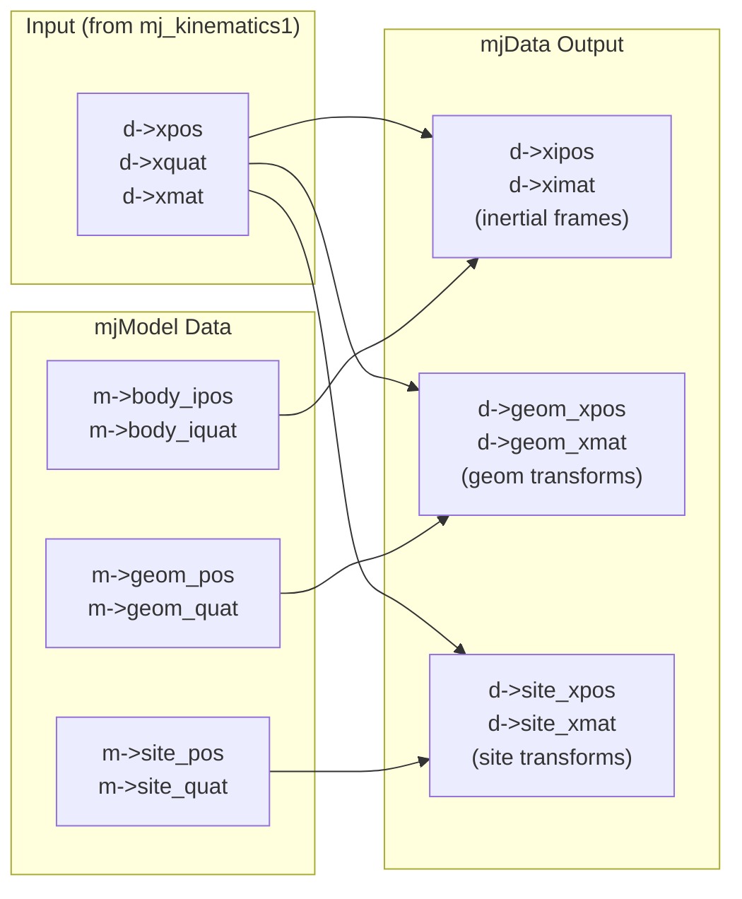
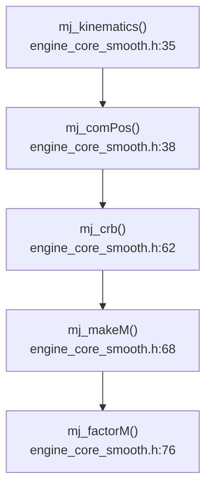

<!-- source: DeepWiki mcp.deepwiki.com · repo google-deepmind/mujoco · page 4.2 Kinematics and Inertia · fetched 2026-10-26 -->

# Kinematics and Inertia

Relevant source files

The following files were used as context for generating this wiki page:

- [src/engine/engine_core_smooth.c](src/engine/engine_core_smooth.c)
- [src/engine/engine_core_smooth.h](src/engine/engine_core_smooth.h)
- [test/benchmark/factorI_benchmark_test.cc](test/benchmark/factorI_benchmark_test.cc)
- [test/benchmark/inertia_benchmark_test.cc](test/benchmark/inertia_benchmark_test.cc)
- [test/benchmark/solveLD_benchmark_test.cc](test/benchmark/solveLD_benchmark_test.cc)
- [test/engine/engine_core_smooth_test.cc](test/engine/engine_core_smooth_test.cc)

## Purpose and Scope

This page documents the kinematics and inertia computation subsystems within MuJoCo's physics pipeline, defined in `src/engine/engine_core_smooth.c` [src/engine/engine_core_smooth.c:1-188]() and declared in `src/engine/engine_core_smooth.h` [src/engine/engine_core_smooth.h:1-123](). These computations form the position-dependent stage of forward dynamics, transforming generalized coordinates (`qpos`) into Cartesian positions, orientations, and the mass matrix `M`. 

The key functions covered are:
- **Forward kinematics**: `mj_kinematics()` [src/engine/engine_core_smooth.h:35](), `mj_kinematics1()` [src/engine/engine_core_smooth.h:29](), and `mj_kinematics2()` [src/engine/engine_core_smooth.h:32]().
- **CoM frame mapping**: `mj_comPos()` [src/engine/engine_core_smooth.h:38](), `mj_comVel()` [src/engine/engine_core_smooth.h:99](), and `mj_subtreeVel()` [src/engine/engine_core_smooth.h:102]().
- **Mass matrix construction**: `mj_crb()` [src/engine/engine_core_smooth.h:62](), `mj_tendonArmature()` [src/engine/engine_core_smooth.h:65](), and `mj_makeM()` [src/engine/engine_core_smooth.h:68]().
- **Factorization and Solvers**: `mj_factorI()` [src/engine/engine_core_smooth.h:72](), `mj_factorM()` [src/engine/engine_core_smooth.h:76](), `mj_solveLD()` [src/engine/engine_core_smooth.h:80](), `mj_solveM()` [src/engine/engine_core_smooth.h:84](), and `mj_solveM2()` [src/engine/engine_core_smooth.h:87]().

Sources: [src/engine/engine_core_smooth.c:1-188](), [src/engine/engine_core_smooth.h:1-123]()

---

## Forward Kinematics Overview

Forward kinematics computes the Cartesian positions and orientations of all bodies, geoms, and sites from the generalized positions `qpos`. The computation is split into two primary stages (`mj_kinematics1` and `mj_kinematics2`) for efficiency and to support sleeping bodies.

### Forward Kinematics Two-Stage Pipeline

Sources: [src/engine/engine_core_smooth.c:41-192](), [src/engine/engine_core_smooth.h:28-35]()

---

## Body Kinematics (`mj_kinematics1`)

`mj_kinematics1()` computes global positions (`xpos`) and orientations (`xquat`, `xmat`) for all bodies by traversing the kinematic tree from parent to child [src/engine/engine_core_smooth.c:41-188]().

### Joint Types and Transformations

The function processes different joint types as follows [src/engine/engine_core_smooth.c:66-152]():

| Joint Type | DOFs | Position Update | Orientation Update |
|------------|------|-----------------|-------------------|
| `mjJNT_FREE` | 6 | `xpos = qpos[0:3]` [src/engine/engine_core_smooth.c:72]() | `xquat = qpos[3:7]` [src/engine/engine_core_smooth.c:73]() |
| `mjJNT_BALL` | 3 | Rotation around anchor [src/engine/engine_core_smooth.c:134-147]() | `xquat = parent_quat * local_quat` [src/engine/engine_core_smooth.c:142]() |
| `mjJNT_HINGE` | 1 | Rotation around axis [src/engine/engine_core_smooth.c:137-148]() | Axis-angle rotation [src/engine/engine_core_smooth.c:138]() |
| `mjJNT_SLIDE` | 1 | Translation along axis [src/engine/engine_core_smooth.c:125-126]() | No rotation |

### Algorithm Structure

### Key Implementation Details

1. **Free joints** [src/engine/engine_core_smooth.c:66-79](): Position and orientation are read directly from `qpos`. Joint anchors and axes are initialized from body positions and model axes.
2. **Regular joints** [src/engine/engine_core_smooth.c:81-158](): Body pose is computed relative to the parent body, incorporating mocap overrides if applicable [src/engine/engine_core_smooth.c:87-95]().
3. **Sleep optimization** [src/engine/engine_core_smooth.c:52-60, 164-181](): Static bodies are skipped entirely. Sleeping bodies whose kinematics have changed are flagged for waking via `d->tree_awake`.

Sources: [src/engine/engine_core_smooth.c:41-188](), [src/engine/engine_core_smooth.h:29]()

---

## Inertial Frames, Geoms, and Sites (`mj_kinematics2`)

`mj_kinematics2()` transforms inertial frames, geoms, and sites from local body-relative coordinates to global coordinates using the body transformations computed by `mj_kinematics1()` [src/engine/engine_core_smooth.c:191-232]().

### Data Flow in `mj_kinematics2`

Sources: [src/engine/engine_core_smooth.c:191-232](), [src/engine/engine_core_smooth.h:32]()

---

## Center of Mass Frame Mapping (`mj_comPos`, `mj_comVel`, `mj_subtreeVel`)

`mj_comPos()` transforms inertias and motion DOFs from body frames to global frames centered at each subtree's center of mass [src/engine/engine_core_smooth.h:38](). 

- `mj_comVel()` computes spatial velocities (`cvel`) and local acceleration terms (`cdof_dot`) [src/engine/engine_core_smooth.h:99]().
- `mj_subtreeVel()` computes subtree linear velocities and angular momenta [src/engine/engine_core_smooth.h:102]().

Sources: [src/engine/engine_core_smooth.h:38,99-102]()

---

## Composite Rigid Body Algorithm (`mj_crb`)

The Composite Rigid Body (CRB) algorithm computes the mass matrix `M` by recursively accumulating composite inertias (`d->crb`) from leaves to root [src/engine/engine_core_smooth.h:62](). Each composite inertia groups a body and all its descendants into a single rigid body structure, simplifying the mass matrix projection onto joint axes.

Sources: [src/engine/engine_core_smooth.h:62]()

---

## Mass Matrix Construction (`mj_makeM`)

`mj_makeM()` constructs the full generalized mass matrix `M` [src/engine/engine_core_smooth.h:68]() by combining the results of `mj_crb()` with diagonal terms such as joint armatures and tendon-specific inertias added via `mj_tendonArmature()` [src/engine/engine_core_smooth.h:65]().

Sources: [src/engine/engine_core_smooth.h:65-68]()

---

## Mass Matrix Factorization and Solvers

MuJoCo utilizes sparse $L^T D L$ decomposition to efficiently solve linear systems of the form $M x = b$ without inverting matrices explicitly.

### Factorization and Solution Functions
- `mj_factorI()`: Performs in-place sparse $L^T D L$ factorization on a matrix in CSR format [src/engine/engine_core_smooth.h:72]().
- `mj_factorM()`: Factorizes the system mass matrix `M` stored in `mjData` [src/engine/engine_core_smooth.h:76]().
- `mj_solveLD()`: Solves $x = (L^T D L)^{-1} x$ via sparse backsubstitution [src/engine/engine_core_smooth.h:80]().
- `mj_solveM()`: Specialized wrapper solving against the factored mass matrix [src/engine/engine_core_smooth.h:84]().
- `mj_solveM2()`: Computes half-factor backsubstitutions $x = D^{-1/2} (L^T)^{-1} y$ [src/engine/engine_core_smooth.h:87]().

Sources: [src/engine/engine_core_smooth.h:70-94](), [test/benchmark/factorI_benchmark_test.cc:55-56](), [test/benchmark/solveLD_benchmark_test.cc:58-59]()

---

## Integration with Forward Dynamics

Kinematics and inertia calculations execute sequentially as the initial stages of the forward dynamics pipeline (`mj_forward`).

### Pipeline Integration Map

Sources: [src/engine/engine_core_smooth.h:35-76]()

---

