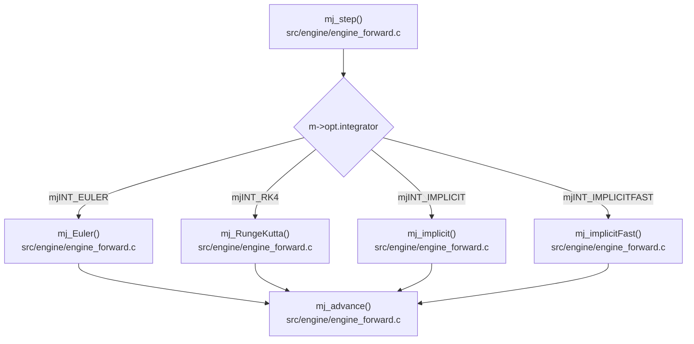
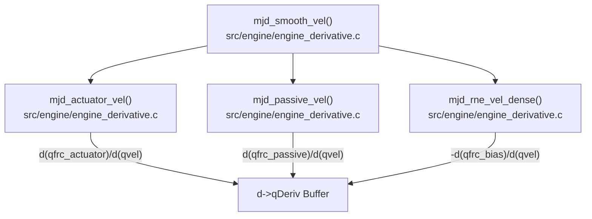

<!-- source: DeepWiki mcp.deepwiki.com · repo google-deepmind/mujoco · page 4.3 Integration Methods · fetched 2026-10-26 -->

# Integration Methods

Relevant source files

The following files were used as context for generating this wiki page:

- [src/engine/engine_core_util.c](src/engine/engine_core_util.c)
- [src/engine/engine_core_util.h](src/engine/engine_core_util.h)
- [src/engine/engine_derivative.c](src/engine/engine_derivative.c)
- [src/engine/engine_derivative.h](src/engine/engine_derivative.h)
- [src/engine/engine_forward.c](src/engine/engine_forward.c)
- [src/engine/engine_passive.c](src/engine/engine_passive.c)
- [src/engine/engine_setconst.c](src/engine/engine_setconst.c)
- [test/engine/engine_derivative_test.cc](test/engine/engine_derivative_test.cc)
- [test/engine/engine_forward_test.cc](test/engine/engine_forward_test.cc)
- [test/engine/engine_passive_test.cc](test/engine/engine_passive_test.cc)

## Purpose and Scope

This page describes the numerical integration methods available in MuJoCo for advancing the simulation state forward in time. Integration methods compute the next state `(qpos, qvel, act)` from the current state, accelerations `qacc`, and activation derivatives.

For information about the overall forward dynamics pipeline that precedes integration, see [Forward Dynamics Pipeline](#4.1). For details about analytical derivative computation used by implicit integrators, see [Analytical Derivatives](#9.5).

Sources: `[src/engine/engine_forward.c:849-1191]()`

---

## Available Integrators

MuJoCo provides four numerical integrators, configured via `mjOption.integrator`:

| Integrator | `mjtIntegrator` | Function | Order | Implicit | Derivative Required |
|-----------|----------------|----------|-------|----------|-------------------|
| Semi-implicit Euler | `mjINT_EULER` | `mj_Euler` | 1st | No | No |
| Runge-Kutta 4 | `mjINT_RK4` | `mj_RungeKutta` | 4th | No | No |
| Implicit | `mjINT_IMPLICIT` | `mj_implicit` | 1st | Yes | Yes |
| Implicit Fast | `mjINT_IMPLICITFAST` | `mj_implicitFast` | 1st | Yes | Yes |

All integrators ultimately call `mj_advance` to update state vectors, handle activation dynamics, and manage sleep filtering.

Sources: `[src/engine/engine_forward.c:849-906]`, `[src/engine/engine_forward.c:909-1191]()`

---

## Integration Method Selection

The step dispatcher inspects `mjModel.opt.integrator` to select the appropriate integration routine during `mj_step`.

Title: Integrator Dispatch and Execution Flow (Code Entity Space)

Sources: `[src/engine/engine_forward.c:909-1191]()`

---

## Semi-Implicit Euler Integration

The semi-implicit Euler integrator (`mj_Euler`) is the primary explicit method. It updates velocities first using the computed acceleration (incorporating joint and actuator damping), and then updates positions using the newly updated velocities.

1. **Damped Acceleration**: `mj_Euler` incorporates joint and actuator damping directly into the effective acceleration term to improve numerical stability.
2. **Velocity Update**: `qvel` is advanced via `qvel += timestep * qacc_damped`.
3. **Position Integration**: `qpos` is updated via `mj_integratePos`, which properly handles rotational coordinates (such as quaternions).

The `mj_EulerSkip` variant allows bypassing forward dynamics when only integration is required (e.g., during finite-difference Jacobian evaluations).

Sources: `[src/engine/engine_forward.c:849-958]`, `[src/engine/engine_derivative_fd.c:129-131]()`

---

## Runge-Kutta 4th Order (RK4)

The RK4 integrator (`mj_RungeKutta`) evaluates dynamics across four intermediate stages (`k1`, `k2`, `k3`, `k4`) per timestep. Each intermediate stage invokes `mj_forwardSkip` to update accelerations at fractional step offsets before performing a weighted combination to advance `qpos` and `qvel`.

Sources: `[src/engine/engine_forward.c:1089-1190]()`

---

## Implicit Integration and Derivative Computation

Implicit integrators (`mj_implicit` and `mj_implicitFast`) solve for the next state by satisfying equilibrium conditions at the end of the timestep, handling stiff systems without requiring excessively small timesteps.

### Implicit Fast (`mj_implicitFast`)
Performs a single linearized Newton step:
1. Calls `mjd_smooth_vel` to compute analytical state-derivative matrices (`qDeriv`).
2. Modifies the mass matrix system using `qDeriv`.
3. Solves the linear system using `mj_solveM`.
4. Finalizes the update via `mj_advance`.

### Full Implicit (`mj_implicit`)
Performs multiple Newton-Raphson iterations until convergence criteria or `mjOption.iterations` is satisfied.

### Analytical Derivatives
Both implicit methods rely heavily on `mjd_smooth_vel`, which aggregates actuator, passive, and RNE bias derivatives into `d->qDeriv`.

Title: Implicit Derivative and State Correction Pipeline (Code Entity Space)

Sources: `[src/engine/engine_forward.c:960-1088]`, `[src/engine/engine_derivative.c:1-48]`, `[src/engine/engine_derivative.h:36-48]()`

---

## State Advancement (`mj_advance`)

All integrators converge on `mj_advance` to execute final state transformations and buffers updates.

1. **Activation Dynamics**: Evaluates activation states (e.g., `mjDYN_FILTER`, `mjDYN_FILTEREXACT`).
2. **Sleep Filtering**: Updates awake/sleep states for bodies via `mj_updateSleep` and `mj_sleep`.
3. **Position Integration**: Calls `mj_integratePos` to advance configuration coordinates.
4. **Warmstart Caching**: Copies `qacc` into `qacc_warmstart` to warm-start the constraint solver on the next step.

Sources: `[src/engine/engine_forward.c:849-906]()`

---

## DOF Damping and Passive Forces

Passive forces (springs, dampers, fluid drag) are computed during `mj_fwdVelocity`. For soft-body flexes, functions such as `mj_flexPassiveInterp` and `mjd_flexInterp_mul` compute internal stretch and bending forces and assemble their stiffness and damping contributions into the global solvers or implicit derivative matrices.

Sources: `[src/engine/engine_passive.c:63-183]`, `[src/engine/engine_derivative.h:65-88]()`

---

