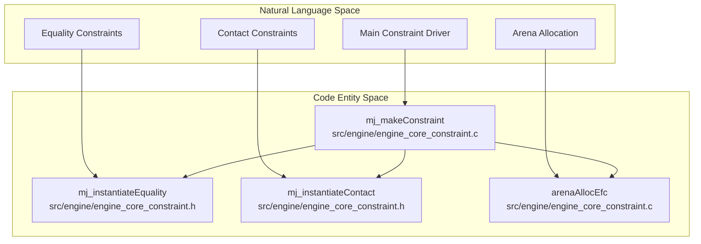
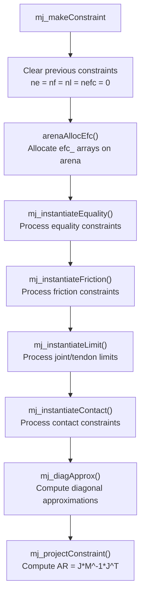
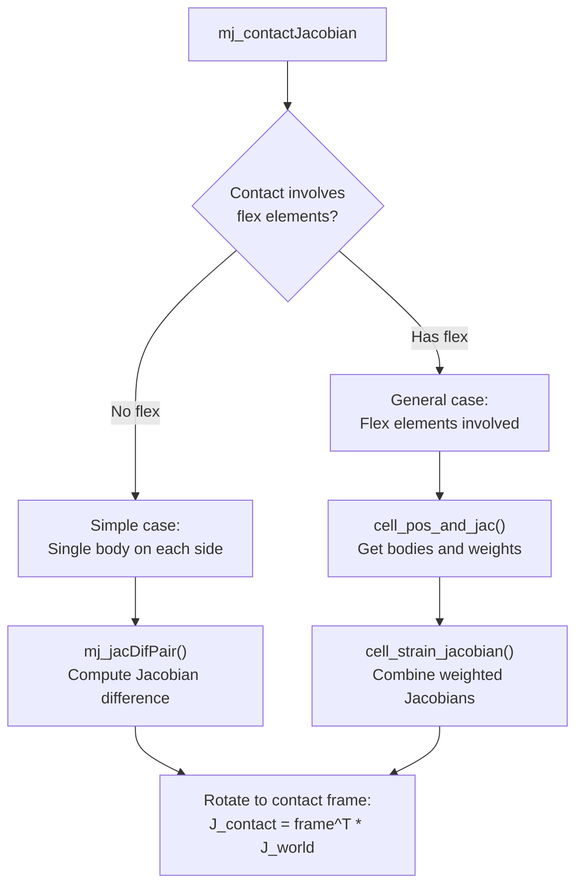
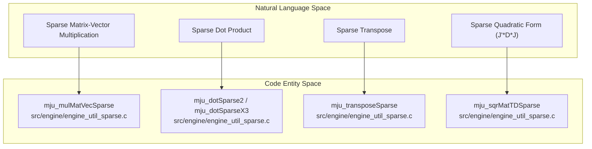

<!-- source: DeepWiki mcp.deepwiki.com · repo google-deepmind/mujoco · page 4.4 Constraint System · fetched 2026-10-26 -->

# Constraint System

Relevant source files

The following files were used as context for generating this wiki page:

- [model/flex/hollow_vs_solid.xml](model/flex/hollow_vs_solid.xml)
- [src/engine/engine_core_constraint.c](src/engine/engine_core_constraint.c)
- [src/engine/engine_core_constraint.h](src/engine/engine_core_constraint.h)
- [src/engine/engine_solver.c](src/engine/engine_solver.c)
- [src/engine/engine_util_sparse.c](src/engine/engine_util_sparse.c)
- [src/engine/engine_util_sparse.h](src/engine/engine_util_sparse.h)
- [src/engine/engine_util_sparse_avx.h](src/engine/engine_util_sparse_avx.h)
- [test/benchmark/engine_util_sparse_benchmark_test.cc](test/benchmark/engine_util_sparse_benchmark_test.cc)
- [test/engine/engine_core_constraint_test.cc](test/engine/engine_core_constraint_test.cc)
- [test/engine/engine_util_sparse_test.cc](test/engine/engine_util_sparse_test.cc)

## Purpose and Scope

The constraint system is responsible for instantiating constraints from model definitions and simulation state, computing their Jacobians, and storing them in data structures suitable for constraint solvers. This page covers constraint types, the instantiation pipeline, Jacobian computation, parameter regularization, and arena allocation.

For information about solving constraints once instantiated, see [Constraint Solvers](#4.5). For the general forward dynamics pipeline where constraint instantiation occurs, see [Forward Dynamics Pipeline](#4.1). For sparse matrix operations used by the constraint system, see [Sparse Matrix Operations](#4.8).

Sources: `[src/engine/engine_core_constraint.c:130-163](), [src/engine/engine_core_constraint.h:87-107]()`

## Constraint Types and Classification

MuJoCo supports five major categories of constraints, each with specific subtypes:

| Constraint Type | Subtypes | Purpose |
|----------------|----------|---------|
| **Equality** (`mjCNSTR_EQUALITY`) | Connect, Weld, Joint, Tendon, Flex | Enforce kinematic relationships between bodies, joints, or tendons |
| **Friction** | DOF (`mjCNSTR_FRICTION_DOF`), Tendon (`mjCNSTR_FRICTION_TENDON`) | Model friction loss in joints and tendons |
| **Limits** | Joint (`mjCNSTR_LIMIT_JOINT`), Tendon (`mjCNSTR_LIMIT_TENDON`) | Enforce position/angle limits on joints and tendons |
| **Contact** | Frictionless (`mjCNSTR_CONTACT_FRICTIONLESS`), Pyramidal (`mjCNSTR_CONTACT_PYRAMIDAL`), Elliptic (`mjCNSTR_CONTACT_ELLIPTIC`) | Handle collision responses and contact friction |
| **Flex Edge** | Implicit in flex constraints | Maintain edge lengths in deformable bodies |

Constraints are classified into three mathematical categories:
- **Bilateral** ($n_e$): Equality constraints that must be exactly satisfied ($J qacc = ar$).
- **Unilateral with bounds** ($n_f$): Friction constraints with bounded forces.
- **Unilateral positive** ($n_l$): Limit and contact constraints requiring non-negative forces.

Sources: `[src/engine/engine_core_constraint.c:218-221](), [src/engine/engine_core_constraint.h:63-72](), [src/engine/engine_core_constraint.h:97-101]()`

## Constraint Data Structures in mjData and Arena Allocation

All instantiated constraints are stored in the `efc_*` arrays within `mjData`. These arrays are allocated dynamically on the arena memory pool using `arenaAllocEfc()` and the `MJDATA_ARENA_POINTERS_SOLVER` macro suite.

Title: Natural Language to Code Entity Space: Constraint Instantiation & Allocation

Sources: `[src/engine/engine_core_constraint.c:130-163](), [src/engine/engine_core_constraint.h:63-68](), [src/engine/engine_core_constraint.h:104-104]()`

### Key Constraint Arrays

| Array | Type | Size | Purpose |
|-------|------|------|---------|
| `efc_J` | mjtNum* | nefc × nv (dense) or sparse | Constraint Jacobian mapping velocities to constraint space. |
| `efc_pos` | mjtNum* | nefc | Constraint position error (negative = penetration). |
| `efc_margin` | mjtNum* | nefc | Detection/activation margin. |
| `efc_force` | mjtNum* | nefc | Computed constraint forces (output from solver). |
| `efc_type` | int* | nefc | Constraint type (equality, friction, limit, contact). |
| `efc_id` | int* | nefc | ID of source object (joint, contact, etc.). |
| `efc_state` | int* | nefc | Constraint state (satisfied, active, cone, etc.). |
| `efc_AR` | mjtNum* | nefc × nefc | Reduced inertia matrix $J M^{-1} J^T + R$. |

Sources: `[src/engine/engine_core_constraint.h:97-101](), [src/engine/engine_core_constraint.c:77-78]()`

## Constraint Instantiation Pipeline

Constraints are instantiated during the forward dynamics pipeline via `mj_makeConstraint()`. The driver coordinates clearing previous buffers, arena allocation, equality processing, limit/friction checks, and contact Jacobian evaluations.

Title: Constraint Construction Flow

Sources: `[src/engine/engine_core_constraint.c:130-163](), [src/engine/engine_core_constraint.h:87-93]()`

## Equality, Friction, and Limit Constraints

- **Equality Constraints (`mj_instantiateEquality`)**: Enforce exact kinematic relationships such as `mjEQ_CONNECT`, `mjEQ_WELD`, `mjEQ_JOINT`, `mjEQ_TENDON`, and `mjEQ_FLEX`.
- **Friction Constraints**: Energy dissipation terms added for degrees of freedom (`dof_frictionloss`) and tendons (`tendon_frictionloss`).
- **Limit Constraints**: Unilateral constraints activated when joint positions or tendon lengths approach specified bounds within their detection margins.

Sources: `[src/engine/engine_core_constraint.h:63-68](), [test/engine/engine_core_constraint_test.cc:44-109]()`

## Contact Constraints and Jacobian Computation

Contact constraints are instantiated by `mj_instantiateContact()`. For complex geometries and flexible elements (`flexcomp`), `mj_contactJacobian()` delegates to helper functions like `cell_pos_and_jac()` and `cell_strain_jacobian()` to compute sparse Jacobians across affected degrees of freedom.

Title: Contact Jacobian Logic

Sources: `[src/engine/engine_core_constraint.c:55-126](), [src/engine/engine_core_constraint.h:69-89]()`

## Sparse Matrix Operations in Constraint System

When sparse Jacobians are enabled (`m->opt.jacobian == mjJAC_SPARSE`), the constraint system uses optimized sparse vector dot products and matrix products defined in `engine_util_sparse.c`.

Title: Natural Language to Code Entity Space: Sparse Utilities

Sources: `[src/engine/engine_util_sparse.c:30-38](), [src/engine/engine_util_sparse.c:59-88](), [src/engine/engine_util_sparse.c:119-126](), [src/engine/engine_util_sparse.c:180-191]()`

## Key Functions Reference

| Function | Purpose | Location |
|----------|---------|----------|
| `mj_makeConstraint` | Main driver for constraint construction. | `[src/engine/engine_core_constraint.h:104-104]()` |
| `mj_projectConstraint` | Computes the `efc_AR` matrix ($J M^{-1} J^T$). | `[src/engine/engine_core_constraint.h:107-107]()` |
| `mj_referenceConstraint` | Computes constraint velocities and reference accelerations. | `[src/engine/engine_core_constraint.h:113-113]()` |
| `mj_constraintUpdate` | Updates constraint states and forces based on solver results. | `[src/engine/engine_core_constraint.h:126-129]()` |
| `mj_diagApprox` | Computes diagonal approximations of the mass matrix for solver scaling. | `[src/engine/engine_core_constraint.h:95-95]()` |
| `mju_mulMatVecSparse` | Multiplies a sparse matrix by a dense vector. | `[src/engine/engine_util_sparse.h:61-63]()` |

Sources: `[src/engine/engine_core_constraint.h:87-130](), [src/engine/engine_util_sparse.h:61-64]()`

---

