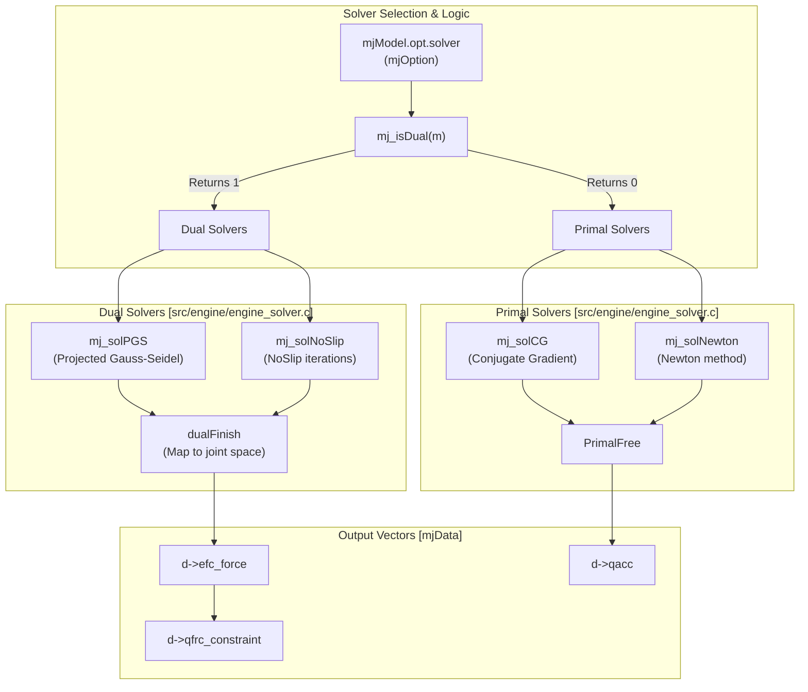
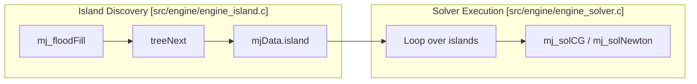

<!-- source: DeepWiki mcp.deepwiki.com · repo google-deepmind/mujoco · page 4.5 Constraint Solvers · fetched 2026-10-26 -->

# Constraint Solvers

Relevant source files

The following files were used as context for generating this wiki page:

- [src/engine/engine_island.c](src/engine/engine_island.c)
- [src/engine/engine_island.h](src/engine/engine_island.h)
- [src/engine/engine_metric.c](src/engine/engine_metric.c)
- [src/engine/engine_metric.h](src/engine/engine_metric.h)
- [src/engine/engine_sleep.c](src/engine/engine_sleep.c)
- [src/engine/engine_util_spatial.c](src/engine/engine_util_spatial.c)
- [src/engine/engine_util_spatial.h](src/engine/engine_util_spatial.h)
- [test/engine/engine_island_test.cc](test/engine/engine_island_test.cc)
- [test/engine/engine_sleep_test.cc](test/engine/engine_sleep_test.cc)
- [test/engine/engine_solver_test.cc](test/engine/engine_solver_test.cc)
- [test/engine/engine_util_spatial_test.cc](test/engine/engine_util_spatial_test.cc)
- [test/engine/testdata/equality_site_body_compare.xml](test/engine/testdata/equality_site_body_compare.xml)
- [test/engine/testdata/island/island_efc.xml](test/engine/testdata/island/island_efc.xml)
- [test/pipeline_test.cc](test/pipeline_test.cc)

## Purpose and Scope

This page describes MuJoCo's constraint solvers, which compute constraint forces that enforce contacts, joint limits, equality constraints, and friction. The solvers operate on the constraint system assembled during `mj_fwdConstraint` and produce constraint forces in `d->efc_force` that are then mapped to joint space.

For information about how constraints are instantiated and the constraint Jacobian is assembled, see [Constraint System](#4.4). For details on the forward dynamics pipeline that calls the solver, see [Forward Dynamics Pipeline](#4.1). For sparse matrix operations used by the solvers, see [Sparse Matrix Operations](#4.8).

---

## Solver Architecture Overview

MuJoCo provides multiple constraint solvers that can be selected via `mjModel.opt.solver`. The solvers differ in their mathematical formulation, convergence properties, and computational cost.

### Solver Data Flow and Entities

The following diagram maps the high-level solver selection logic to the specific code entities responsible for the computation.

**Sources:** [src/engine/engine_solver.c:71-84](), [src/engine/engine_solver.c:752-760]()

---

## Dual vs Primal Formulation

The constraint problem can be formulated in two mathematically equivalent ways:

### Dual Formulation
The dual formulation solves for constraint forces `λ` directly by minimizing a cost function in constraint space.
*   **Cost:** `(1/2) λᵀ A λ + bᵀ λ`
*   **Hessian:** `A = J M⁻¹ Jᵀ + R` (stored in `d->efc_AR`)
*   **Implementation:** Used by PGS and NoSlip solvers.

### Primal Formulation
The primal formulation solves for accelerations `qacc` directly in joint space.
*   **Cost:** `(1/2) qaccᵀ M qacc - qaccᵀ τ`
*   **Implementation:** Used by CG and Newton solvers.

**Determining Formulation:**
The function `mj_isDual` returns true if the solver is PGS or if `noslip_iterations > 0`.

**Sources:** [src/engine/engine_solver.c:71-78](), [src/engine/engine_solver.c:752-803]()

---

## Projected Gauss-Seidel (PGS) Solver

PGS is the default solver (`mjSOL_PGS`). It iterates through constraints, updating each constraint force by solving a local subproblem.

### Key Implementation Details
1.  **Residual Computation:** Uses `residual()` to compute `res = b + AR * force`. In sparse mode, this utilizes `mju_dotSparse` [src/engine/engine_solver.c:186-211]().
2.  **Diagonal Inversion:** `ARdiaginv()` precomputes `1 / diag(AR)` for efficient updates [src/engine/engine_solver.c:89-123]().
3.  **Friction Handling:** For elliptic cones, it uses `mju_QCQP2` or `mju_QCQP3` to solve the friction subproblem [src/engine/engine_util_solve.h:126-132]().

**Sources:** [src/engine/engine_solver.c:89-211](), [src/engine/engine_util_solve.c:33-62]()

---

## NoSlip Solver

The NoSlip solver is an extension that performs additional iterations focusing only on friction constraints to eliminate "creep" or "sliding" artifacts.

### Algorithm
*   It modifies the Hessian by subtracting the regularizer `R`: `A_noslip = AR - R`.
*   This is handled in `ARdiaginv` by setting `flg_subR = 1` [src/engine/engine_solver.c:90-112]().
*   It iterates specifically over friction dimensions (type `mjCNSTR_FRICTION_DOF`, `mjCNSTR_FRICTION_TENDON`, or contact friction).

**Sources:** [src/engine/engine_solver.c:90-112]()

---

## Conjugate Gradient (CG) and Newton Solvers

These solvers use the primal formulation and share workspace management logic.

### Newton Solver Logic
The Newton solver computes a second-order step by factorizing the Hessian `H = M + JᵀDJ`.
1.  **Hessian Assembly:** `mju_sqrMatTDSparse` computes `JᵀDJ` [src/engine/engine_util_sparse.c:118-127]().
2.  **Factorization:** Specialized sparse Cholesky routines like `mju_cholFactorSparse` are used to solve the linear system [src/engine/engine_util_solve.c:141-183]().
3.  **Symbolic Phase:** `mju_cholFactorSymbolic` pre-computes the sparsity pattern of the Cholesky factor [src/engine/engine_util_solve.c:190-231]().

**Sources:** [src/engine/engine_util_sparse.c:118-127](), [src/engine/engine_util_solve.c:141-231]()

---

## Island Decomposition

Island decomposition splits the system into independent kinematic groups to allow parallel or more efficient solving.

### Detection and Implementation
*   **Flood Fill:** `mj_floodFill` identifies groups of bodies and constraints that are coupled [src/engine/engine_island.c:97-137]().
*   **Tree Iteration:** `treeIterInit` and `treeNext` are used to traverse the kinematic tree associated with constraints during island discovery [src/engine/engine_island.c:149-212]().
*   **Per-Island Stats:** Solver statistics are recorded per island in `mjData.solver` via `saveStats` [src/engine/engine_solver.c:40-67]().

**Sources:** [src/engine/engine_island.c:97-212](), [src/engine/engine_solver.c:40-67]()

---

## Sparse Matrix Operations

The solvers rely on high-performance sparse utilities defined in `src/engine/engine_util_sparse.c`.

### Key Utilities
*   **`mju_dotSparse`**: Computes dot product where one vector is sparse [src/engine/engine_util_sparse.c:30-56]().
*   **`mju_mulMatVecSparse`**: Multiplies a sparse matrix (CSR) by a dense vector. It supports **AVX** acceleration if available [src/engine/engine_util_sparse.c:180-191]().
*   **`mju_sqrMatTDSparse`**: Computes `Mᵀ D M` for sparse matrices, essential for Newton Hessian assembly [src/engine/engine_util_sparse.c:118-127]().
*   **`mju_transposeSparse`**: Efficiently transposes CSR matrices and optionally computes row supernodes [src/engine/engine_util_sparse.c:110-112]().

### Sparse Cholesky
For tree-structured kinematic chains, MuJoCo uses a specialized sparse Cholesky solver:
*   **`mju_cholFactorSparse`**: In-place sparse factorization using a reverse-order backpass [src/engine/engine_util_solve.c:141-183]().
*   **`mju_cholFactorSymbolic`**: Computes the symbolic pattern based on the algorithm for concise sparse Cholesky factorization [src/engine/engine_util_solve.c:190-231]().

**Sources:** [src/engine/engine_util_sparse.c:30-191](), [src/engine/engine_util_solve.c:141-231]()

---

## Warmstarting

Warmstarting uses the solution from the previous timestep to initialize the current solver state.

*   **Logic:** Previous constraint forces are used to initialize the current solver to reduce iterations.
*   **Island Support:** Warmstarting is integrated into the island solver loop, allowing each island to be initialized from its respective previous state [src/engine/engine_solver.c:40-57]().

**Sources:** [src/engine/engine_solver.c:40-57]()

---

