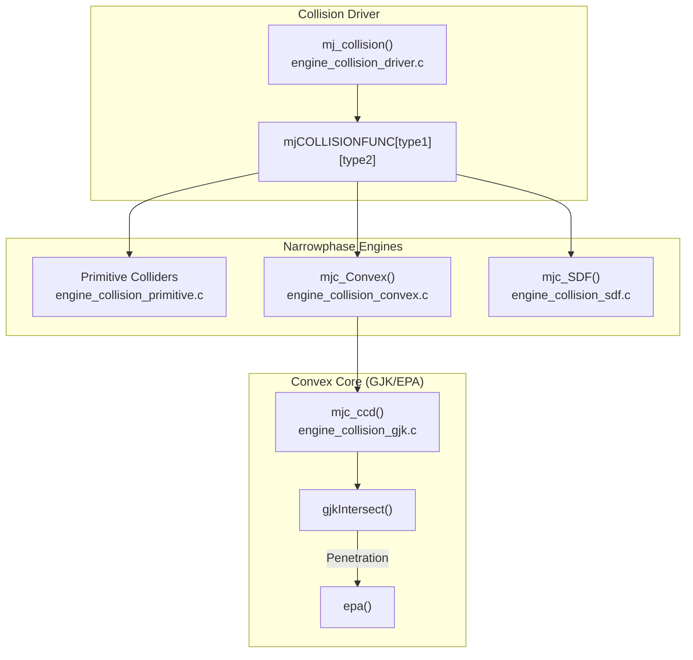

<!-- source: DeepWiki mcp.deepwiki.com · repo google-deepmind/mujoco · page 4.6 Collision Detection · fetched 2026-10-26 -->

# Collision Detection

Relevant source files

The following files were used as context for generating this wiki page:

- [src/engine/BUILD.bazel](src/engine/BUILD.bazel)
- [src/engine/CMakeLists.txt](src/engine/CMakeLists.txt)
- [src/engine/engine_collision_box.c](src/engine/engine_collision_box.c)
- [src/engine/engine_collision_continuous.c](src/engine/engine_collision_continuous.c)
- [src/engine/engine_collision_continuous.h](src/engine/engine_collision_continuous.h)
- [src/engine/engine_collision_convex.c](src/engine/engine_collision_convex.c)
- [src/engine/engine_collision_convex.h](src/engine/engine_collision_convex.h)
- [src/engine/engine_collision_driver.c](src/engine/engine_collision_driver.c)
- [src/engine/engine_collision_driver.h](src/engine/engine_collision_driver.h)
- [src/engine/engine_collision_flex.c](src/engine/engine_collision_flex.c)
- [src/engine/engine_collision_flex.h](src/engine/engine_collision_flex.h)
- [src/engine/engine_collision_gjk.c](src/engine/engine_collision_gjk.c)
- [src/engine/engine_collision_gjk.h](src/engine/engine_collision_gjk.h)
- [src/engine/engine_collision_primitive.c](src/engine/engine_collision_primitive.c)
- [src/engine/engine_collision_primitive.h](src/engine/engine_collision_primitive.h)
- [src/engine/engine_collision_sdf.c](src/engine/engine_collision_sdf.c)
- [src/engine/engine_collision_sdf.h](src/engine/engine_collision_sdf.h)
- [src/engine/engine_ipc.c](src/engine/engine_ipc.c)
- [src/user/BUILD.bazel](src/user/BUILD.bazel)
- [test/engine/CMakeLists.txt](test/engine/CMakeLists.txt)
- [test/engine/engine_collision_box_test.cc](test/engine/engine_collision_box_test.cc)
- [test/engine/engine_collision_continuous_test.cc](test/engine/engine_collision_continuous_test.cc)
- [test/engine/engine_collision_convex_test.cc](test/engine/engine_collision_convex_test.cc)
- [test/engine/engine_collision_driver_test.cc](test/engine/engine_collision_driver_test.cc)
- [test/engine/engine_collision_gjk_test.cc](test/engine/engine_collision_gjk_test.cc)
- [test/engine/engine_collision_sdf_test.cc](test/engine/engine_collision_sdf_test.cc)
- [test/engine/engine_ipc_test.cc](test/engine/engine_ipc_test.cc)

## Purpose and Scope

This document describes MuJoCo's narrowphase collision detection system, which computes precise contact information between pairs of geometries. The system uses the Gilbert-Johnson-Keerthi (GJK) algorithm for distance computation and the Expanding Polytope Algorithm (EPA) for penetration depth recovery. It also covers specialized primitive colliders, Signed Distance Field (SDF) collisions, continuous collision detection for deformables/flex, and multi-contact generation for stable physics.

## System Architecture

The collision detection system operates primarily during the forward position stage (`mj_fwdPosition`). It is dispatched by a table of pairwise functions `mjCOLLISIONFUNC` [src/engine/engine_collision_driver.c:48-59]().

### Collision Dispatch Logic
The driver iterates through potential contacts and selects the appropriate narrowphase algorithm based on geometry types.

Title: Collision Detection Dispatch Flow

**Sources:** [src/engine/engine_collision_driver.c:48-59](), [src/engine/engine_collision_convex.c:87-134](), [src/engine/engine_collision_gjk.h:98-103]()

## Core Data Structures

### mjCCDObj - Collision Object Representation
The `mjCCDObj` structure encapsulates a geometry for the GJK/EPA narrowphase. It abstracts various types (mesh, box, capsule, flex elements, etc.) into a common interface [src/engine/engine_collision_convex.h:39-94]().

| Field | Type | Purpose |
|-------|------|---------|
| `geom_type` | `int` | Type from `mjtGeom` [src/engine/engine_collision_convex.h:41]() |
| `pos`, `mat` | `mjtNum[]` | World position and orientation [src/engine/engine_collision_convex.h:43-44]() |
| `size` | `mjtNum[]` | Geometry dimensions [src/engine/engine_collision_convex.h:42]() |
| `margin` | `mjtNum` | Distance at which contact begins [src/engine/engine_collision_convex.h:50]() |
| `support` | `func` | Support function pointer [src/engine/engine_collision_convex.h:93]() |

**Sources:** [src/engine/engine_collision_convex.h:39-94]()

### mjCCDStatus - Results
Contains the output of a GJK/EPA run, including witness points and iteration counts [src/engine/engine_collision_gjk.h:75-93]().

| Field | Type | Purpose |
|-------|------|---------|
| `dist` | `mjtNum[]` | Distance (positive) or penetration (negative) [src/engine/engine_collision_gjk.h:78]() |
| `x1`, `x2` | `mjtNum[]` | Witness points on obj1 and obj2 [src/engine/engine_collision_gjk.h:79-80]() |
| `nx` | `int` | Number of contact points found [src/engine/engine_collision_gjk.h:81]() |
| `epa_status`| `mjEPAStatus`| Success or error code from EPA run [src/engine/engine_collision_gjk.h:92]() |

**Sources:** [src/engine/engine_collision_gjk.h:75-93]()

## GJK Algorithm

The GJK algorithm computes the minimum distance between convex shapes by building a simplex in the Minkowski Difference space.

### Algorithm Implementation
The core implementation is found in `mjc_ccd` and `mjc_gjk` [src/engine/engine_collision_gjk.h:98-103]().
1. **Support Point**: Compute support points using `gjkSupport` where direction points toward the origin [src/engine/engine_collision_gjk.c:73-75]().
2. **Intersection Test**: `gjkIntersect` determines if the shapes overlap [src/engine/engine_collision_gjk.c:126-128]().
3. **Subdistance**: The `subdistance()` function computes the barycentric coordinates of the point in a simplex closest to the origin, adapting the Montanari algorithm [src/engine/engine_collision_gjk.c:61-64]().

### Support Functions
Support functions return the furthest point in a given direction for a specific shape:
- **Sphere**: `mjc_sphereSupport` [src/engine/engine_collision_convex.c:207-215]()
- **Capsule/Line**: `mjc_lineSupport` [src/engine/engine_collision_convex.h:117]()
- **Mesh**: `mjc_meshSupport` [src/engine/engine_collision_convex.c](). This uses hill-climbing on the mesh graph if the vertex count exceeds `mjMESH_HILLCLIMB_MIN` [src/engine/engine_collision_convex.h:31-32]().

**Sources:** [src/engine/engine_collision_gjk.c:61-75](), [src/engine/engine_collision_convex.h:31-118]()

## EPA Algorithm

When GJK detects that the origin is contained within the Minkowski Difference (indicating penetration), EPA is invoked to find the penetration depth and normal [src/engine/engine_collision_gjk.h:98-103]().

### Polytope Expansion
1. **Initial Polytope**: Built from the GJK simplex using `polytope2`, `polytope3`, or `polytope4` depending on the simplex dimension [src/engine/engine_collision_gjk.c:130-133]().
2. **Expansion**:
    - The algorithm finds the face closest to the origin in the `Polytope` structure [src/engine/engine_collision_gjk.c:98-114]().
    - It computes a new support point using `epaSupport` [src/engine/engine_collision_gjk.c:116-118]().
    - If the improvement is significant, it expands the polytope by building a horizon of visible faces and adding new ones via `attachFace` [src/engine/engine_collision_gjk.c:122-124]().

**Sources:** [src/engine/engine_collision_gjk.c:98-138]()

## Multi-Contact Generation

For stable stacking and complex contacts, MuJoCo generates multiple contact points using `mjc_multicontact` [src/engine/engine_collision_gjk.h:105-108]().

- **Feature Identification**: The algorithm identifies if the contact is face-face, face-edge, or edge-edge based on normal alignment using tolerance flags like `mjFACE_TOL` and `mjEDGE_TOL` [src/engine/engine_collision_gjk.h:35-44]().
- **Clipping**: For face-face contacts, it performs polygon clipping to find the intersection area using mesh topology information.
- **Contact Selection**: The system returns up to `max_contacts` as specified in `mjCCDConfig` [src/engine/engine_collision_gjk.h:67]().

**Sources:** [src/engine/engine_collision_gjk.h:35-108]()

## Primitive Colliders

MuJoCo provides optimized analytical colliders for common shapes to avoid the overhead of GJK/EPA. These are defined in `engine_collision_primitive.c` and `engine_collision_box.c`.

| Function | Pair | Logic |
|----------|------|-------|
| `mjc_PlaneSphere` | Plane-Sphere | Analytical distance along plane normal [src/engine/engine_collision_driver.c:50]() |
| `mjc_SphereSphere`| Sphere-Sphere| Distance between centers minus radii [src/engine/engine_collision_driver.c:52]() |
| `mjc_SphereBox` | Sphere-Box | Clamping sphere center to box bounds [src/engine/engine_collision_box.c:90-99]() |
| `mjc_BoxBox` | Box-Box | Separating Axis Theorem (SAT) implementation [src/engine/engine_collision_driver.c:56]() |

**Sources:** [src/engine/engine_collision_driver.c:48-59](), [src/engine/engine_collision_box.c:90-99]()

## Continuous and Flex Collision Detection

Continuous collision detection (CCD) and deformable/flex collision systems handle fast-moving objects and internal/external contacts for meshes, points, segments, and triangles (`engine_collision_continuous.c`) [src/engine/engine_collision_continuous.c:15-41]().

- **Point-Triangle Distances**: `mjc_PtTri` computes distance, closest points, and barycentric weights for point-triangle queries [src/engine/engine_collision_continuous.c:45-54]().
- **Segment-Segment Distances**: `mjc_SegSeg` calculates closest points and parameters between two line segments [src/engine/engine_collision_continuous.c:59-72]().
- **Geometry Distance Queries**: `mjc_GeomDist` evaluates signed distances from a static geometry surface to a world point, supporting planes, spheres, capsules, boxes, and GJK-backed queries for meshes, cylinders, and ellipsoids [src/engine/engine_collision_continuous.c:86-168]().

**Sources:** [src/engine/engine_collision_continuous.c:15-168]()

## SDF Collision Detection

Signed Distance Fields (SDF) allow for collisions with arbitrary shapes defined by a distance function or mesh octrees.

- **Octree Interpolation**: For mesh-based SDFs, MuJoCo uses an octree. `findOct` locates the leaf node containing a point, and `oct_distance` performs trilinear interpolation using `oct_coeff` [src/engine/engine_collision_sdf.c:65-165]().
- **Gradient Computation**: `oct_gradient` computes the contact normal using analytic gradients in the interior and finite differences in the exterior [src/engine/engine_collision_sdf.c:168-201]().
- **Plugin Support**: Custom SDFs and distance evaluators integrate seamlessly into the engine pipeline via registered plugins.

**Sources:** [src/engine/engine_collision_sdf.c:65-201]()

---

