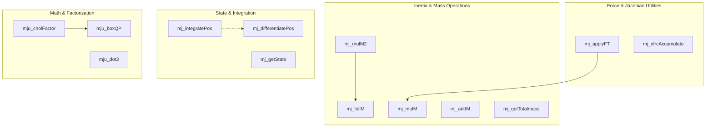
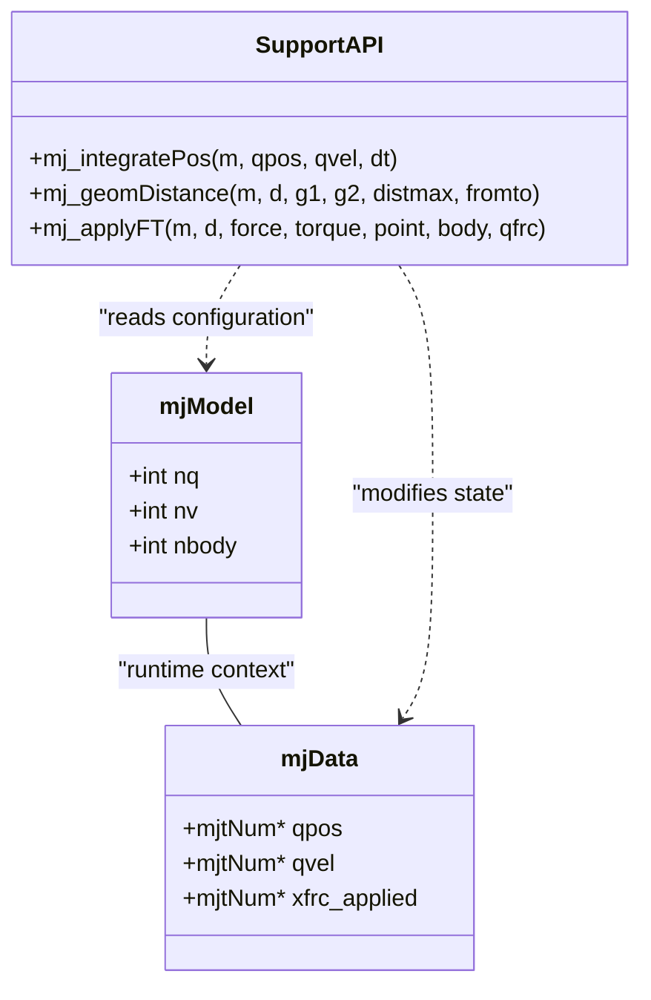

<!-- source: DeepWiki mcp.deepwiki.com · repo google-deepmind/mujoco · page 4.7 Support Functions and Utilities · fetched 2026-10-26 -->

# Support Functions and Utilities

Relevant source files

The following files were used as context for generating this wiki page:

- [src/engine/engine_support.h](src/engine/engine_support.h)
- [src/engine/engine_util_blas.c](src/engine/engine_util_blas.c)
- [src/engine/engine_util_blas.h](src/engine/engine_util_blas.h)
- [src/engine/engine_util_blas_avx.h](src/engine/engine_util_blas_avx.h)
- [src/engine/engine_util_misc.c](src/engine/engine_util_misc.c)
- [src/engine/engine_util_misc.h](src/engine/engine_util_misc.h)
- [src/engine/engine_util_solve.c](src/engine/engine_util_solve.c)
- [src/engine/engine_util_solve.h](src/engine/engine_util_solve.h)
- [test/benchmark/CMakeLists.txt](test/benchmark/CMakeLists.txt)
- [test/benchmark/ccd_benchmark_test.cc](test/benchmark/ccd_benchmark_test.cc)
- [test/benchmark/chol_benchmark_test.cc](test/benchmark/chol_benchmark_test.cc)
- [test/benchmark/engine_util_solve_benchmark_test.cc](test/benchmark/engine_util_solve_benchmark_test.cc)
- [test/engine/engine_support_test.cc](test/engine/engine_support_test.cc)
- [test/engine/engine_util_blas_test.cc](test/engine/engine_util_blas_test.cc)
- [test/engine/engine_util_misc_test.cc](test/engine/engine_util_misc_test.cc)
- [test/engine/engine_util_solve_test.cc](test/engine/engine_util_solve_test.cc)
- [test/fixture.cc](test/fixture.cc)
- [test/fixture.h](test/fixture.h)

## Purpose and Scope

This page documents the support functions and utility routines in the MuJoCo physics engine. These utilities provide high-level interfaces for force application, Jacobian computation, inertia matrix operations, position/velocity integration, geometry distance queries, and low-level spatial/BLAS/solver math. These functions serve as the computational building blocks for the core physics pipeline and external user interaction.

## System Overview

The utility system is implemented across header and implementation files in `src/engine/`, providing the mathematical infrastructure for transforming between Cartesian and generalized coordinates, solving linear systems and factorizations, and manipulating runtime states.

Title: MuJoCo Support Utility Architecture

**Sources:** [src/engine/engine_support.h:1-170](), [src/engine/engine_util_blas.h:1-150](), [src/engine/engine_util_solve.h:1-127]()

## Force Application and Jacobians

MuJoCo uses Jacobians to map Cartesian forces applied to bodies into generalized forces acting on joints.

### Cartesian Force Application (`mj_applyFT`)
The function `mj_applyFT` converts a 3D force and torque applied at a specific point on a body into a generalized force vector `qfrc_target` [src/engine/engine_support.h:78-82]().

*   **Sparse vs Dense Paths**: Internal implementations leverage model configurations to select sparse traversal or dense 3xnv Jacobian evaluations.
*   **Body Force Accumulation (`mj_xfrcAccumulate`)**: Iterates through all bodies and applies any external forces stored in `mjData.xfrc_applied` to the generalized force vector `qfrc` [src/engine/engine_support.h:84-85]().

**Sources:** [src/engine/engine_support.h:78-86]()

## Inertia Matrix Operations

MuJoCo's mass matrix $M$ is manipulated through specialized inertia utility functions declared in `src/engine/engine_support.h`.

### Matrix Multiplication and Factorization
*   **`mj_fullM`**: Converts the sparse mass matrix into a dense $nv \times nv$ symmetric matrix [src/engine/engine_support.h:61-62]().
*   **`mj_mulM`**: Computes the product $res = M \cdot vec$ [src/engine/engine_support.h:64-65]().
*   **`mj_mulM2`**: Computes $res = M^{1/2} \cdot vec$ using factorizations stored in `mjData` [src/engine/engine_support.h:67-68]().
*   **`mj_addM`**: Adds the inertia matrix to a destination matrix (sparse or dense) [src/engine/engine_support.h:70-74]().

### Mass Scaling
*   **`mj_getTotalmass`**: Returns the sum of all body masses in the model [src/engine/engine_support.h:117-118]().
*   **`mj_setTotalmass`**: Scales all body masses and inertias to achieve a specified total mass [src/engine/engine_support.h:120-121]().

**Sources:** [src/engine/engine_support.h:59-75](), [src/engine/engine_support.h:117-122]()

## Kinematic and Geometry Utilities

### Position Integration and Differentiation
*   **`mj_integratePos`**: Updates `qpos` based on `qvel` and `dt` [src/engine/engine_support.h:104-106]().
*   **`mj_differentiatePos`**: Computes the `qvel` required to move from `qpos1` to `qpos2` in time `dt` [src/engine/engine_support.h:96-98]().
*   **`mj_normalizeQuat`**: Normalizes all quaternions in a `qpos`-type vector [src/engine/engine_support.h:107-109]().

### Geometry Distance and Containment
*   **`mj_geomDistance`**: Computes the smallest distance between two geoms and populates witness points [src/engine/engine_support.h:89-91]().
*   **`mj_insideSite`**: Returns 1 if a point is inside a site (or convex hull for meshes), 0 otherwise [src/engine/engine_support.h:93-94]().
*   **`mju_insidePrimitive`**: Returns 1 if a point is inside a primitive geom [src/engine/engine_util_misc.h:73-74]().

Title: Geometry and State Entity Mapping

**Sources:** [src/engine/engine_support.h:87-110](), [src/engine/engine_util_misc.h:70-75]()

## State Serialization

MuJoCo provides a state serialization and extraction system driven by bitmask signatures (`sig`).

*   **`mj_stateSize`**: Returns the size of the state signature for a given model and bitmask [src/engine/engine_support.h:40-41]().
*   **`mj_getState` / `mj_setState`**: Get and set runtime states across `mjData` [src/engine/engine_support.h:43-51]().
*   **`mj_copyState` / `mj_extractState`**: Copy states between instances or extract sub-states [src/engine/engine_support.h:46-54]().
*   **`mj_setKeyframe`**: Copies the current state to the $k$-th model keyframe [src/engine/engine_support.h:56-57]().

**Sources:** [src/engine/engine_support.h:38-58]()

## Mathematical, BLAS, and Solver Utilities

Low-level math and solver utilities are located in `src/engine/engine_util_blas.h`, `src/engine/engine_util_solve.h`, and `src/engine/engine_util_misc.h`.

### BLAS and Spatial Math
*   Provides 3D vector operations (`mju_zero3`, `mju_copy3`, `mju_add3`, `mju_dot3`, `mju_norm3`, `mju_dist3`) and matrix-vector/matrix-matrix operations (`mju_mulMatVec3`, `mju_mulMatMat3`) [src/engine/engine_util_blas.c:26-215]().
*   AVX-optimized routines (`src/engine/engine_util_blas_avx.h`) accelerate bulk vector and matrix operations.

### Factorizations and Solvers
*   **Cholesky Factorization**: Dense (`mju_cholFactor`, `mju_cholSolve`, `mju_cholUpdate`) [src/engine/engine_util_solve.h:26-34]() and sparse reverse-order Cholesky (`mju_cholFactorSparse`, `mju_cholFactorSymbolic`, `mju_cholFactorNumeric`) [src/engine/engine_util_solve.h:35-75]().
*   **LU Factorization**: Dense LU with partial pivoting (`mju_factorLU`, `mju_solveLU`) and 6x6 unrolled specialization (`mju_factorLU6`, `mju_solveLU6`) [src/engine/engine_util_solve.h:114-127]().
*   **Box Quadratic Programming**: `mju_boxQP` solves bound-constrained quadratic programming problems [test/engine/engine_util_solve_test.cc:163-164]().

**Sources:** [src/engine/engine_util_blas.c:26-215](), [src/engine/engine_util_solve.h:26-127](), [test/engine/engine_util_solve_test.cc:155-205]()

---

