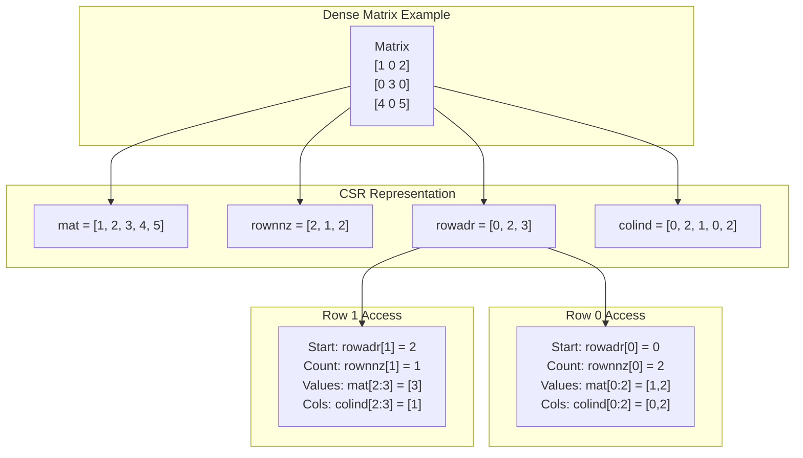
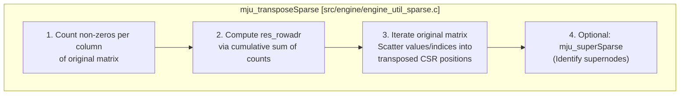
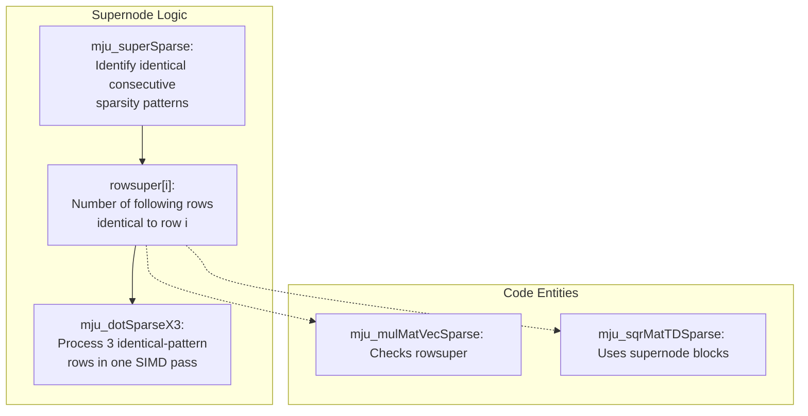

<!-- source: DeepWiki mcp.deepwiki.com · repo google-deepmind/mujoco · page 4.8 Sparse Matrix Operations · fetched 2026-10-26 -->

# Sparse Matrix Operations

Relevant source files

The following files were used as context for generating this wiki page:

- [model/flex/hollow_vs_solid.xml](model/flex/hollow_vs_solid.xml)
- [src/engine/engine_core_constraint.c](src/engine/engine_core_constraint.c)
- [src/engine/engine_core_constraint.h](src/engine/engine_core_constraint.h)
- [src/engine/engine_solver.c](src/engine/engine_solver.c)
- [src/engine/engine_util_sparse.c](src/engine/engine_util_sparse.c)
- [src/engine/engine_util_sparse.h](src/engine/engine_util_sparse.h)
- [src/engine/engine_util_sparse_avx.h](src/engine/engine_util_sparse_avx.h)
- [test/benchmark/engine_util_sparse_benchmark_test.cc](test/benchmark/engine_util_sparse_benchmark_test.cc)
- [test/engine/engine_core_constraint_test.cc](test/engine/engine_core_constraint_test.cc)
- [test/engine/engine_util_sparse_test.cc](test/engine/engine_util_sparse_test.cc)

## Purpose and Scope

This page documents MuJoCo's sparse matrix operations, which provide critical performance optimizations for systems with many degrees of freedom. Sparse matrices efficiently store and manipulate large Jacobian matrices where most elements are zero, exploiting kinematic tree structure to reduce memory usage and computation time from $O(n^2)$ to $O(k)$ where $k$ is the number of non-zeros.

MuJoCo's sparse utility suite includes specialized algorithms for transpose, multiplication, and matrix squaring ($M^TDM$), often utilizing AVX SIMD instructions and supernode optimizations to maximize throughput.

Sources: [src/engine/engine_util_sparse.h:1-137](), [src/engine/engine_util_sparse.c:1-25]()

## CSR Sparse Matrix Format

MuJoCo uses the **Compressed Sparse Row (CSR)** format for sparse matrices. This format stores only non-zero elements along with their column indices, organized by rows.

### Data Structure Components

A sparse matrix in CSR format requires four arrays:

| Array | Type | Size | Description |
|-------|------|------|-------------|
| `mat` | `mjtNum*` | `nnz` | Non-zero values stored row-by-row |
| `rownnz` | `int*` | `nr` | Number of non-zeros in each row |
| `rowadr` | `int*` | `nr` | Starting address of each row in `mat` and `colind` |
| `colind` | `int*` | `nnz` | Column index of each non-zero element |

Title: CSR Representation and Data Access

Sources: [src/engine/engine_util_sparse.c:93-125](), [src/engine/engine_util_sparse.h:42-47]()

### Format Conversion

MuJoCo provides functions to convert between dense and sparse representations:

- `mju_dense2sparse()`: Scans a dense matrix for non-zeros and builds the CSR structure. It returns 1 if the provided `nnz` buffer is too small [src/engine/engine_util_sparse.c:93-125]().
- `mju_sparse2dense()`: Reconstructs a full matrix by scattering CSR elements [src/engine/engine_util_sparse.c:129-140]().
- `mju_sym2dense()`: Specifically converts a lower-triangular symmetric CSR matrix to a full dense matrix, reflecting elements across the diagonal [src/engine/engine_util_sparse.c:144-157]().
- `mju_compressSparse()`: Removes elements with absolute values below a threshold `minval` to maintain sparsity during iterative processes, returning the new total non-zero count [src/engine/engine_util_sparse.h:85-87]().

Sources: [src/engine/engine_util_sparse.c:93-157](), [src/engine/engine_util_sparse.h:85-87]()

## Basic Sparse Operations

### Sparse Dot Product

The fundamental operation is computing the dot product between a sparse vector and a dense vector:
$result = \sum sparse\_vec[i] \times dense\_vec[sparse\_indices[i]]$

MuJoCo provides several variants:
- `mju_dotSparse()`: Scalar dot product with loop unrolling. When `mjUSEAVX` is defined, it calls `mju_dotSparse_avx` [src/engine/engine_util_sparse_avx.h:32-80]().
- `mju_dotSparse2()`: Dot product between two sparse vectors by performing a two-pointer merge on their index arrays [src/engine/engine_util_sparse.c:60-88]().
- `mju_dotSparseX3()`: Computes three dot products simultaneously using the same sparse index set (used for supernodes) [src/engine/engine_util_sparse.c:30-56]().

Sources: [src/engine/engine_util_sparse.c:30-88](), [src/engine/engine_util_sparse_avx.h:32-80](), [test/engine/engine_util_sparse_test.cc:56-73]()

### Sparse Matrix-Vector Multiplication

- `mju_mulMatVecSparse()`: Multiplies a sparse matrix by a dense vector: $res = mat \times vec$. It iterates through rows, calling `mju_dotSparse` for each. It also supports `rowsuper` optimizations to process multiple rows in blocks [src/engine/engine_util_sparse.c:180-191]().
- `mju_mulMatTVecSparse()`: Multiplies a transposed sparse matrix by a dense vector: $res = mat^T \times vec$. It iterates through rows of the original matrix, scaling each row by the corresponding vector element and scattering the result into `res` [src/engine/engine_util_sparse.c:195-215]().

Sources: [src/engine/engine_util_sparse.c:180-215](), [src/engine/engine_util_sparse.h:61-67]()

## Sparse Matrix Transpose

Transposing a sparse matrix requires reorganizing the CSR structure. MuJoCo's `mju_transposeSparse` implementation can also compute row supernodes during the process.

Title: Transpose Sparse Algorithm Flow

**Implementation details:**
- The algorithm uses `res_rownnz` as a workspace to track the current write position for each row of the transpose during the scatter phase [src/engine/engine_util_sparse.h:110-112]().
- It can detect "supernodes"—consecutive rows with identical column indices—to enable later SIMD optimizations via `mju_superSparse` [src/engine/engine_util_sparse.h:115-117]().

Sources: [src/engine/engine_util_sparse.h:110-117](), [test/engine/engine_util_sparse_test.cc:170-216]()

## Matrix Squaring ($M^TDM$)

The `mju_sqrMatTDSparse` function computes $res = M^T \times D \times M$, where $D$ is a diagonal matrix. This is a critical operation for constraint projection in the solver.

### Algorithm Flow

1. **Sparsity Analysis**: `mju_sqrMatTDSparse` pre-computes or uses precomputed sparsity patterns of the result [src/engine/engine_util_sparse.h:119-126]().
2. **Supernode Processing**: It utilizes `rowsuper` information to process blocks of rows simultaneously if they share identical patterns [src/engine/engine_util_sparse.h:119-126]().
3. **Diagonal Scaling**: Each column is scaled by the diagonal $D$ (if provided) before being multiplied. If `diag` is NULL, it computes $M^TM$ [src/engine/engine_util_sparse.h:119-126]().

Sources: [src/engine/engine_util_sparse.h:119-126](), [test/benchmark/engine_util_sparse_benchmark_test.cc:131-138]()

## Supernode Optimization

**Supernodes** are groups of rows (or columns) that share the same sparsity pattern. In MuJoCo, these often correspond to degrees of freedom in a single kinematic chain, such as a multi-DOF joint.

Title: Supernode Detection and SIMD Mapping

**Key functions:**
- `mju_superSparse()`: Scans the CSR structure to identify and count identical consecutive rows, storing the count in `rowsuper` [src/engine/engine_util_sparse.h:115-117]().
- `mju_dotSparseX3()`: Exploits supernodes to compute three dot products using a single pass over the index array, reducing memory bandwidth requirements [src/engine/engine_util_sparse.c:30-56]().
- `mju_mulMatVecSparse_avx()`: When processing supernodes, it handles rows in blocks of 3 using `mju_dotSparseX3_avx` [src/engine/engine_util_sparse_avx.h:194-200]().

Sources: [src/engine/engine_util_sparse.c:30-56](), [src/engine/engine_util_sparse.h:115-117](), [src/engine/engine_util_sparse_avx.h:176-219]()

## AVX Acceleration

MuJoCo utilizes AVX SIMD instructions to accelerate sparse operations when `mjUSEPLATFORMSIMD` is enabled and the hardware supports `__AVX__`.

### AVX-Optimized Functions

If `mjUSEAVX` is defined, the engine switches to optimized paths:
- `mju_dotSparse_avx()`: Vectorized version of the sparse dot product using `__m256d` registers to process 4 doubles at once [src/engine/engine_util_sparse_avx.h:33-80]().
- `mju_dotSparseX3_avx()`: Vectorized supernode dot product, loading `vec2` once and performing three multiplications in parallel [src/engine/engine_util_sparse_avx.h:86-172]().
- `mju_mulMatVecSparse_avx()`: Main entry point for vectorized sparse multiplication, dispatching to scalar or supernode paths based on `rowsuper` [src/engine/engine_util_sparse_avx.h:176-219]().

Sources: [src/engine/engine_util_sparse.c:30-56](), [src/engine/engine_util_sparse_avx.h:1-220]()

## Sparse Operations in Solver Context

Sparse matrix utilities are heavily utilized in `src/engine/engine_solver.c` to compute residuals and update constraint forces during iterative solving.

- **Diagonal Extraction**: `ARdiaginv` computes $1/\text{diag}(AR)$ by searching the CSR structure for diagonal elements (where `i == colind[adr]`) [src/engine/engine_solver.c:89-127]().
- **Block Extraction**: `extractBlock` copies a sub-matrix from the sparse $AR$ matrix into a dense block for local solver updates [src/engine/engine_solver.c:131-186]().
- **Residual Computation**: The `residual` function uses `mju_dotSparse` (via its sparse path) to compute $b + AR \times force$ efficiently [src/engine/engine_solver.c:190-215]().

Sources: [src/engine/engine_solver.c:89-215]()

## Summary of Key Sparse Functions

| Function | Role | Source |
|----------|------|--------|
| `mju_dotSparse2` | Dot product between two sparse vectors | [src/engine/engine_util_sparse.h:32]() |
| `mju_mulMatVecSparse` | $y = Ax$ (sparse $A$, dense $x$) | [src/engine/engine_util_sparse.c:180]() |
| `mju_mulMatTVecSparse` | $y = A^T x$ (sparse $A$, dense $x$) | [src/engine/engine_util_sparse.c:195]() |
| `mju_transposeSparse` | $A^T$ (sparse) + supernode detection | [src/engine/engine_util_sparse.h:110]() |
| `mju_sqrMatTDSparse` | $M^TDM$ (sparse) for constraint projection | [src/engine/engine_util_sparse.h:119]() |
| `mju_combineSparseCount` | Counts non-zeros in the sum of two sparse vectors | [src/engine/engine_util_sparse.h:89]() |
| `mju_addChains` | Merges two kinematic chains (integer index sets) | [src/engine/engine_util_sparse.h:106]() |

Sources: [src/engine/engine_util_sparse.h:1-137](), [src/engine/engine_util_sparse.c:1-230]()

---

