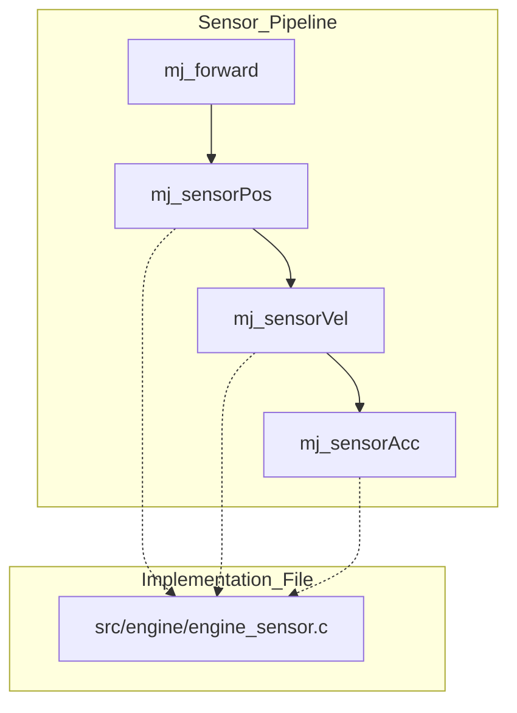
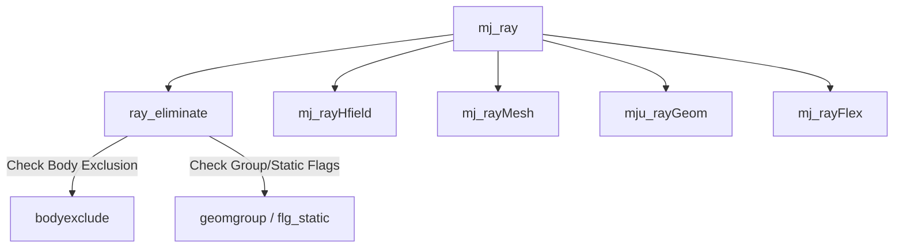

<!-- source: DeepWiki mcp.deepwiki.com · repo google-deepmind/mujoco · page 4.9 Sensors and Ray Casting · fetched 2026-10-26 -->

# Sensors and Ray Casting

<details>
<summary>Relevant source files</summary>

The following files were used as context for generating this wiki page:

- [src/engine/engine_ray.c](src/engine/engine_ray.c)
- [src/engine/engine_ray.h](src/engine/engine_ray.h)
- [src/engine/engine_sensor.c](src/engine/engine_sensor.c)
- [src/engine/engine_vis_interact.c](src/engine/engine_vis_interact.c)
- [src/engine/engine_vis_interact.h](src/engine/engine_vis_interact.h)
- [test/engine/engine_ray_test.cc](test/engine/engine_ray_test.cc)
- [test/engine/engine_sensor_test.cc](test/engine/engine_sensor_test.cc)

</details>


## Purpose and Scope
This page details MuJoCo's sensor evaluation architecture, sensor types, and ray casting infrastructure. It covers how sensors are evaluated across position, velocity, and acceleration stages (`mj_sensorPos`, `mj_sensorVel`, `mj_sensorAcc`), how specialized sensors like tactile arrays operate, and how ray casting (`mj_ray`, `mj_multiRay`) and interaction queries (`mjv_select`) power both sensors and interactive visualization tools.

---

## 1. Sensor Evaluation Architecture and Stages

Sensors in MuJoCo map internal physical states (positions, velocities, accelerations, forces) and auxiliary quantities into fixed-size sensor data arrays stored in `mjData::sensordata`. Sensor processing is split into distinct evaluation stages that mirror the physics pipeline stages:

- **Position Stage (`mj_sensorPos`)**: Evaluates sensors dependent strictly on configuration coordinates (`qpos`) and spatial positions/orientations (e.g., `framepos`, `framequat`, `clock`, joint position sensors).
- **Velocity Stage (`mj_sensorVel`)**: Evaluates sensors dependent on velocities (`qvel`) and spatial velocities (e.g., joint velocity, gyro, accelerometer components requiring velocity-product accelerations).
- **Acceleration Stage (`mj_sensorAcc`)**: Evaluates sensors dependent on accelerations (`qacc`), contact forces, and applied actuation.

Sensors can be globally disabled via model configuration flags such as `mjDSBL_SENSOR` [test/engine/engine_sensor_test.cc:95](). When disabled, sensor buffers are bypassed or left unpopulated during stepping routines `mj_step` and `mj_step1` [test/engine/engine_sensor_test.cc:90-99]().


*Figure 1: Sensor evaluation flow across execution stages.*

**Sources:** `src/engine/engine_sensor.c`, `test/engine/engine_sensor_test.cc`

---

## 2. Sensor Types and Implementation Details

MuJoCo supports a rich set of built-in sensor types, alongside plugin-based sensors. 

### Relative Frame Sensors
Frame sensors (`framepos`, `framexaxis`, `frameyaxis`, `framezaxis`, `framequat`) measure properties of a target object relative to an optional reference frame. If no reference frame is specified, measurements default to the global Cartesian coordinate system. 

```cpp
// Example from test/engine/engine_sensor_test.cc retrieving sensor readings
static vector<mjtNum> GetSensor(const mjModel* model, const mjData* data, int id) {
  return vector<mjtNum>(
      data->sensordata + model->sensor_adr[id],
      data->sensordata + model->sensor_adr[id] + model->sensor_dim[id]);
}
```
*Code snippet 1: Accessing sensor buffers via `model->sensor_adr` and `model->sensor_dim`.* [test/engine/engine_sensor_test.cc:51-57]()

### Tactile Sensors
Tactile sensors use mesh vertices or taxel grids to query penetration depths and velocities against colliding geometries. The engine employs parallel task execution (`tactile_taxel_batch`, `tactileTask`) to evaluate taxel batches across meshes [src/engine/engine_sensor.c:83-191](). Signed Distance Functions (SDF) and octrees are utilized to compute distances rapidly for complex collision meshes:

- Penetration depth is calculated via `mjc_distance` [src/engine/engine_sensor.c:155]().
- Relative velocities between the sensor parent weld and contacting bodies are transformed into local geom frames to yield normal and tangential tactile slip components [src/engine/engine_sensor.c:161-184]().

| Sensor Category | Typical Types | Evaluated Stage | Output Dimension |
| :--- | :--- | :--- | :--- |
| **Kinematic** | `jointpos`, `framepos`, `clock` | `mj_sensorPos` | Varies (1 to 7) |
| **Dynamic** | `jointvel`, `gyro`, `accelerometer` | `mj_sensorVel` / `mj_sensorAcc` | 1 to 3 |
| **Force/Contact** | `force`, `torque`, `touch`, `tactile` | `mj_sensorAcc` | Varies by taxel count |

**Sources:** `src/engine/engine_sensor.c`, `test/engine/engine_sensor_test.cc`

---

## 3. Ray Casting Engine (`mj_ray`)

Ray casting is a core geometric utility used by proximity sensors, rangefinders, and mouse interaction picking. The primary entry point is `mj_ray`, which intersects a ray defined by an origin point `pnt` and a direction vector `vec` against visible geometries in the scene [src/engine/engine_ray.h:42-44]().


*Figure 2: Ray casting dispatch and exclusion filtering logic.*

### Ray Intersection Semantics
The function `mj_ray` returns the distance scalar `x` ($pnt + x \cdot vec$, where $x \ge 0$) to the nearest intersecting surface, or `-1` if no intersection occurs [src/engine/engine_ray.h:39-44](). It populates the output parameter `geomid` with the index of the hit geometry.

Exclusions are handled inside `ray_eliminate`, which filters out:
- Geometries belonging to an excluded body (`bodyexclude`) [src/engine/engine_ray.c:71-73]().
- Invisible geometries (zero alpha or unassigned materials) [src/engine/engine_ray.c:75-83]().
- Static geoms when static exclusion (`flg_static = 0`) is active [src/engine/engine_ray.c:85-88]().
- Geometries outside active visual groups (`geomgroup`) [src/engine/engine_ray.c:90-99]().

### Specialized Ray Intersectors
Depending on the geometry type, `mj_ray` delegates to specialized intersection routines:
- **Primitives**: `mju_rayGeom` tests analytic shapes (spheres, boxes, cylinders, ellipsoids, capsules) using quadratic solvers (`ray_quad`) [src/engine/engine_ray.c:103-128]().
- **Heightfields**: `mj_rayHfield` marches through heightfield grid cells [src/engine/engine_ray.h:47]().
- **Meshes**: `mj_rayMesh` and `ray_triangle` test ray-triangle intersections against mesh face hierarchies [src/engine/engine_ray.h:50-56]().
- **Flex and Skin**: `mj_rayFlex` and `mju_raySkin` intersect rays with deformable element vertices, edges, or faces [src/engine/engine_ray.h:64-71]().
- **Multi-Ray**: `mj_multiRay` and `mju_multiRayPrepare` optimize batch ray casting originating from a single source (e.g., depth camera simulation) [src/engine/engine_ray.h:26-36]().

**Sources:** `src/engine/engine_ray.h`, `src/engine/engine_ray.c`, `test/engine/engine_ray_test.cc`

---

##  4. Interaction Queries and Visualization Integration

Ray casting and sensor math directly support interactive manipulation and scene selection via `mjv_select` [src/engine/engine_vis_interact.h:79-83](). 

### Object Selection (`mjv_select`)
When a user clicks in the viewer or when programmatic picking is invoked, `mjv_select` converts normalized screen coordinates (`relx`, `rely`) into a 3D ray using camera parameters (`mjvScene`), and casts it into the model [src/engine/engine_vis_interact.h:79-83](). It returns the selected body ID and identifies intersecting geometries (`geomid`), flex objects (`flexid`), or skins (`skinid`) [src/engine/engine_vis_interact.h:82]().

### Coordinate Space Transformations
Interaction queries frequently translate poses between room (window/OpenGL) space and model space:
- `mjv_room2model` maps room coordinates into simulation model coordinates accounting for scene scaling (`scn->scale`) and transforms [src/engine/engine_vis_interact.c:34-64]().
- `mjv_model2room` performs the inverse mapping [src/engine/engine_vis_interact.c:68-95]().
- Camera orientation helpers (`mjv_cameraInModel`, `mjv_cameraInRoom`, `mjv_frustumHeight`) compute averaged view vectors from stereo or monocular OpenGL camera structures to drive ray generation and perturbation applications (`mjv_applyPerturbPose`, `mjv_applyPerturbForce`) [src/engine/engine_vis_interact.c:99-237]().

**Sources:** `src/engine/engine_vis_interact.h`, `src/engine/engine_vis_interact.c`

---

