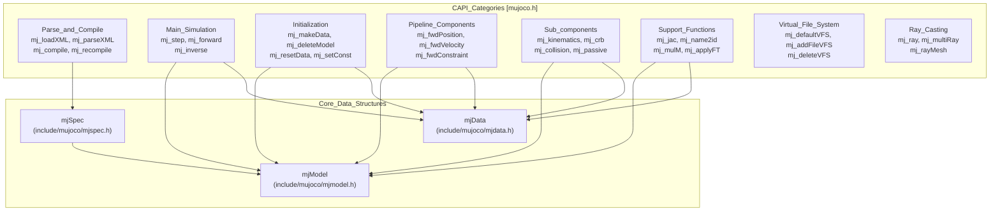
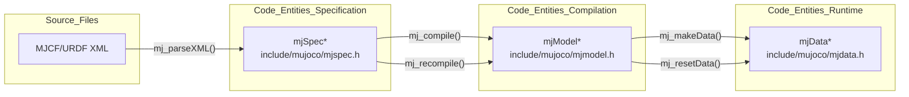

<!-- source: DeepWiki mcp.deepwiki.com · repo google-deepmind/mujoco · page 5.1 C API Reference · fetched 2026-10-26 -->

# C API Reference

Relevant source files

The following files were used as context for generating this wiki page:

- [doc/APIreference/APIglobals.rst](doc/APIreference/APIglobals.rst)
- [doc/APIreference/functions.rst](doc/APIreference/functions.rst)
- [doc/APIreference/functions_override.rst](doc/APIreference/functions_override.rst)
- [doc/includes/references.h](doc/includes/references.h)
- [doc/programming/samples.rst](doc/programming/samples.rst)
- [include/mujoco/mjdata.h](include/mujoco/mjdata.h)
- [include/mujoco/mjmodel.h](include/mujoco/mjmodel.h)
- [include/mujoco/mjspec.h](include/mujoco/mjspec.h)
- [include/mujoco/mjxmacro.h](include/mujoco/mjxmacro.h)
- [include/mujoco/mujoco.h](include/mujoco/mujoco.h)
- [python/mujoco/introspect/functions.py](python/mujoco/introspect/functions.py)
- [python/mujoco/introspect/structs.py](python/mujoco/introspect/structs.py)
- [sample/basic.cc](sample/basic.cc)
- [sample/compile.cc](sample/compile.cc)
- [sample/dependencies.cc](sample/dependencies.cc)
- [sample/record.cc](sample/record.cc)
- [sample/testspeed.cc](sample/testspeed.cc)
- [src/engine/engine_io.c](src/engine/engine_io.c)
- [src/engine/engine_io.h](src/engine/engine_io.h)
- [src/engine/engine_print.c](src/engine/engine_print.c)
- [test/engine/engine_io_test.cc](test/engine/engine_io_test.cc)
- [unity/Runtime/Bindings/MjBindings.cs](unity/Runtime/Bindings/MjBindings.cs)

## Purpose and Scope

This page documents the C API exposed in `include/mujoco/mujoco.h`, which provides the primary low-level interface for interacting with MuJoCo's physics engine. The C API consists of core routines for model loading, compilation, data allocation, simulation stepping, state management, forward and inverse dynamics, and support utilities.

For information about using the C API from Python, see [5.2 Python Bindings Architecture]() and [5.3 Python API Usage](). For details on the underlying data layouts, see [3.1 mjModel Structure]() and [3.2 mjData Structure]().

**Sources:** [include/mujoco/mujoco.h:1-43](), [doc/APIreference/functions.rst:1-100]()

---

## API Organization

The C API is organized into functional modules, prefixed by their subsystem. 

Title: C API Functional Categories and Subsystems

**Sources:** [include/mujoco/mujoco.h:76-172](), [include/mujoco/mjmodel.h:1-100](), [include/mujoco/mjdata.h:97-149]()

---

## Naming Conventions and API Architecture

Public functions and types adhere to strict naming conventions:

| Prefix | Subsystem / Purpose | Example Code Entities |
|--------|---------------------|-----------------------|
| `mj_` | Core engine simulation and model functions | `mj_step`, `mj_forward`, `mj_kinematics` [include/mujoco/mujoco.h:128-164]() |
| `mjs_` | Specification (`mjSpec`) building and editing | `mjs_compile`, `mjs_getError` [doc/APIreference/functions.rst:84-86]() |
| `mju_` | Utility functions (math, string manipulation) | `mju_user_malloc`, `mju_user_free` [include/mujoco/mujoco.h:45-46]() |
| `mjcb_` | Global callback function pointers | `mjcb_control`, `mjcb_passive` [include/mujoco/mujoco.h:54-61]() |

**Sources:** [include/mujoco/mujoco.h:44-62](), [doc/APIreference/functions.rst:84-86]()

---

## Core Data Structures

The simulation runtime revolves around three primary structures: `mjSpec` (editable specification), `mjModel` (immutable compiled physics model), and `mjData` (mutable runtime state and workspace).

Title: Runtime Data Structures and Compilation Bridge

**Sources:** [include/mujoco/mujoco.h:132-164](), [include/mujoco/mjmodel.h:67-124](), [include/mujoco/mjdata.h:97-149]()

---

## Model Parsing, Compilation, and I/O

Parsing and compilation convert high-level descriptions into low-level runtime structures (`mjModel`).

### Key Functions

| Function Signature | Description | Sources |
|---|---|---|
| `mj_loadXML(filename, vfs, error, error_sz)` | Parse XML (MJCF/URDF) and compile directly to `mjModel`. | [include/mujoco/mujoco.h:132]() |
| `mj_parseXML(filename, vfs, error, error_sz)` | Parse XML file into an editable `mjSpec`. | [include/mujoco/mujoco.h:136]() |
| `mj_compile(s, vfs)` | Compile an `mjSpec` into a new `mjModel`. | [include/mujoco/mujoco.h:156]() |
| `mj_recompile(s, vfs, m, d)` | In-place re-compilation of `mjSpec` into existing `mjModel` and `mjData`, preserving state. | [include/mujoco/mujoco.h:163]() |
| `mj_encode(...)` | Serialize `mjSpec` or `mjModel` to binary or text formats. | [include/mujoco/mujoco.h:150]() |

**Sources:** [include/mujoco/mujoco.h:132-172](), [doc/APIreference/functions.rst:5-110]()

---

## Main Simulation Functions

Simulation execution advances the physical state through discrete time increments.

### Simulation Functions

| Function Signature | Purpose | Sources |
|---|---|---|
| `mj_step(m, d)` | Advances simulation state by one timestep (`m->opt.timestep`), executing `mj_step1` and `mj_step2`. | [include/mujoco/mujoco.h:163-185]() |
| `mj_step1(m, d)` | First half of step: kinematics, sensor positioning, and control evaluation up to control application. | [include/mujoco/mujoco.h:170]() |
| `mj_step2(m, d)` | Second half of step: actuation, acceleration, constraint solving, and numerical integration. | [include/mujoco/mujoco.h:174]() |
| `mj_forward(m, d)` | Computes forward dynamics without performing state integration. | [include/mujoco/mujoco.h:178]() |
| `mj_inverse(m, d)` | Computes inverse dynamics given accelerations `d->qacc`. | [include/mujoco/mujoco.h:182]() |

**Sources:** [include/mujoco/mujoco.h:163-185](), [doc/APIreference/functions.rst:152-243]()

---

## Initialization and Memory Management

Dynamic memory utilization in MuJoCo requires explicit model and data management functions implemented in `src/engine/engine_io.c`.

### Core Memory Management Functions

| Function | Description | Sources |
|---|---|---|
| `mj_makeData(m)` | Allocates and initializes an `mjData` instance matching `mjModel *m`. | [src/engine/engine_io.c:148-174]() |
| `mj_deleteData(d)` | Deallocates an `mjData` instance and its arena buffer. | [src/engine/engine_io.c:148-174]() |
| `mj_deleteModel(m)` | Deallocates an `mjModel` instance and its underlying pointer buffer. | [src/engine/engine_io.c:148-174]() |
| `mj_setPtrModel(m)` | Internal layout initializer for `mjModel` buffer pointer offsets with 64-byte alignment (`BUFFER_ALIGN`). | [src/engine/engine_io.c:148-174]() |

**Sources:** [src/engine/engine_io.c:134-175](), [include/mujoco/mujoco.h:187-210]()

---

## Support Functions, Jacobians, and Inertia Operations

Support routines provide geometric Jacobians (`mj_jac`), composite rigid body mass matrix construction (`mj_makeM`), and matrix factorization (`mj_factorM`).

| Function | Purpose | Sources |
|---|---|---|
| `mj_jac(...)` | Computes translational and rotational Jacobians for a point on a body. | [include/mujoco/mujoco.h:471-500]() |
| `mj_makeM(m, d)` | Computes the joint-space inertia matrix `M` (`d->qM`). | [include/mujoco/mujoco.h:510-520]() |
| `mj_factorM(m, d)` | Factors `M` into $LDL^T$ form for linear solves. | [include/mujoco/mujoco.h:522-530]() |
| `mj_solveM(m, d, x, y, n)` | Solves linear system $Mx = y$ using the factored inertia matrix. | [include/mujoco/mujoco.h:532-540]() |

**Sources:** [include/mujoco/mujoco.h:471-550](), [doc/APIreference/functions.rst:244-300]()

---

## Virtual File System (VFS) and Asset Cache

The Virtual File System (`mjVFS`) allows loading assets (XML, meshes, textures) directly from memory buffers without touching disk storage.

| VFS Function | Description | Sources |
|---|---|---|
| `mj_defaultVFS(vfs)` | Initializes an empty `mjVFS` instance. | [include/mujoco/mujoco.h:82]() |
| `mj_addFileVFS(vfs, dir, filename)` | Mounts a file from disk into the VFS. | [include/mujoco/mujoco.h:92]() |
| `mj_addBufferVFS(vfs, name, buffer, sz)` | Adds an in-memory buffer as a virtual file. | [include/mujoco/mujoco.h:95]() |
| `mj_deleteVFS(vfs)` | Cleans up and frees VFS resources. | [include/mujoco/mujoco.h:107]() |

**Sources:** [include/mujoco/mujoco.h:79-108](), [doc/APIreference/functions_override.rst:5-27]()

---

## Callbacks, Global Variables, and Error Handling

Global function pointers (`mjcb_*`) allow extension of the physics pipeline without modifying core source files.

| Global Variable / Callback | Type | Purpose | Sources |
|---|---|---|---|
| `mjcb_control` | `mjfGeneric` | Custom user control law execution callback. | [include/mujoco/mujoco.h:55](), [doc/APIreference/APIglobals.rst:137-157]() |
| `mjcb_passive` | `mjfGeneric` | Custom joint-space passive force addition. | [include/mujoco/mujoco.h:54](), [doc/APIreference/APIglobals.rst:120-135]() |
| `mjcb_contactfilter` | `mjfConFilt` | Custom contact filtering logic replacing default masks. | [include/mujoco/mujoco.h:56](), [doc/APIreference/APIglobals.rst:159-168]() |
| `mju_user_malloc` / `mju_user_free` | Pointers | Custom heap memory allocation handlers. | [include/mujoco/mujoco.h:45-46](), [doc/APIreference/APIglobals.rst:75-100]() |

**Sources:** [include/mujoco/mujoco.h:44-62](), [doc/APIreference/APIglobals.rst:1-168]()

---

