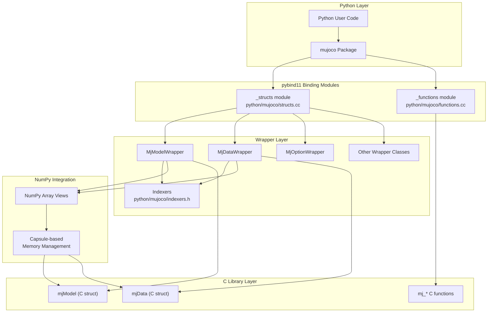
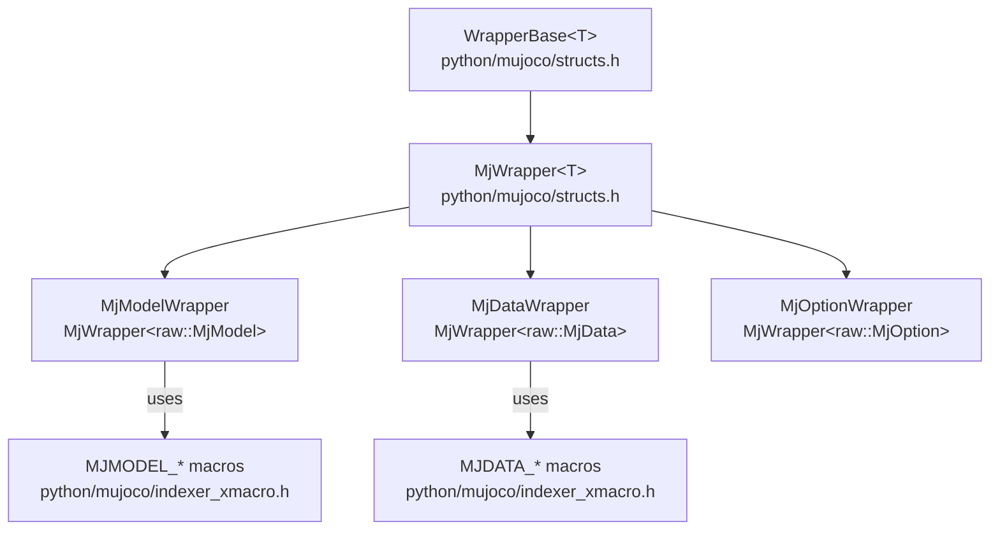
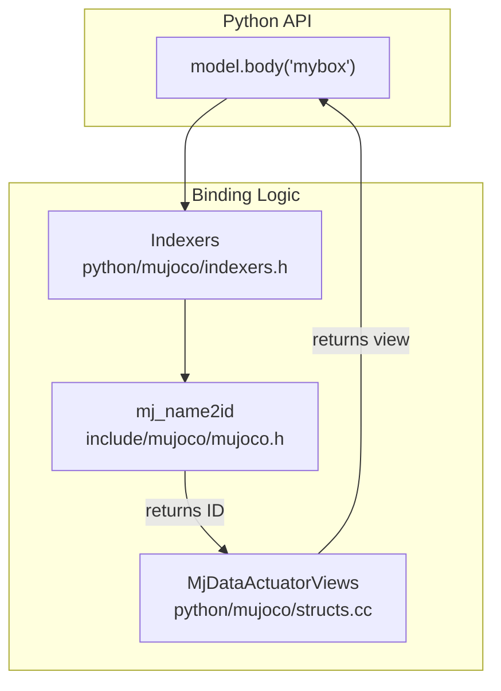

<!-- source: DeepWiki mcp.deepwiki.com · repo google-deepmind/mujoco · page 5.2 Python Bindings Architecture · fetched 2026-10-26 -->

# Python Bindings Architecture

Relevant source files

The following files were used as context for generating this wiki page:

- [.github/workflows/python-version](.github/workflows/python-version)
- [BUILD.bazel](BUILD.bazel)
- [build_defs.bzl](build_defs.bzl)
- [doc/images/changelog/plane_uv_tiling.png](doc/images/changelog/plane_uv_tiling.png)
- [include/mujoco/mjrender.h](include/mujoco/mjrender.h)
- [mujoco_symbols.sh](mujoco_symbols.sh)
- [python/mujoco/__init__.py](python/mujoco/__init__.py)
- [python/mujoco/bindings_test.py](python/mujoco/bindings_test.py)
- [python/mujoco/codegen/BUILD.bazel](python/mujoco/codegen/BUILD.bazel)
- [python/mujoco/experimental/studio/CMakeLists.txt](python/mujoco/experimental/studio/CMakeLists.txt)
- [python/mujoco/experimental/studio/sample/filament_multimodel.py](python/mujoco/experimental/studio/sample/filament_multimodel.py)
- [python/mujoco/experimental/studio/sample/filament_multiview.py](python/mujoco/experimental/studio/sample/filament_multiview.py)
- [python/mujoco/experimental/studio/sample/filament_render.py](python/mujoco/experimental/studio/sample/filament_render.py)
- [python/mujoco/experimental/studio/window.cc](python/mujoco/experimental/studio/window.cc)
- [python/mujoco/functions.cc](python/mujoco/functions.cc)
- [python/mujoco/indexer_xmacro.h](python/mujoco/indexer_xmacro.h)
- [python/mujoco/indexers.cc](python/mujoco/indexers.cc)
- [python/mujoco/indexers.h](python/mujoco/indexers.h)
- [python/mujoco/introspect/BUILD.bazel](python/mujoco/introspect/BUILD.bazel)
- [python/mujoco/introspect/enums.py](python/mujoco/introspect/enums.py)
- [python/mujoco/mjrf.py](python/mujoco/mjrf.py)
- [python/mujoco/pypi/BUILD.bazel](python/mujoco/pypi/BUILD.bazel)
- [python/mujoco/render.cc](python/mujoco/render.cc)
- [python/mujoco/render_filament.cc](python/mujoco/render_filament.cc)
- [python/mujoco/render_filament.h](python/mujoco/render_filament.h)
- [python/mujoco/render_test.py](python/mujoco/render_test.py)
- [python/mujoco/rendering/__init__.py](python/mujoco/rendering/__init__.py)
- [python/mujoco/rendering/filament/__init__.py](python/mujoco/rendering/filament/__init__.py)
- [python/mujoco/rendering/filament/renderer.py](python/mujoco/rendering/filament/renderer.py)
- [python/mujoco/structs.cc](python/mujoco/structs.cc)
- [python/mujoco/structs.h](python/mujoco/structs.h)
- [python/mujoco/structs_wrappers.cc](python/mujoco/structs_wrappers.cc)
- [python/setup.py](python/setup.py)
- [src/experimental/studio/launcher.cc](src/experimental/studio/launcher.cc)
- [src/render/classic/render_context.c](src/render/classic/render_context.c)
- [src/render/classic/render_gl3.c](src/render/classic/render_gl3.c)
- [test/mujoco_shared_exports_test.sh](test/mujoco_shared_exports_test.sh)
- [wasm/codegen/templates/bindings.h](wasm/codegen/templates/bindings.h)

## Purpose and Scope

This page describes the internal architecture of MuJoCo's Python bindings, which expose the C library to Python using **pybind11**. The bindings provide Pythonic access to MuJoCo's data structures and functions while maintaining performance through zero-copy memory views and proper management of the Python Global Interpreter Lock (GIL).

For information about using the Python API, see [Python API Usage](#5.3). For details about the underlying C functions, see [C API Reference](#5.1).

Sources: [python/mujoco/__init__.py:15-16](), [python/mujoco/structs.cc:149-158]()

## Overall Binding Architecture

The Python bindings are implemented using pybind11, which generates CPython extension modules that bridge C++ and Python. The architecture consists of several key layers:

Title: Python Binding Data Flow

Sources: [python/mujoco/structs.cc:149-158](), [python/mujoco/functions.cc:40-41](), [python/mujoco/structs.h:95-125]()

## Binding Module Structure

The Python bindings are split into several pybind11 modules, typically prefixed with an underscore in the package directory:

| Module | Source File | Purpose |
|--------|-------------|---------|
| `_structs` | `python/mujoco/structs.cc` | Exposes C structs (`mjModel`, `mjData`, `mjOption`) as Python classes with NumPy array properties. |
| `_functions` | `python/mujoco/functions.cc` | Wraps C API functions (`mj_step`, `mj_forward`) with Pythonic interfaces and GIL management. |
| `_render` | `python/mujoco/render.cc` | Exposes rendering contexts (`MjrContext`) and visualization helpers. |
| `_enums` | `python/mujoco/introspect/enums.py` | Metadata and introspection for MuJoCo enums (`mjtJoint`, `mjtGeom`, etc.). |

Sources: [python/mujoco/structs.cc:149-158](), [python/mujoco/functions.cc:40-41](), [python/mujoco/render.cc:149-155](), [python/mujoco/introspect/enums.py:24-52]()

## Wrapper Class Hierarchy

All major C structs are wrapped using the `MjWrapper` template class, which provides memory management and Python object lifetime management.

Title: Wrapper System Code Entities

Sources: [python/mujoco/structs.h:95-125](), [python/mujoco/structs.h:144-147](), [python/mujoco/indexer_xmacro.h:20-67]()

### WrapperBase Template
The `WrapperBase<T>` template provides core functionality for all wrapper classes:
- **Pointer Storage**: Stores a raw pointer to the underlying C struct (`ptr_`) [python/mujoco/structs.h:123]().
- **Ownership Tracking**: Uses a `pybind11::object owner_` to maintain the Python object lifetime, ensuring the C memory is not freed while Python views (like NumPy arrays) are still active [python/mujoco/structs.h:122]().
- **Capsule Destructor**: Registers a destructor function via `PyCapsule` for proper cleanup when the reference count hits zero [python/mujoco/structs.h:105-110]().

### Memory Management Strategy
The wrapper classes use **PyCapsules** to manage C struct lifetimes. This is critical because NumPy arrays created as views into MuJoCo data must keep the underlying C struct alive.
1. When an `MjModel` is created, it owns a capsule containing the `mjModel*` [python/mujoco/structs_wrappers.cc:215-218]().
2. When a property like `model.body_pos` is accessed, the resulting NumPy array's `base` attribute is set to this capsule.
3. This prevents the `mjModel` from being deleted as long as the NumPy array exists.

Sources: [python/mujoco/structs.h:105-125](), [python/mujoco/structs_wrappers.cc:215-218]()

## NumPy Array Integration

All array fields in MuJoCo structs are exposed as **NumPy arrays** that provide direct memory views into the underlying C data.

### Array Property Definition
Arrays are defined using macros that:
1. Return a NumPy array wrapping the C memory.
2. Configure appropriate writeable flags based on whether the data is constant.
3. Use `XArrayShapeImpl` to determine if the array should be 1D or 2D based on the model's dimensions [python/mujoco/structs.cc:58-75]().

### Zero-Copy Access
The bindings prioritize performance by avoiding data copies. Accessing fields like `data.qpos` returns a view of the memory already allocated in the `mjData` struct [python/mujoco/bindings_test.py:187-190]().

Sources: [python/mujoco/structs.cc:58-75](), [python/mujoco/bindings_test.py:187-190]()

## Named Indexing System

The named indexing system allows accessing model elements by name or numeric ID using a clean syntax like `model.body("mybox")` or `data.actuator("myactuator")`.

Title: Named Indexing Code Path

Sources: [python/mujoco/structs.cc:131-145](), [python/mujoco/bindings_test.py:162-170]()

### Grouped Views
For each element type, a grouped views class provides access to that specific element's fields. These views are effectively slices into the global model/data arrays.

Sources: [python/mujoco/structs.cc:131-145]()

## Function Bindings and GIL Management

C API functions are wrapped with template machinery that handles argument conversion, error checking, and **GIL management**.

### GIL Management
MuJoCo simulation can be computationally expensive. To support multi-threading in Python, the bindings release the Global Interpreter Lock (GIL) during calls to core physics functions like `mj_step` and `mj_forward`.

- **Release**: `py::call_guard<py::gil_scoped_release>()` is used in the pybind11 definition for `mj_step` [python/mujoco/functions.cc:165-177]().
- **Manual Release**: In complex workflows like `mj_recompile`, the GIL is released manually using `py::gil_scoped_release no_gil;` before calling the C function [python/mujoco/structs.cc:105-111]().

### Error Handling
The bindings convert MuJoCo's C-style error handling into Python exceptions.
- **InterceptMjErrors**: A wrapper function that installs temporary error handlers to capture messages and throw appropriate exceptions like `py::value_error` or `FatalError` [python/mujoco/functions.cc:84-88](), [python/mujoco/structs.cc:113-115]().

Sources: [python/mujoco/functions.cc:80-89](), [python/mujoco/structs.cc:105-116](), [python/mujoco/functions.cc:164-177]()

## Packaging via setup.py

The Python package is built and packaged using `setup.py`, which integrates with CMake to compile the underlying C++ extension modules (`_structs`, `_functions`, `_render`, etc.).

- **BuildCMakeExtension**: A custom `setuptools.command.build_ext` subclass that invokes CMake, discovers MuJoCo installation and include paths, builds the extension libraries, and copies external runtime dependencies and plugins [python/setup.py:144-165]().
- **Environment Variables**: Relies on variables such as `MUJOCO_PATH`, `MUJOCO_PLUGIN_PATH`, and `MUJOCO_CMAKE_ARGS` to locate prebuilt components or configure the build process [python/setup.py:33-36]().

Sources: [python/setup.py:33-36](), [python/setup.py:144-165]()

## Struct Lists

Arrays of structs (like elements in lists) are handled by the `StructListBase` template. This provides list-like access in Python (indexing, slicing, iteration) while maintaining references to the underlying C array [python/mujoco/structs.h:149-215]().

- **Lazy Initialization**: Wrappers for individual elements in the list are created only when accessed to minimize overhead via `PopulateUpTo` [python/mujoco/structs.h:184-191]().
- **Dynamic Sizing**: The `StructListBase` class manages the mapping between Python indices and the underlying C array pointers [python/mujoco/structs.h:161-167]().

Sources: [python/mujoco/structs.h:149-215]()

---

