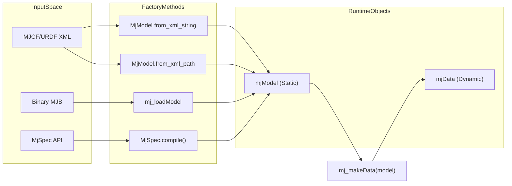
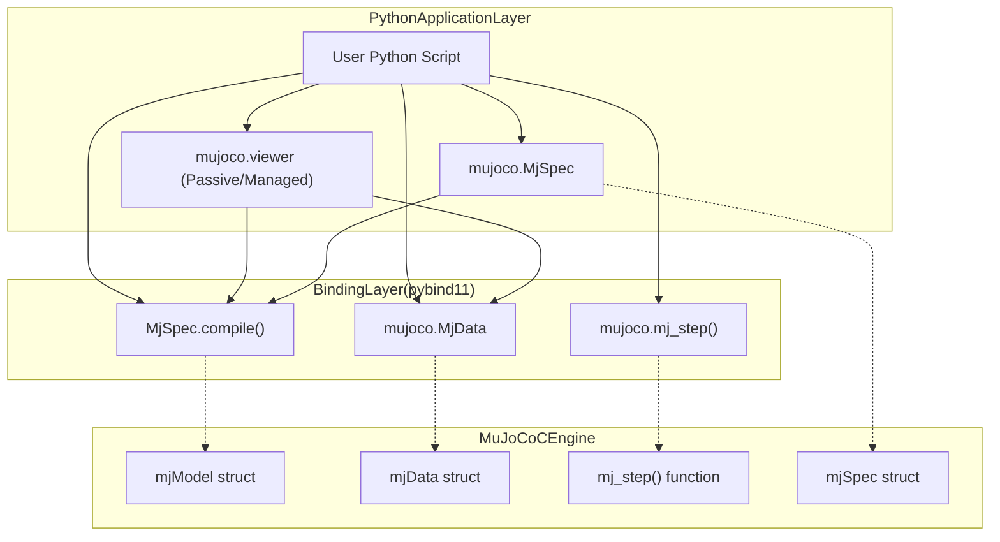

<!-- source: DeepWiki mcp.deepwiki.com · repo google-deepmind/mujoco · page 5.3 Python API Usage · fetched 2026-10-26 -->

# Python API Usage

<details>
<summary>Relevant source files</summary>

The following files were used as context for generating this wiki page:

- [doc/APIreference/APIfunctions.rst](doc/APIreference/APIfunctions.rst)
- [doc/APIreference/APItypes.rst](doc/APIreference/APItypes.rst)
- [doc/images/changelog/procedural_terrain_generation.png](doc/images/changelog/procedural_terrain_generation.png)
- [doc/images/python/rollout.png](doc/images/python/rollout.png)
- [doc/js/linenumbers.js](doc/js/linenumbers.js)
- [doc/programming/index.rst](doc/programming/index.rst)
- [doc/programming/modeledit.rst](doc/programming/modeledit.rst)
- [doc/programming/visualization.rst](doc/programming/visualization.rst)
- [doc/python.rst](doc/python.rst)
- [mjx/mujoco/mjx/testspeed.py](mjx/mujoco/mjx/testspeed.py)
- [mjx/tutorial.ipynb](mjx/tutorial.ipynb)
- [python/LQR.ipynb](python/LQR.ipynb)
- [python/least_squares.ipynb](python/least_squares.ipynb)
- [python/mjspec.ipynb](python/mjspec.ipynb)
- [python/mujoco/minimize.py](python/mujoco/minimize.py)
- [python/mujoco/minimize_test.py](python/mujoco/minimize_test.py)
- [python/mujoco/rollout.cc](python/mujoco/rollout.cc)
- [python/mujoco/rollout.py](python/mujoco/rollout.py)
- [python/mujoco/rollout_test.py](python/mujoco/rollout_test.py)
- [python/rollout.ipynb](python/rollout.ipynb)
- [python/tutorial.ipynb](python/tutorial.ipynb)

</details>


## Purpose and Scope

The MuJoCo Python package provides a high-level, performant interface to the MuJoCo physics engine. It is built using `pybind11` and maintains consistency with the underlying C API while providing Pythonic enhancements like NumPy integration, named indexing, and automatic memory management [doc/python.rst:5-13](). This page details practical usage patterns for loading models, controlling simulations, and utilizing the interactive visualization tools.

## Model Loading and Initialization

MuJoCo separates simulation into two primary structures: `mjModel` (static description) and `mjData` (dynamic state) [doc/overview.rst:86-95]().

### Loading Mechanisms
Models can be loaded from XML strings, files, or binary MJB files. The Python API provides static factory methods on the `MjModel` class for these operations.

| Method | Source | Description |
| :--- | :--- | :--- |
| `MjModel.from_xml_string(xml_str)` | [python/mjspec.ipynb:88]() | Compiles an MJCF or URDF string into a binary model. |
| `MjModel.from_xml_path(path)` | [doc/python.rst:285]() | Loads and compiles a model from a filesystem path. |
| `mj_loadModel(path)` | [doc/modeling.rst:35-36]() | Loads a pre-compiled binary MJB file. |
| `MjSpec.from_string(xml, assets)` | [python/mujoco/__init__.py:161]() | Creates an editable `MjSpec` from XML and an asset dictionary. |

### Lifecycle Management
In the Python API, memory management is handled automatically. When an `MjModel` or `MjData` object is garbage collected, the underlying C memory is freed via `mj_deleteModel` and `mj_deleteData` respectively [doc/programming/simulation.rst:72-79](). Python's `MjSpec` wrapper also ensures `mj_deleteSpec` is called upon destruction [python/mujoco/specs_wrapper.cc:90]().

Model Initialization Data Flow


Sources: [doc/modeling.rst:29-49](), [doc/programming/simulation.rst:22-68](), [python/mujoco/specs_wrapper.cc:92-151]()

## Simulation Pipeline and Callbacks

The primary entry point for advancing physics is `mj_step(model, data)`. This function executes the forward dynamics and integrates the state [doc/programming/simulation.rst:139-142]().

### The Simulation Loop
A typical simulation loop involves setting control inputs and calling the stepper.
1. **Set Inputs**: Modify `data.ctrl` (actuator inputs) or `data.qfrc_applied` (external forces) [doc/programming/simulation.rst:131-135]().
2. **Step**: Call `mujoco.mj_step(model, data)`.
3. **Retrieve State**: Access `data.qpos` and `data.qvel` for analysis [python/rollout.ipynb:180-185]().

### Physics Callbacks
MuJoCo allows intercepting the simulation pipeline via global callbacks. In Python, these are exposed through the `mujoco._callbacks` module [python/mujoco/__init__.py:54]().

*   **`mjcb_control`**: Executed during `mj_step` to compute control signals [doc/programming/simulation.rst:114-123]().
*   **`mjcb_time`**: Allows providing a custom high-resolution timer [doc/python.rst:63]().

Sources: [doc/programming/simulation.rst:86-145](), [python/mujoco/__init__.py:52-60](), [python/rollout.ipynb:180-185]()

## Data Access and Named Indexing

MuJoCo Python bindings provide two ways to access data: raw numeric indexing and named accessors.

### Named Accessors
Instead of manually looking up IDs (e.g., `mj_name2id`), Python users can use named indexers on `mjModel` and `mjData`.
*   **Accessing Geoms**: `model.geom('red_box').rgba` [python/mjspec.ipynb:164]().
*   **Accessing Joints**: `data.joint('hinge').qpos`.
*   **Binding Specs**: The `_bind_model` and `_bind_data` functions allow binding `MjStruct` elements directly to runtime data structures for easier manipulation [python/mujoco/__init__.py:198-226]().

### NumPy Integration
Most arrays in `mjData` (like `qpos`, `qvel`, `ctrl`) are exposed as NumPy views. Modifying these views directly modifies the underlying C memory [doc/python.rst:245-256](). The package defines `MJTNUM_DTYPE` based on whether MuJoCo was built with single or double precision [python/mujoco/__init__.py:63]().

Sources: [doc/python.rst:360-418](), [python/mujoco/__init__.py:62-63](), [python/mujoco/__init__.py:198-226]()

## Interactive Visualization

The `mujoco.viewer` module provides a high-performance GUI for real-time interaction and debugging [doc/python.rst:48-54]().

### Viewer Modes
1. **Managed Viewer**: `viewer.launch(model, data)` blocks the main thread and manages the simulation loop. Ideal for simple scripts [doc/python.rst:58-70]().
2. **Passive Viewer**: `viewer.launch_passive(model, data)` runs in a separate thread, allowing the user's script to continue execution. The user must call `viewer.sync()` to update the GUI [doc/python.rst:85-110]().

### Thread Safety and Locking
When using the passive viewer, the user must hold a lock when modifying `mjModel` or `mjData` to avoid race conditions with the renderer:
```python
with viewer.lock():
    data.qpos[0] += 0.1
viewer.sync()
```
Sources: [doc/python.rst:105-122](), [python/mujoco/renderer.py:19]()

## Procedural Model Editing (MjSpec)

The `MjSpec` class allows for programmatic creation and modification of models without writing XML [python/mjspec.ipynb:14-17]().

### Spec Operations
*   **Adding Elements**: Use methods like `add_body()` or `add_geom()` on parent elements. For example, `spec.worldbody.add_geom()` [doc/programming/modeledit.rst:82-92]().
*   **Querying**: Use `find_all()` to retrieve elements of a specific type recursively [python/mjspec.ipynb:175]().
*   **Asset Management**: `MjSpec` can be initialized with an `assets` dictionary (mapping filenames to bytes) to handle meshes and textures [python/mujoco/specs_wrapper.cc:40-44]().
*   **Serialization**: Convert the spec to XML via `to_xml()` or save to a zip file containing all assets using `mujoco.to_zip(spec, file)` [python/mujoco/__init__.py:108-116]().

Sources: [python/mjspec.ipynb:160-175](), [python/mujoco/specs_wrapper.cc:92-151](), [python/mujoco/__init__.py:108-161]()

## Summary Table of Key Python Classes

| Python Class | C Equivalent | Purpose |
| :--- | :--- | :--- |
| `mujoco.MjModel` | `mjModel` | Static model definition [doc/overview.rst:89](). |
| `mujoco.MjData` | `mjData` | Dynamic simulation state [doc/overview.rst:92](). |
| `mujoco.MjSpec` | `mjSpec` | Procedural model editing API [python/mujoco/specs_wrapper.cc:39](). |
| `mujoco.Renderer` | `mjrContext` / `mjvScene` | Offscreen rendering utility [python/mujoco/renderer.py:19](). |

Bridge between Python User Space and C Engine


Sources: [doc/python.rst:5-13](), [doc/python.rst:48-54](), [python/mujoco/__init__.py:52-60](), [python/mujoco/specs_wrapper.cc:128]()

---

