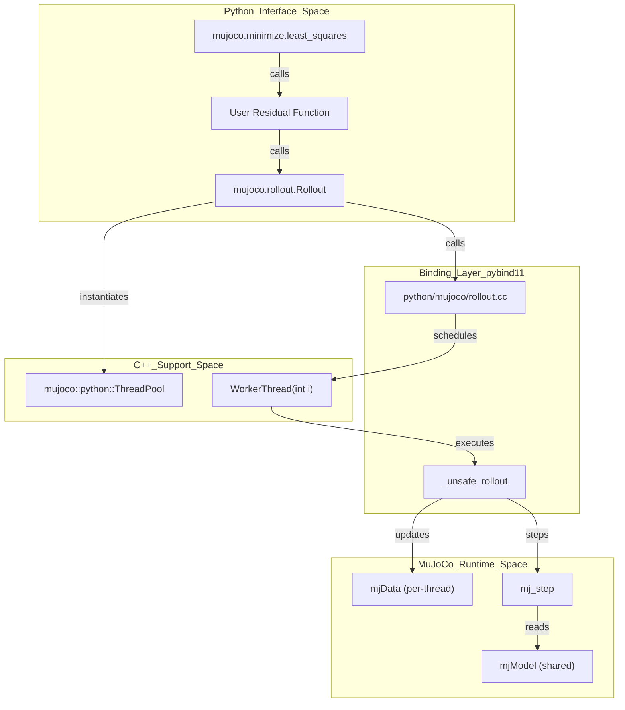
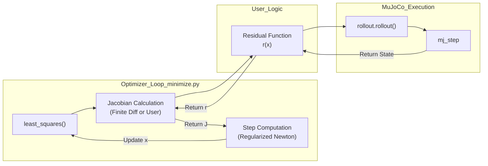

<!-- source: DeepWiki mcp.deepwiki.com · repo google-deepmind/mujoco · page 5.4 Python Rollout and Optimization · fetched 2026-10-26 -->

# Python Rollout and Optimization

<details>
<summary>Relevant source files</summary>

The following files were used as context for generating this wiki page:

- [doc/APIreference/APIfunctions.rst](doc/APIreference/APIfunctions.rst)
- [doc/APIreference/APItypes.rst](doc/APIreference/APItypes.rst)
- [doc/images/changelog/procedural_terrain_generation.png](doc/images/changelog/procedural_terrain_generation.png)
- [doc/images/python/rollout.png](doc/images/python/rollout.png)
- [doc/js/linenumbers.js](doc/js/linenumbers.js)
- [doc/programming/index.rst](doc/programming/index.rst)
- [doc/programming/modeledit.rst](doc/programming/modeledit.rst)
- [doc/programming/visualization.rst](doc/programming/visualization.rst)
- [doc/python.rst](doc/python.rst)
- [mjx/mujoco/mjx/testspeed.py](mjx/mujoco/mjx/testspeed.py)
- [mjx/tutorial.ipynb](mjx/tutorial.ipynb)
- [python/LQR.ipynb](python/LQR.ipynb)
- [python/least_squares.ipynb](python/least_squares.ipynb)
- [python/mjspec.ipynb](python/mjspec.ipynb)
- [python/mujoco/minimize.py](python/mujoco/minimize.py)
- [python/mujoco/minimize_test.py](python/mujoco/minimize_test.py)
- [python/mujoco/rollout.cc](python/mujoco/rollout.cc)
- [python/mujoco/rollout.py](python/mujoco/rollout.py)
- [python/mujoco/rollout_test.py](python/mujoco/rollout_test.py)
- [python/rollout.ipynb](python/rollout.ipynb)
- [python/tutorial.ipynb](python/tutorial.ipynb)

</details>


## Purpose and Scope

This page documents the `mujoco.rollout` and `mujoco.minimize` Python modules, which provide efficient batched simulation and optimization capabilities. The `rollout` module enables parallel execution of multiple simulation trajectories using multithreading and persistent thread pools implemented in C++. The `minimize` module provides a box-bounded nonlinear least squares optimization framework.

**Sources:** [python/mujoco/rollout.py:15-18](), [python/mujoco/minimize.py:15-15]()

## Architecture Overview

The rollout system is split between a high-level Python interface and a high-performance C++ backend. The C++ backend manages a custom `ThreadPool` to execute simulations in parallel while releasing the Python Global Interpreter Lock (GIL).

### System Component Diagram
"This diagram associates Python-level entities with their corresponding C++ implementation and MuJoCo core structures."



**Sources:** [python/mujoco/rollout.cc:32-72](), [python/mujoco/rollout.py:27-39](), [python/mujoco/threadpool.cc:25-34]()

## Rollout Module

The `rollout` module is designed for "open-loop" trajectories where a batch of initial states is advanced by a fixed number of steps, optionally under control.

### Basic Usage

The primary entry point is the `rollout.rollout` function or the `rollout.Rollout` class for persistent pooling.

```python
import mujoco
from mujoco import rollout
import numpy as np

# Load model and setup data
model = mujoco.MjModel.from_xml_string('<mujoco>...</mujoco>')
data = mujoco.MjData(model)

# Define batch: 100 trajectories, 50 steps each
nbatch = 100
nstep = 50
nstate = mujoco.mj_stateSize(model, mujoco.mjtState.mjSTATE_FULLPHYSICS)

initial_state = np.zeros((nbatch, nstate))
control = np.zeros((nbatch, nstep, model.nu))

# Run batched rollout
states, sensors = rollout.rollout(model, data, initial_state, control)
```

**Sources:** [python/mujoco/rollout.py:50-96](), [python/mujoco/rollout_test.py:152-165]()

### Implementation Details: `_unsafe_rollout`

The core logic resides in `_unsafe_rollout` within `rollout.cc`. This function performs the following for each trajectory in its assigned chunk:
1. **State Initialization**: Calls `mj_setState` using the provided `state0` [python/mujoco/rollout.cc:117-118]().
2. **Warmstart Handling**: Copies `qacc_warmstart` if provided, otherwise zeroes it [python/mujoco/rollout.cc:121-125]().
3. **Simulation Loop**: Iterates for `nstep`. In each step:
    - Checks for simulation warnings (e.g., divergence) [python/mujoco/rollout.cc:135-141](). If a warning occurs, it fills the remainder of that trajectory's output with the current state and breaks [python/mujoco/rollout.cc:144-155]().
    - Applies controls via `mj_setState` [python/mujoco/rollout.cc:160-162]().
    - Executes `mj_step` [python/mujoco/rollout.cc:165-165]().
    - Extracts resulting state and sensor data [python/mujoco/rollout.cc:168-175]().

**Sources:** [python/mujoco/rollout.cc:74-178]()

### ThreadPool and Parallelism

The `Rollout` class manages a C++ `ThreadPool` via the `_rollout` binding [python/mujoco/rollout.py:38-38](). When `rollout` is called:
- If `nthread > 0`, the work is divided into chunks defined by `chunk_size` [python/mujoco/rollout.cc:187-189]().
- Jobs are scheduled to the pool using `pool->Schedule`. Each worker thread uses its own assigned `mjData` instance to avoid race conditions [python/mujoco/rollout.cc:195-200]().
- The main thread waits for all scheduled tasks to complete via `pool->WaitCount` [python/mujoco/rollout.cc:211-211]().
- Individual worker threads are assigned a `worker_id_` which indexes into the list of `mjData` objects [python/mujoco/threadpool.cc:58-59]().

**Sources:** [python/mujoco/rollout.cc:181-212](), [python/mujoco/threadpool.cc:29-85]()

## Minimize Module

The `minimize` module implements a Nonlinear Least Squares solver with box bounds, specifically optimized for MuJoCo-related tasks like system identification or trajectory optimization.

### Key Concepts

*   **Residuals**: The user provides a function that returns a vector of residuals $r(x)$. The solver minimizes the norm of this vector [python/mujoco/minimize.py:142-144]().
*   **Levenberg-Marquardt**: The solver uses a regularized Newton method (LM) where the step $\delta x$ is computed using a regularization parameter $\mu$ [python/least_squares.ipynb:142-150]().
*   **Norms**: Users can define custom norm functions by subclassing `minimize.Norm` and implementing `value` and `grad_hess` [python/mujoco/minimize.py:76-95](). A standard `Quadratic` norm is provided by default [python/mujoco/minimize.py:118-123]().

### Optimization Data Flow



**Sources:** [python/mujoco/minimize.py:142-205](), [python/least_squares.ipynb:122-133]()

### Solver Features

| Feature | Description | Code Pointer |
| :--- | :--- | :--- |
| **Box Bounds** | Constraints on the decision variables $x_{min} \le x \le x_{max}$. | [python/mujoco/minimize.py:145]() |
| **Finite Differencing** | Automatically computes Jacobians if a user function is not provided, using `eps` perturbation. | [python/mujoco/minimize.py:148]() |
| **Iteration Logging** | Returns a `trace` of `IterLog` objects containing objective value, reduction, and gradient at each step. | [python/mujoco/minimize.py:52-74]() |
| **Derivative Checking** | Optional verification of user-provided Jacobians against finite differences. | [python/mujoco/minimize.py:158]() |

**Sources:** [python/mujoco/minimize.py:142-185]()

## Implementation of Persistent Pools

The `Rollout` class in `python/mujoco/rollout.py` provides a context-manager compatible interface for maintaining a thread pool across multiple optimization or simulation iterations.

```python
with rollout.Rollout(nthread=4) as pool:
    for i in range(iterations):
        # The pool and its threads are reused here
        states, sensors = pool.rollout(model, data_list, initial_batch)
```

When `pool.rollout` is called, it performs input validation (unless `skip_checks` is True), handles singleton expansion for batch dimensions, and invokes the C++ `rollout_` object [python/mujoco/rollout.py:110-123](). The `ThreadPool` implementation uses a `std::condition_variable` to manage task queuing and worker notification [python/mujoco/threadpool.cc:17-21]().

**Sources:** [python/mujoco/rollout.py:27-49](), [python/mujoco/rollout.py:102-123](), [python/mujoco/threadpool.cc:40-55]()

---

