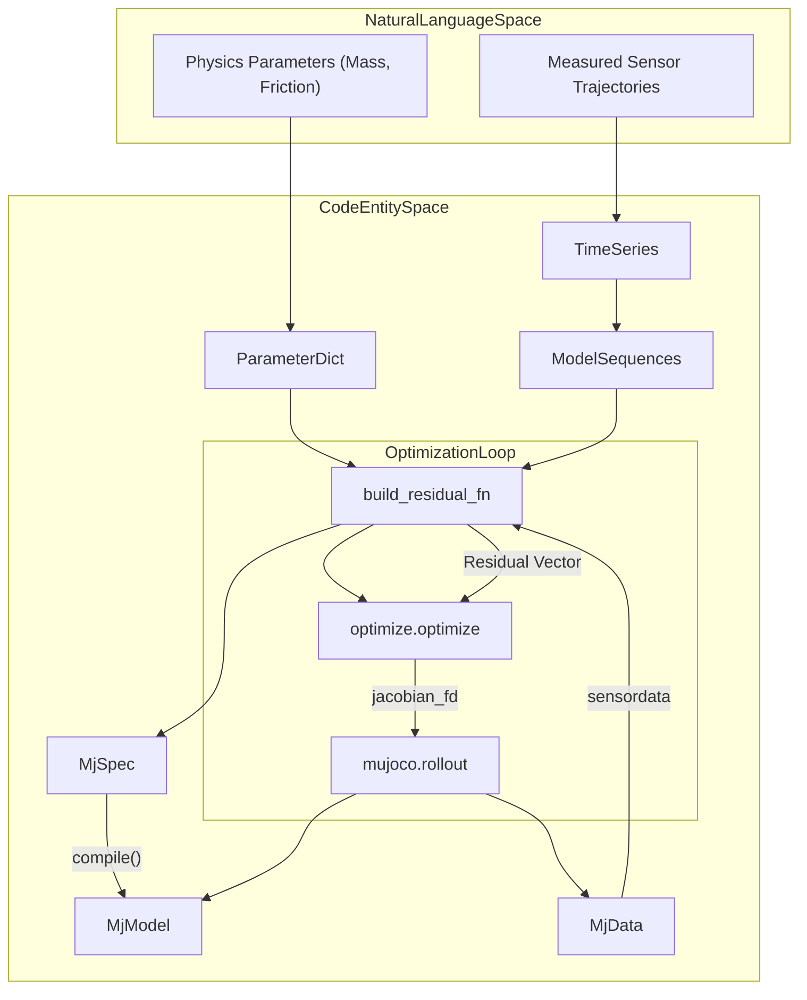
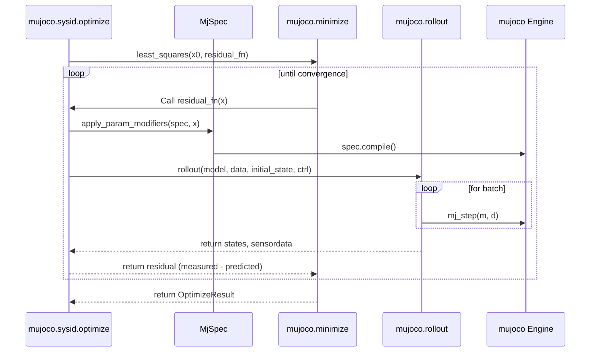

<!-- source: DeepWiki mcp.deepwiki.com · repo google-deepmind/mujoco · page 5.5 System Identification Toolbox · fetched 2026-10-26 -->

# System Identification Toolbox

Relevant source files

The following files were used as context for generating this wiki page:

- [.github/workflows/python-version](.github/workflows/python-version)
- [BUILD.bazel](BUILD.bazel)
- [build_defs.bzl](build_defs.bzl)
- [doc/images/changelog/procedural_terrain_generation.png](doc/images/changelog/procedural_terrain_generation.png)
- [doc/images/python/rollout.png](doc/images/python/rollout.png)
- [mjx/mujoco/mjx/testspeed.py](mjx/mujoco/mjx/testspeed.py)
- [mjx/tutorial.ipynb](mjx/tutorial.ipynb)
- [mujoco_symbols.sh](mujoco_symbols.sh)
- [python/LQR.ipynb](python/LQR.ipynb)
- [python/least_squares.ipynb](python/least_squares.ipynb)
- [python/mjspec.ipynb](python/mjspec.ipynb)
- [python/mujoco/__init__.py](python/mujoco/__init__.py)
- [python/mujoco/codegen/BUILD.bazel](python/mujoco/codegen/BUILD.bazel)
- [python/mujoco/introspect/BUILD.bazel](python/mujoco/introspect/BUILD.bazel)
- [python/mujoco/minimize.py](python/mujoco/minimize.py)
- [python/mujoco/minimize_test.py](python/mujoco/minimize_test.py)
- [python/mujoco/pypi/BUILD.bazel](python/mujoco/pypi/BUILD.bazel)
- [python/rollout.ipynb](python/rollout.ipynb)
- [python/tutorial.ipynb](python/tutorial.ipynb)
- [test/mujoco_shared_exports_test.sh](test/mujoco_shared_exports_test.sh)

The `mujoco.sysid` package provides a suite of tools for fitting physics parameters (such as mass, friction, or damping) to measured data. It leverages MuJoCo's fast simulation capabilities, the `mjSpec` model editing API, and Python-based optimization routines to minimize the discrepancy between observed trajectories and simulated behavior.

## Overview and Purpose

System identification in MuJoCo involves finding a set of model parameters $\theta$ that minimize a residual function $R(\theta)$, typically representing the difference between measured sensor data and simulated sensor data over a sequence of states. The toolbox is designed to handle:
*   **Parameter Estimation**: Fitting specific attributes like `geom_friction`, `body_mass`, or `dof_damping` [python/mujoco/sysid/README.md:32-44]().
*   **Multi-sequence Optimization**: Fitting parameters across multiple independent data sequences simultaneously using `ModelSequences` [python/mujoco/sysid/_src/trajectory.py:261-270]().
*   **HTML Reporting**: Generating visual summaries of the optimization process and the quality of the fit [python/mujoco/sysid/README.md:95-96]().

The system utilizes the `mjSpec` API [python/mujoco/sysid/_src/model_modifier.py:60-67]() to programmatically modify model attributes before recompilation and evaluation.

Sources: [python/mujoco/sysid/README.md:5-15](), [python/mujoco/sysid/_src/model_modifier.py:60-67](), [python/mujoco/sysid/_src/trajectory.py:261-270]()

## Key Components

The toolbox is built on several core classes and functions that manage the data flow from raw measurements to optimized models.

### ParameterDict
The `ParameterDict` [python/mujoco/sysid/_src/parameter.py:255-265]() serves as the central configuration for parameters subject to optimization. It maps specific `mjSpec` attributes to optimization variables via `ModifierFn` callbacks [python/mujoco/sysid/_src/parameter.py:38-38](). It manages parameter bounds, scaling, and "frozen" states where parameters are excluded from optimization [python/mujoco/sysid/_src/parameter.py:59-62]().

### ModelSequences
The `ModelSequences` class [python/mujoco/sysid/_src/trajectory.py:261-270]() bundles a model specification (`MjSpec`) with one or more sequences of measured data. It includes:
1.  An initial state created via `create_initial_state` [python/mujoco/sysid/_src/trajectory.py:214-222]().
2.  Control inputs stored as a `TimeSeries` [python/mujoco/sysid/_src/timeseries.py:193-205]().
3.  Target sensor measurements for comparison.

### Residual Functions
The `build_residual_fn` [python/mujoco/sysid/_src/residual.py:176-189]() factory constructs the objective function. It applies parameters to an `MjSpec`, compiles it, and runs a "rollout" using `mujoco.rollout` [python/mujoco/sysid/README.md:12-15](). It can also apply `SignalTransform` operations like delays, gains, and biases to the residuals [python/mujoco/sysid/_src/signal_transform.py:30-43]().

### Optimization Engine
The `optimize` function [python/mujoco/sysid/_src/optimize.py:186-193]() dispatches to different backends:
*   `mujoco`: Native least-squares solver in `mujoco.minimize` [python/mujoco/sysid/_src/optimize.py:122-132]().
*   `scipy`: Standard `scipy.optimize.least_squares` [python/mujoco/sysid/_src/optimize.py:71-77]().
*   `scipy_parallel_fd`: Scipy optimizer using MuJoCo's parallel finite-difference Jacobians [python/mujoco/sysid/_src/optimize.py:174-174]().

Sources: [python/mujoco/sysid/_src/parameter.py:255-265](), [python/mujoco/sysid/_src/trajectory.py:261-270](), [python/mujoco/sysid/_src/optimize.py:186-193](), [python/mujoco/sysid/_src/residual.py:176-189]()

## Data Flow and Implementation

### System Identification Pipeline
The following diagram illustrates the relationship between the Python entities and the underlying MuJoCo structures.

System Identification Data Flow

Sources: [python/mujoco/sysid/_src/optimize.py:186-193](), [python/mujoco/sysid/_src/residual.py:176-189](), [python/mujoco/sysid/_src/parameter.py:47-62]()

### Optimization Logic

Code Entity Interaction for Optimization

Sources: [python/mujoco/sysid/_src/optimize.py:139-146](), [python/mujoco/sysid/_src/model_modifier.py:70-73](), [python/mujoco/sysid/README.md:12-15]()

## Implementation Details

### Parallel Rollouts
The toolbox utilizes `mujoco.rollout` for massive parallelism [python/mujoco/sysid/README.md:12-15](). Each parameter perturbation in a finite-difference Jacobian calculation is treated as an independent rollout in a batch, allowing the engine to saturate multi-core CPUs during the most expensive part of the optimization.

### Parameter Modifiers
Modifiers are Python callbacks with the signature `(MjSpec, Parameter) -> None` [python/mujoco/sysid/_src/parameter.py:38-38](). 
*   **Body Inertia**: `body_inertia_param` handles complex parameterizations like `InertiaType.Pseudo` (10-D) to ensure physical consistency [python/mujoco/sysid/_src/model_modifier.py:241-255]().
*   **Actuator Gains**: `apply_pdgain` updates `gainprm` and `biasprm` simultaneously for position actuators [python/mujoco/sysid/_src/model_modifier.py:174-185]().

### Signal Transformations
The `SignalTransform` class [python/mujoco/sysid/_src/signal_transform.py:30-43]() allows users to identify non-physics parameters that affect the residual:
*   **Time Delays**: `delay(pattern, param)` handles sensor latency [python/mujoco/sysid/_src/signal_transform.py:53-60]().
*   **Gains/Biases**: `gain` and `bias` correct for sensor calibration errors [python/mujoco/sysid/_src/signal_transform.py:62-79]().

### I/O and Results
The `save_results` function [python/mujoco/sysid/_src/io.py:30-37]() persists the identified model and parameters:
*   Saves `params_x_hat.yaml` (optimized values) [python/mujoco/sysid/_src/io.py:56-56]().
*   Exports the identified `MjSpec` to a `.xml` file [python/mujoco/sysid/_src/io.py:78-81]().
*   Calculates confidence intervals using `calculate_intervals` based on the Jacobian at the solution [python/mujoco/sysid/_src/optimize.py:246-258]().

## Summary of Key Entities

| Entity | File Path | Purpose |
| :--- | :--- | :--- |
| `Parameter` | [python/mujoco/sysid/_src/parameter.py:47]() | Holds value, bounds, and a modifier callback for one parameter. |
| `ParameterDict` | [python/mujoco/sysid/_src/parameter.py:255]() | Collection of parameters; handles vector flattening for solvers. |
| `TimeSeries` | [python/mujoco/sysid/_src/timeseries.py:193]() | Time-indexed data with signal-to-model name mapping. |
| `ModelSequences` | [python/mujoco/sysid/_src/trajectory.py:261]() | Links a model spec to specific measurement trajectories. |
| `build_residual_fn` | [python/mujoco/sysid/_src/residual.py:176]() | Factory for the least-squares objective function. |
| `optimize` | [python/mujoco/sysid/_src/optimize.py:186]() | High-level entry point for running the optimization. |

Sources: [python/mujoco/sysid/_src/parameter.py:47-62](), [python/mujoco/sysid/_src/timeseries.py:193-205](), [python/mujoco/sysid/_src/trajectory.py:261-270](), [python/mujoco/sysid/_src/residual.py:176-189](), [python/mujoco/sysid/_src/optimize.py:186-193]()

---

